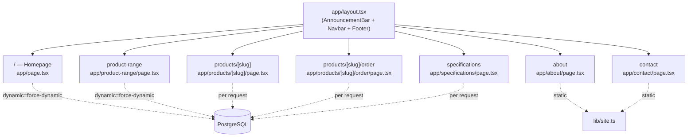
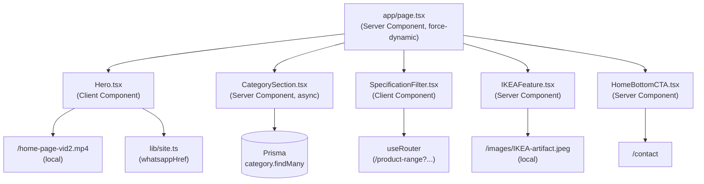
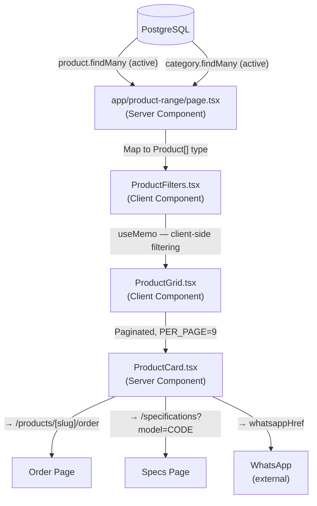
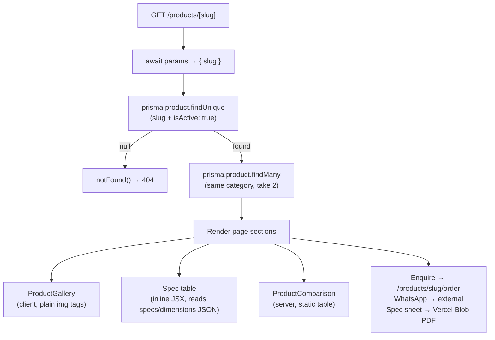
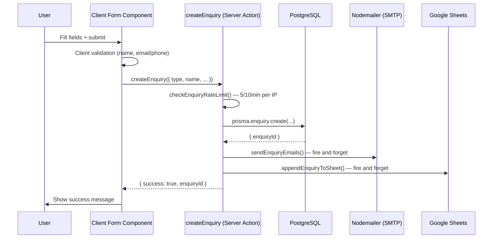
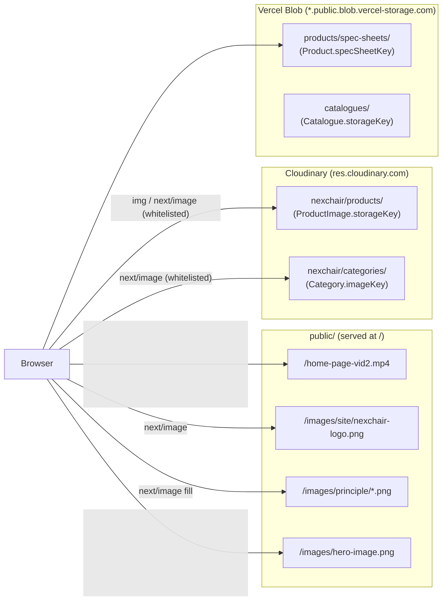

# NexChair — Stage 2: Public Website and Frontend Documentation

**Document type:** Developer reference — public-facing website, components, and frontend architecture  
**Stage:** 2 of N  
**Date:** 2026-11-24  
**Prerequisite:** Stage 1 inventory at `docs/nexchair-handover/00-project-inventory.md`  
**Status labels:** IMPLEMENTED · PARTIALLY IMPLEMENTED · UNVERIFIED · UNUSED/LEGACY · PENDING

---

## Table of Contents

1. [Public Route Map](#1-public-route-map)
2. [Root Layout and Global Shared Components](#2-root-layout-and-global-shared-components)
3. [Homepage](#3-homepage)
4. [Product Range Page](#4-product-range-page)
5. [Individual Product Detail Page](#5-individual-product-detail-page)
6. [Product Order / Enquiry Page](#6-product-order--enquiry-page)
7. [About Page](#7-about-page)
8. [Contact / Request a Quote Page](#8-contact--request-a-quote-page)
9. [Specifications Page](#9-specifications-page)
10. [Sitemap and Robots](#10-sitemap-and-robots)
11. [Frontend Architecture](#11-frontend-architecture)
12. [Images, Videos, and Static Assets](#12-images-videos-and-static-assets)
13. [Legacy and Unused Frontend Code](#13-legacy-and-unused-frontend-code)
14. [Implementation Status Summary](#14-implementation-status-summary)

---

## 1. Public Route Map

### 1.1 Route Inventory

| Route | File | Render Mode | `force-dynamic` | Auth | Key Components | Data Source |
|---|---|---|---|---|---|---|
| `/` | `app/page.tsx` | Server Component | Yes | No | Hero, CategorySection, SpecificationFilter, IKEAFeature, HomeBottomCTA | Prisma (via CategorySection) |
| `/product-range` | `app/product-range/page.tsx` | Server Component | Yes | No | ProductRangeHeader, ProductFilters, ProductRangeCTA | Prisma (products + categories) |
| `/products/[slug]` | `app/products/[slug]/page.tsx` | Server Component | No | No | ProductGallery, ProductComparison | Prisma `findUnique` by slug |
| `/products/[slug]/order` | `app/products/[slug]/order/page.tsx` | Server Component | No | No | OrderEnquiryForm | Prisma `findMany` (all active) |
| `/about` | `app/about/page.tsx` | Server Component | No | No | _(inline JSX)_ | Static / `lib/site.ts` |
| `/contact` | `app/contact/page.tsx` | Server Component | No | No | ContactQuoteForm | Static / `lib/site.ts` |
| `/specifications` | `app/specifications/page.tsx` | Server Component | No | No | SpecGallery | Prisma (dual-mode — grid or single product) |
| `/sitemap.xml` | `app/sitemap.ts` | Next.js metadata handler | — | No | — | Prisma (active products) |
| `/robots.txt` | `app/robots.ts` | Next.js metadata handler | — | No | — | Static |

**Notes on rendering:**
- `/` and `/product-range` use `export const dynamic = "force-dynamic"`. This opts both pages out of static generation and ISR entirely — every request hits the database. This prevents stale category or product lists.
- `/products/[slug]` and `/products/[slug]/order` are dynamically rendered on demand but do not set `force-dynamic` explicitly — Next.js renders them as needed.
- `/specifications` resolves `searchParams` at request time, which also makes it dynamic.
- No static-generation `generateStaticParams` is configured for product slugs.

**Root layout wrappers** (applied to all routes via `app/layout.tsx`):  
`AnnouncementBar` → `Navbar` → `{children}` → `Footer`

### 1.2 Route Structure Diagram



---

## 2. Root Layout and Global Shared Components

### 2.1 Root Layout

**File:** `app/layout.tsx`  
**Type:** Server Component  
**Status:** IMPLEMENTED

The root layout wraps every page in the application.

**Fonts** (loaded via `next/font/google`, injected as CSS variables):

| Font | CSS Variable | Weights / Styles |
|---|---|---|
| Plus Jakarta Sans | `--font-sans` | Variable weight, Latin subset, `display: swap` |
| Cormorant Garamond | `--font-cormorant` | 400/500/600/700, normal + italic, Latin, `display: swap` |

Both variables are applied to the `<html>` element via the `className` prop. The `.font-display` utility in `globals.css` maps `--font-cormorant` to major headings.

**Google Tag Manager:**
- Container ID: `GTM-TB368V3C`
- Implementation: `<Script>` with `strategy="afterInteractive"` + inline GTM snippet in `dangerouslySetInnerHTML`
- Noscript fallback: `<iframe src="https://www.googletagmanager.com/ns.html?id=GTM-TB368V3C">` placed as first child of `<body>`

**Default metadata:**
```
title: "NexChair"
description: "Seating engineered for the long day."
```

**Render order inside `<body>`:**
1. GTM noscript iframe
2. `<AnnouncementBar />`
3. `<Navbar />`
4. `{children}`
5. `<Footer />`
6. GTM `<Script>`

---

### 2.2 AnnouncementBar

**File:** `components/AnnouncementBar.tsx`  
**Type:** Server Component (no `"use client"`)  
**Data source:** Hardcoded  
**Status:** IMPLEMENTED

A thin banner displayed at the very top of every page, above the navbar.

**Responsive content:**

| Viewport | Content |
|---|---|
| Mobile (default) | "1 year warranty on every chair" (single line, centred) |
| `sm:` (≥640px) | Three items with gold dividers: "Corporate & bulk orders — dedicated project desk" · "GST invoicing for businesses" · "1 year warranty on every chair" |

**Visual style:**
- Background: `#0B3838` (dark teal)
- Text: `#FFF9F0` at 80% opacity
- Icon colour: `#E8AD4D` (gold) — inline SVGs, 14×14 px
- Padding: `px-4 py-2.5`, centred with `max-width: 1360px`

No props. No interactivity. No external data.

---

### 2.3 Navbar

**File:** `components/Navbar.tsx`  
**Type:** Client Component (`"use client"`)  
**Data source:** Hardcoded navigation array + `lib/site.ts` for WhatsApp link  
**Status:** IMPLEMENTED

The sticky site navigation header.

**Logo:**
- Component: `next/image`
- Source: `/images/site/nexchair-logo.png`
- Dimensions: `width={140} height={36}`, responsive height via CSS
- Loading: `priority` (above fold)
- Link: `/`

**Navigation links (hardcoded):**

| Label | Destination |
|---|---|
| Home | `/` |
| Product Range | `/product-range` |
| About | `/about` |
| Contact | `/contact` |

**CTA buttons:**

| Button | Style | Destination | Behaviour |
|---|---|---|---|
| WhatsApp | Green `#1aad4b`, bordered | `whatsappHref` (from `lib/site.ts`) | Opens new tab |
| Request a quote | Orange `#D85B13` with shadow | `/contact` | Internal navigation |

**Mobile menu:**
- State: `menuOpen` (boolean), managed by `useState`
- Toggle: hamburger SVG icon (3 stacked bars)
- Close: `closeMenu()` called on any link click
- Visibility: menu is `md:hidden` on desktop, shown/hidden by `menuOpen` state on mobile

**Responsive breakpoint:** Desktop layout becomes visible at `md:` (768px). Below that, only the logo and hamburger button are visible.

**Visual style:**
- Background: `#F8F2E9` (cream/off-white)
- Text: `#0E3159` (dark navy)
- Border bottom: `#D9CDBF` at 60% opacity
- Position: `sticky top-0 z-50`

---

### 2.4 Footer

**File:** `components/Footer.tsx`  
**Type:** Server Component  
**Data source:** Hardcoded link arrays + `lib/site.ts` for all contact info  
**Status:** IMPLEMENTED

A multi-column footer displayed at the bottom of every page.

**Logo:**
- Component: `next/image`
- Source: `/images/site/nexchair-logo.png`
- Dimensions: `width={120} height={30}`

**Link columns:**

_Shop (links to product-range with category filter):_

| Label | Destination |
|---|---|
| Ergonomic Chair | `/product-range?category=ergonomic-chair` |
| Executive Chair | `/product-range?category=executive-chair` |
| Lounge Chair | `/product-range?category=lounge-chair` |
| Visitor Chair | `/product-range?category=visitor-chair` |

_Company:_

| Label | Destination |
|---|---|
| About | `/about` |
| Specifications | `/product-range` |
| Bulk orders | `/contact` |
| Contact | `/contact` |

**Contact information** (all sourced from `lib/site.ts`):
- Phone: `+91 77982 03669` (clickable `tel:` link)
- Email: `nexchairsales@gmail.com` (clickable `mailto:` link)
- Address: Chakan Talegoan Road, Chakan, Pune, Maharashtra – 410501 (linked to Google Maps)
- WhatsApp: `whatsappHref` link with WhatsApp icon

**Grid layout:**
- Mobile/tablet: `grid-cols-2`
- Desktop (`lg:`): `grid-cols-4`

**Visual style:**
- Background: linear gradient `#092F30 → #073B38 → #0a3c39`
- Text: `#F5EBDD` (light cream)
- Section headings: `#D9BD91` (tan/gold)
- Link icons: `#F26919` (orange)

---

### 2.5 lib/site.ts — Contact Information Source

**File:** `lib/site.ts`  
**Type:** Server-side configuration module (no `"use server"` — not a server action)  
**Status:** IMPLEMENTED

This module is the single source of truth for all contact information used across the website (navbar, footer, contact page, product detail page).

**Key exports:**

| Export | Value | Source |
|---|---|---|
| `whatsappHref` | WhatsApp deep link URL | `NEXT_PUBLIC_WHATSAPP_NUMBER` env var (default: `917798203669`) |
| `contactPhone` | `"+91 77982 03669"` | Hardcoded |
| `contactPhoneHref` | `"tel:+917798203669"` | Hardcoded |
| `contactEmail` | `"nexchairsales@gmail.com"` | Hardcoded |
| `contactEmailHref` | `"mailto:nexchairsales@gmail.com"` | Hardcoded |
| `contactAddress` | Chakan primary address | Hardcoded |
| `contactAddressHref` | Google Maps link (Chakan) | Hardcoded |
| `contactAddress1Label` | `"Chakan"` | Hardcoded |
| `contactAddress1` | Full Chakan address | Hardcoded |
| `contactAddress1Href` | Google Maps link | Hardcoded |
| `contactAddress2Label` | `"Balewadi"` | Hardcoded |
| `contactAddress2` | Full Balewadi address | Hardcoded |
| `contactAddress2Href` | Google Maps link | Hardcoded |
| `businessHours` | Array of `{ day, hours }` objects (Mon–Sat 9:30 AM–8:00 PM, Sun Closed) | Hardcoded |

**To update contact information:** Edit `lib/site.ts`. Changes propagate automatically to all pages that import from it. For the WhatsApp number, update `NEXT_PUBLIC_WHATSAPP_NUMBER` in the deployment environment.

---

## 3. Homepage

### 3.1 Page File

**File:** `app/page.tsx`  
**Type:** Server Component  
**Export:** `export const dynamic = "force-dynamic"`  
**Status:** IMPLEMENTED

```tsx
// Active render order
<Hero />
<CategorySection />
<SpecificationFilter />
<IKEAFeature />
<HomeBottomCTA />

// Commented out:
// <SpecsHighlights />
```

The homepage renders five sections in a fixed order. All section components are co-located under `components/home/`. Six additional components exist in that directory but are not currently imported or rendered — see Section 13.

### 3.2 Homepage Component Tree



---

### 3.3 Hero Section

**File:** `components/home/Hero.tsx`  
**Type:** Client Component (`"use client"`)  
**Data source:** `lib/site.ts` (WhatsApp link only), all other content hardcoded  
**Status:** IMPLEMENTED

**What the visitor sees:**
A full-width dark teal section with a large heading, two CTA buttons, and a video panel on the right (desktop) or below the text (mobile). Below the video is a trust metrics strip.

**Video:**
- Source: `/home-page-vid2.mp4` (served from `public/`, ~5.3 MB)
- Attributes: `autoPlay`, `loop`, `muted` (default), `playsInline`
- Poster (fallback image while loading): `/images/hero-image.png`
- Mute toggle: interactive button in video corner, managed by `isMuted` state; toggles `videoRef.current.muted`
- Note: `/home-page-vid.mp4` (~335 KB) also exists in `public/` but is not referenced by this component

**Heading and copy:**
- Eyebrow: "Ergonomic seating · Made for long hours"
- H1: "Built for the long day. Sold on facts."
- Body: "Every NexChair ships with its full specification sheet..."

**CTA buttons:**
- "Explore the range" → `/product-range`
- "Chat on WhatsApp" → `whatsappHref` (new tab)

**Trust strip (below hero):**
Hardcoded metrics, layout changes at `lg:`:

| Metric | Label |
|---|---|
| 1 year | Warranty on every chair |
| 13+ | Years in seating |
| Pan-India | Delivery & service |

**Responsive layout:**
- Mobile/tablet: text stacked above video
- Desktop (`lg:`): `flex-row`, text 43% left, video 57% right

**Visual style:**
- Background: `#073B38`
- Text: `#FFF9F0`
- Gold underline on heading: `#E8AD4D`
- Video border: 2px `#E8AD4D/50`
- Video container: asymmetric border radius (`rounded-bl-[56px] rounded-br-[20px]`, larger on `lg:`)
- Trust section: radial gradient background with decorative SVG arcs

---

### 3.4 Category Section

**File:** `components/home/CategorySection.tsx`  
**Type:** Server Component (async)  
**Data source:** Prisma  
**Status:** IMPLEMENTED

**Prisma query:**
```ts
prisma.category.findMany({
  where: { isActive: true },
  orderBy: [{ sortOrder: "asc" }, { name: "asc" }],
  select: { id, name, slug, imageKey }
})
```

If the database query throws an error, the component falls back to a hardcoded array of six category names (Executive Chair, Ergonomic Chair, Visitor Chair, Lounge Chair, Canteen Chair, Staff Chair) with placeholder images.

**Category card:**
- Image: `category.imageKey` (Cloudinary URL stored in `Category.imageKey` column)
- Link: `/product-range?category=${category.slug}`

**"View all chairs" link:** `/product-range`

**Grid layout:** `grid-cols-2 sm:grid-cols-3 lg:grid-cols-6`

**Hover effects:** Card lifts `-translate-y-[5px]`, image scales `1.035`, border and shadow intensify.

**Visual style:**
- Section background: `#FBF2E8`
- Heading colour: `#103B39`
- Section eyebrow label: `#D85B13`

---

### 3.5 Specification Filter

**File:** `components/home/SpecificationFilter.tsx`  
**Type:** Client Component (`"use client"`)  
**Data source:** Hardcoded (no database queries)  
**Status:** IMPLEMENTED

A filter section allowing visitors to find chairs by budget, back type, and armrest type before navigating to the product range.

**Filter options (all hardcoded):**

_Budget:_

| Label | URL params generated |
|---|---|
| Under ₹3,000 | `minPrice=0&maxPrice=3000` |
| ₹3,000–₹5,000 | `minPrice=3000&maxPrice=5000` |
| ₹5,000–₹8,000 | `minPrice=5000&maxPrice=8000` |
| ₹8,000–₹12,000 | `minPrice=8000&maxPrice=12000` |
| Above ₹12,000 | `minPrice=12000` (no maxPrice) |

_Back type:_ Mesh · Fabric · Leatherette · Leather

_Armrests:_ Fixed · Adjustable · 2D Adjustable · 4D Adjustable · No armrests

**Interaction:** Each filter is a `<select>` element. On "Show chairs" button click, `handleShowChairs()` constructs `URLSearchParams` from the selected values and calls `useRouter().push('/product-range?...')`. This routes the user to the product range page with the matching filters pre-applied.

**State:** `budget`, `back`, `armrests` — all `string`, updated via `onChange`.

**Visual style:**
- Background: linear gradient `#092F30 → #073B38`
- Heading: `#FFF9F0`, 30px mobile → 44px desktop
- Label: `#F0A52E` (gold)
- Select elements: `#1C5450` (teal) background, white text, pill shape
- CTA button: `#D85B13`

---

### 3.6 IKEA Feature Section

**File:** `components/home/IKEAFeature.tsx`  
**Type:** Server Component  
**Data source:** Fully hardcoded  
**Status:** IMPLEMENTED — content is placeholder/demonstration

**What it shows:**
A visual feature panel referencing an IKEA GLOSTAD 2-seat sofa with a link to the IKEA India product page. The component name, image filename (`IKEA-artifact.jpeg`), and external link all indicate this is intentionally positioned as a comparison product, likely to demonstrate NexChair's spec-sheet-first approach versus mass-market furniture.

**Hardcoded content:**
- Product image: `/images/IKEA-artifact.jpeg` (a photo of the IKEA GLOSTAD sofa)
- Product name: "GLOSTAD"
- Description: "2-seat sofa · Knisa dark grey"
- External link: IKEA India product URL (`ikea.com/in/en/...`) — opens new tab

**CTA:** "View on IKEA" → external IKEA product URL

**Layout:** `grid md:grid-cols-[5fr_7fr]` — text on left (order-2 mobile), image on right (order-1 mobile), swapped on `md:`.

**Visual style:**
- Outer section: `#F1E5D6` (warm tan)
- Inner container: `#0B3838` background, `#E8AD4D/20` border
- Text: `#FFF9F0`, accent stripe `#F26919` (orange)

> **Developer note:** This component contains hardcoded references to a third-party product. If this section is intended to be replaced with NexChair product content, the entire component would need to be rewritten.

---

### 3.7 Home Bottom CTA

**File:** `components/home/HomeBottomCTA.tsx`  
**Type:** Server Component  
**Data source:** Hardcoded  
**Status:** IMPLEMENTED

A corporate-focused closing call-to-action section.

**Copy:**
- Eyebrow: "Corporate solutions"
- Heading: "Kitting out a whole office?"
- Body: "Share seat count and budget — we shortlist three options with spec sheets."

**CTA:** "Request a quote" → `/contact`

**Layout:** `flex flex-col md:flex-row md:justify-between`

**Visual style:**
- Background: `#F1E5D6`
- Heading: `#102F32`
- Button: `#D85B13`

---

## 4. Product Range Page

### 4.1 Page File

**File:** `app/product-range/page.tsx`  
**Type:** Server Component (async)  
**Export:** `export const dynamic = "force-dynamic"`  
**Status:** IMPLEMENTED

**Prisma queries (run in parallel via `Promise.all`):**
```ts
// 1. All active products with primary image
prisma.product.findMany({
  where: { isActive: true },
  include: {
    category: true,
    images: { where: { isPrimary: true }, orderBy: { sortOrder: "asc" }, take: 1 }
  },
  orderBy: { createdAt: "desc" }
})

// 2. All active categories for filter pills
prisma.category.findMany({
  where: { isActive: true },
  orderBy: [{ sortOrder: "asc" }, { name: "asc" }],
  select: { name: true, slug: true }
})
```

**Data transformation:** Prisma results are mapped into the legacy `Product` type (`@/types/product`). This is an intermediate shape — a simplified flat object — used by the client-side filtering and card components. The transformation includes:
- Normalising `price` via `normalisedPrice()` (placeholder values containing `[` become `"Price on request"`)
- Setting `imageUrl` from `images[0]?.storageKey` (Cloudinary URL)
- Extracting `specs.lumbar`, `specs.armrests`, `specs.back` from JSON
- Extracting `features` from JSON array

**Error handling:** If either Prisma query throws, the page catches the error and renders with empty `products = []` and `categories = []`, which causes `ProductFilters` to show an empty-state message.

**Component layout (render order):**
1. `ProductRangeHeader` — static header
2. `ProductFilters` — receives all products + categories, handles all filtering client-side
3. `ProductRangeCTA` — static CTA at bottom

---

### 4.2 Product Range Data Flow Diagram



---

### 4.3 ProductRangeHeader

**File:** `components/product-range/ProductRangeHeader.tsx`  
**Type:** Server Component  
**Status:** IMPLEMENTED

Static page header with breadcrumb.

- Breadcrumb: Home `/` → Product Range (current)
- Heading: "The Range"
- Description: "Filter by category or by the numbers that matter — load rating, adjustability, back type and budget."
- Decorative: SVG curves and radial glow

**Visual style:**
- Background: `linear-gradient(145deg, #073B38 0%, #092F30 55%, #073B38 100%)`
- Heading: `font-display`, 44px → 54px → 64px responsive

---

### 4.4 ProductFilters

**File:** `components/product-range/ProductFilters.tsx`  
**Type:** Client Component (`"use client"`)  
**Props:** `{ products: Product[], categories: { name: string, slug: string }[] }`  
**Status:** IMPLEMENTED

The main filtering and display hub for the product range. All filtering happens in memory on the client — no server round-trips after the initial page load.

**Category filter (top pill row):**
- "All" pill (default) + one pill per category from DB
- Clicking a category sets `selectedCategory` state
- Active pill: `border-[#D85B13] bg-[#D85B13] text-white`

**Advanced filter panel (toggle):**

| Filter | Options | Source |
|---|---|---|
| Back type | Mesh, Fabric, Leatherette, Leather | Hardcoded |
| Armrests | Fixed, Adjustable, 2D Adjustable, 4D Adjustable, No armrests | Hardcoded |
| Max weight | Up to 100 kg, 101–120 kg, 121 kg and above | Hardcoded |
| Features | Adjustable lumbar, Headrest, Seat slider, Synchro-tilt | Hardcoded |
| Colour | Dynamic | Derived from `product.colour` values in the passed array |
| Budget (min/max) | Numeric text inputs | User-entered; `parsePrice()` extracts number from price string |

**Sort options:** Recommended (default) · Price: Low to high · Price: High to low · Newest

**Filter behaviour:**
- All logic inside a `useMemo` over the `products` prop
- Filters are ANDed (all selected criteria must match)
- Colour is single-select (one colour at a time); other filters are also single-select
- "Clear all filters" resets all state to defaults
- Active filter count badge appears on the toggle button

**Price parsing:** `parsePrice(value: string)` strips `₹`, commas, and whitespace, returns a number. Products with unparseable prices (e.g., "Price on request") are excluded when a price filter is active.

**Products are passed to `ProductGrid`** as the filtered+sorted array.

---

### 4.5 ProductGrid

**File:** `components/product-range/ProductGrid.tsx`  
**Type:** Client Component (`"use client"`)  
**Props:** `{ products: Product[] }`  
**Status:** IMPLEMENTED

**Pagination:** Client-side, `PER_PAGE = 9`. Renders numbered page buttons + previous/next arrows. Active page button is orange (`bg-[#D85B13]`).

**Empty state:** When `products` array is empty: "No chairs found for this selection. Try removing some filters."

**Product display:** `ProductCard` for each product in the current page slice.

---

### 4.6 ProductCard

**File:** `components/ProductCard.tsx`  
**Type:** Server Component  
**Props:** `{ product: Product }` (the legacy `Product` interface from `types/product.ts`, **not** the Prisma type)  
**Status:** IMPLEMENTED

**Layout:** `flex flex-col sm:flex-row` — stacked on mobile, side-by-side on desktop. Image panel is `sm:w-[36%]`.

**Product image:**
- Source: `product.imageUrl` (Cloudinary URL, stored as `ProductImage.storageKey`)
- Rendered via plain `` tag (not `next/image`)
- Fallback: "NC" placeholder text if `imageUrl` is falsy

**Bestseller badge:** Shown if `product.isBestseller === true`. Orange pill: `bg-[#F26919]/20 text-[#F26919]`.

**Specification display (3-column):**
- Back: `product.specs.back`
- Armrests: `product.armrests`
- Max weight: `product.maxUserWeight`

**CTA buttons:**

| Button | Destination | Style |
|---|---|---|
| Enquire | `/products/${slug}/order` | Orange `#D85B13` |
| WhatsApp | `whatsappHref` (new tab) | Green `#1aad4b` |
| Full specs | `/specifications?model=${code}` | Underlined text link |

**Visual style:**
- Background: `linear-gradient(145deg, #073B38 0%, #092F30 55%, #073B38 100%)`
- Border: `white/10`, hover: `white/20`
- Hover lift: `-translate-y-[3px]`, image scale `1.025`

---

### 4.7 ProductRangeCTA

**File:** `components/product-range/ProductRangeCTA.tsx`  
**Type:** Server Component  
**Status:** IMPLEMENTED

Static CTA at the bottom of the product range page.

- Label: "Not sure where to start?"
- Heading: "Not sure which model fits your team?"
- Body: "Share your team size and budget — we shortlist three options for you."
- CTA: "Get a shortlist →" → `/contact`

---

## 5. Individual Product Detail Page

### 5.1 Page File

**File:** `app/products/[slug]/page.tsx`  
**Type:** Server Component (dynamic)  
**Status:** IMPLEMENTED

**Dynamic routing:** The `[slug]` segment maps to `Product.slug` in the database (e.g., `/products/nx-task-mesh`). The slug is extracted from `params` using Next.js 16's async params pattern: `const { slug } = await params`.

**Prisma queries:**
```ts
// 1. Main product — 404 if not found or inactive
prisma.product.findUnique({
  where: { slug, isActive: true },
  include: {
    category: true,
    images: { orderBy: { sortOrder: "asc" } }
  }
})

// 2. Similar products (same category, up to 2, excluding current)
prisma.product.findMany({
  where: { isActive: true, categoryId: product.categoryId, id: { not: product.id } },
  include: { category: true },
  orderBy: { createdAt: "asc" },
  take: 2
})
```

**404 handling:** If `product` is null (slug not found or `isActive: false`), `notFound()` from `next/navigation` is called, rendering Next.js's not-found UI.

**Price display:** `normalisedProductPrice(raw: string)` trims the value; if the trimmed string is empty, contains `[`, or equals `"Price on request"`, it returns `"Price on request"`. Otherwise returns the trimmed string.

---

### 5.2 Product Header Section

Rendered as inline JSX in `app/products/[slug]/page.tsx`.

**Breadcrumb:** Home → Product Range → `{product.name}`

**Spec badge tags (shown only if value is not `"-"`):**
- Max user weight
- Armrests
- Back type (from `product.specs.back` JSON key)
- Warranty

**CTA buttons:**
- "Enquire" → `/products/${product.slug}/order` (internal)
- "WhatsApp" → `whatsappHref` (new tab, green)

**Spec sheet:**
- If `product.specSheetKey` is set: `<a href={product.specSheetKey} target="_blank">` — Vercel Blob URL
- If not set: disabled `<span>` with `cursor-not-allowed` and reduced opacity

**Trust indicators (hardcoded):**
- "Manufacturer warranty included"
- "Delivery & assembly"
- "Bulk pricing available"

---

### 5.3 ProductGallery

**File:** `components/product-detail/ProductGallery.tsx`  
**Type:** Client Component (`"use client"`)  
**Props:** `{ productName: string, images: { id: string, storageKey: string, altText?: string }[] }`  
**Status:** IMPLEMENTED

> **Note:** This component uses plain `` tags, **not** `next/image`. This means no automatic optimisation, resizing, or lazy loading from Next.js. Images are served directly as Cloudinary URLs.

**State:** `selectedIndex` — tracks which image is displayed in the main view.

**Navigation:** Previous (`←`) and next (`→`) buttons, positions absolute on the main image. Index wraps with modulo: `(selectedIndex - 1 + count) % count`.

**Thumbnails:** Horizontal scrollable row below main image. Clicking a thumbnail updates `selectedIndex`. Selected thumbnail has an orange border.

**Empty state:** If `images` array is empty, the main panel shows "NC" (NexChair initials) as a placeholder.

**Image dimensions:**
- Main: `h-[280px]` → `sm:h-[360px]` → `lg:h-[440px]`
- Thumbnails: `h-[68px] w-[68px]`

**Hover effect:** `motion-safe:group-hover:scale-[1.02]` on main image (CSS animation, respects `prefers-reduced-motion`).

---

### 5.4 Specification Sections

All rendered as inline JSX within `app/products/[slug]/page.tsx`.

**Sticky tab navigation:**
```
Specifications | Mechanism | Warranty & care | Compare
```
Tabs are plain anchor links (`href="#specifications"`, etc.) with `scroll-margin-top` on target sections. No JavaScript tab switching — pure CSS scroll-to-anchor.

**Specifications tab (`#specifications`):**
Renders a two-column table of spec rows. Only rows where the value is not `"-"` are shown.

Left column (direct fields):

| Row label | DB field |
|---|---|
| Model code | `product.code` |
| Category | `product.category.name` |
| Back | `product.specs.back` (JSON) |
| Seat | `product.dimensions.seat` (JSON) |
| Armrests | `product.armrests` |
| Base | `product.dimensions.base` (JSON) |
| Casters | `product.dimensions.casters` (JSON) |
| Gas lift | `product.dimensions.gasLift` (JSON) |
| Max user weight | `product.maxUserWeight` |

Right column (mechanism & adjustments from `product.dimensions` JSON):

| Row label | JSON key |
|---|---|
| Tilt mechanism | `tiltMechanism` |
| Recline range | `reclineRange` |
| Tilt lock | `tiltLock` |
| Seat slider | `seatSlider` |
| Headrest | `headrest` |

Warranty rows from `product.dimensions` JSON:

| Row label | JSON key |
|---|---|
| Frame & mechanism | `warrantyFrame` |
| Upholstery | `warrantyUpholstery` |
| Service | `warrantyService` |

**Helper functions:**
- `getSpec(specs: unknown, key: string): string` — safely reads a JSON object key, returns `"-"` if missing
- `getDim(dimensions: unknown, key: string): string` — alias for `getSpec`

**Mechanism tab (`#mechanism`):** Four cards (tilt mechanism, recline range, seat slider, headrest) using the same `getDim()` helper. Falls back to bracket placeholders like `"[Synchro / knee-tilt]"` if the value is `"-"`.

**Warranty & care tab (`#warranty`):** Shows `product.warranty` + static care copy.

---

### 5.5 ProductComparison

**File:** `components/product-detail/ProductComparison.tsx`  
**Type:** Server Component (no `"use client"`)  
**Props:**
```ts
{
  currentProduct: ComparisonProduct,
  products: ComparisonProduct[]  // up to 2 similar products
}

type ComparisonProduct = {
  name, category, price, maxUserWeight, armrests, warranty, lumbar, back
}
```
**Status:** IMPLEMENTED

A static comparison table with no interactivity. Displays the current product alongside up to two similar products (same category, from Prisma query in the page).

**Comparison rows:** Price · Maximum user weight · Armrests · Lumbar · Back · Warranty

**Scroll target:** `id="compare"` with `scroll-mt-20`

---

### 5.6 Product Detail Flow Diagram



---

## 6. Product Order / Enquiry Page

### 6.1 Page File

**File:** `app/products/[slug]/order/page.tsx`  
**Type:** Server Component (dynamic)  
**Status:** IMPLEMENTED

**Prisma query:**
```ts
prisma.product.findMany({
  where: { isActive: true },
  orderBy: { name: "asc" }
})
```

This fetches **all** active products (not just the current one). The current product is then found by slug match in the results array. If no matching product is found, `notFound()` is called.

**Why all products?** The `OrderEnquiryForm` allows adding multiple product lines to a single enquiry (e.g., ordering a mix of chair models). The full list is needed to populate the product dropdown inside the form.

**Data passed to `OrderEnquiryForm`:**
```ts
product: { id, name, code, price, colour }  // current product (pre-selected)
products: { id, name, code, price, colour }[]  // all active products (dropdown)
```

---

### 6.2 OrderEnquiryForm

**File:** `components/order/OrderEnquiryForm.tsx`  
**Type:** Client Component (`"use client"`)  
**Status:** IMPLEMENTED

The most complex form in the application — a multi-section order enquiry with dynamic line items.

**Layout:** Two-column on desktop (`lg:grid-cols-[1fr_340px]`) — form on left, sticky summary sidebar on right.

**Section 1 — Order type:**
Radio group: "For myself / home office" (Home) | "For a business / institution" (Business)

**Section 2 — Chairs (dynamic line items):**
- Starts pre-populated with the current product
- Each item has:
  - Product select: dropdown of all active products (already-selected products are disabled in other rows)
  - Colour select: Graphite · Black · Brown (hardcoded)
  - Quantity: `+` / `−` buttons, minimum 1
  - Remove button (visible when more than one item)
- "+ Add another model" button adds a new blank item

**Section 3 — Customer details:**

| Field | Type | Required | Notes |
|---|---|---|---|
| name | text | Yes | |
| phone | tel | Yes | Labelled "Mobile / WhatsApp" |
| email | email | No | |
| city | text | No | Labelled "City / pincode" |
| company | text | No | |
| gstin | text | No | For business GST invoicing |
| neededBy | select | No | "Within 2 weeks" · "Within 1 month" · "Just exploring" |
| preferredContact | select | No | "WhatsApp" · "Phone" · "Email" |
| notes | textarea | No | Site access, floor, assembly requirements |
| agreed | checkbox | Yes | "I agree to be contacted about this enquiry" |

**Client-side validation:**
- Name required
- Phone required (email optional as backup)
- `agreed` checkbox must be checked
- At least one item

**Server action called:** `createEnquiry` from `app/actions/enquiries.ts`
```ts
createEnquiry({
  type: "ORDER",
  name, phone, email, whatsapp: phone, company, gstin, city,
  orderType, preferredContact, neededBy, message,
  items: [{ productId, colour, quantity }, ...]
})
```

**Loading state:** `useTransition()` — button shows "Submitting..." and is disabled while pending.

**Summary sidebar:**
- Shows: Models count, Order type (Home/Business), Total chairs (sum of quantities), Pricing status
- "What happens next" — 3 steps: "We confirm stock and lead time", "You receive a GST quote", "You confirm and we schedule delivery"
- Sidebar is `sticky top-24` on desktop

---

## 7. About Page

### 7.1 Page File

**File:** `app/about/page.tsx`  
**Type:** Server Component (async)  
**Data source:** Fully static (no Prisma queries)  
**Imports:** `Image` from `next/image`, `whatsappHref` from `lib/site.ts`  
**Status:** IMPLEMENTED

---

### 7.2 Page Sections (in render order)

**Section 1 — Hero**
- Gradient background header
- Heading: "Chairs you can choose on facts"
- Factory image: `/images/factory-image.png` — rendered via `next/image` with `fill` layout and `priority`
- Image has a distinctive shaped crop: `rounded-tl-[60px] rounded-bl-[60px]` mobile, `rounded-tl-[88px] rounded-bl-[88px]` desktop

**Section 2 — Statistics strip**
Four hardcoded stats rendered inline (not from `CompanyStats.tsx`, which is unused — see Section 13):

| Value | Label |
|---|---|
| 13+ | Years in seating |
| 1500+ | Offices furnished |
| 1 year | Warranty on every chair |
| Pan-India | Delivery & service coverage |

Grid: `grid-cols-2 lg:flex` (2×2 on mobile, horizontal row on desktop)

**Section 3 — "Every seat in a modern workspace"**
Descriptive copy section — no images, no links.

**Section 4 — Four company principles**
Rendered by mapping over a hardcoded `principles` array. Each principle has:

| Field | Type | Content |
|---|---|---|
| `img` | Image path | Local `public/images/principle/*.png` |
| `imgAlt` | Alt text | Descriptive of image content |
| `imgPos` | CSS `object-position` | Controls image crop anchor point |
| `icon` | Inline SVG | Concept icon |
| `title` | String | Principle name |
| `body` | String | Principle description |
| `note` | String | Additional clarification |

**Principle images and content:**

| Image file | Alt text | Title |
|---|---|---|
| `principle-specs.png` | "Executive chair with clean lines" | Specification transparency |
| `principle-fit.png` | "Ergonomic mesh chair with adjustable support" | Ergonomic fit |
| `principle-teams.png` | "Open-plan office with multiple workstations" | Team and bulk orders |
| `principle-support.png` | "Close-up of chair mechanism and product detail" | After-sales support |

> **Content gap:** The support principle card has `note: "Coverage details pending — awaiting confirmation from client."` hardcoded in the JSX array. This renders visibly on the page and is a placeholder for final warranty/support copy.

**Section 5 — Closing CTA**
- Heading: "Planning a bulk order?"
- WhatsApp CTA: `whatsappHref` (new tab)

---

## 8. Contact / Request a Quote Page

### 8.1 Page File

**File:** `app/contact/page.tsx`  
**Type:** Server Component  
**Data source:** `lib/site.ts` for all contact info; `ContactQuoteForm` for the form  
**Status:** IMPLEMENTED

**Layout:**
- Hero section (dark teal): breadcrumb, heading "Request a Quote", description
- Quick-info strip (4 columns): Quick Response · Spec Sheets · GST Quote · Expert Guidance — hardcoded
- Two-column body on `lg:`: form 60% left, contact info panel 40% right

---

### 8.2 ContactQuoteForm

**File:** `components/contact/ContactQuoteForm.tsx`  
**Type:** Client Component (`"use client"`)  
**Status:** IMPLEMENTED

**Form fields:**

| Field name | Input type | Required | Notes |
|---|---|---|---|
| `name` | text | Yes | |
| `company` | text | No | |
| `phone` | tel | Yes | |
| `email` | email | No | |
| `model` | select | No | 7 hardcoded chair models + "Not sure yet" — **not from database** |
| `seats` | select | No | "1–5" · "6–20" · "21–50" · "Custom" |
| `customSeats` | number | Conditional | Shown only when `seats === "Custom"`, `min=1` |
| `anything` | textarea | No | Placeholder: "Budget per seat, delivery city, timelines..." |

**Hardcoded model options** in the `model` select (not dynamically fetched from the database):
"NX Task Mesh" · "NX Pro Mesh" · "NX Home Compact" · "NX Executive" · "NX Board" · "NX Studio" · "NX Nest" · "Not sure yet"

> **Developer note:** If new products are added to the database, this select will not update automatically. The model options must be manually added to `ContactQuoteForm.tsx`.

**Client-side validation:**
- Name: required (checked before submit)
- Contact: email OR phone required
- Error messages rendered below submit button

**On submit:**
1. `useTransition()` starts — button shows "Submitting...", disabled
2. Builds `message` string from model + seats + `anything` text field
3. Calls `createEnquiry({ type: "CONTACT", name, company, phone, whatsapp: phone, email, preferredContact, message })`
4. On success: form reset, success banner shown
5. On error: error message shown below button

**Visual style:**
- Input: `rounded-[12px] border border-[#DCCAB7] bg-[#FBF2E8] min-h-[48px]`
- Focus: `border-[#D85B13] ring-2 ring-[#D85B13]/15`
- Grid: `sm:grid-cols-2` for most field pairs
- Button: full-width orange `#D85B13`

---

### 8.3 Contact Information Panel

Rendered as inline JSX in `app/contact/page.tsx`, sourced entirely from `lib/site.ts`.

**Displayed information:**
- Phone: `contactPhone` with `contactPhoneHref` tel link
- Email: `contactEmail` with `contactEmailHref` mailto link
- Locations: Both `contactAddress1` (Chakan) and `contactAddress2` (Balewadi), each with Google Maps link
- Hours: `businessHours` array — Monday–Saturday 9:30 AM–8:00 PM IST, Sunday Closed
- WhatsApp: `whatsappHref` link

---

### 8.4 Enquiry Interaction Diagram



Failures in email or Sheets do not propagate to the user — they are logged server-side only.

---

## 9. Specifications Page

### 9.1 Page File

**File:** `app/specifications/page.tsx`  
**Type:** Server Component (async)  
**Data source:** Prisma (dual-mode — grid or single product)  
**Status:** IMPLEMENTED

The specifications page has two distinct modes, determined by the `searchParams`:

| Mode | URL | Behaviour |
|---|---|---|
| Grid | `/specifications` | Shows all active products in a filterable grid |
| Grid + category | `/specifications?category=SLUG` | Filtered grid showing one category |
| Single product | `/specifications?model=CODE` | Full spec sheet for one product (by `Product.code`) |

---

### 9.2 Grid Mode (default)

**Prisma queries:**
```ts
prisma.product.findMany({
  where: { isActive: true },
  include: {
    category: true,
    images: { where: { isPrimary: true }, orderBy: { sortOrder: "asc" }, take: 1 }
  },
  orderBy: [{ category: { sortOrder: "asc" } }, { name: "asc" }]
})

prisma.category.findMany({
  where: { isActive: true },
  orderBy: [{ sortOrder: "asc" }, { name: "asc" }],
  select: { name: true, slug: true }
})
```

**Category filter tabs:** Sticky at `top-[61px] z-40` (below the navbar). One tab per active category + "All". Clicking a tab navigates to `?category=SLUG`.

**Product grid:** `gap-4 sm:grid-cols-2 lg:grid-cols-3 xl:grid-cols-4`. Each card links to `?model=${product.code}`.

---

### 9.3 Single Product Mode (`?model=CODE`)

**Prisma query:**
```ts
prisma.product.findFirst({
  where: { code: modelCode, isActive: true },
  include: { category: true, images: { orderBy: { sortOrder: "asc" } } }
})
```

Finds by `Product.code` (not slug). If not found, `notFound()` is called.

**Rendered sections:**
1. `SpecGallery` — image gallery
2. Spec table — model code, category, back, lumbar, armrests, weight, seat weight, colour, warranty (filtering out `"-"` values)
3. Spec sheet download: `product.specSheetKey` → Vercel Blob PDF, `target="_blank"`
4. CTAs: "Enquire" → `/products/${slug}/order`, "WhatsApp" → `whatsappHref`

---

### 9.4 SpecGallery

**File:** `components/specifications/SpecGallery.tsx`  
**Type:** Client Component (`"use client"`)  
**Props:** `{ images: GalleryImage[], productName: string }`  
**Status:** IMPLEMENTED

> **Note:** Unlike `ProductGallery` in the product detail page (which uses ``), `SpecGallery` uses `next/image` with `fill` layout for image optimisation.

**State:** `selectedIndex` — initial value from `images.findIndex(img => img.isPrimary)`.

**Navigation:** Previous/next buttons with modulo wrap. Thumbnails clickable.

**Image sizing:**
- Main: `h-[280px] sm:h-[360px] lg:h-[440px]`, `fill` with `object-contain`
- Responsive sizes: `(max-width: 1023px) calc(100vw - 40px), 48vw`
- Thumbnails: `72×72px`

---

## 10. Sitemap and Robots

### 10.1 Sitemap

**File:** `app/sitemap.ts`  
**Type:** Next.js dynamic sitemap route  
**Status:** IMPLEMENTED

Generated dynamically from the database. Prisma query fetches all active products (`isActive: true`, ordered by `createdAt: "asc"`).

**Static routes included:**

| URL | Priority | Change frequency |
|---|---|---|
| `https://www.nexchair.in` | 1.0 | weekly |
| `https://www.nexchair.in/product-range` | 0.9 | weekly |
| `https://www.nexchair.in/specifications` | 0.7 | monthly |
| `https://www.nexchair.in/about` | 0.6 | monthly |
| `https://www.nexchair.in/contact` | 0.6 | monthly |

**Dynamic routes:** One entry per active product at `/products/${slug}`, priority 0.8, frequency monthly, `lastModified` from `product.updatedAt`.

**Base URL hardcoded:** `https://www.nexchair.in` (line 5 of `app/sitemap.ts`)

---

### 10.2 Robots

**File:** `app/robots.ts`  
**Status:** IMPLEMENTED

```
User-Agent: *
Allow: /
Disallow: /admin/
Disallow: /admin-v2/
Disallow: /api/
Sitemap: https://www.nexchair.in/sitemap.xml
```

`/admin-v2/` appears in the disallow list; no `/admin-v2/` route exists in the codebase — this is likely a precautionary entry.

---

## 11. Frontend Architecture

### 11.1 App Router Structure

The application uses the Next.js App Router exclusively. There is no Pages Router (`pages/` directory does not exist).

```
app/
├── layout.tsx              ← Root layout (wraps all routes)
├── page.tsx                ← /
├── about/page.tsx          ← /about
├── contact/page.tsx        ← /contact
├── product-range/page.tsx  ← /product-range
├── specifications/page.tsx ← /specifications
├── products/[slug]/
│   ├── page.tsx            ← /products/[slug]
│   └── order/page.tsx      ← /products/[slug]/order
├── admin/
│   ├── login/page.tsx      ← /admin/login
│   └── (protected)/        ← Route group (not in URL)
│       ├── layout.tsx      ← Applies AdminShell + session guard
│       └── ...
├── globals.css
├── icon.png
├── robots.ts
└── sitemap.ts
```

There is no `loading.tsx`, `error.tsx`, or `not-found.tsx` defined at the route level (outside of Next.js's default handling). The only 404 handling is via programmatic `notFound()` calls in product pages.

---

### 11.2 Server vs Client Component Map

| Component | File | Type | Why Client? |
|---|---|---|---|
| `AnnouncementBar` | `components/AnnouncementBar.tsx` | Server | Static |
| `Navbar` | `components/Navbar.tsx` | Client | `useState` for mobile menu |
| `Footer` | `components/Footer.tsx` | Server | Static |
| `ProductCard` | `components/ProductCard.tsx` | Server | Static render, no interaction |
| `CompanyStats` | `components/CompanyStats.tsx` | Server | Static (unused) |
| `Hero` | `components/home/Hero.tsx` | Client | `useState` + `useRef` for video mute |
| `CategorySection` | `components/home/CategorySection.tsx` | Server | Prisma data fetch |
| `SpecificationFilter` | `components/home/SpecificationFilter.tsx` | Client | `useState` + `useRouter` |
| `IKEAFeature` | `components/home/IKEAFeature.tsx` | Server | Static |
| `HomeBottomCTA` | `components/home/HomeBottomCTA.tsx` | Server | Static |
| `ProductRangeHeader` | `components/product-range/ProductRangeHeader.tsx` | Server | Static |
| `ProductFilters` | `components/product-range/ProductFilters.tsx` | Client | Complex filter state, `useSearchParams` |
| `ProductGrid` | `components/product-range/ProductGrid.tsx` | Client | Pagination state |
| `ProductRangeCTA` | `components/product-range/ProductRangeCTA.tsx` | Server | Static |
| `ProductGallery` | `components/product-detail/ProductGallery.tsx` | Client | Gallery index state |
| `ProductComparison` | `components/product-detail/ProductComparison.tsx` | Server | Static table |
| `ContactQuoteForm` | `components/contact/ContactQuoteForm.tsx` | Client | Form state + server action |
| `ContactEnquiryForm` | `components/contact/ContactEnquiryForm.tsx` | Client | Form state (unused) |
| `OrderEnquiryForm` | `components/order/OrderEnquiryForm.tsx` | Client | Complex form state + items array |
| `SpecGallery` | `components/specifications/SpecGallery.tsx` | Client | Gallery index state |

---

### 11.3 Data Flow Patterns

**Pattern A — Static pages (About, parts of Contact):**
Server Component reads from `lib/site.ts` or inline hardcoded data. No database access. No client state.

**Pattern B — Database-backed listing (Product Range):**
Server Component → parallel Prisma queries → transform to legacy `Product[]` type → pass as props to Client Components. All filtering happens in memory client-side via `useMemo`.

**Pattern C — Dynamic single product (Product Detail, Specs single-product, Order page):**
Server Component → `params` async resolution → Prisma `findUnique/findFirst` by slug/code → `notFound()` guard → render page with product data.

**Pattern D — Form submission:**
Client Component → `useTransition` hook → `createEnquiry()` Server Action → returns `{ success: boolean, message: string }` → update local status state → show success/error message.

---

### 11.4 The Legacy `Product` Type Bridge

**File:** `types/product.ts`

This interface was originally created for the static product data in `data/products.ts`. It is a simplified, flat representation of a product — simpler than the Prisma-generated type.

**Why it still exists:** The active component layer (`ProductFilters`, `ProductGrid`, `ProductCard`, `Bestsellers`) all accept `Product[]` props. The `app/product-range/page.tsx` transforms Prisma results into this type before passing them down.

**Active files using `@/types/product`:**
1. `app/product-range/page.tsx` — transforms Prisma results → `Product[]`
2. `components/product-range/ProductFilters.tsx` — receives `Product[]` as props
3. `components/product-range/ProductGrid.tsx` — receives `Product[]` as props
4. `components/ProductCard.tsx` — receives single `Product` as prop
5. `components/home/Bestsellers.tsx` — transforms Prisma results (unused)
6. `components/home/SpecsHighlights.tsx` — via `ProductShowcase` (unused)
7. `components/home/ProductShowcase.tsx` — receives `Product[]` (unused)

**The `Product` interface:**
```ts
type Product = {
  name, slug, code, category: string, price: string
  description, colour, seatWeight, maxUserWeight, armrests, warranty: string
  features: string[]
  isBestseller?: boolean
  imageUrl?: string        // Cloudinary URL — set during page-level transformation
  specs: { lumbar: string, armrests: string, back: string }
}
```

---

### 11.5 Styling Architecture

**Framework:** Tailwind CSS v4

There is **no `tailwind.config.ts` or `tailwind.config.js`** in the repository. Tailwind v4 does not require a separate config file — it auto-detects classes from source files. Configuration is applied through CSS in `globals.css`.

**PostCSS config (`postcss.config.mjs`):**
```js
{ plugins: { "@tailwindcss/postcss": {} } }
```

**Global styles (`app/globals.css`):**

The global stylesheet is the design system entry point.

_CSS custom properties (colour tokens):_

| Variable | Hex | Description |
|---|---|---|
| `--color-navy` | `#0E3159` | Dark navy |
| `--color-navy-deep` | `#102B43` | Deeper navy |
| `--color-orange` | `#F26919` | Brand orange |
| `--color-orange-dark` | `#d95e15` | Hover state orange |
| `--color-cream` | `#F5EBDD` | Page background |
| `--color-cream-deep` | `#E9D8C0` | Borders, dividers |
| `--color-gold` | `#D9BD91` | Decorative gold |
| `--color-gold-muted` | `#B58A50` | Muted gold |
| `--color-charcoal` | `#352C27` | Body text |
| `--color-warm-brown` | `#5C4A3C` | Secondary text |
| `--background` | `#F5EBDD` | Default page background |
| `--foreground` | `#352C27` | Default text colour |

_Tailwind import:_ `@import "tailwindcss";` (v4 syntax — single directive replaces the old `@tailwind base/components/utilities`)

_Font display utility:_
```css
.font-display {
  font-family: var(--font-cormorant), Georgia, "Times New Roman", serif;
}
```
Used on major headings throughout the site to apply Cormorant Garamond.

_Animation system:_

| Class | Keyframe | Duration | Easing |
|---|---|---|---|
| `.animate-fade-up` | `fadeUp`: `translateY(22px) opacity:0` → `translateY(0) opacity:1` | 0.65s | ease-out |
| `.animate-fade-in` | `fadeIn`: `opacity:0` → `opacity:1` | 0.65s | ease-out |

Animation delay utilities: `.anim-delay-1` (0.10s) through `.anim-delay-5` (0.60s)

_Reduced motion:_ `@media (prefers-reduced-motion: reduce)` sets `animation: none` on all animated elements. All animations in the application respect this.

---

### 11.6 Brand Colour Reference

The following colours are used consistently across all components (confirmed from source):

| Colour | Hex values used | Primary usage |
|---|---|---|
| Dark teal | `#073B38`, `#092F30`, `#0B3838` | Hero, footer, product card, navbar |
| Orange (CTA) | `#D85B13`, `#F26919`, `#c44e18` | Buttons, active filters, accents |
| Gold | `#E8AD4D`, `#F0A52E`, `#D9BD91` | Decorative curves, dividers, icons |
| Cream (bg) | `#FBF2E8`, `#F5EBDD`, `#F1E5D6`, `#FBF7F0` | Page backgrounds, light sections |
| Navy | `#0E3159`, `#102B43` | Secondary headings, link colours |
| Charcoal | `#352C27` | Body text |
| Warm brown | `#5C4A3C` | Secondary body text |
| Green | `#1aad4b`, `#16BD60` | WhatsApp buttons |

> Note: Tailwind classes reference these values as hex literals (e.g., `bg-[#D85B13]`) rather than named design tokens. This is a characteristic of the Tailwind v4 approach.

---

### 11.7 Responsive Breakpoints

Standard Tailwind CSS v4 defaults (confirmed from class usage across components):

| Prefix | Min-width | Common usage |
|---|---|---|
| _(none)_ | 0px | Mobile base styles |
| `sm:` | 640px | Two-column layouts, larger text |
| `md:` | 768px | Navbar desktop mode, side-by-side sections |
| `lg:` | 1024px | Full desktop layout, multi-column grids |
| `xl:` | 1280px | Wider grids (product specifications grid) |

---

### 11.8 Typography

| Font | CSS variable | Applied via |
|---|---|---|
| Plus Jakarta Sans | `--font-sans` | Default `font-family` on `body` |
| Cormorant Garamond | `--font-cormorant` | `.font-display` class on major headings |

Both fonts are loaded via `next/font/google` in `app/layout.tsx` with `display: "swap"` and injected as CSS variables on the `<html>` element. No external `<link>` tags are used — Next.js handles font optimisation and self-hosting automatically.

---

## 12. Images, Videos, and Static Assets

### 12.1 Local Static Assets

All files in `public/` are served at the root URL path.

| Asset | Public path | Used by | Component |
|---|---|---|---|
| Logo | `/images/site/nexchair-logo.png` | Navbar, Footer | `next/image`, 140×36 / 120×30 |
| Favicon | `/images/site/favicon.png` | Site `<head>` | Auto-linked by Next.js |
| App icon | _(root)_ `app/icon.png` | Site `<head>` | Next.js metadata convention |
| Hero video (main) | `/home-page-vid2.mp4` | Hero section | HTML `<video>` |
| Hero video (small) | `/home-page-vid.mp4` | _(unused — not referenced by Hero.tsx)_ | — |
| Hero poster | `/images/hero-image.png` | Hero section | `<video poster>` attribute |
| Factory image | `/images/factory-image.png` | About page hero | `next/image fill priority` |
| About concept | `/images/aboutUsConcept.png` | About page | Unconfirmed |
| Contact concept | `/images/contactconcept.png` | Contact page | Unconfirmed |
| Home concept | `/images/HomeConcept.png` | Homepage section | Unconfirmed |
| Home section | `/images/homesection.png` | Homepage section | Unconfirmed |
| IKEA feature | `/images/IKEA-artifact.jpeg` | IKEAFeature component | HTML `` |
| Product range concept | `/images/prconcept.png` | Product range | Unconfirmed |
| Specs concept | `/images/specsconcept.png` | Specifications page | Unconfirmed |
| UI concept | `/images/UI-concept.png` | Unknown | Possibly unused |
| Principle — specs | `/images/principle/principle-specs.png` | About principles | `next/image fill` |
| Principle — fit | `/images/principle/principle-fit.png` | About principles | `next/image fill` |
| Principle — teams | `/images/principle/principle-teams.png` | About principles | `next/image fill` |
| Principle — support | `/images/principle/principle-support.png` | About principles | `next/image fill` |
| SVG defaults | `/file.svg`, `/globe.svg`, `/next.svg`, `/vercel.svg`, `/window.svg` | None confirmed | Next.js scaffold remnants — likely unused |

---

### 12.2 Cloudinary-Hosted Product and Category Images

**Configuration (`next.config.ts`):**
```ts
images: {
  remotePatterns: [{ protocol: "https", hostname: "res.cloudinary.com" }]
}
```

This whitelist allows `next/image` to serve and optimise images from Cloudinary. No other remote image host is whitelisted.

**Storage folders:**

| Asset type | Cloudinary folder | DB column | Deletion via |
|---|---|---|---|
| Product images | `nexchair/products/` | `ProductImage.storageKey` | `ProductImage.publicId` |
| Category images | `nexchair/categories/` | `Category.imageKey` | `Category.imagePublicId` |

**How images are referenced in components:**

| Component | Cloudinary URL access | Image renderer |
|---|---|---|
| `ProductCard.tsx` | `product.imageUrl` (mapped from `ProductImage.storageKey`) | `` (plain) |
| `ProductGallery.tsx` | `image.storageKey` (from `ProductImage` records) | `` (plain) |
| `SpecGallery.tsx` | `image.storageKey` (from `ProductImage` records) | `next/image fill` |
| `CategorySection.tsx` | `category.imageKey` | `next/image` |
| `Bestsellers.tsx` | `product.imageUrl` (mapped) | `ProductCard` |

> **Inconsistency:** `ProductGallery` uses plain `` while `SpecGallery` uses `next/image`. This means product images in the detail view are not optimised by Next.js, while images in the specifications view are. Both components display Cloudinary URLs.

---

### 12.3 Vercel Blob PDF Assets

Spec sheets and catalogues are stored in Vercel Blob and accessed via public HTTPS URLs.

| Asset type | Blob path prefix | DB column | Access pattern |
|---|---|---|---|
| Product spec sheets | `products/spec-sheets/` | `Product.specSheetKey` | Direct `<a href>` link, `target="_blank"` |
| Catalogues | `catalogues/` | `Catalogue.storageKey` | Admin portal (not public-facing) |

Spec sheets are served from `*.public.blob.vercel-storage.com`. The full URL is stored directly in `Product.specSheetKey`.

---

### 12.4 Asset Retrieval Diagram



---

### 12.5 Practical Guide — Adding or Replacing a Product Image

1. In the admin portal, navigate to **Products** and open the product to edit.
2. Use the **ProductImageManager** component to upload a new image (JPEG/PNG/WebP, max 5 MB).
3. The admin server action calls `uploadFile(file, "product-image")` in `lib/storage.ts`, which streams the file to Cloudinary under `nexchair/products/`.
4. Cloudinary returns a `secure_url` (stored as `ProductImage.storageKey`) and a `public_id` (stored as `ProductImage.publicId`).
5. The new record is inserted into `ProductImage` with `sortOrder` and `isPrimary` flags.
6. Product pages read `images[0].storageKey` for the primary display.
7. To delete an old image: use the admin image manager. This calls `deleteStorageAsset({ url, publicId })` in `lib/storage.ts`, which calls `cloudinary.uploader.destroy(publicId, { invalidate: true })` to remove the CDN-cached copy.

---

## 13. Legacy and Unused Frontend Code

The following files exist in the repository but are not part of the current active website.

| File | Purpose | Active | Reason | Notes |
|---|---|---|---|---|
| `data/products.ts` | Static product array (9 products) | No | Zero imports confirmed by grep | Placeholder values (`[PRICE]`, `[—]`, `[X]`) indicate pre-launch template data |
| `types/product.ts` | `Product` interface | Partially | The **type** is used as a bridge between Prisma and components; `data/products.ts` is not | Used by `ProductFilters`, `ProductGrid`, `ProductCard`, the product-range page |
| `components/CompanyStats.tsx` | Company stat cards (13+, 1500+, etc.) | No | Never imported | The about page renders the same stats inline in its own JSX |
| `components/contact/ContactEnquiryForm.tsx` | Alternative contact form with topic dropdown | No | Never imported; `ContactQuoteForm` is used instead | Has incomplete placeholder copy: "Reply within [—] working hours" |
| `components/home/Bestsellers.tsx` | Bestseller product grid (3×2 layout) | No | Not imported in `app/page.tsx` | Fully functional — has Prisma query for `isBestseller: true` products |
| `components/home/ProductShowcase.tsx` | Product carousel with page navigation | No | Only referenced by `SpecsHighlights` (also unused) | Client component, `PER_PAGE=4`, prev/next + dot pagination |
| `components/home/SpecsHighlights.tsx` | Server wrapper — fetches all products, renders ProductShowcase | No | Commented out in `app/page.tsx` | Could be re-enabled with one import and render |
| `components/home/QuoteForm.tsx` | Quote request form (homepage variant) | No | Not imported in `app/page.tsx` | Calls `createEnquiry` — backend integration is functional |
| `components/home/QuoteSection.tsx` | Section wrapper for QuoteForm | No | Not imported in `app/page.tsx` | Static layout wrapper |
| `components/home/WhyNexChair.tsx` | Value propositions (4-point list) | No | Not imported in `app/page.tsx` | Hardcoded content |

**Key distinction:**
- `data/products.ts` is fully legacy — zero imports, all placeholders, superseded by the database.
- `types/product.ts` is **not** legacy — the `Product` type is actively used as the data contract between the product-range page and its client components.
- The unused homepage components (`Bestsellers`, `ProductShowcase`, `SpecsHighlights`, `QuoteForm`, `QuoteSection`, `WhyNexChair`) appear to be a previous iteration of the homepage that was replaced. Their underlying logic is functional (Prisma queries work, server actions are wired up).

---

## 14. Implementation Status Summary

| Area | Status | Notes |
|---|---|---|
| Root layout and fonts | IMPLEMENTED | GTM, fonts, global nav all working |
| AnnouncementBar | IMPLEMENTED | Static, responsive |
| Navbar | IMPLEMENTED | Mobile menu, WhatsApp, quote CTA |
| Footer | IMPLEMENTED | Category links, contact info |
| `lib/site.ts` contact data | IMPLEMENTED | Single source of truth for contact info |
| Homepage — Hero | IMPLEMENTED | Video, mute toggle, trust metrics |
| Homepage — CategorySection | IMPLEMENTED | DB-backed, fallback categories |
| Homepage — SpecificationFilter | IMPLEMENTED | Hardcoded options, navigates to product range |
| Homepage — IKEAFeature | IMPLEMENTED | Hardcoded external product — content likely placeholder |
| Homepage — HomeBottomCTA | IMPLEMENTED | Static, links to contact |
| Product Range page | IMPLEMENTED | DB-backed, force-dynamic |
| Product Range filtering | IMPLEMENTED | All client-side, no server round-trips |
| Product Range pagination | IMPLEMENTED | Client-side, 9 per page |
| ProductCard | IMPLEMENTED | Uses legacy `Product` type, plain `` |
| Product Detail page | IMPLEMENTED | Prisma findUnique, notFound guard |
| ProductGallery | IMPLEMENTED | Plain `` (not optimised) |
| Spec/dimension display | IMPLEMENTED | JSON key reads with "-" fallback |
| ProductComparison | IMPLEMENTED | Static table, up to 2 similar products |
| Product Order page | IMPLEMENTED | Multi-item form, all active products |
| About page | IMPLEMENTED | Static; one principle note is placeholder content |
| Contact page | IMPLEMENTED | Form + contact info panel |
| ContactQuoteForm | IMPLEMENTED | 7 hardcoded model options (not from DB) |
| Specifications page (grid) | IMPLEMENTED | DB-backed, category filter via URL param |
| Specifications page (single) | IMPLEMENTED | By `Product.code`, SpecGallery with next/image |
| Sitemap | IMPLEMENTED | Dynamic from DB, includes all active products |
| Robots.txt | IMPLEMENTED | Admin and API excluded |
| Tailwind v4 styling | IMPLEMENTED | No config file — auto-detected |
| Animation system | IMPLEMENTED | fadeUp, fadeIn, delay utilities, respects reduced-motion |
| Cloudinary images | IMPLEMENTED | Product + category images |
| Vercel Blob PDFs | IMPLEMENTED | Spec sheets accessible from product pages |
| `CompanyStats` component | UNUSED/LEGACY | Defined, never imported |
| `ContactEnquiryForm` | UNUSED/LEGACY | Defined, never imported; incomplete copy |
| `data/products.ts` | UNUSED/LEGACY | Zero imports; superseded by DB |
| Homepage legacy components (×6) | UNUSED/LEGACY | Not in `app/page.tsx` |
| `home-page-vid.mp4` (small) | UNVERIFIED | Present in `public/`; not referenced by `Hero.tsx` |
| Several `public/images/*.png` files | UNVERIFIED | Presence confirmed; exact usage in components not fully traced |
| GTM container contents | UNVERIFIED | Container ID `GTM-TB368V3C` confirmed; tag/trigger config requires GTM dashboard |
| `ProductGallery` vs `SpecGallery` image optimisation | PARTIALLY IMPLEMENTED | SpecGallery uses next/image; ProductGallery uses plain `` — inconsistency |
| `ContactQuoteForm` model options | PARTIALLY IMPLEMENTED | Hardcoded list does not auto-update when products change in DB |
| About page "Coverage details" principle note | PENDING | Hardcoded placeholder text in JSX — awaiting client content |
| Admin settings page | PENDING | Placeholder "coming soon" |

---

*End of Stage 2 — Public Website and Frontend Documentation*  
*Source: direct repository inspection, 2026-11-24*  
*Next step: Stage 3 — Enquiry Workflow End-to-End (or Environment Setup and Local Development, per roadmap)*
