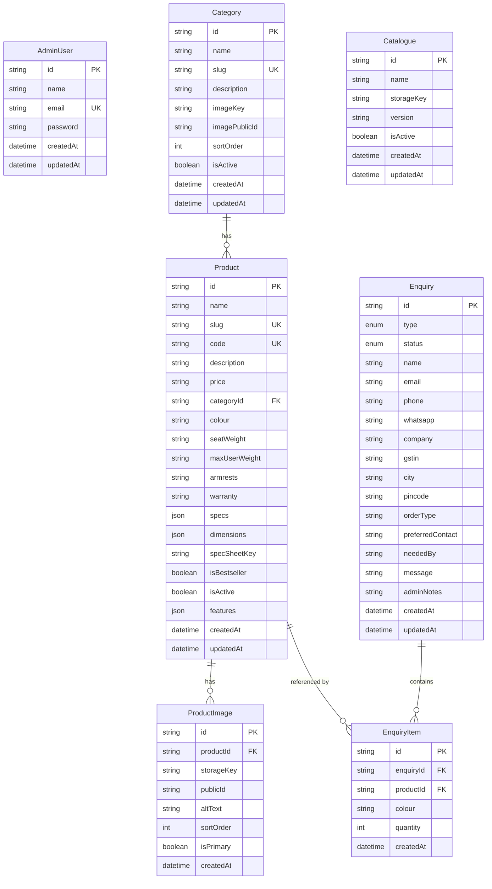
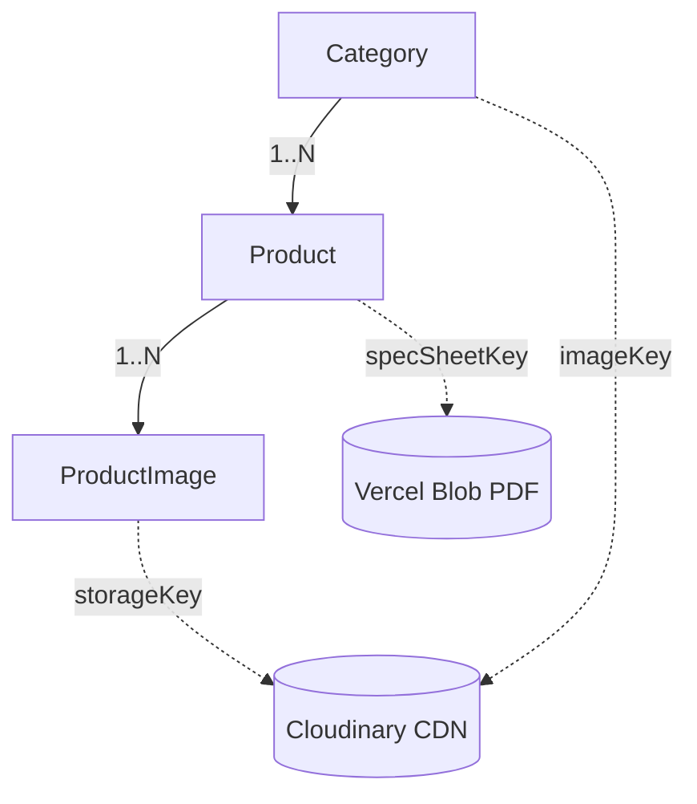
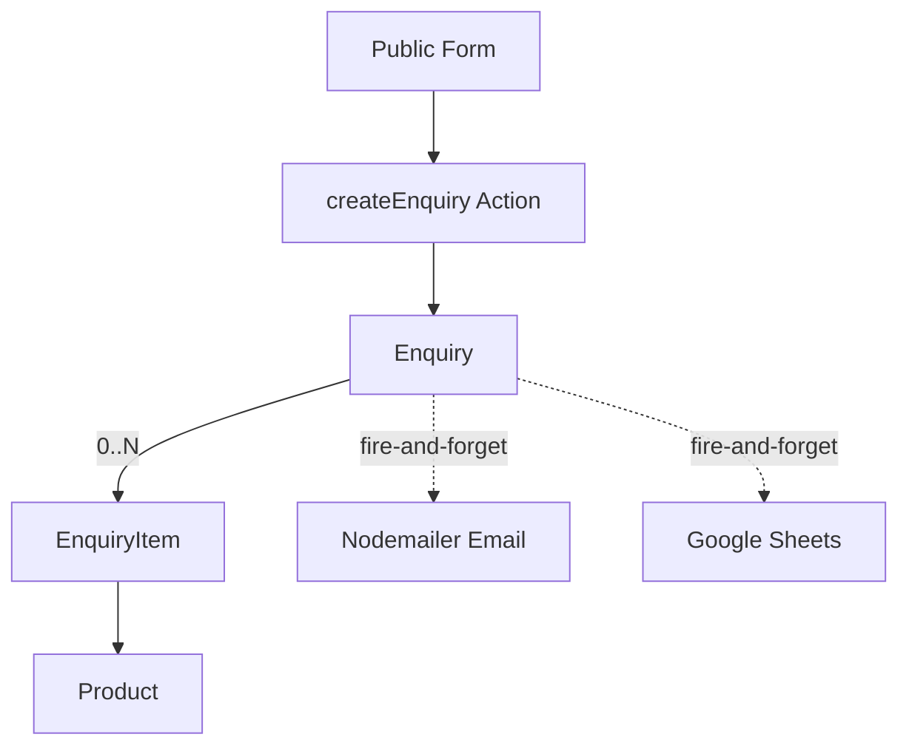

# NexChair — Stage 3 Database Schema Reference

**Document type:** Database schema, data model and operations reference  
**Stage:** 3 of N — Database schema and data model  
**Date:** 2026-11-24  
**Source of truth:** Repository at `C:\Users\Pragya Awasthi\OneDrive\Desktop\IG1\nexchair`  
**Status labels used:** IMPLEMENTED · PARTIALLY IMPLEMENTED · UNVERIFIED · UNUSED/LEGACY · PENDING

---

## Table of Contents

1. [Database Infrastructure and Configuration](#1-database-infrastructure-and-configuration)
2. [Complete Prisma Model Inventory](#2-complete-prisma-model-inventory)
3. [Model-by-Model Documentation](#3-model-by-model-documentation)
   - [3.1 AdminUser](#31-adminuser)
   - [3.2 Category](#32-category)
   - [3.3 Product](#33-product)
   - [3.4 ProductImage](#34-productimage)
   - [3.5 Catalogue](#35-catalogue)
   - [3.6 Enquiry](#36-enquiry)
   - [3.7 EnquiryItem](#37-enquiryitem)
4. [Database Relationships and ER Diagram](#4-database-relationships-and-er-diagram)
5. [Enum Reference](#5-enum-reference)
6. [JSON Fields and Structured Data](#6-json-fields-and-structured-data)
7. [Database Constraints and Data Integrity](#7-database-constraints-and-data-integrity)
8. [Database Operations and Data Flow](#8-database-operations-and-data-flow)
9. [CRUD Reference Matrix](#9-crud-reference-matrix)
10. [Database Migrations](#10-database-migrations)
11. [Seed Data and Initial Database Setup](#11-seed-data-and-initial-database-setup)
12. [Data Deletion, Retention and Archival](#12-data-deletion-retention-and-archival)
13. [Data Handling and Type Conventions](#13-data-handling-and-type-conventions)
14. [Database Security](#14-database-security)
15. [Database Maintenance and Developer Instructions](#15-database-maintenance-and-developer-instructions)
16. [Important Database Risks and Observations](#16-important-database-risks-and-observations)

---

## 1. Database Infrastructure and Configuration

### 1.1 Database Provider

| Item | Detail | Source |
|---|---|---|
| Provider | PostgreSQL | `prisma/migrations/migration_lock.toml` |
| ORM | Prisma 7.10.0 | `package.json` |
| Adapter | `@prisma/adapter-pg` with `pg` pool | `lib/prisma.ts` |
| Generated client output | `generated/prisma/` | `prisma/schema.prisma` generator block |
| Schema file | `prisma/schema.prisma` | Confirmed |
| Config file | `prisma.config.ts` (root) | Confirmed |
| Seed file | `prisma/seed.ts` | `prisma.config.ts` migrations.seed |
| SSL | `rejectUnauthorized: true` on pg Pool | `lib/prisma.ts` |
| Connection string env var | `DATABASE_URL` | `lib/prisma.ts`, `prisma.config.ts` |

The `migration_lock.toml` file confirms provider `postgresql`. The production database host is not identifiable from source code — it is determined solely by the `DATABASE_URL` environment variable. The comment `✓  All changes committed to Neon DB` appears in `scripts/merge-excel-specs.ts`, indicating the production database is hosted on [Neon](https://neon.tech). This is not verified from repository source alone.

**Note on `@prisma/adapter-neon`:** The `@prisma/adapter-neon` package is listed in `package.json` dependencies but is not imported or used anywhere in the application. The active adapter is `@prisma/adapter-pg`. The Neon package is UNUSED/LEGACY.

### 1.2 Prisma Configuration

`prisma.config.ts` (root):

```typescript
export default defineConfig({
  schema: "prisma/schema.prisma",
  migrations: {
    path: "prisma/migrations",
    seed: "tsx prisma/seed.ts",
  },
  datasource: {
    url: env("DATABASE_URL"),
  },
});
```

This file uses `dotenv/config` for local env loading and delegates the actual `DATABASE_URL` to Prisma's migration and seed tooling. The datasource `provider` is declared in `prisma/schema.prisma` as `postgresql`.

### 1.3 Database Client Initialization

`lib/prisma.ts`:

```typescript
const databaseUrl = new URL(connectionString);
// sslmode is stripped from the query string — SSL is configured explicitly.
databaseUrl.searchParams.delete("sslmode");

const pool = new Pool({
  connectionString: databaseUrl.toString(),
  ssl: { rejectUnauthorized: true },
});

const adapter = new PrismaPg(pool);
export const prisma = globalForPrisma.prisma ?? new PrismaClient({ adapter });

if (process.env.NODE_ENV !== "production") {
  globalForPrisma.prisma = prisma;
}
```

Three important behaviours:

1. **SSL mode is stripped then re-applied.** The `sslmode` query parameter is removed from the URL before passing to `pg`, then SSL is re-applied with `{ rejectUnauthorized: true }`. This prevents the driver from accepting self-signed certificates. This is correct for production but will fail if the local dev database does not have a valid SSL certificate.

2. **Singleton pattern.** In development, the Prisma client is attached to `globalThis` to survive Next.js hot-reload cycles. In production, a fresh instance is created per cold start. This prevents connection pool exhaustion.

3. **Throws if `DATABASE_URL` is undefined.** The module throws immediately on import if the env var is missing, so the error surfaces at startup rather than at the first database call.

### 1.4 Build Script

The `build` script in `package.json` runs `prisma generate` before `next build`. This ensures the generated client at `generated/prisma/` is always up to date with the schema before the application is compiled.

---

## 2. Complete Prisma Model Inventory

The schema defines **7 models** and **2 enums**.

| Model | Table Name | Purpose |
|---|---|---|
| `AdminUser` | `AdminUser` | Portal authentication — admin login accounts |
| `Category` | `Category` | Product category taxonomy |
| `Product` | `Product` | Core product catalogue records |
| `ProductImage` | `ProductImage` | Cloudinary-hosted product images |
| `Catalogue` | `Catalogue` | PDF catalogue files stored in Vercel Blob |
| `Enquiry` | `Enquiry` | Customer enquiry submissions |
| `EnquiryItem` | `EnquiryItem` | Line items within an enquiry (product + quantity) |

| Enum | Values |
|---|---|
| `EnquiryType` | `CONTACT`, `QUOTE`, `ORDER` |
| `EnquiryStatus` | `NEW`, `CONTACTED`, `CLOSED` |

Prisma maps model names directly to table names unless `@@map` is specified. No `@@map` directives are present in this schema — all table names match the model names exactly.

---

## 3. Model-by-Model Documentation

---

### 3.1 AdminUser

#### A. Purpose

Stores admin portal login accounts. Each record represents one human operator of the NexChair admin dashboard. Passwords are stored as bcryptjs hashes — plaintext is never persisted.

#### B. Fields

| Field | DB Type | Prisma Type | Required | Default | Constraints | Description |
|---|---|---|---|---|---|---|
| `id` | `TEXT` | `String` | Yes | `cuid()` | PK | Unique identifier. CUID generated by Prisma. |
| `name` | `TEXT` | `String` | Yes | — | NOT NULL | Display name of the admin user. |
| `email` | `TEXT` | `String` | Yes | — | UNIQUE, NOT NULL | Login email address, normalised to lowercase before storage. |
| `password` | `TEXT` | `String` | Yes | — | NOT NULL | bcryptjs hash of the password (12 rounds). Plaintext is never stored. |
| `createdAt` | `TIMESTAMP(3)` | `DateTime` | Yes | `CURRENT_TIMESTAMP` | NOT NULL | Record creation timestamp. |
| `updatedAt` | `TIMESTAMP(3)` | `DateTime` | Yes | — | NOT NULL, auto-updated by Prisma | Automatically updated on every write by Prisma's `@updatedAt`. |

#### C. Relationships

`AdminUser` has no foreign keys and no relations to other models. It is a standalone authentication table.

#### D. Application Usage

| Operation | File | Function |
|---|---|---|
| Read (findUnique by email) | `app/actions/admin-auth.ts` | `signInAdmin()` |
| Create or update (upsert) | `scripts/create-admin.ts` | `main()` |
| Update (password) | `scripts/create-admin.ts` | `main()` (upsert updates the password) |

The `AdminUser` model is **not** managed via the admin portal UI. There is no admin screen for creating or deleting admin users. Users are created exclusively via the `scripts/create-admin.ts` command-line script, run as `npm run create-admin`.

Authentication does **not** store session state in the database. After a successful login, a JWT is issued and stored as an httpOnly cookie (`nexchair_admin_session`). No session table exists. `lib/auth/admin.ts` manages the JWT lifecycle entirely in memory and cookies.

#### E. Lifecycle

- **Created** by running `npm run create-admin` with `ADMIN_EMAIL` and `ADMIN_PASSWORD` environment variables. The script uses `upsert`, so running it again updates the password.
- **Updated** only by re-running `create-admin.ts`.
- **Never deleted** via any implemented code path. Deletion requires direct database access.

#### F. Important Rules

| Rule | Enforced By | Detail |
|---|---|---|
| Email must be unique | Database (UNIQUE constraint) | Duplicate insert throws Prisma error P2002 |
| Password must be ≥ 8 characters | Application code only (`scripts/create-admin.ts`) | No DB-level constraint on length |
| Password stored as bcrypt hash | Application code only (`scripts/create-admin.ts`, `app/actions/admin-auth.ts`) | No DB enforcement; relies on the script always hashing |
| Email lowercased before storage | Application code only (`scripts/create-admin.ts`) | `email.trim().toLowerCase()` |

---

### 3.2 Category

#### A. Purpose

Product categories displayed on the public website. Categories appear in the homepage grid (`CategorySection`), the product range filter, the footer quick-links, and the specifications page filter tabs. Each product belongs to exactly one category.

#### B. Fields

| Field | DB Type | Prisma Type | Required | Default | Constraints | Description |
|---|---|---|---|---|---|---|
| `id` | `TEXT` | `String` | Yes | `cuid()` | PK | Unique identifier. |
| `name` | `TEXT` | `String` | Yes | — | NOT NULL | Display name shown on the website (e.g., "Executive Chair"). |
| `slug` | `TEXT` | `String` | Yes | — | UNIQUE, NOT NULL | URL-safe identifier (e.g., `executive-chair`). Generated from name via `toSlug()`. Used in `?category=` URL params. |
| `description` | `TEXT` | `String?` | No | NULL | — | Optional description. Currently not displayed on the public site. |
| `imageKey` | `TEXT` | `String?` | No | NULL | — | Full Cloudinary URL for the category card image. NULL if no image uploaded. |
| `imagePublicId` | `TEXT` | `String?` | No | NULL | — | Cloudinary `public_id` used for deletion requests. Added in migration `20261015065134`. |
| `sortOrder` | `INTEGER` | `Int` | Yes | `0` | NOT NULL | Controls display order. Lower values appear first. Used in `orderBy: [{ sortOrder: "asc" }, { name: "asc" }]`. |
| `isActive` | `BOOLEAN` | `Boolean` | Yes | `true` | NOT NULL | Whether the category is visible on the public site. Inactive categories are excluded from all public queries. |
| `createdAt` | `TIMESTAMP(3)` | `DateTime` | Yes | `CURRENT_TIMESTAMP` | NOT NULL | Record creation timestamp. |
| `updatedAt` | `TIMESTAMP(3)` | `DateTime` | Yes | — | NOT NULL, auto-updated | Automatically updated on every write. |

**Nullable fields:** `description`, `imageKey`, `imagePublicId`. A null `imageKey` causes the homepage category card to show a text fallback instead of an image.

#### C. Relationships

| Relation | Direction | Model | Cardinality | FK | Delete Behaviour |
|---|---|---|---|---|---|
| `products` | One-to-many | `Product` | Category has many Products | `Product.categoryId → Category.id` | RESTRICT — cannot delete a category that has products |

#### D. Application Usage

| Operation | File | Function/Context |
|---|---|---|
| Read (homepage grid) | `components/home/CategorySection.tsx` | `prisma.category.findMany({ where: { isActive: true }, ... })` |
| Read (product range filter) | `app/product-range/page.tsx` | `prisma.category.findMany({ where: { isActive: true }, ... })` |
| Read (specifications page tabs) | `app/specifications/page.tsx` | `prisma.category.findMany({ where: { isActive: true }, ... })` |
| Read (admin list) | `app/actions/admin-categories.ts` | `getCategories()` |
| Read (dashboard count) | `app/admin/(protected)/page.tsx` | `prisma.category.count({ where: { isActive: true } })` |
| Create | `app/actions/admin-categories.ts` | `createCategory()` |
| Update | `app/actions/admin-categories.ts` | `updateCategory()` |
| Toggle active | `app/actions/admin-categories.ts` | `toggleCategoryActive()` |
| Delete | `app/actions/admin-categories.ts` | `deleteCategory()` |
| Upsert (seed) | `prisma/seed.ts` | `prisma.category.upsert(...)` |
| Upsert (import script) | `scripts/import-archive.ts` | `prisma.category.upsert(...)` |

#### E. Lifecycle

- **Created** via admin portal (`createCategory`) or seeded via `prisma/seed.ts` / `scripts/import-archive.ts`.
- **Updated** via admin portal (`updateCategory`, `toggleCategoryActive`).
- **Deleted** via admin portal (`deleteCategory`) only if the category has zero products. The application blocks deletion with a user-facing error if `_count.products > 0`. The database also enforces this via the `RESTRICT` referential action on `Product.categoryId`.
- **Deactivated** (soft deletion) via `toggleCategoryActive`. The public site excludes inactive categories from all queries.

#### F. Important Rules

| Rule | Enforced By | Detail |
|---|---|---|
| Slug must be unique | Database (UNIQUE index) | Throws P2002 on duplicate. `createCategory` pre-checks before upload. |
| Cannot delete if products exist | Database (RESTRICT FK) + Application (`_count.products > 0` guard) | Both layers enforce this. |
| Slug generated from name | Application code only (`toSlug()`) | Never user-supplied directly. |
| `imageKey` and `imagePublicId` must be cleared together | Application code only | `updateCategory` and `deleteCategory` handle both fields atomically. |

---

### 3.3 Product

#### A. Purpose

The core entity of the NexChair catalogue. Each record represents a single chair model. Products are the central data entity — they appear on every public page, are referenced by enquiries, and have associated images and PDF spec sheets.

#### B. Fields

| Field | DB Type | Prisma Type | Required | Default | Constraints | Description |
|---|---|---|---|---|---|---|
| `id` | `TEXT` | `String` | Yes | `cuid()` | PK | Unique identifier. |
| `name` | `TEXT` | `String` | Yes | — | NOT NULL | Product display name (e.g., "Ergomax"). Max 200 chars enforced by application. |
| `slug` | `TEXT` | `String` | Yes | — | UNIQUE, NOT NULL | URL path segment (e.g., `nc-ergomax`). Generated from name by `toSlug()`. Used in `/products/[slug]`. |
| `code` | `TEXT` | `String` | Yes | — | UNIQUE, NOT NULL | Model code (e.g., `NC-ERGOMAX`). Stored uppercase. Used in `/specifications?model=CODE`. Max 50 chars. |
| `description` | `TEXT` | `String?` | No | NULL | — | Optional long-form description shown on product detail and specifications pages. |
| `price` | `TEXT` | `String` | Yes | — | NOT NULL | Price as a human-readable string (e.g., `₹ 12,500` or `Price on request`). **Not a numeric type.** Defaults to `"Price on request"` when empty. |
| `categoryId` | `TEXT` | `String` | Yes | — | NOT NULL, FK → Category | Foreign key to the owning category. |
| `colour` | `TEXT` | `String?` | No | NULL | — | Available colour options as a plain string (e.g., `Graphite / Black`). |
| `seatWeight` | `TEXT` | `String?` | No | NULL | — | Net weight of the seat/chair. Plain string. |
| `maxUserWeight` | `TEXT` | `String?` | No | NULL | — | Maximum supported user weight (e.g., `120 kg`). |
| `armrests` | `TEXT` | `String?` | No | NULL | — | Armrest description (e.g., `4D Adjustable`). |
| `warranty` | `TEXT` | `String?` | No | NULL | — | Warranty description (e.g., `1 year`). |
| `specs` | `JSONB` | `Json?` | No | NULL | — | Freeform JSON object. See Section 6 for key contracts. |
| `dimensions` | `JSONB` | `Json?` | No | NULL | — | Freeform JSON object for mechanism dimensions. See Section 6. |
| `specSheetKey` | `TEXT` | `String?` | No | NULL | — | Full Vercel Blob URL to the PDF spec sheet. NULL if not uploaded. |
| `isBestseller` | `BOOLEAN` | `Boolean` | Yes | `false` | NOT NULL | Whether the product appears in the bestseller filter. |
| `isActive` | `BOOLEAN` | `Boolean` | Yes | `true` | NOT NULL | Whether the product is visible on the public site. |
| `features` | `JSONB` | `Json?` | No | NULL | — | JSON array of feature strings (e.g., `["Adjustable lumbar", "Seat slider"]`). |
| `createdAt` | `TIMESTAMP(3)` | `DateTime` | Yes | `CURRENT_TIMESTAMP` | NOT NULL | Record creation timestamp. |
| `updatedAt` | `TIMESTAMP(3)` | `DateTime` | Yes | — | NOT NULL, auto-updated | Automatically updated on every write. |

**Indexes (beyond PK and UNIQUE):**

```sql
CREATE INDEX "Product_categoryId_idx" ON "Product"("categoryId");
CREATE INDEX "Product_isActive_idx" ON "Product"("isActive");
CREATE INDEX "Product_isBestseller_idx" ON "Product"("isBestseller");
```

#### C. Relationships

| Relation | Direction | Model | Cardinality | FK | Delete Behaviour |
|---|---|---|---|---|---|
| `category` | Many-to-one | `Category` | Each Product has one Category | `Product.categoryId → Category.id` | RESTRICT on Category delete; CASCADE on `categoryId` update |
| `images` | One-to-many | `ProductImage` | Product has many images | `ProductImage.productId` | CASCADE on Product delete |
| `enquiryItems` | One-to-many | `EnquiryItem` | Product can appear in many EnquiryItems | `EnquiryItem.productId` | RESTRICT — Product cannot be deleted if referenced by EnquiryItem |

#### D. Application Usage

**Public website reads:**

| Context | File | Query |
|---|---|---|
| Product range listing | `app/product-range/page.tsx` | `findMany({ where: { isActive: true }, include: { category, images (primary) } })` |
| Product detail | `app/products/[slug]/page.tsx` | `findUnique({ where: { slug, isActive: true }, include: { category, images } })` |
| Similar products | `app/products/[slug]/page.tsx` | `findMany({ where: { isActive: true, categoryId, id: { not: ... } }, take: 2 })` |
| Order form (all active) | `app/products/[slug]/order/page.tsx` | `findMany({ where: { isActive: true }, orderBy: { name: 'asc' } })` |
| Specifications grid | `app/specifications/page.tsx` | `findMany({ where: { isActive: true }, include: { category, images (primary) } })` |
| Specifications detail | `app/specifications/page.tsx` | `findFirst({ where: { code: modelCode, isActive: true }, include: { category, images } })` |
| Enquiry validation | `app/actions/enquiries.ts` | `findMany({ where: { id: { in: productIds }, isActive: true }, select: { id } })` |
| Sitemap | `app/sitemap.ts` | `findMany({ where: { isActive: true }, select: { slug, updatedAt } })` |
| Dashboard count | `app/admin/(protected)/page.tsx` | `count()` and `count({ where: { isActive: true } })` |

**Admin reads:**

| Context | File | Function |
|---|---|---|
| Product list | `app/actions/admin-products.ts` | `getProducts()` — all products including inactive |
| Product detail (for update form pre-fill) | `app/actions/admin-products.ts` | `findUnique` within `updateProduct()`, `deleteProduct()` |

**Writes:**

| Operation | File | Function |
|---|---|---|
| Create | `app/actions/admin-products.ts` | `createProduct()` — inside `$transaction` with optional first image |
| Update (all fields) | `app/actions/admin-products.ts` | `updateProduct()` |
| Toggle active | `app/actions/admin-products.ts` | `toggleProductActive()` |
| Delete | `app/actions/admin-products.ts` | `deleteProduct()` — blocked if `enquiryItems` exist |
| Upsert (seed) | `prisma/seed.ts` | `prisma.product.upsert(...)` |
| Upsert (import) | `scripts/import-archive.ts` | `prisma.product.upsert(...)` |
| Update specs/description (batch) | `scripts/merge-excel-specs.ts` | `prisma.product.update(...)` per product |
| Deactivate placeholders | `scripts/import-archive.ts` | `prisma.product.updateMany(...)` |

#### E. Lifecycle

- **Created** via admin portal (`createProduct`) or by running import scripts.
- **Updated** via admin portal (`updateProduct`, `toggleProductActive`).
- **Deactivated** (preferred): Set `isActive: false`. Product disappears from all public pages but remains in the database with its enquiry history intact.
- **Deleted** (destructive): Via `deleteProduct()`. Blocked if the product is referenced by any `EnquiryItem`. On successful deletion: `ProductImage` records cascade-delete, Cloudinary images are cleaned up fire-and-forget, spec sheet is cleaned up fire-and-forget.

#### F. Important Rules

| Rule | Enforced By | Detail |
|---|---|---|
| Slug must be unique | Database (UNIQUE index) | Generated from product name, not user-supplied |
| Code must be unique | Database (UNIQUE index) | Stored uppercase. Admin checks before upload. |
| Price is a string, not numeric | Application convention | Cannot be sorted numerically without parsing |
| Empty price defaults to "Price on request" | Application code only (`admin-products.ts`) | `String(formData.get("price") ?? "").trim() \|\| "Price on request"` |
| Inactive products invisible on public site | Application code only | All public queries include `isActive: true` filter |
| Product cannot be deleted with EnquiryItems | Database (RESTRICT FK) + Application guard | Application pre-checks `_count.enquiryItems > 0` before attempting delete |
| `dims` column never written by application | Architecture gap | See Section 16 Risk |

---

### 3.4 ProductImage

#### A. Purpose

Images associated with a product, stored in Cloudinary. A product can have zero or many images. The image with `isPrimary: true` and the lowest `sortOrder` is used as the main thumbnail throughout the application. Display order is controlled by `sortOrder`.

#### B. Fields

| Field | DB Type | Prisma Type | Required | Default | Constraints | Description |
|---|---|---|---|---|---|---|
| `id` | `TEXT` | `String` | Yes | `cuid()` | PK | Unique identifier. |
| `productId` | `TEXT` | `String` | Yes | — | NOT NULL, FK → Product | The product this image belongs to. |
| `storageKey` | `TEXT` | `String` | Yes | — | NOT NULL | Full Cloudinary HTTPS URL (e.g., `https://res.cloudinary.com/...`). Used directly in `` src or `next/image`. |
| `publicId` | `TEXT` | `String?` | No | NULL | — | Cloudinary `public_id` (e.g., `nexchair/products/nc-ergomax`). Used for deletion. Added in migration `20261015065134`. NULL for images uploaded before that migration. |
| `altText` | `TEXT` | `String?` | No | NULL | — | Optional accessible alt text. If NULL, the product name is used as a fallback by the gallery component. |
| `sortOrder` | `INTEGER` | `Int` | Yes | `0` | NOT NULL | Controls gallery display order. Lower values appear first. |
| `isPrimary` | `BOOLEAN` | `Boolean` | Yes | `false` | NOT NULL | Whether this is the main/thumbnail image. At most one image per product should have `isPrimary: true`. This invariant is maintained by application code, not a database constraint. |
| `createdAt` | `TIMESTAMP(3)` | `DateTime` | Yes | `CURRENT_TIMESTAMP` | NOT NULL | Creation timestamp. No `updatedAt` — images are immutable once stored. |

**Index:** `CREATE INDEX "ProductImage_productId_idx" ON "ProductImage"("productId");`

**No `updatedAt`.** `ProductImage` records are not updated after creation. Changes are made by deleting the old record and creating a new one (re-upload). The exception is `setProductImagePrimary` and `reorderProductImages`, which update `isPrimary` and `sortOrder` respectively.

#### C. Relationships

| Relation | Direction | Model | Cardinality | FK | Delete Behaviour |
|---|---|---|---|---|---|
| `product` | Many-to-one | `Product` | Each image belongs to one Product | `ProductImage.productId → Product.id` | CASCADE — deleting a Product deletes all its images in DB (but Cloudinary cleanup is fire-and-forget application code) |

#### D. Application Usage

| Operation | File | Function |
|---|---|---|
| Read (all images, ordered) | `app/products/[slug]/page.tsx` | Included in `product.findUnique` with `include: { images: { orderBy: { sortOrder: "asc" } } }` |
| Read (primary image only) | `app/product-range/page.tsx`, `app/specifications/page.tsx` | `include: { images: { where: { isPrimary: true }, orderBy: { sortOrder: "asc" }, take: 1 } }` |
| Create | `app/actions/admin-products.ts` | `addProductImage()` — uploads to Cloudinary, then creates DB record |
| Create (within product creation) | `app/actions/admin-products.ts` | `createProduct()` — inside `$transaction` |
| Delete | `app/actions/admin-products.ts` | `deleteProductImage()` — inside `$transaction`, then fire-and-forget Cloudinary cleanup |
| Set primary | `app/actions/admin-products.ts` | `setProductImagePrimary()` — `$transaction`: `updateMany` to clear all, then `update` to set |
| Reorder | `app/actions/admin-products.ts` | `reorderProductImages()` — `$transaction` with one `update` per image |
| Create (import script) | `scripts/import-archive.ts` | `prisma.productImage.create(...)` |
| Create (update-images script) | `scripts/update-images.ts` | `prisma.productImage.create(...)` |

#### E. Lifecycle

- **Created** when an image is uploaded via the admin product manager, or during initial import by scripts.
- **Never directly updated** by field content. The `sortOrder` and `isPrimary` fields are updated by `reorderProductImages` and `setProductImagePrimary`.
- **Deleted** explicitly via `deleteProductImage` (fires Cloudinary cleanup), or implicitly when the parent product is deleted (CASCADE, no Cloudinary cleanup is triggered for the cascade path — only the application-level `deleteProduct` function cleans up Cloudinary).
- **Important:** When a product is deleted via the admin portal (`deleteProduct`), the application captures image URLs before deletion and fires Cloudinary cleanup fire-and-forget. When a product is deleted directly via raw SQL or by a cascade (hypothetically), Cloudinary assets become orphaned.

#### F. Important Rules

| Rule | Enforced By | Detail |
|---|---|---|
| Exactly one `isPrimary = true` per product | Application code only | No DB constraint. `setProductImagePrimary` uses a transaction to clear all then set one. |
| Primary image auto-promoted on delete | Application code only (`deleteProductImage`) | Inside a transaction, the next image (lowest sortOrder) is promoted if the deleted image was primary. |
| `publicId` required for Cloudinary deletion | Application convention | Images uploaded before migration `20261015` have NULL publicId. If NULL, `deleteStorageAsset` falls back to deleting by URL. |
| `sortOrder` must be contiguous | Soft convention | No DB enforcement. `reorderProductImages` enforces this by assigning `0, 1, 2...` on reorder. |

---

### 3.5 Catalogue

#### A. Purpose

PDF catalogue documents uploaded by admin users. Stored in Vercel Blob. Catalogues are managed via the admin portal but are not currently linked to any public-facing pages via the database — they are management records only.

**Note:** The public website does not have a catalogues browsing page. The admin portal (`/admin/catalogues`) manages these records. No public route reads from the `Catalogue` model.

#### B. Fields

| Field | DB Type | Prisma Type | Required | Default | Constraints | Description |
|---|---|---|---|---|---|---|
| `id` | `TEXT` | `String` | Yes | `cuid()` | PK | Unique identifier. |
| `name` | `TEXT` | `String` | Yes | — | NOT NULL | Display name for the catalogue (e.g., "NexChair 2026 Product Range"). Max 200 chars (application). |
| `storageKey` | `TEXT` | `String` | Yes | — | NOT NULL | Full Vercel Blob public URL to the PDF file. |
| `version` | `TEXT` | `String?` | No | NULL | — | Optional version label (e.g., `v2.1`). Max 50 chars (application). |
| `isActive` | `BOOLEAN` | `Boolean` | Yes | `true` | NOT NULL | Whether the catalogue is active. Currently used only as an admin toggle — inactive catalogues are still visible in the admin list. |
| `createdAt` | `TIMESTAMP(3)` | `DateTime` | Yes | `CURRENT_TIMESTAMP` | NOT NULL | Record creation timestamp. |
| `updatedAt` | `TIMESTAMP(3)` | `DateTime` | Yes | — | NOT NULL, auto-updated | Automatically updated on every write. |

#### C. Relationships

`Catalogue` has no foreign keys and no relations to other models. It is a standalone storage-reference table.

#### D. Application Usage

| Operation | File | Function |
|---|---|---|
| Read (admin list) | `app/actions/admin-catalogues.ts` | `getCatalogues()` |
| Create | `app/actions/admin-catalogues.ts` | `createCatalogue()` |
| Update (name/version) | `app/actions/admin-catalogues.ts` | `updateCatalogue()` |
| Toggle active | `app/actions/admin-catalogues.ts` | `toggleCatalogueActive()` |
| Delete | `app/actions/admin-catalogues.ts` | `deleteCatalogue()` |

No public-facing code reads the `Catalogue` model.

#### E. Lifecycle

- **Created** when an admin uploads a PDF. Upload to Vercel Blob happens first; if the DB write fails, the blob file is cleaned up (fire-and-forget).
- **Updated** (name/version) via `updateCatalogue`. The file itself cannot be replaced — delete and re-upload is required.
- **Deleted** via `deleteCatalogue`. DB record is deleted first, then Vercel Blob deletion is fired-and-forgotten.
- **Deactivated** (soft toggle) via `toggleCatalogueActive`. Inactive records remain in the DB.

#### F. Important Rules

| Rule | Enforced By | Detail |
|---|---|---|
| No duplicate name enforcement | None | Multiple catalogues can share the same name. |
| File cannot be replaced, only deleted | Application convention | No update path for `storageKey`. |
| `isActive` has no public-site effect | Architecture — PENDING | The flag exists but no public route queries it. |

---

### 3.6 Enquiry

#### A. Purpose

Captures customer enquiry submissions from all three public forms: Contact/Quote (`/contact`), Order (`/products/[slug]/order`), and the alternative quote form. Each enquiry stores the customer's contact details, the nature of the request, and a status for the sales team to track.

#### B. Fields

| Field | DB Type | Prisma Type | Required | Default | Constraints | Description |
|---|---|---|---|---|---|---|
| `id` | `TEXT` | `String` | Yes | `cuid()` | PK | Unique enquiry identifier. Also the Lead ID sent to Google Sheets. |
| `type` | `EnquiryType` | `EnquiryType` | Yes | — | NOT NULL | Discriminator: `CONTACT`, `QUOTE`, or `ORDER`. |
| `status` | `EnquiryStatus` | `EnquiryStatus` | Yes | `NEW` | NOT NULL | Sales pipeline status. Default `NEW` on creation. |
| `name` | `TEXT` | `String` | Yes | — | NOT NULL | Customer full name. Max 200 chars (application). |
| `email` | `TEXT` | `String?` | No | NULL | — | Customer email address. At least one of `email` or `phone` required (application). |
| `phone` | `TEXT` | `String?` | No | NULL | — | Customer phone number. |
| `whatsapp` | `TEXT` | `String?` | No | NULL | — | Optional separate WhatsApp number if different from phone. |
| `company` | `TEXT` | `String?` | No | NULL | — | Company name. Relevant for B2B enquiries. |
| `gstin` | `TEXT` | `String?` | No | NULL | — | GST identification number. For customers requesting GST invoices. |
| `city` | `TEXT` | `String?` | No | NULL | — | Customer's city. Used in email notifications and lead log. |
| `pincode` | `TEXT` | `String?` | No | NULL | — | Customer's PIN code. Currently collected only on the Order form. |
| `orderType` | `TEXT` | `String?` | No | NULL | — | Free-text: "Home" or "Business" (from `OrderEnquiryForm` radio). |
| `preferredContact` | `TEXT` | `String?` | No | NULL | — | Customer's preferred contact method. Free-text. |
| `neededBy` | `TEXT` | `String?` | No | NULL | — | Requested delivery timeframe. Free-text select option. |
| `message` | `TEXT` | `String?` | No | NULL | — | Free-text message. Max 2000 chars (application). |
| `adminNotes` | `TEXT` | `String?` | No | NULL | — | Internal notes added by admin staff. Not visible to customers. Added in migration `20261023`. Max 2000 chars (application). |
| `createdAt` | `TIMESTAMP(3)` | `DateTime` | Yes | `CURRENT_TIMESTAMP` | NOT NULL | Submission timestamp. |
| `updatedAt` | `TIMESTAMP(3)` | `DateTime` | Yes | — | NOT NULL, auto-updated | Updated when status or adminNotes change. |

**Indexes:**

```sql
CREATE INDEX "Enquiry_type_idx"      ON "Enquiry"("type");
CREATE INDEX "Enquiry_status_idx"    ON "Enquiry"("status");
CREATE INDEX "Enquiry_createdAt_idx" ON "Enquiry"("createdAt");
```

These indexes support the admin enquiry list (`getEnquiries`) which filters by `type`, `status` and orders by `createdAt DESC`.

#### C. Relationships

| Relation | Direction | Model | Cardinality | FK | Delete Behaviour |
|---|---|---|---|---|---|
| `items` | One-to-many | `EnquiryItem` | Enquiry has 0–50 items | `EnquiryItem.enquiryId` | CASCADE on Enquiry delete |

CONTACT and QUOTE type enquiries typically have zero items. ORDER type enquiries typically have one or more items.

#### D. Application Usage

| Operation | File | Function |
|---|---|---|
| Create (public form) | `app/actions/enquiries.ts` | `createEnquiry()` — with nested `EnquiryItem` creation |
| Read (admin list, paginated) | `app/actions/admin-enquiries.ts` | `getEnquiries()` — 20 per page, filter/search |
| Read (admin detail) | `app/actions/admin-enquiries.ts` | `getEnquiry()` — full record + items |
| Read (dashboard count) | `app/admin/(protected)/page.tsx` | `prisma.enquiry.count({ where: { status: "NEW" } })` |
| Update status | `app/actions/admin-enquiries.ts` | `updateEnquiryStatus()` |
| Update notes | `app/actions/admin-enquiries.ts` | `updateEnquiryNotes()` |

No delete operation is implemented for Enquiry via the admin portal. Deletion requires direct database access.

#### E. Lifecycle

- **Created** when a customer submits a form. Rate-limited (5 per 10 minutes per IP, fail-open). After DB write, `sendEnquiryEmails` and `appendEnquiryToSheet` are fired concurrently and independently.
- **Updated** by admin when changing `status` or `adminNotes`.
- **Never deleted** via any implemented application code path.
- **EnquiryItems cascade-delete** when an Enquiry is deleted (direct DB only).

#### F. Important Rules

| Rule | Enforced By | Detail |
|---|---|---|
| Either `email` or `phone` must be present | Application code only (`app/actions/enquiries.ts`) | `if (!email && !phone) return error`. No DB constraint. |
| Email format validation | Application code only | Regex: `/^[^\s@]+@[^\s@]+\.[^\s@]+$/` |
| Phone format validation | Application code only | Regex: `/^[+\d\s\-()\[\]]{7,20}$/` |
| `message` max 2000 chars | Application code only | No DB constraint on length |
| `adminNotes` max 2000 chars | Application code only (`updateEnquiryNotes` uses `.slice(0, 2000)`) | Truncated silently |
| `type` must be valid enum value | Database (enum constraint) | Invalid value throws Prisma error |
| `status` defaults to NEW | Database default | Explicit default in schema |
| Items max 50 | Application code only | `input.items.length > 50` check |

---

### 3.7 EnquiryItem

#### A. Purpose

A line item within an `ORDER` enquiry, representing one chair model, colour and quantity. A single enquiry can contain multiple items (up to 50, enforced by the `createEnquiry` action).

CONTACT and QUOTE type enquiries do not normally create `EnquiryItem` records. The `items` array in `createEnquiry` is optional.

#### B. Fields

| Field | DB Type | Prisma Type | Required | Default | Constraints | Description |
|---|---|---|---|---|---|---|
| `id` | `TEXT` | `String` | Yes | `cuid()` | PK | Unique identifier. |
| `enquiryId` | `TEXT` | `String` | Yes | — | NOT NULL, FK → Enquiry | The parent enquiry. |
| `productId` | `TEXT` | `String` | Yes | — | NOT NULL, FK → Product | The product being enquired about. |
| `colour` | `TEXT` | `String?` | No | NULL | — | Customer's selected colour option (e.g., `Black`, `Graphite`). Free-text. |
| `quantity` | `INTEGER` | `Int` | Yes | `1` | NOT NULL | Number of units. Must be ≥ 1 (application code). Default 1. |
| `createdAt` | `TIMESTAMP(3)` | `DateTime` | Yes | `CURRENT_TIMESTAMP` | NOT NULL | Creation timestamp. No `updatedAt`. |

**Indexes:**

```sql
CREATE INDEX "EnquiryItem_enquiryId_idx" ON "EnquiryItem"("enquiryId");
CREATE INDEX "EnquiryItem_productId_idx" ON "EnquiryItem"("productId");
```

The `productId` index supports `getEnquiry()` which joins product names, and also makes it efficient to check if a product is referenced before allowing deletion.

#### C. Relationships

| Relation | Direction | Model | Cardinality | FK | Delete Behaviour |
|---|---|---|---|---|---|
| `enquiry` | Many-to-one | `Enquiry` | Each item belongs to one Enquiry | `EnquiryItem.enquiryId → Enquiry.id` | CASCADE — EnquiryItem deleted when parent Enquiry is deleted |
| `product` | Many-to-one | `Product` | Each item references one Product | `EnquiryItem.productId → Product.id` | RESTRICT — Product cannot be deleted while EnquiryItem exists |

The RESTRICT behaviour on `productId` means a product that has appeared in any enquiry can never be deleted via the admin portal. The admin form shows a user-facing error counting the number of referencing enquiry items.

#### D. Application Usage

| Operation | File | Function |
|---|---|---|
| Create (nested in enquiry) | `app/actions/enquiries.ts` | `createEnquiry()` — `items: { create: [...] }` nested write |
| Read (via enquiry include) | `app/actions/admin-enquiries.ts` | `getEnquiry()` — `include: { items: { include: { product: { select: { name, code } } } } }` |
| Validate products active | `app/actions/enquiries.ts` | `prisma.product.findMany({ where: { id: { in: productIds }, isActive: true } })` before creation |
| Count (guards product deletion) | `app/actions/admin-products.ts` | `deleteProduct()` — `_count: { select: { enquiryItems: true } }` |

`EnquiryItem` has no standalone CRUD operations. Items are created atomically with their parent `Enquiry` and are read only as part of the `getEnquiry` detail view.

#### E. Lifecycle

- **Created** atomically with the parent `Enquiry` via Prisma's nested write (`items: { create: [...] }`).
- **Never updated** after creation.
- **Deleted** only by cascade when the parent `Enquiry` is deleted (direct DB only — no admin portal delete path exists for Enquiry).

#### F. Important Rules

| Rule | Enforced By | Detail |
|---|---|---|
| Quantity must be ≥ 1 | Application code only (`createEnquiry`) | No DB constraint (default 1 but no CHECK constraint) |
| Product must be active at time of creation | Application code only (`createEnquiry`) | Pre-validated before the enquiry is created |
| Items cascade-delete with parent Enquiry | Database (CASCADE FK) | Enquiry delete cascades to all its items |
| Product RESTRICT prevents deletion | Database (RESTRICT FK) | A product referenced by any EnquiryItem cannot be deleted |

---

## 4. Database Relationships and ER Diagram

### 4.1 Relationship Summary

| From | Relationship | To | FK Field | On Delete (From perspective) | On Delete (To perspective) |
|---|---|---|---|---|---|
| `Product` | belongs to | `Category` | `Product.categoryId` | Restricts Category deletion | Cascade Category FK update |
| `ProductImage` | belongs to | `Product` | `ProductImage.productId` | Cascades ProductImage deletion | — |
| `EnquiryItem` | belongs to | `Enquiry` | `EnquiryItem.enquiryId` | Cascades EnquiryItem deletion | — |
| `EnquiryItem` | references | `Product` | `EnquiryItem.productId` | Restricts Product deletion | — |

There are no many-to-many relationships or join tables.

### 4.2 Complete ER Diagram



### 4.3 Functional Groupings

**Products and categories:**



**Enquiry and lead capture:**



---

## 5. Enum Reference

### 5.1 EnquiryType

| Value | Meaning | Where Set | Business Impact |
|---|---|---|---|
| `CONTACT` | General contact or question from `/contact` form | `app/actions/enquiries.ts` — `type: "CONTACT"` from `ContactQuoteForm` | Typically no EnquiryItems. Sales team responds generally. |
| `QUOTE` | Quote request from `/contact` form | `app/actions/enquiries.ts` — `type: "QUOTE"` | Same form as CONTACT; type is passed by the client form. Currently both CONTACT and QUOTE use the same `/contact` page form (`ContactQuoteForm`). |
| `ORDER` | Product order enquiry from `/products/[slug]/order` | `app/actions/enquiries.ts` — `type: "ORDER"` from `OrderEnquiryForm` | Includes EnquiryItems with product + colour + quantity. Sales team follows up with pricing and delivery. |

**Files that depend on EnquiryType:**
- `app/actions/enquiries.ts` — validates and stores
- `app/actions/admin-enquiries.ts` — filters admin list
- `lib/email.ts` — email template content varies by type (UNVERIFIED — not read in this stage)
- `lib/sheets.ts` — column "Type" in Sheets log
- `app/admin/(protected)/enquiries/page.tsx` — filter UI

**Risk:** Renaming or removing any value would break the database enum type, all application-level string comparisons (`"ORDER"`, `"CONTACT"`, `"QUOTE"`), the admin filter UI, the email templates, and the Sheets log. A migration would be required to rename an enum value.

### 5.2 EnquiryStatus

| Value | Meaning | Default | Where Changed | Business Impact |
|---|---|---|---|---|
| `NEW` | Enquiry received, not yet acted on | Yes (`@default(NEW)`) | Set by DB default on creation | Dashboard "New Enquiries" counter counts these |
| `CONTACTED` | Sales team has made contact with the customer | No | `updateEnquiryStatus()` in admin portal | Removes from "New" count |
| `CLOSED` | Enquiry resolved or no longer active | No | `updateEnquiryStatus()` in admin portal | Removes from "New" count |

**Files that depend on EnquiryStatus:**
- `app/actions/admin-enquiries.ts` — `VALID_STATUSES` array, `updateEnquiryStatus`, `getEnquiries` filter
- `app/admin/(protected)/page.tsx` — `count({ where: { status: "NEW" } })`
- `app/admin/(protected)/enquiries/page.tsx` — filter UI
- `app/admin/(protected)/enquiries/[id]/page.tsx` — status change form

**Unused values check:** All three status values (`NEW`, `CONTACTED`, `CLOSED`) are actively used by application code.

---

## 6. JSON Fields and Structured Data

Three `JSONB` columns exist on the `Product` model: `specs`, `dimensions`, and `features`. Each has a different write path, read path, and level of schema enforcement.

---

### 6.1 `Product.specs`

**Purpose:** Stores product specification attributes that do not fit scalar columns — primarily back type, lumbar support type, and mechanism details added by scripts.

**DB column type:** `JSONB` (PostgreSQL); `Json?` in Prisma schema.

**Expected structure:** An object (not an array). Keys and their sources:

| Key | Type | Written By | Read By | Description |
|---|---|---|---|---|
| `back` | `string` | `import-archive.ts`, `merge-excel-specs.ts`, `prisma/seed.ts` (via `data/products.ts`) | `app/products/[slug]/page.tsx` (`getSpec`), `app/specifications/page.tsx` (`getSpec`), `app/product-range/page.tsx` (specs transform), `app/actions/admin-products.ts` (`extractSpecs`) | Back type description (e.g., `"Mesh"`, `"High Back Mesh"`, `"Leather"`) |
| `lumbar` | `string` | `prisma/seed.ts` (via `data/products.ts`), `app/actions/admin-products.ts` (`parseSpecs` from `specsLumbar` form field) | `app/products/[slug]/page.tsx` (`getSpec`), `app/specifications/page.tsx` (`getSpec`), `app/actions/admin-products.ts` (`extractSpecs`) | Lumbar support description |
| `armrests` | `string` | `import-archive.ts` (via `specs.armrests`), `prisma/seed.ts` | Not read by page — the scalar `Product.armrests` column is used instead | Armrest description written by scripts to `specs`, but page uses scalar `product.armrests` |
| `mechanism` | `string` | `scripts/merge-excel-specs.ts` | **NOT read by any page** | Mechanism type (e.g., `"Butterfly"`, `"Synchronised"`, `"Tilt"`). Written to `specs` by scripts but product detail page reads mechanism from `dimensions.tiltMechanism` (which is never written). See Risk 16.1. |
| `gasLift` | `string` | `scripts/merge-excel-specs.ts` | **NOT read by any page** | Gas lift class (e.g., `"Class 4"`). Same data gap as `mechanism`. |
| `base` | `string` | `scripts/merge-excel-specs.ts` | **NOT read by any page** | Base material (e.g., `"Nylon"`, `"Aluminium"`). Same data gap. |
| `castor` | `string` | `scripts/merge-excel-specs.ts` | **NOT read by any page** | Caster type (e.g., `"PU"`, `"Nylon"`). Same data gap. |

**Example value (fictional):**

```json
{
  "back": "High Back Mesh",
  "lumbar": "Adjustable lumbar",
  "mechanism": "Synchronised",
  "gasLift": "Class 4",
  "base": "Aluminium",
  "castor": "PU"
}
```

**Write paths:**

| Write path | Keys written | Notes |
|---|---|---|
| `app/actions/admin-products.ts` → `parseSpecs()` | `lumbar`, `back` | Only these two keys. Admin form has `specsLumbar` and `specsBack` inputs. Other keys not surfaced in admin UI. |
| `prisma/seed.ts` | `lumbar`, `armrests`, `back` | From `data/products.ts` — legacy placeholder data. |
| `scripts/import-archive.ts` | `back`, `armrests` | Writes these when creating new product records. |
| `scripts/merge-excel-specs.ts` | `back`, `mechanism`, `gasLift`, `base`, `castor` (additive) | Only adds keys that are absent or null. Never overwrites. |

**Read paths:**

| Read path | Keys used |
|---|---|
| `app/products/[slug]/page.tsx` | `back`, `lumbar` (via `getSpec()`) |
| `app/specifications/page.tsx` | `back`, `lumbar` (via `getSpec()`) |
| `app/product-range/page.tsx` | `back`, `lumbar` (via specs transform) |
| `app/actions/admin-products.ts` | `back`, `lumbar` (via `extractSpecs()`) |

**Keys written by scripts but never read by any page:** `mechanism`, `gasLift`, `base`, `castor`, `armrests` (in specs).

**Validation:** None at database level. `parseSpecs` in `admin-products.ts` returns a plain object; malformed input would result in an empty object being written, not an error.

**Behaviour when key is missing:** `getSpec(product.specs, key)` returns `"-"` for any missing or empty-string key. Missing spec rows are filtered out of the spec table display.

---

### 6.2 `Product.dimensions`

**Purpose:** Intended to store chair dimension data: seat measurements, mechanism details, caster type, warranty coverage periods. These keys are read by the product detail page to populate the Specifications and Mechanism sections.

**DB column type:** `JSONB` (PostgreSQL); `Json?` in Prisma schema.

**Expected keys (from product detail page read path):**

| Key | Used By | Description |
|---|---|---|
| `seat` | `app/products/[slug]/page.tsx` | Seat dimensions |
| `base` | `app/products/[slug]/page.tsx` | Base description |
| `casters` | `app/products/[slug]/page.tsx` | Caster type |
| `gasLift` | `app/products/[slug]/page.tsx` | Gas lift class |
| `tiltMechanism` | `app/products/[slug]/page.tsx` | Mechanism type |
| `reclineRange` | `app/products/[slug]/page.tsx` | Recline range in degrees |
| `tiltLock` | `app/products/[slug]/page.tsx` | Tilt lock description |
| `seatSlider` | `app/products/[slug]/page.tsx` | Seat depth adjustment |
| `headrest` | `app/products/[slug]/page.tsx` | Headrest adjustment range |
| `warrantyFrame` | `app/products/[slug]/page.tsx` | Warranty on frame and mechanism |
| `warrantyUpholstery` | `app/products/[slug]/page.tsx` | Warranty on upholstery |
| `warrantyService` | `app/products/[slug]/page.tsx` | Service warranty period |

**CRITICAL — `dimensions` is never written by any application code path:**

A complete audit of all write paths to `Product` confirms that **no code writes to `dimensions`**:

- `app/actions/admin-products.ts` (`createProduct`, `updateProduct`): only writes `specs`, not `dimensions`.
- `prisma/seed.ts`: does not write `dimensions`.
- `scripts/import-archive.ts`: does not write `dimensions`.
- `scripts/merge-excel-specs.ts`: writes to `specs` only. The comment in that file says "isActive, price, isBestseller, images, slug, id: never touched" — `dimensions` is not mentioned at all.

The `dimensions` column is effectively always `NULL` for every product in the live database. The product detail page falls back gracefully (returns `"-"` for all dimension keys and shows placeholder text like `"[Synchro / knee-tilt]"` in the Mechanism cards).

**Example of intended value (from page keys — fictional):**

```json
{
  "seat": "Adjustable height 440–520 mm",
  "base": "5-star aluminium, 680 mm diameter",
  "casters": "60 mm dual-wheel PU",
  "gasLift": "Class 4",
  "tiltMechanism": "Synchronised tilt",
  "reclineRange": "95°–125°",
  "tiltLock": "Multi-position tilt lock",
  "seatSlider": "50 mm forward/backward",
  "headrest": "Height and angle adjustable",
  "warrantyFrame": "5 years",
  "warrantyUpholstery": "2 years",
  "warrantyService": "1 year on-site"
}
```

**Risk:** See Section 16.1. This is a HIGH risk data gap.

---

### 6.3 `Product.features`

**Purpose:** A JSON array of feature strings displayed as a checklist on product cards and filter results. Used by `ProductFilters` for the "Features" multi-select filter option.

**DB column type:** `JSONB` (PostgreSQL); `Json?` in Prisma schema.

**Expected structure:** An array of strings.

**Example:**

```json
["Adjustable lumbar", "Seat slider", "Synchro-tilt", "Headrest"]
```

**Write paths:**

| Write path | Notes |
|---|---|
| `app/actions/admin-products.ts` → `parseFeatures()` | Reads all `features` repeated form fields. Writes as JSON array. |
| `prisma/seed.ts` → `productFeatures` map | Hardcoded features per slug for 9 seed products. |
| `scripts/import-archive.ts` | Creates products with `features: []` (empty array). |

**Read paths:**

| Read path | Usage |
|---|---|
| `app/product-range/page.tsx` | Extracted via `Array.isArray(product.features) ? product.features.filter(...)` and passed to `ProductFilters`. |
| `app/actions/admin-products.ts` → `extractFeatures()` | Converts raw JSON to `string[]` for the admin form. |
| `components/product-range/ProductFilters.tsx` | Used to build the "Features" multi-select filter. Options are derived dynamically from product data. |

**Validation:** `parseFeatures` filters empty strings. `extractFeatures` filters non-string values. No DB constraint on array structure.

**Behaviour when null:** `app/product-range/page.tsx` checks `Array.isArray(product.features)` and falls back to `[]`. An empty array results in no feature badges.

---

## 7. Database Constraints and Data Integrity

### 7.1 Database-Level Constraints

| Constraint | Table | Type | SQL Name | Protects |
|---|---|---|---|---|
| PK | All models | PRIMARY KEY | `{Model}_pkey` | Each record uniquely identifiable |
| Unique email | `AdminUser` | UNIQUE INDEX | `AdminUser_email_key` | No duplicate admin accounts |
| Unique slug | `Category` | UNIQUE INDEX | `Category_slug_key` | No duplicate category URL paths |
| Unique slug | `Product` | UNIQUE INDEX | `Product_slug_key` | No duplicate product URL paths |
| Unique code | `Product` | UNIQUE INDEX | `Product_code_key` | No duplicate model codes |
| FK: Product → Category | `Product` | FOREIGN KEY + RESTRICT | `Product_categoryId_fkey` | Product must belong to an existing Category |
| FK: ProductImage → Product | `ProductImage` | FOREIGN KEY + CASCADE | `ProductImage_productId_fkey` | Images always belong to an existing Product; cascade-delete when Product deleted |
| FK: EnquiryItem → Enquiry | `EnquiryItem` | FOREIGN KEY + CASCADE | `EnquiryItem_enquiryId_fkey` | Items always belong to an existing Enquiry; cascade-delete when Enquiry deleted |
| FK: EnquiryItem → Product | `EnquiryItem` | FOREIGN KEY + RESTRICT | `EnquiryItem_productId_fkey` | Item must reference an existing Product; blocks Product deletion while referenced |
| Enum type | `Enquiry.type` | ENUM constraint | — | Only `CONTACT`, `QUOTE`, `ORDER` permitted |
| Enum status | `Enquiry.status` | ENUM constraint | — | Only `NEW`, `CONTACTED`, `CLOSED` permitted |

### 7.2 Application-Level Integrity Rules (Not DB-Enforced)

| Rule | Where | Consequence if Skipped |
|---|---|---|
| Enquiry requires email or phone | `app/actions/enquiries.ts` | Could create orphan enquiries with no contact method |
| Email format validation | `app/actions/enquiries.ts` | Malformed email stored in DB |
| Phone format validation | `app/actions/enquiries.ts` | Malformed phone stored in DB |
| Enquiry item quantity ≥ 1 | `app/actions/enquiries.ts` | Zero-quantity items could be stored |
| Product must be active for enquiry | `app/actions/enquiries.ts` | Inactive product IDs in items |
| Product items max 50 | `app/actions/enquiries.ts` | Oversized enquiries |
| `isPrimary` unique per product | `app/actions/admin-products.ts` | Multiple primary images per product |
| Product code uppercase | `app/actions/admin-products.ts` | Mixed-case codes, duplicate lookup failures |
| Slug generated deterministically from name | `app/actions/admin-products.ts`, `admin-categories.ts` | Inconsistent URL paths if generation logic changes |
| Category must have zero products before deletion | `app/actions/admin-categories.ts` | Also enforced by DB RESTRICT, so only matters if the application guard is bypassed |

### 7.3 Integrity Rule Reference Table

| Rule | Enforced By | Purpose | Consequence if Violated |
|---|---|---|---|
| Unique admin email | Database UNIQUE | Prevents duplicate admin accounts | Insert fails with P2002 |
| Unique product slug | Database UNIQUE | Guarantees unique URL paths | Insert/update fails with P2002 |
| Unique product code | Database UNIQUE | Guarantees unique model identifiers | Insert/update fails with P2002 |
| Product requires valid categoryId | Database FK RESTRICT | Products always belong to a valid category | Insert/update fails with P2003 |
| Cannot delete Category with Products | Database FK RESTRICT | Prevents orphan products | Delete fails with P2003 |
| Cannot delete Product with EnquiryItems | Database FK RESTRICT | Preserves enquiry history | Delete fails with P2003 |
| ProductImage cascades with Product | Database FK CASCADE | No orphan image records | Automatic, transparent |
| EnquiryItem cascades with Enquiry | Database FK CASCADE | No orphan item records | Automatic, transparent |
| Email or phone required on Enquiry | Application code | Ensures contact is possible | Contactless enquiry stored |
| Enquiry item quantity ≥ 1 | Application code | Prevents zero-quantity orders | Zero stored (default=1 helps) |

---

## 8. Database Operations and Data Flow

### 8.1 Public Website — Read Patterns

#### 8.1.1 Homepage Category Grid

**User action:** Homepage loads.  
**Server Component:** `components/home/CategorySection.tsx`  
**Prisma operation:**
```typescript
prisma.category.findMany({
  where: { isActive: true },
  orderBy: [{ sortOrder: "asc" }, { name: "asc" }],
  select: { id, name, slug, imageKey },
})
```
**Result:** Renders category grid. If DB is unreachable, falls back to 6 hardcoded categories.

#### 8.1.2 Product Range Page

**User action:** User visits `/product-range`.  
**Server Component:** `app/product-range/page.tsx` (`force-dynamic`)  
**Prisma operations (parallel):**
```typescript
// 1. Active products with primary image
prisma.product.findMany({
  where: { isActive: true },
  include: {
    category: true,
    images: { where: { isPrimary: true }, orderBy: { sortOrder: "asc" }, take: 1 },
  },
  orderBy: { createdAt: "desc" },
})

// 2. Active categories for filter pills
prisma.category.findMany({
  where: { isActive: true },
  orderBy: [{ sortOrder: "asc" }, { name: "asc" }],
  select: { name, slug },
})
```
**Transform:** Prisma results are mapped to the legacy `Product` type (`types/product.ts`) before being passed to client components. All filtering and sorting then happens in-memory on the client.

#### 8.1.3 Product Detail Page

**User action:** User visits `/products/nc-ergomax`.  
**Server Component:** `app/products/[slug]/page.tsx`  
**Prisma operations (sequential):**
```typescript
// 1. Product by slug — 404 if not found or inactive
prisma.product.findUnique({
  where: { slug, isActive: true },
  include: {
    category: true,
    images: { orderBy: { sortOrder: "asc" } },
  },
})

// 2. Similar products (same category, different id, take 2)
prisma.product.findMany({
  where: { isActive: true, categoryId: product.categoryId, id: { not: product.id } },
  include: { category: true },
  orderBy: { createdAt: "asc" },
  take: 2,
})
```

#### 8.1.4 Specifications Page (Single Product View)

**User action:** User visits `/specifications?model=NC-ERGOMAX`.  
**Server Component:** `app/specifications/page.tsx`  
**Prisma operation:**
```typescript
prisma.product.findFirst({
  where: { code: modelCode, isActive: true },
  include: {
    category: true,
    images: { orderBy: { sortOrder: "asc" } },
  },
})
```
Note: Uses `findFirst` by `code` (not `findUnique`). The `code` field has a UNIQUE index so this is equivalent to `findUnique` in practice.

#### 8.1.5 Sitemap

**Prisma operation:**
```typescript
prisma.product.findMany({
  where: { isActive: true },
  select: { slug, updatedAt },
  orderBy: { createdAt: "asc" },
})
```
Returns all active product slugs for inclusion in the XML sitemap.

---

### 8.2 Enquiry Submission Flow

**User action:** User submits the Order, Contact, or Quote form.  
**Server Action:** `app/actions/enquiries.ts` → `createEnquiry(input)`

```
Rate limit check (checkEnquiryRateLimit)
  → If blocked: return error (fail-open — does not block if Upstash is down)
Input validation (name, email/phone, message length, items count, quantity ≥ 1)
  → If invalid: return field error
Product ID validation (findMany active products by submitted IDs)
  → If any inactive/missing: return error
prisma.enquiry.create({
  data: { type, name, email, phone, ..., items: { create: [...] } },
  include: { items: { include: { product: { select: { name, code } } } } },
})
  → DB write creates Enquiry + EnquiryItem records atomically
Promise.allSettled([
  sendEnquiryEmails({ ... }),      // fire-and-forget — failure does not affect response
  appendEnquiryToSheet({ ... }),   // fire-and-forget — failure logged, not propagated
])
return { success: true, enquiryId }
```

The DB write is the only operation that affects the user response. Email and Sheets failures are logged server-side but do not cause form errors.

---

### 8.3 Admin Operations

#### 8.3.1 Admin Authentication

```
User submits login form
  → signInAdmin(formData) [app/actions/admin-auth.ts]
  → checkLoginRateLimit(email) — fail-closed: blocked if Upstash unavailable
  → prisma.adminUser.findUnique({ where: { email } })
  → bcrypt.compare(password, admin.password)
  → createAdminSession(admin.id, admin.email) → JWT → httpOnly cookie
  → redirect("/admin")
```

No session is stored in the database. The session exists only in the JWT cookie.

#### 8.3.2 Admin Dashboard

```
app/admin/(protected)/page.tsx
→ requireAdminSession() (cookie check, no DB query)
→ Promise.all([
    prisma.product.count(),
    prisma.product.count({ where: { isActive: true } }),
    prisma.category.count({ where: { isActive: true } }),
    prisma.enquiry.count({ where: { status: "NEW" } }),
  ])
```

#### 8.3.3 Product Creation (Full Flow)

```
Admin fills ProductForm → createProduct(formData) [app/actions/admin-products.ts]
→ requireAdminSession()
→ Validate name, code, categoryId
→ Generate slug from name
→ Promise.all([
    prisma.product.findUnique({ where: { slug } }),    // uniqueness check
    prisma.product.findUnique({ where: { code } }),    // uniqueness check
    prisma.category.findUnique({ where: { id: categoryId } }),  // existence check
  ])
→ If image file: uploadFile(imageFile, "product-image") → Cloudinary
→ prisma.$transaction(async (tx) => {
    tx.product.create({ data: { name, slug, code, ... } })
    if (imageUpload) tx.productImage.create({ ... })
  })
→ revalidateAll(slug)
```

If the DB transaction fails after a Cloudinary upload, the orphaned Cloudinary asset is cleaned up fire-and-forget.

#### 8.3.4 Product Deletion

```
Admin clicks Delete → deleteProduct(formData) [app/actions/admin-products.ts]
→ requireAdminSession()
→ prisma.product.findUnique({ select: { slug, specSheetKey, _count.enquiryItems, images } })
→ If enquiryItems > 0: return error (blocked)
→ Capture image URLs and specSheetKey before deletion
→ prisma.product.delete({ where: { id } })  ← ProductImage records cascade-delete
→ Fire-and-forget: Cloudinary deletion for each image
→ Fire-and-forget: Vercel Blob deletion for specSheetKey
→ revalidatePath(...)
```

---

## 9. CRUD Reference Matrix

| Model | Create | Read | Update | Delete/Deactivate | Used By |
|---|---|---|---|---|---|
| `AdminUser` | IMPLEMENTED — `scripts/create-admin.ts` | IMPLEMENTED — `app/actions/admin-auth.ts` (findUnique by email) | IMPLEMENTED — `scripts/create-admin.ts` (upsert updates password) | NOT IMPLEMENTED (no code path) | Admin authentication |
| `Category` | IMPLEMENTED — `createCategory()` | IMPLEMENTED — public pages, admin list, dashboard count | IMPLEMENTED — `updateCategory()`, `toggleCategoryActive()` | IMPLEMENTED — `deleteCategory()` (blocked if has products) | Homepage grid, product range filter, specifications tabs, footer |
| `Product` | IMPLEMENTED — `createProduct()` | IMPLEMENTED — all public pages, admin list | IMPLEMENTED — `updateProduct()`, `toggleProductActive()` | IMPLEMENTED — `deleteProduct()` (blocked if has EnquiryItems) | All public pages, enquiry validation, sitemap |
| `ProductImage` | IMPLEMENTED — `addProductImage()`, `createProduct()` tx | IMPLEMENTED — included in product queries | PARTIALLY IMPLEMENTED — `setProductImagePrimary()`, `reorderProductImages()` (sortOrder/isPrimary only; no field content update) | IMPLEMENTED — `deleteProductImage()` with Cloudinary cleanup | Product gallery, product card, spec gallery |
| `Catalogue` | IMPLEMENTED — `createCatalogue()` | IMPLEMENTED — `getCatalogues()` (admin only) | IMPLEMENTED — `updateCatalogue()` (name/version), `toggleCatalogueActive()` | IMPLEMENTED — `deleteCatalogue()` with Blob cleanup | Admin catalogue management only |
| `Enquiry` | IMPLEMENTED — `createEnquiry()` | IMPLEMENTED — `getEnquiries()`, `getEnquiry()`, dashboard count | IMPLEMENTED — `updateEnquiryStatus()`, `updateEnquiryNotes()` | NOT IMPLEMENTED (no admin or public delete path) | Public forms, admin enquiry management |
| `EnquiryItem` | IMPLEMENTED — nested in `createEnquiry()` | IMPLEMENTED — via `Enquiry` include | NOT IMPLEMENTED | NOT IMPLEMENTED (cascade-only via Enquiry) | Admin enquiry detail, product deletion guard |

---

## 10. Database Migrations

### 10.1 Migration History

| Migration | Date (from filename) | Purpose | Tables/Columns Affected |
|---|---|---|---|
| `20261005163606_init` | 2026-10-05 | Initial schema creation | All 7 models, 2 enums, all indexes and FKs |
| `20261006061354_add_product_features` | 2026-10-06 | Added `features` JSON column to Product | `Product.features` JSONB (nullable) |
| `20261015065134_add_cloudinary_public_ids` | 2026-10-15 | Added Cloudinary `publicId` tracking for asset deletion | `Category.imagePublicId` TEXT (nullable), `ProductImage.publicId` TEXT (nullable) |
| `20261023000000_add_enquiry_admin_notes` | 2026-10-23 | Added internal admin notes field to Enquiry | `Enquiry.adminNotes` TEXT (nullable) |

**Total migrations: 4.**

### 10.2 Migration Analysis

**Migration 1 (`_init`):** The initial schema is comprehensive. All seven models were created in one migration, suggesting the schema was designed upfront before launch. The `specs` and `dimensions` JSONB columns were present from the start, as was the full enum set.

**Migration 2 (`_add_product_features`):** Added `features` as a separate `JSONB` column one day after init. This is a backward-compatible addition — existing rows get `NULL` for the new column, which the application handles via `extractFeatures()` returning `[]`.

**Migration 3 (`_add_cloudinary_public_ids`):** Added nullable `publicId` columns to `Category` and `ProductImage`. Existing records without a `publicId` are handled in `deleteStorageAsset()` by falling back to URL-based deletion. This is a backward-compatible change.

**Migration 4 (`_add_enquiry_admin_notes`):** Added `adminNotes` to `Enquiry`. The timestamp `20261023000000` uses midnight exactly, which may indicate it was manually named rather than auto-generated by `prisma migrate dev`. This is worth noting — if a migration timestamp was hand-edited, it may cause conflicts if development migrations are merged. The file should not be edited.

### 10.3 Gaps Between Schema and Migration History

The current `prisma/schema.prisma` matches the cumulative effect of all 4 migrations. No schema drift was identified.

### 10.4 How Migrations Work

**Generating a new migration (development):**
```bash
npx prisma migrate dev --name describe_the_change
```
This:
1. Compares `prisma/schema.prisma` to the last applied migration.
2. Generates a new SQL file in `prisma/migrations/`.
3. Applies the migration to the development database.
4. Regenerates the Prisma client.

**Applying migrations in production:**
```bash
npx prisma migrate deploy
```
Applies all pending migrations in `prisma/migrations/` that have not yet been applied to the production database. Does not prompt; designed for CI/CD use. The production build script (`npm run build`) runs `prisma generate` (client regeneration), not `migrate deploy`.

**Important:** `migrate deploy` for production must be run separately before or after deployment. It is not currently automated in `package.json`. Deploying a new schema to production without running `migrate deploy` first will cause runtime errors.

**On migration failure:** If `migrate deploy` fails partway through a migration, Prisma marks the migration as `failed` in its `_prisma_migrations` table. It will not attempt to re-run it automatically. The failed migration must be manually resolved or rolled back before subsequent migrations can be applied.

**Why migration files must not be edited:** Prisma stores a checksum of each applied migration in `_prisma_migrations`. Editing a migration file after it has been applied breaks the checksum and causes `migrate deploy` to fail on all environments where it has been applied.

---

## 11. Seed Data and Initial Database Setup

### 11.1 Seed Script (`prisma/seed.ts`)

**Command:** `tsx prisma/seed.ts` (also called by `prisma migrate dev --seed` in development workflows per `prisma.config.ts`)

**Package script:** No explicit seed script in `package.json`. It is defined in `prisma.config.ts` migrations.seed. Run manually with `tsx prisma/seed.ts` from the project root.

**Models seeded:**
- `Category`: 6 categories
- `Product`: 9 products (from `data/products.ts`)

**Categories seeded:**

| Name | Slug | sortOrder |
|---|---|---|
| Executive Chair | executive-chair | 1 |
| Ergonomic Chair | ergonomic-chair | 2 |
| Visitor Chair | visitor-chair | 3 |
| Lounge Chair | lounge-chair | 4 |
| Canteen Chair | canteen-chair | 5 |
| Staff Chair | staff-chair | 6 |

**Products seeded:** 9 products from `data/products.ts` with model codes NX-T1, NX-P2, NX-H1, NX-E1, NX-B1, NX-S1, NX-N1, NX-V2, NX-D1. These are **placeholder products** with prices formatted as `[PRICE]` or `[—]`. They were used for pre-launch testing.

**Is the seed idempotent?** Yes. Both `Category` and `Product` are seeded via `upsert` (by `slug`). Running the seed twice updates existing records rather than duplicating them.

**Side effect of re-running:** Categories not in the `categoryDefs` array are set to `isActive: false`. Running the seed in production after adding new real categories would not damage existing data, but would deactivate any categories not in the seed's hardcoded list.

**Bestseller logic:** The seed marks products with slugs `nx-task-mesh`, `nx-pro-mesh`, and `nx-executive` as bestsellers. These are the placeholder slugs. In production, the archive import deactivated these products, so the bestseller flag has no visible effect.

**Seed vs. production state:** The seed data is entirely superseded by the archive import (`scripts/import-archive.ts`). The 9 seed placeholder products were deactivated by `import-archive.ts` after the import. The 6 categories were either preserved (Executive Chair, Ergonomic Chair, Staff Chair) or created fresh (Visitor Chair, Lounge Chair, Canteen Chair) by both the seed and the import script.

**Security implications of default seeded records:** The seed creates no admin users. Admin users are created via `scripts/create-admin.ts`. There are no default or hardcoded credentials.

### 11.2 Import Archive Script (`scripts/import-archive.ts`)

A one-off migration script used to populate the production database from the initial product archive (`NexChair_Product_Archive.zip`). Key behaviour:

- Processes 40 defined products.
- Uses `upsert` by `code` — idempotent.
- Does NOT overwrite `price`, `isBestseller`, or `features` on existing products (preserving admin edits).
- Uploads images to Cloudinary if not already present (by `public_id`).
- Deactivates the 9 placeholder seed products after import.

**Current state:** This script has already been run in production (confirmed by memory notes: 40 products/31 images in DB). It is not expected to be run again in its current form, but supports `--dry-run` for safe re-inspection.

### 11.3 Merge Excel Specs Script (`scripts/merge-excel-specs.ts`)

An additive spec enrichment script run after the archive import. Patches 18 products with mechanism, gasLift, base, and castor data from an Excel spreadsheet source. Writes to `Product.specs` only, additively — never overwrites populated keys.

**Note:** This script writes `specs.mechanism`, `specs.gasLift`, `specs.base`, `specs.castor` — but as noted in Section 6.1, these keys are not read by any public page. The product detail page reads mechanism data from `Product.dimensions`, which no script writes.

---

## 12. Data Deletion, Retention and Archival

### 12.1 Hard Deletion

| Record | Hard Delete | Code Path | Prerequisite |
|---|---|---|---|
| `Category` | Yes | `deleteCategory()` in `admin-categories.ts` | Zero products assigned |
| `Product` | Yes | `deleteProduct()` in `admin-products.ts` | Zero EnquiryItem references |
| `ProductImage` | Yes | `deleteProductImage()` in `admin-products.ts` | None |
| `Catalogue` | Yes | `deleteCatalogue()` in `admin-catalogues.ts` | None |
| `AdminUser` | Not implemented | Direct DB access only | — |
| `Enquiry` | Not implemented | Direct DB access only | — |
| `EnquiryItem` | Not implemented (cascade only) | Via parent Enquiry deletion | — |

### 12.2 Soft Deletion (Active/Inactive Flag)

| Record | Flag | Effect |
|---|---|---|
| `Category.isActive` | Soft | Inactive categories excluded from all public queries and from product range filter |
| `Product.isActive` | Soft | Inactive products excluded from all public pages, sitemap, and enquiry validation |
| `Catalogue.isActive` | Soft | Currently has no visible effect on any page (no public catalogue page exists) |

Soft deletion is the preferred mechanism. Setting `isActive: false` hides a product or category without losing its history.

### 12.3 Cascade Deletion

| Parent delete | Cascades to | Behaviour |
|---|---|---|
| `Product` delete | `ProductImage` | All `ProductImage` records for the product are deleted by the database. Cloudinary cleanup only happens if deletion is performed via `deleteProduct()`. Direct SQL deletion orphans Cloudinary assets. |
| `Enquiry` delete | `EnquiryItem` | All `EnquiryItem` records for the enquiry cascade-delete. No application-level code path exists to trigger this. |

### 12.4 Storage Asset Cleanup

Asset cleanup (Cloudinary, Vercel Blob) is application-managed, fire-and-forget. It is **not** triggered by database cascade operations. The sequence for `deleteProduct()` is:

1. Capture storage URLs before deletion.
2. Delete the database record (triggers cascade for images).
3. Fire Cloudinary deletion for each captured image URL (async, errors logged not thrown).
4. Fire Vercel Blob deletion for `specSheetKey` if present (async, errors logged not thrown).

If step 3 or 4 fails (network error, Cloudinary API issue), the asset is permanently orphaned in Cloudinary/Blob. Manual cleanup would be required via the Cloudinary Media Library or Vercel Blob dashboard.

### 12.5 Retention Policy

No data retention, archival, or automated deletion policy is implemented. Enquiries accumulate indefinitely. No `cron` jobs, scheduled database tasks, or TTL-based deletion exist. This is appropriate for a small-volume lead capture tool.

**What to expect over time:** The `Enquiry` and `EnquiryItem` tables grow with every form submission. No automated cleanup exists. If GDPR or data minimisation requirements arise, a deletion workflow would need to be implemented.

---

## 13. Data Handling and Type Conventions

### 13.1 Price as String

`Product.price` is stored as `TEXT`, not a numeric type.

| Format | Example | Meaning |
|---|---|---|
| Formatted currency | `₹ 12,500` | Displayable price including currency symbol and formatting |
| "Price on request" | `Price on request` | Standard placeholder for unset or confidential prices |
| Legacy placeholder | `[PRICE]` or `[—]` | Pre-launch placeholder values from seed data |

**Normalisation:** The function `normalisedProductPrice()` (defined in both `app/products/[slug]/page.tsx` and `app/product-range/page.tsx`) maps empty strings, strings containing `[`, and `"Price on request"` to the display value `"Price on request"`. This function runs at render time — the raw string is preserved in the DB.

**Implication:** Prices cannot be sorted numerically. The `ProductFilters` component on the product range page accepts manual min/max price inputs from the user and parses them in the browser. The filter compares these against `Product.price` using string parsing (`parseInt`/`parseFloat`), which will produce unexpected results if the price format varies (e.g., `₹ 12,500` vs `12500`).

### 13.2 String Fields for Measurements

`seatWeight`, `maxUserWeight`, `armrests`, `warranty`, `colour` are all stored as `TEXT`. Values are display strings, not numeric measurements. Examples: `"120 kg"`, `"4D Adjustable"`, `"1 year"`, `"Graphite / Black"`. No unit normalisation or numeric parsing is applied at the database level.

### 13.3 IDs

All models use Prisma's `cuid()` as the default for `id` fields. CUIDs are URL-safe, time-sortable identifiers starting with `c` (e.g., `clzu4...`). They are assigned by Prisma at write time, not by the database.

### 13.4 Slugs

Product slugs are generated by the `toSlug()` function:
```
name.toLowerCase().trim().replace(/[^a-z0-9]+/g, "-").replace(/^-+|-+$/g, "")
```
Example: `"Ergomax"` → `"ergomax"`, `"NC-ERGOMAX"` becomes the product `code`, `"ergomax"` becomes the `slug`.

For products imported via `scripts/import-archive.ts`, the slug is `product.code.toLowerCase()`: `"NC-ERGOMAX"` → `nc-ergomax`.

**Consistency warning:** Admin-created products use `toSlug(name)` (e.g., `"Ergomax"` → `"ergomax"`), while import-script products use `code.toLowerCase()` (e.g., `"NC-ERGOMAX"` → `"nc-ergomax"`). These patterns are different. Slug generation logic must not change after products are created — URL changes break inbound links and SEO.

### 13.5 Timestamps

All timestamps are stored as `TIMESTAMP(3)` (millisecond precision) in UTC. Next.js serialises these to ISO 8601 strings via `.toISOString()` before passing to client components (e.g., `createdAt.toISOString()` in `admin-enquiries.ts`). Time zone conversion is handled at the display layer. No time zone-aware types (`TIMESTAMPTZ`) are used.

### 13.6 JSON / JSONB

Prisma's `Json?` type maps to PostgreSQL `JSONB`. Values are stored as binary JSON (efficiently indexed, ordered object keys), not as raw text. `null` and `undefined` have different meanings in Prisma's JSON handling:

- Setting a `Json?` field to `null` stores SQL NULL.
- Setting to `{}` stores an empty JSON object (not null).
- `admin-products.ts` uses `Object.keys(specs).length > 0 ? specs : {}` on update — writing an empty object `{}` rather than `null` when no spec keys are populated. On create, it uses `Object.keys(specs).length > 0 ? specs : undefined` — writing `null` (Prisma coerces `undefined` to null for optional Json fields).

This creates a minor inconsistency: on create, an empty-spec product has `specs = NULL`; on update with no specs, it has `specs = {}`. Both are handled gracefully by `extractSpecs()` and `getSpec()`.

### 13.7 Null vs Empty String

The application consistently treats empty strings as `null` before storage:
```typescript
email: input.email?.trim() || null
```
This prevents empty strings from being stored. Fields with no value are always `NULL`, never `""`.

### 13.8 Currency

Prices are stored in Indian Rupees (₹) as formatted strings. No currency code or conversion logic exists. The application is single-currency.

---

## 14. Database Security

### 14.1 Connection Security

| Item | Implementation | Verified |
|---|---|---|
| Connection string in env var | `DATABASE_URL` — read in `lib/prisma.ts`, never logged | Yes |
| SSL enforcement | `rejectUnauthorized: true` on pg Pool in `lib/prisma.ts` | Yes |
| SSL mode parameter stripping | `databaseUrl.searchParams.delete("sslmode")` before passing to pg | Yes |
| Credential never hardcoded | No connection strings in source code | Yes |

### 14.2 Query Security

Prisma's query builder generates parameterised SQL for all operations. No raw SQL strings are constructed from user input anywhere in the application. The only use of `prisma.$transaction` and `prisma.$queryRaw` is `prisma.$transaction` for atomic image operations — no raw SQL.

### 14.3 Server-Only Database Access

The Prisma client is instantiated in `lib/prisma.ts`, which imports `pg` and runs only in a Node.js server environment. It is never imported or executed in the browser. Next.js App Router Server Components and Server Actions are the only callers.

The `lib/` directory is not a Next.js "server-only" package boundary (no `server-only` import), but all callers are server-side by nature (Server Components, Server Actions, scripts).

### 14.4 Admin Authentication Guard

Every admin-facing database operation begins with:
```typescript
await requireAdminSession();
```
(`lib/auth/admin.ts`) This verifies the JWT cookie. If the session is invalid or absent, the function calls `redirect("/admin/login")`, preventing any database query from executing. The guard is not enforced by a database-level row permission — it is application-level only.

### 14.5 Sensitive Data Storage

| Data type | Storage | Protection |
|---|---|---|
| Admin passwords | bcrypt hash (12 rounds) in `AdminUser.password` | Hash only — plaintext never stored |
| Customer contact details | Plain text in `Enquiry` (name, email, phone, company, GSTIN) | No encryption at the column level. Protected by application auth guard on admin reads. |
| Session tokens | JWT in httpOnly cookie — not in DB | httpOnly prevents JavaScript access; `secure: true` in production |
| Cloudinary/Blob credentials | Environment variables only | Never written to DB |
| Google service account key | `GOOGLE_PRIVATE_KEY` env var | Never written to DB |

### 14.6 Potential Exposure Risks

| Risk | Severity | Detail |
|---|---|---|
| Customer PII in Enquiry | MEDIUM | Name, email, phone, company, GSTIN stored in plaintext. No column-level encryption. If DB credentials are compromised, customer data is readable. |
| `AdminUser.password` bcrypt hash | LOW | Hashes are not plaintext but are valuable for offline brute-force attacks if DB is compromised. 12 rounds is a good cost factor. |
| `DATABASE_URL` scope | MEDIUM | A single connection string with full read/write access. No read-only credentials for public-side queries. |

---

## 15. Database Maintenance and Developer Instructions

### 15.1 Adding a New Model

1. **Edit `prisma/schema.prisma`** — add the model block with all fields, relations, `@@index`, `@@unique` as needed.

2. **Generate and review the migration:**
   ```bash
   npx prisma migrate dev --name add_your_model_name
   ```
   This creates `prisma/migrations/<timestamp>_add_your_model_name/migration.sql`. Review the SQL before committing.

3. **Regenerate the Prisma client:**
   The `migrate dev` command regenerates the client automatically. For manual regeneration:
   ```bash
   npx prisma generate
   ```

4. **Add server actions** in `app/actions/` for CRUD operations. Guard every function with `await requireAdminSession()` for admin-only operations.

5. **Add types** in the action file (e.g., `TypeRow`, `TypeActionState`).

6. **Add public reads** in relevant page files if the model is publicly visible.

7. **Update tests** in `app/actions/__tests__/` or `lib/__tests__/` as appropriate.

8. **Apply to production** — run `npx prisma migrate deploy` on the production database before or after deploying the new code.

### 15.2 Adding a New Field to an Existing Model

**Decision: Required or optional?**

For an existing table with live data, prefer optional fields (`?` in Prisma) unless a default value covers all existing rows. A required field without a default will fail `migrate deploy` if the table already has rows.

**Steps:**

1. Add the field to `prisma/schema.prisma` with the correct type, optionality, and default.
2. Run `npx prisma migrate dev --name add_field_name_to_model`.
3. If the field is required with no default, include a `-- UpdateStatement` in the migration SQL to backfill existing rows, or add a default temporarily and remove it in a follow-up migration.
4. Update all relevant admin forms (`ProductForm`, `CategoryForm`, etc.) to include the new field.
5. Update the server action's `create`/`update` parse functions.
6. Update type definitions (`ProductRow`, etc.) exported by the action file.
7. Update any public page that should display the new field.

### 15.3 Modifying a Relationship

Relationship changes are among the highest-risk migrations. Before changing a FK or referential action:

1. Verify no live data would violate the new constraint. Run a SQL check query first.
2. Changing `ON DELETE RESTRICT` to `ON DELETE CASCADE` can cause silent mass-deletion if records exist.
3. Changing `ON DELETE CASCADE` to `ON DELETE RESTRICT` will fail if any rows would be orphaned.
4. Test on a staging database first with a copy of production data.

### 15.4 Removing a Field or Model

**Check dependencies before removal:**

1. Search for all usages: `grep -r "fieldName" app/ components/ lib/ scripts/`.
2. Check test files: `grep -r "fieldName" app/actions/__tests__/ lib/__tests__/`.
3. Verify no active code path reads or writes the field.

**Migration precautions:**

1. First mark the field as optional in the schema (if not already) and deploy. This decouples the application from the field.
2. Remove the field from application code and deploy.
3. Only then run a migration to drop the column.
4. Never drop a column and deploy application code in the same step.

**Data loss:** Dropping a column is irreversible without a backup. Ensure a database backup exists before running column-drop migrations.

### 15.5 Modifying JSON Field Keys

Renaming or removing a key from `specs`, `dimensions`, or `features` requires:

1. Identifying all read and write paths (see Section 6).
2. Writing a one-off data migration script to rename the key in all existing rows:
   ```sql
   UPDATE "Product"
   SET specs = jsonb_set(
     (specs - 'old_key'),
     '{new_key}',
     specs->'old_key'
   )
   WHERE specs ? 'old_key';
   ```
3. Deploying application code changes (read + write paths updated) atomically with or after the data migration.

**Failure to do this:** Old rows retain the old key; new rows use the new key. Query code that reads the old key will produce `"-"` for new rows; code that reads the new key will produce `"-"` for old rows.

### 15.6 Running the Seed

```bash
npx tsx prisma/seed.ts
```

The seed script requires `.env.local` or `.env` with `DATABASE_URL`. It creates or updates 6 categories and 9 placeholder products. It deactivates any categories not in its list. **Do not run in production without understanding the deactivation side effect** (Section 11.1).

### 15.7 Creating or Resetting an Admin User

```bash
ADMIN_EMAIL=your@email.com ADMIN_PASSWORD=yourpassword npm run create-admin
```

Or set the variables in `.env.local` and run `npm run create-admin`. The script uses `upsert` — running it again updates the password for the given email.

---

## 16. Important Database Risks and Observations

---

### Risk 16.1 — `Product.dimensions` is never written

**Severity: HIGH**

**Evidence:** Complete audit of all write paths to the `Product` model confirms no code writes to the `dimensions` column:
- `app/actions/admin-products.ts` (`createProduct`, `updateProduct`): only writes `specs`.
- `prisma/seed.ts`: does not write `dimensions`.
- `scripts/import-archive.ts`: does not write `dimensions`.
- `scripts/merge-excel-specs.ts`: writes to `specs` only.

The product detail page (`app/products/[slug]/page.tsx`) reads 12 keys from `dimensions` via `getDim()`: `seat`, `base`, `casters`, `gasLift`, `tiltMechanism`, `reclineRange`, `tiltLock`, `seatSlider`, `headrest`, `warrantyFrame`, `warrantyUpholstery`, `warrantyService`. Since `dimensions` is always `NULL`, all these fields display as `"-"` and are filtered out. The Mechanism cards show placeholder text (`"[Synchro / knee-tilt]"`, `"[–]° – [–]°"`, etc.).

**Consequence:** Every product detail page shows incomplete Mechanism and Warranty coverage sections.

**Recommended action:** Either populate `dimensions` via a data migration script, or refactor the product detail page to read mechanism and warranty data from `specs` and scalar fields where the data already exists.

---

### Risk 16.2 — Key mismatch: `specs` vs `dimensions` for mechanism data

**Severity: HIGH**

**Evidence:** `scripts/merge-excel-specs.ts` writes mechanism data to `specs.mechanism`, `specs.gasLift`, `specs.base`, `specs.castor`. However, the product detail page (`app/products/[slug]/page.tsx`) reads mechanism data from `dimensions.tiltMechanism`, `dimensions.gasLift`, `dimensions.casters`, `dimensions.base`. The column names differ (`specs` vs `dimensions`) and the key names differ (`mechanism` vs `tiltMechanism`, `castor` vs `casters`).

**Consequence:** Mechanism data written by `merge-excel-specs.ts` to 18 products is completely invisible on the product detail page, even though it exists in the database.

**Data currently in `specs` that is not surfaced on the detail page:** `mechanism`, `gasLift`, `base`, `castor` for 18 products.

---

### Risk 16.3 — `Product.price` is not a numeric type

**Severity: MEDIUM**

**Evidence:** `Product.price` is `TEXT NOT NULL`. Values include formatted strings with ₹ symbols, commas, and spaces (e.g., `₹ 12,500`).

**Consequence:** 
- Price cannot be sorted at the database level.
- The browser-side `ProductFilters` price range filter parses the string with `parseInt`/`parseFloat`, which returns `NaN` for `"₹ 12,500"` and `0` for `"Price on request"`. Filtering by price budget may produce incorrect results for products whose price includes formatting characters.
- Database-level aggregations (min, max, average) are not possible.

---

### Risk 16.4 — `specs` has orphaned keys not read by any page

**Severity: MEDIUM**

**Evidence:** `specs` contains keys `mechanism`, `gasLift`, `base`, `castor`, `armrests` written by scripts. No application page reads these keys from `specs`. Some of them (gasLift, base, casters) are read from `dimensions` (which is always null). The `armrests` key in `specs` is never read — the page uses the scalar `product.armrests` column.

**Consequence:** Data loss in terms of discoverability. The admin form for product editing shows only `lumbar` and `back` from `specs`, causing admin edits to silently overwrite an empty specs object that may not have populated these extra script-written keys (since `updateProduct` writes `specs: parseSpecs(formData)` which only contains `lumbar` and `back`).

**Critical implication of admin save:** If an admin edits a product via the admin form and saves it, `updateProduct` overwrites `specs` with `{ lumbar: "...", back: "..." }` — this would erase the `mechanism`, `gasLift`, `base`, `castor` keys previously written by `merge-excel-specs.ts`. Those keys are never re-written by the admin form.

---

### Risk 16.5 — `Enquiry` has no delete path

**Severity: LOW (current scale) / MEDIUM (at scale or for GDPR)**

**Evidence:** No server action or admin UI provides a path to delete `Enquiry` records. Enquiries accumulate indefinitely.

**Consequence:** At current lead volume, this is acceptable. However, if data minimisation or right-to-erasure requirements arise, there is no tooling to delete individual enquiries.

---

### Risk 16.6 — `ProductImage.publicId` is nullable for legacy images

**Severity: LOW**

**Evidence:** `publicId` was added in migration `20261015`. Images uploaded by `scripts/import-archive.ts` before this migration may have `publicId = NULL`. `deleteStorageAsset()` in `lib/storage.ts` handles this by falling back to URL-based deletion.

**Consequence:** Cloudinary deletion of pre-migration images relies on URL parsing to extract the `publicId`. If Cloudinary URL structure changes, deletions may silently fail for these images.

---

### Risk 16.7 — `@prisma/adapter-neon` package is installed but unused

**Severity: INFORMATIONAL**

**Evidence:** `package.json` lists `@prisma/adapter-neon` as a dependency. `lib/prisma.ts` imports only `@prisma/adapter-pg`. The Neon adapter is never used.

**Consequence:** Unnecessary dependency bloat. No functional impact. The package can be safely removed if `@prisma/adapter-pg` is confirmed as the final adapter choice.

---

### Risk 16.8 — `Catalogue.isActive` has no public effect

**Severity: INFORMATIONAL**

**Evidence:** No public route queries the `Catalogue` model. `isActive` is toggled via the admin portal but has no visible effect anywhere.

**Consequence:** The flag is misleading to operators who may toggle it expecting public-facing effects. If a catalogue download link is added to the public site in the future, this flag would need to be respected in that query.

---

### Risk 16.9 — Single `DATABASE_URL` for all operations

**Severity: MEDIUM**

**Evidence:** `lib/prisma.ts` uses a single connection string for all operations — public site reads and admin writes alike. No read-only replica or separate credential exists.

**Consequence:** A compromised `DATABASE_URL` grants full read/write access to all data, including customer PII and admin credentials hash. Separating public reads onto a read-only connection would reduce blast radius.

---

## Final Report

| Item | Count/Detail |
|---|---|
| Total Prisma models | 7 (AdminUser, Category, Product, ProductImage, Catalogue, Enquiry, EnquiryItem) |
| Total enums | 2 (EnquiryType, EnquiryStatus) |
| Relationships identified | 4 (Category→Product RESTRICT, Product→ProductImage CASCADE, Enquiry→EnquiryItem CASCADE, EnquiryItem→Product RESTRICT) |
| JSON fields inspected | 3 (Product.specs, Product.dimensions, Product.features) |
| Migration files reviewed | 4 (init, add_product_features, add_cloudinary_public_ids, add_enquiry_admin_notes) |
| Seed operations reviewed | 1 (prisma/seed.ts) + 3 scripts (import-archive, merge-excel-specs, update-images) |
| CRUD operations mapped | Full matrix across all 7 models in Section 9 |
| Data integrity rules documented | 15 DB-enforced + 11 application-level (Sections 7.1–7.3) |
| Risks identified | 9 (2 HIGH, 2 MEDIUM, 1 LOW, 4 INFORMATIONAL) |
| Unverified areas | Production database host (Neon — inferred from script comment, not confirmed from env), `lib/email.ts` content (not read in this stage) |
| Generated documentation file | `docs/nexchair-handover/02-database-schema-reference.md` |

---

*End of Stage 3 — Database Schema Reference*  
*Source: direct repository inspection, 2026-11-24*  
*Next step: Stage 4 — Enquiry Workflow End-to-End, or Stage 5 — Admin Portal Features*
