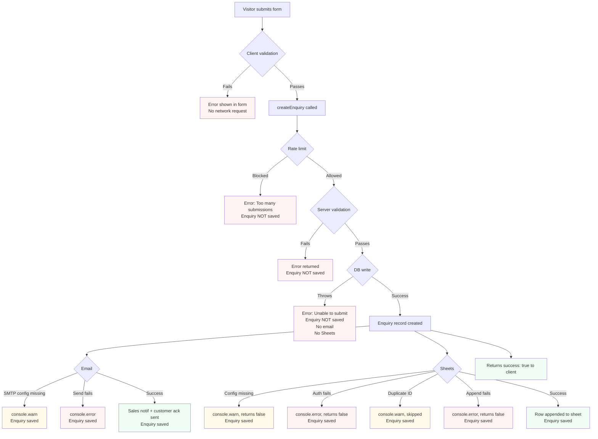
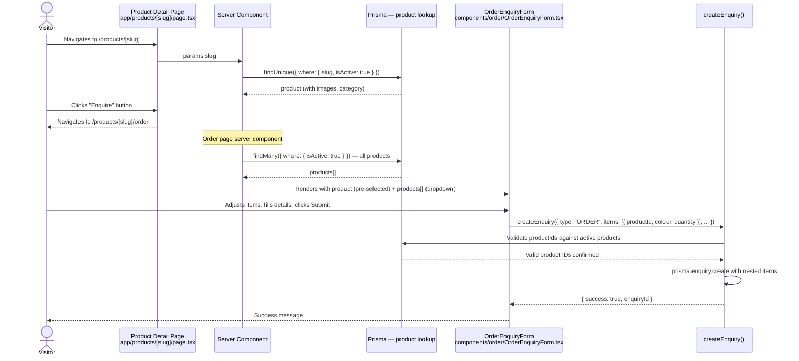
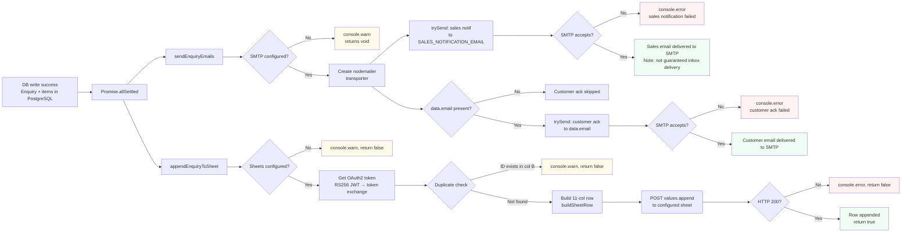

# NexChair — Stage 4: Enquiry Workflow End-to-End

**Document type:** Technical handover reference — enquiry lifecycle  
**Stage:** 4 of N  
**Date:** 2026-11-24  
**Source of truth:** Repository source code — no assumed behaviour  
**Status labels used:** IMPLEMENTED · PARTIALLY IMPLEMENTED · UNVERIFIED · UNUSED/LEGACY · PENDING

---

## Table of Contents

1. [All Enquiry Entry Points](#1-all-enquiry-entry-points)
2. [Complete Form Field Reference](#2-complete-form-field-reference)
3. [Frontend Form Implementation](#3-frontend-form-implementation)
4. [Server Action and Backend Processing](#4-server-action-and-backend-processing)
5. [Rate Limiting](#5-rate-limiting)
6. [Database Storage](#6-database-storage)
7. [Email Notification Workflow](#7-email-notification-workflow)
8. [Google Sheets Integration](#8-google-sheets-integration)
9. [End-to-End Workflow Diagrams](#9-end-to-end-workflow-diagrams)
10. [Admin Portal Connection](#10-admin-portal-connection)
11. [Privacy and Data Handling](#11-privacy-and-data-handling)
12. [Testing and Failure Scenarios](#12-testing-and-failure-scenarios)
13. [Troubleshooting Reference](#13-troubleshooting-reference)
14. [Final Report](#14-final-report)

---

## 1. All Enquiry Entry Points

### 1.1 Inventory

The following table covers every CTA and button across the public website that relates to enquiry or contact behaviour. Each entry is sourced directly from component code.

| Entry point | Page / component | User action | Destination | Creates DB record? | Data passed |
|---|---|---|---|---|---|
| "Request a quote" — Navbar | `components/Navbar.tsx` | Click button | Navigates to `/contact` | No | None |
| "Chat on WhatsApp" — Navbar | `components/Navbar.tsx` | Click button | Opens `wa.me/{number}` in new tab | No | None |
| "Explore the range" — Hero | `components/home/Hero.tsx` | Click `<a>` | Navigates to `/product-range` | No | None |
| "Chat on WhatsApp" — Hero | `components/home/Hero.tsx` | Click `<a>` | Opens `wa.me/{number}` in new tab | No | None |
| "Request a quote" — HomeBottomCTA | `components/home/HomeBottomCTA.tsx` | Click `<Link>` | Navigates to `/contact` | No | None |
| "Enquire" — ProductCard | `components/ProductCard.tsx` | Click `<Link>` | Navigates to `/products/${slug}/order` | No | Slug in URL |
| "WhatsApp" — ProductCard | `components/ProductCard.tsx` | Click `<a>` | Opens `wa.me/{number}` in new tab | No | None |
| "Full specs" — ProductCard | `components/ProductCard.tsx` | Click `<Link>` | Navigates to `/specifications?model=${code}` | No | Product code in URL |
| "Enquire" — Product detail | `app/products/[slug]/page.tsx` | Click `<Link>` | Navigates to `/products/${slug}/order` | No | Slug in URL |
| "Chat on WhatsApp" — Product detail | `app/products/[slug]/page.tsx` | Click `<a>` | Opens `wa.me/{number}` in new tab | No | None |
| Contact form submit | `components/contact/ContactQuoteForm.tsx` | Click "Send enquiry" | Calls `createEnquiry()` Server Action | **Yes** | See Section 2 |
| Order form submit | `components/order/OrderEnquiryForm.tsx` | Click "Submit enquiry" | Calls `createEnquiry()` Server Action | **Yes** | See Section 2 |
| "Chat on WhatsApp" — Contact page | `app/contact/page.tsx` | Click `<a>` | Opens `wa.me/{number}` in new tab | No | None |

### 1.2 Database-creating entry points: exactly two

Only two paths create a `Enquiry` database record:

1. **Contact / Quote form** — `/contact` → `ContactQuoteForm` → `createEnquiry({ type: "CONTACT", ... })`
2. **Product Order form** — `/products/[slug]/order` → `OrderEnquiryForm` → `createEnquiry({ type: "ORDER", ... })`

### 1.3 WhatsApp button implementation

All WhatsApp buttons use the `whatsappHref` constant from `lib/site.ts`:

```typescript
const raw = process.env.NEXT_PUBLIC_WHATSAPP_NUMBER ?? "917798203669";
const digits = raw.replace(/[^\d]/g, "");
export const whatsappHref = `https://wa.me/${digits}`;
```

The number is configurable via `NEXT_PUBLIC_WHATSAPP_NUMBER`. Clicking any WhatsApp button opens WhatsApp directly — no form is submitted and no database record is created.

### 1.4 Unused homepage form components

The following components exist in the codebase but are **not imported in `app/page.tsx`** and therefore never rendered or reachable by visitors. None are active enquiry entry points.

| Component | File | Status | Notes |
|---|---|---|---|
| `QuoteForm` | `components/home/QuoteForm.tsx` | UNUSED/LEGACY | Calls `createEnquiry`. Never rendered |
| `QuoteSection` | `components/home/QuoteSection.tsx` | UNUSED/LEGACY | Wraps `QuoteForm`. Never rendered |
| `Bestsellers` | `components/home/Bestsellers.tsx` | UNUSED/LEGACY | Product display only, no enquiry |
| `SpecsHighlights` | `components/home/SpecsHighlights.tsx` | UNUSED/LEGACY | Commented out in `app/page.tsx` |
| `WhyNexChair` | `components/home/WhyNexChair.tsx` | UNUSED/LEGACY | Static copy, no enquiry |
| `ContactEnquiryForm` | `components/contact/ContactEnquiryForm.tsx` | UNUSED/LEGACY | Alternative form, never imported |

### 1.5 The `QUOTE` enquiry type

The `createEnquiry()` server action accepts three types: `CONTACT`, `QUOTE`, and `ORDER`. The `QUOTE` type is **never submitted** by any currently active form:

- `ContactQuoteForm` hardcodes `type: "CONTACT"`.
- `OrderEnquiryForm` hardcodes `type: "ORDER"`.
- The unused `QuoteForm` and `ContactEnquiryForm` are not rendered.

`QUOTE` is validated and stored correctly if submitted but no live path generates it. The Google Sheets test suite (`lib/__tests__/sheets.test.ts`) includes a QUOTE fixture to verify that free-text messages without structured prefixes are handled correctly.

---

## 2. Complete Form Field Reference

### 2.1 ContactQuoteForm — `/contact`

**Component:** `components/contact/ContactQuoteForm.tsx`  
**Enquiry type submitted:** `"CONTACT"`

| Field | Label | Internal name | Input type | Required | Default | Options | Client validation | Server validation | DB mapping |
|---|---|---|---|---|---|---|---|---|---|
| Name | "Name *" | `name` | `text` | Yes | — | — | Non-empty, trimmed | Non-empty; max 200 chars | `Enquiry.name` |
| Company | "Company" | `company` | `text` | No | — | — | None | Trimmed or null | `Enquiry.company` |
| Phone / WhatsApp | "Phone / WhatsApp *" | `phone` | `tel` | Conditionally | — | — | At least one of phone/email required | Regex `/^[+\d\s\-()\[\]]{7,20}$/` | `Enquiry.phone` and `Enquiry.whatsapp` (identical value) |
| Email | "Email" | `email` | `email` | Conditionally | — | — | At least one of phone/email required | Regex `/^[^\s@]+@[^\s@]+\.[^\s@]+$/` | `Enquiry.email` |
| Model of interest | "Model of interest" | (controlled state) | `select` | No | "Not sure yet" | "Not sure yet", "Ergonomic task", "Executive", "Gaming & streaming", "Visitor & training", "Drafting stools", "Work-from-home" | None | None (packed into `message`) | Packed into `Enquiry.message`; also stored to `Enquiry.preferredContact`† |
| Number of seats | "Number of seats" | (controlled state) | `select` | No | "1–5" | "1–5", "6–20", "21–50", "Custom" | None | None (packed into `message`) | Packed into `Enquiry.message` |
| Custom seats | (shown when seats="Custom") | (controlled state) | `number` | No | — | min=1 | None | None | Packed into `Enquiry.message` as the seats value |
| Anything else? | "Anything else?" | `anything` | `textarea` | No | — | — | None | Max 2000 chars (whole message) | Packed into `Enquiry.message` as "Additional info" |

†**Notable implementation quirk:** `ContactQuoteForm` passes `preferredContact: model` to `createEnquiry()`. The `preferredContact` field in the `Enquiry` table is semantically intended for the customer's preferred contact method (WhatsApp/Phone/Email), but the contact form repurposes it to store the selected model of interest. The model is also independently available in the structured `message` string.

**Message packing:** The form constructs a single structured string before calling `createEnquiry()`:

```
Model of interest: {model}
Number of seats: {seatsValue}
Additional info: {anything}  ← only if non-empty
```

This string is stored in `Enquiry.message`. The email and Sheets integrations reverse-parse it via `parseContactMessage()` to extract the three fields back for display.

**WhatsApp duplication:** The form passes `whatsapp: phone`, setting both `Enquiry.phone` and `Enquiry.whatsapp` to the same phone number. This is a deliberate simplification — the contact form does not ask for a separate WhatsApp number.

### 2.2 OrderEnquiryForm — `/products/[slug]/order`

**Component:** `components/order/OrderEnquiryForm.tsx`  
**Enquiry type submitted:** `"ORDER"`

#### Section 1 — Order type

| Field | Label | Internal name | Input type | Required | Default | Options | Client validation | DB mapping |
|---|---|---|---|---|---|---|---|---|
| Order type | "Who is this order for?" | `orderType` (state) | Radio-style buttons | No | "Business" | "Home", "Business" | None | `Enquiry.orderType` |

#### Section 2 — Chairs (dynamic items array)

| Field | Label | Internal name | Input type | Required | Default | Options | Client validation | DB mapping |
|---|---|---|---|---|---|---|---|---|
| Product | (product name shown) | `productId` (state) | `select` | Yes (at least one item) | Current page product | All active products from server | Unique per row; previously-selected disabled | `EnquiryItem.productId` |
| Colour | — | `colour` (state) | `select` | No | Product's `colour` or "Graphite" | "Graphite", "Black", "Brown" | None | `EnquiryItem.colour` |
| Quantity | — | `quantity` (state) | Stepper (+/−) | Yes (≥1) | 1 | Min 1 (enforced by Math.max) | Min 1 (client enforced) | `EnquiryItem.quantity` |

Multiple items: "Add another model" appends a new item. Items with the same product are prevented via disabled options. Items cannot be reduced below one total (Remove button disabled when only one item).

#### Section 3 — Customer details

| Field | Label | Internal name | Input type | Required | Default | Options | Client validation | Server validation | DB mapping |
|---|---|---|---|---|---|---|---|---|---|
| Full name | "Full name" | `name` | `text` | Yes | — | — | Non-empty | Non-empty; max 200 chars | `Enquiry.name` |
| Mobile / WhatsApp | "Mobile / WhatsApp" | `phone` | `text` | Conditionally | — | — | At least one of phone/email required | Regex `/^[+\d\s\-()\[\]]{7,20}$/` | `Enquiry.phone` and `Enquiry.whatsapp` (identical) |
| Email | "Email" | `email` | `email` | Conditionally | — | — | At least one of phone/email required | Regex `/^[^\s@]+@[^\s@]+\.[^\s@]+$/` | `Enquiry.email` |
| City / pincode | "City / pincode" | `city` | `text` | No | — | — | None | Trimmed or null | `Enquiry.city` |
| Company name | "Company name" | `company` | `text` | No | — | — | None | Trimmed or null | `Enquiry.company` |
| GSTIN | "GSTIN (optional)" | `gstin` | `text` | No | — | — | None | Trimmed or null | `Enquiry.gstin` |
| Needed by | "Needed by" | `neededBy` (state) | `select` | No | "Within 2 weeks" | "Within 2 weeks", "Within 1 month", "Just exploring" | None | Trimmed or null | `Enquiry.neededBy` |
| Preferred contact | "Preferred contact" | `preferredContact` (state) | `select` | No | "WhatsApp" | "WhatsApp", "Phone", "Email" | None | Trimmed or null | `Enquiry.preferredContact` |
| Notes | "Notes" | `message` (state) | `textarea` | No | "" | — | None | Max 2000 chars | `Enquiry.message` |
| Agreement checkbox | "I agree to be contacted…" | `agreed` (state) | `checkbox` | Yes (client only) | false | — | Must be checked | Not checked server-side | Not stored |

**Server-side-only fields (from `createEnquiry` input type):** `pincode`, `orderType`, `whatsapp` are accepted but the form sends them. `pincode` is not collected by the order form (city is used instead); `whatsapp` and `phone` receive the same value.

### 2.3 Field comparison between forms

| Capability | ContactQuoteForm | OrderEnquiryForm |
|---|---|---|
| Enquiry type | CONTACT | ORDER |
| Product items | No | Yes (required) |
| Order type | No | Yes (Home/Business) |
| Model of interest | Yes (dropdown) | Yes (via items) |
| Number of seats / quantity | Yes (dropdown) | Yes (per-item stepper) |
| GSTIN | No | Yes |
| Preferred contact method | No (repurposed for model) | Yes |
| Needed by | No | Yes |
| Notes / free-text | "Anything else?" (packed into message) | "Notes" textarea |
| Agreement checkbox | No | Yes (client-only) |
| City | No | Yes (combined city/pincode field) |

---

## 3. Frontend Form Implementation

### 3.1 ContactQuoteForm

**File:** `components/contact/ContactQuoteForm.tsx`  
**Directive:** `"use client"`  
**React hooks used:** `useState`, `useTransition`, `FormEvent`

**State:**

```typescript
const [model, setModel]             = useState("Not sure yet");   // controlled select
const [seats, setSeats]             = useState("1–5");             // controlled select
const [customSeats, setCustomSeats] = useState("");                // conditional input
const [status, setStatus]           = useState("");                // user-visible message
const [isSuccess, setIsSuccess]     = useState(false);             // controls message colour
const [isPending, startTransition]  = useTransition();             // disables button during submission
```

**Form inputs:** A mix of controlled and uncontrolled. The `name`, `company`, `phone`, `email`, and `anything` inputs are **uncontrolled** — read via `new FormData(form)` on submit. The `model`, `seats`, and `customSeats` fields are **controlled** via state.

**Client-side validation (before calling server):**

1. `name` must not be empty after trimming — sets `status` and returns early.
2. At least one of `email` or `phone` must be non-empty — sets `status` and returns early.

If validation passes, `status` is cleared and `startTransition` is called.

**Message construction (pre-call transformation):**

```typescript
const seatsValue = seats === "Custom"
  ? (customSeats.trim() || "Custom")
  : seats;

const message = [
  `Model of interest: ${model}`,
  `Number of seats: ${seatsValue}`,
  anything ? `Additional info: ${anything}` : "",
].filter(Boolean).join("\n");
```

This structured message is the sole vehicle for model and seats data into the database (see Section 2.1 for the db mapping detail).

**Server Action call:**

```typescript
startTransition(async () => {
  const result = await createEnquiry({
    type: "CONTACT",
    name, company, phone,
    whatsapp: phone,       // phone doubled as whatsapp
    email,
    preferredContact: model,  // model repurposed here
    message,
  });
  setStatus(result.message);
  setIsSuccess(result.success);
  if (result.success) {
    form.reset();
    setModel("Not sure yet");
    setSeats("1–5");
    setCustomSeats("");
  }
});
```

**Loading state:** `disabled={isPending}`. Button text changes from "Send enquiry" (with arrow icon) to "Sending…". The button uses `disabled:opacity-60 disabled:cursor-not-allowed`.

**Duplicate-click prevention:** `useTransition` keeps `isPending` true for the duration of the server action. The button is disabled during this time, preventing double-submit.

**Success state:** `form.reset()` clears uncontrolled inputs; controlled state is manually reset. A green-tinted `<p>` with the server's `result.message` is shown.

**Error state:** A red-tinted `<p>` with the error message is shown. The form is not reset.

**Navigation after submission:** None — the form stays on the contact page.

### 3.2 OrderEnquiryForm

**File:** `components/order/OrderEnquiryForm.tsx`  
**Directive:** `"use client"`  
**React hooks used:** `useState`, `useTransition`, `FormEvent`

**Props received:**

```typescript
type OrderEnquiryFormProps = {
  product: Product;    // the current product (pre-selected)
  products: Product[]; // all active products (for the select dropdown)
};
```

**State:**

```typescript
const [orderType, setOrderType]           = useState("Business");
const [items, setItems]                   = useState<SelectedItem[]>([initialItem]);
const [preferredContact, setPreferredContact] = useState("WhatsApp");
const [neededBy, setNeededBy]             = useState("Within 2 weeks");
const [agreed, setAgreed]                 = useState(false);
const [message, setMessage]               = useState(""); // notes textarea
const [status, setStatus]                 = useState(""); // user-visible message
const [isPending, startTransition]        = useTransition();
```

The initial item is derived from the `product` prop: `{ productId: product.id, name, code, price, colour: product.colour ?? "Graphite", quantity: 1 }`.

**Form inputs:** Most customer-detail inputs are **uncontrolled** (read via `FormData`). Order type, items array, neededBy, preferredContact, agreed, and notes are **controlled** via state.

**Items management:**

- `addAnotherModel()` — finds the first product not yet in items, appends it.
- `removeModel(index)` — removes an item (blocked when only one remains).
- `handleProductChange(index, productId)` — replaces item at index with selected product data.
- `updateItem(index, updates)` — partial update to any item field (colour, quantity).

The items array cannot be empty (Remove blocked at one item) but the server independently validates `items.length > 0` is not checked — the server allows empty items arrays for non-ORDER types.

**Client-side validation:**

1. `name` required.
2. At least one of `email` or `phone` required.
3. `agreed` must be `true`.
4. `items.length === 0` check (practically unreachable due to Remove guard).

**Server Action call:**

```typescript
startTransition(async () => {
  const result = await createEnquiry({
    type: "ORDER",
    name, email, phone,
    whatsapp: phone,     // phone doubled as whatsapp
    company, gstin, city,
    orderType,
    preferredContact,
    neededBy,
    message,             // the notes textarea
    items: items.map(item => ({
      productId: item.productId,
      colour: item.colour,
      quantity: item.quantity,
    })),
  });
  setStatus(result.message);
  if (result.success) {
    form.reset();
    setItems([initialItem]);
    setOrderType("Business");
    setPreferredContact("WhatsApp");
    setNeededBy("Within 2 weeks");
    setAgreed(false);
    setMessage("");
  }
});
```

**Loading state:** `disabled={isPending}`. Button text changes from "Submit enquiry" to "Submitting...".

**Success state:** Controlled state is reset manually; `form.reset()` clears uncontrolled inputs. Status message shown — no colour differentiation (plain `text-black/60`).

**Navigation after submission:** None — stays on the order page.

**Enquiry summary sidebar:** The right column shows a live summary of the current items, order type, total chairs, and "Pricing: On request". This is purely cosmetic — it reads from local state and does not affect submission.

---

## 4. Server Action and Backend Processing

### 4.1 Server Action

**File:** `app/actions/enquiries.ts`  
**Directive:** `"use server"`  
**Exported function:** `createEnquiry(input: CreateEnquiryInput): Promise<{ success: boolean; message: string; enquiryId?: string }>`

### 4.2 Input type

```typescript
export type CreateEnquiryInput = {
  type: "CONTACT" | "QUOTE" | "ORDER";
  name: string;
  email?: string;
  phone?: string;
  whatsapp?: string;
  company?: string;
  gstin?: string;
  city?: string;
  pincode?: string;
  orderType?: string;
  preferredContact?: string;
  neededBy?: string;
  message?: string;
  items?: {
    productId: string;
    colour?: string;
    quantity: number;
  }[];
};
```

No schema-validation library is used. All validation is manual regex and length checks.

### 4.3 Execution sequence

| Step | Operation | Location | Success result | Failure result |
|---|---|---|---|---|
| 1 | Rate limit check | `checkEnquiryRateLimit()` in `lib/ratelimit.ts` | `rl.allowed === true` | `{ success: false, message: "Too many submissions. Please try again in N seconds." }` |
| 2 | Enquiry type validation | Inline — `VALID_TYPES.has(input.type)` | Type is CONTACT, QUOTE, or ORDER | `{ success: false, message: "Invalid enquiry type." }` |
| 3 | Name validation | Inline — `name.trim()` non-empty, `name.length ≤ 200` | Valid name | `{ success: false, message: "Name is required." }` or length error |
| 4 | Contact validation | Inline — at least one of email or phone non-empty | Passes | `{ success: false, message: "Email or mobile number is required." }` |
| 5 | Email format | Inline — `EMAIL_RE` regex if email provided | Valid format or skipped | `{ success: false, message: "Please enter a valid email address." }` |
| 6 | Phone format | Inline — `PHONE_RE` regex if phone provided | Valid format or skipped | `{ success: false, message: "Please enter a valid phone number." }` |
| 7 | Message length | Inline — `message.length ≤ 2000` | Passes | `{ success: false, message: "Message must be 2000 characters or fewer." }` |
| 8 | Items count | Inline — `items.length ≤ 50` | Passes | `{ success: false, message: "Too many items in a single enquiry." }` |
| 9 | Item quantity | Inline — each item `quantity ≥ 1` and is an integer | Passes | `{ success: false, message: "Quantity must be at least 1." }` |
| 10 | Product ID validation | `prisma.product.findMany({ where: { id: { in: productIds }, isActive: true } })` | All product IDs found and active | `{ success: false, message: "One or more selected products are unavailable." }` |
| 11 | Database write | `prisma.enquiry.create(...)` with nested `items.create` | Enquiry + items created | `{ success: false, message: "Unable to submit enquiry right now." }` |
| 12 | Email + Sheets (concurrent) | `Promise.allSettled([sendEnquiryEmails(...), appendEnquiryToSheet(...)])` | Both fire; failures logged | Failures do NOT affect return value |
| 13 | Return success | — | `{ success: true, message: "Enquiry submitted successfully.", enquiryId }` | — |

**Key ordering notes:**

- Rate limiting (step 1) runs **before** all validation. This prevents throttled callers from distinguishing error types through repeated probing.
- Product ID validation (step 10) is **skipped entirely** when `items` is empty or absent — no Prisma query runs.
- Steps 1–10 all run **before** the database write (step 11). If any fails, no DB record is created.
- Steps 12–13 run **after** the database write. Email and Sheets failures cannot prevent a successful return once the DB write succeeds.

### 4.4 Regex patterns

```typescript
const EMAIL_RE = /^[^\s@]+@[^\s@]+\.[^\s@]+$/;
const PHONE_RE = /^[+\d\s\-()\[\]]{7,20}$/;
```

The email regex is a minimal format check — it does not verify domain existence. The phone regex allows international formats (`+91 77982 03669`), extensions with parentheses, and a 7–20 character range.

### 4.5 Return value shape

On success:
```typescript
{ success: true, message: "Enquiry submitted successfully.", enquiryId: "cuid..." }
```

On failure (any step):
```typescript
{ success: false, message: "<specific error message>" }
```

The `enquiryId` is only present on success. Both frontend forms test `result.success` before resetting.

---

## 5. Rate Limiting

### 5.1 Implementation

**File:** `lib/ratelimit.ts`  
**Library:** `@upstash/ratelimit` + `@upstash/redis`  
**Algorithm:** Sliding window

The module exports two distinct limiters with different configurations and fail-modes.

### 5.2 Enquiry rate limiter

**Function:** `checkEnquiryRateLimit()`  
**Limit:** 5 requests per 10-minute sliding window  
**Key:** `nexchair:rl:enquiry:{clientIp}`  
**Fail mode:** Fail-OPEN

```typescript
export async function checkEnquiryRateLimit(): Promise<RateLimitResult> {
  const ip = await getClientIp();
  return applyLimit(`enquiry:${ip}`, 5, "10 m", "open");
}
```

Rationale (from code comment): real users rarely send more than 1–2 enquiries per session; 5/10 min accommodates retries without enabling inbox flooding.

### 5.3 Admin login rate limiter

**Function:** `checkLoginRateLimit(email)`  
**Limit:** 5 attempts per 15-minute sliding window  
**Key:** `nexchair:rl:login:{clientIp}:{email.toLowerCase()}`  
**Fail mode:** Fail-CLOSED

Rationale: brute force needs thousands of attempts; 5/15 min stops that while allowing a legitimate admin enough retries. The email is lowercased before inclusion in the key.

### 5.4 IP extraction

```typescript
export async function getClientIp(): Promise<string> {
  const h = await headers();
  const realIp = h.get("x-real-ip");
  if (realIp) return realIp.trim();
  const forwarded = h.get("x-forwarded-for");
  if (forwarded) return forwarded.split(",")[0].trim();
  return "unknown";
}
```

Priority: `x-real-ip` (Vercel-injected, non-spoofable) → first segment of `x-forwarded-for` → `"unknown"`. The `x-real-ip` header is set by Vercel's edge layer and cannot be overridden by a client, making it safe to use as the rate-limit key on Vercel deployments.

### 5.5 Environment variables required

| Variable | Purpose |
|---|---|
| `UPSTASH_REDIS_REST_URL` | Upstash Redis REST endpoint URL |
| `UPSTASH_REDIS_REST_TOKEN` | Upstash Redis REST authentication token |

Both are required. The absence of either variable triggers different behaviour depending on context.

### 5.6 Behaviour matrix

| Condition | Enquiry limiter (fail-open) | Login limiter (fail-closed) |
|---|---|---|
| Development (`NODE_ENV !== "production"`) + no credentials | `{ allowed: true }` + `console.warn("[ratelimit] WARNING: … rate limiting is DISABLED")` | Same — `{ allowed: true }` with warning |
| Production + no credentials | `{ allowed: true }` + `console.error("[ratelimit] CRITICAL: Upstash credentials missing …")` — **allows all requests** | `{ allowed: false }` + `console.error("[ratelimit] CRITICAL: … Blocking request as a fail-safe.")` — **blocks all login attempts** |
| Upstash responds, limit not exceeded | `{ allowed: true }` | `{ allowed: true }` |
| Upstash responds, limit exceeded | `{ allowed: false, retryAfterSeconds: N }` | `{ allowed: false, retryAfterSeconds: N }` |
| Upstash throws (network error etc.) | `{ allowed: true }` + `console.error` — **fail-open** | `{ allowed: true }` + `console.error` — also fail-open on runtime errors† |

†Note: Upstash runtime errors (network timeout etc.) always fail-open for both limiters regardless of the `onMisconfigured` setting, because the `catch` block at the bottom of `applyLimit()` returns `{ allowed: true }`. The `onMisconfigured` parameter only controls behaviour when credentials are **absent**; it does not affect what happens when credentials exist but Upstash is temporarily unavailable.

### 5.7 What the visitor sees

When rate limited:
```
Too many submissions. Please try again in {retryAfterSeconds} seconds.
```
If `retryAfterSeconds` is not provided by Upstash, the message defaults to 60 seconds. The error is shown as a red status message below the submit button.

### 5.8 Redis key prefix

All keys are stored with the prefix `nexchair:rl` as configured in the `Ratelimit` constructor:
```typescript
const limiter = new Ratelimit({
  redis: Redis.fromEnv(),
  limiter: Ratelimit.slidingWindow(max, window),
  prefix: "nexchair:rl",
});
```

---

## 6. Database Storage

### 6.1 Models involved

Two models are written during enquiry creation:

- **`Enquiry`** — one record per submission
- **`EnquiryItem`** — zero or more records per submission (ORDER enquiries have items; CONTACT enquiries do not)

### 6.2 Prisma create operation

```typescript
const enquiry = await prisma.enquiry.create({
  data: {
    type: input.type,
    name: input.name.trim(),
    email: input.email?.trim() || null,
    phone: input.phone?.trim() || null,
    whatsapp: input.whatsapp?.trim() || null,
    company: input.company?.trim() || null,
    gstin: input.gstin?.trim() || null,
    city: input.city?.trim() || null,
    pincode: input.pincode?.trim() || null,
    orderType: input.orderType?.trim() || null,
    preferredContact: input.preferredContact?.trim() || null,
    neededBy: input.neededBy?.trim() || null,
    message: input.message?.trim() || null,
    items: input.items?.length
      ? {
          create: input.items.map(item => ({
            productId: item.productId,
            colour: item.colour?.trim() || null,
            quantity: item.quantity,
          })),
        }
      : undefined,
  },
  include: {
    items: {
      include: {
        product: { select: { name: true, code: true } },
      },
    },
  },
});
```

The `include` is for immediate use in email/Sheets notifications — it avoids a second round-trip to fetch product names.

### 6.3 Fields written at creation

| Field | Source | Stored as null when |
|---|---|---|
| `id` | Auto-generated CUID | Never (always set) |
| `type` | `input.type` | Never |
| `status` | Default `"NEW"` (schema default) | Never |
| `name` | `input.name.trim()` | Never (required) |
| `email` | `input.email?.trim()` | Input empty or missing |
| `phone` | `input.phone?.trim()` | Input empty or missing |
| `whatsapp` | `input.whatsapp?.trim()` | Input empty or missing |
| `company` | `input.company?.trim()` | Input empty or missing |
| `gstin` | `input.gstin?.trim()` | Input empty or missing |
| `city` | `input.city?.trim()` | Input empty or missing |
| `pincode` | `input.pincode?.trim()` | Input empty or missing |
| `orderType` | `input.orderType?.trim()` | Input empty or missing |
| `preferredContact` | `input.preferredContact?.trim()` | Input empty or missing |
| `neededBy` | `input.neededBy?.trim()` | Input empty or missing |
| `message` | `input.message?.trim()` | Input empty or missing |
| `adminNotes` | Not set at creation | Always null initially |
| `createdAt` | Auto-set by Prisma | Never |
| `updatedAt` | Auto-set by Prisma | Never |

### 6.4 EnquiryItem fields written

| Field | Source | Notes |
|---|---|---|
| `id` | Auto-generated CUID | — |
| `enquiryId` | Parent enquiry (via nested create) | — |
| `productId` | `item.productId` | Validated against active products before DB write |
| `colour` | `item.colour?.trim()` or null | Optional |
| `quantity` | `item.quantity` | Integer ≥1, validated before DB write |
| `createdAt` | Auto-set by Prisma | — |
| `updatedAt` | Auto-set by Prisma | — |

### 6.5 Database operation: single non-transactional write

The `prisma.enquiry.create` with nested `items.create` is a **single Prisma operation** that writes the parent record and all child items atomically. It is not wrapped in a `$transaction` block, but Prisma's nested create guarantees the parent–child relationship is correct.

### 6.6 Duplicate enquiry behaviour

There is **no application-level duplicate prevention** for enquiries. If a visitor submits the same form twice:
- Both submissions pass rate-limit checks (5 submissions per 10 minutes are allowed).
- Both create separate `Enquiry` records with different CUIDs.
- Both trigger email and Sheets integrations.

The only anti-duplicate mechanism is in Google Sheets: `appendEnquiryToSheet()` performs a pre-append lookup on column B to skip records whose `enquiryId` already appears in the sheet. This prevents duplicate Sheets rows if the function is called twice with the same enquiry (e.g., due to a retry), but it does not prevent two separate enquiry submissions from the same visitor.

### 6.7 Database insertion failure handling

If `prisma.enquiry.create` throws:
1. The `catch` block at lines 204–209 of `enquiries.ts` catches the error.
2. `console.error("Failed to create enquiry:", error)` is logged.
3. `{ success: false, message: "Unable to submit enquiry right now." }` is returned to the client.
4. No email is sent. No Sheets row is written.

The form shows the generic error message. No partial state is saved.

---

## 7. Email Notification Workflow

### 7.1 Overview

**File:** `lib/email.ts`  
**Library:** `nodemailer`  
**Guard:** `import "server-only"` — cannot be imported in client components

`sendEnquiryEmails()` sends up to two emails after every successful DB write:

1. **Sales notification** — always sent (if SMTP is configured)
2. **Customer acknowledgement** — sent only if the enquiry includes an email address

### 7.2 When emails are triggered

```typescript
// In app/actions/enquiries.ts, after prisma.enquiry.create succeeds:
await Promise.allSettled([
  sendEnquiryEmails({ ... }),
  appendEnquiryToSheet({ ... }),
]);
```

Both fire **concurrently** after the DB write. `sendEnquiryEmails()` and `appendEnquiryToSheet()` are independent — either can fail without affecting the other.

`sendEnquiryEmails()` itself launches two `trySend()` calls via its own `Promise.allSettled`:

```typescript
const sends: Promise<void>[] = [];
sends.push(trySend(transporter, salesPayload, "sales notification"));
if (data.email) {
  sends.push(trySend(transporter, customerPayload, "customer acknowledgement"));
}
await Promise.allSettled(sends);
```

### 7.3 Sales notification

| Attribute | Value |
|---|---|
| Recipient | `SALES_NOTIFICATION_EMAIL` env var; falls back to `ADMIN_EMAIL` if `SALES_NOTIFICATION_EMAIL` is absent |
| Subject | `New Website Enquiry from {name} – NexChair` |
| Sender | `EMAIL_FROM` env var |
| Content | HTML table with all non-null enquiry fields; product items table if ORDER; admin panel link if `APP_URL` is set |
| Triggered by | Every successful enquiry DB write |
| Conditional fields | `phone/whatsapp` shown as one field; if phone ≠ whatsapp, shown as "phone (WhatsApp: whatsapp)"; fields with null values are omitted |

**Message parsing for CONTACT/QUOTE enquiries:** The sales notification calls `parseContactMessage()` to extract model of interest, number of seats, and additional info from the structured message field, displaying them as separate labelled rows. For ORDER enquiries, the parsed fields are skipped and the product items table is used instead.

**Admin panel link:** If `APP_URL` env var is set, the notification includes a "View in admin panel →" hyperlink:
```
{APP_URL}/admin/enquiries/{enquiryId}
```
If `APP_URL` is not set, the raw `enquiryId` is shown instead.

### 7.4 Customer acknowledgement

| Attribute | Value |
|---|---|
| Recipient | `enquiry.email` — the customer's email address |
| Triggered by | Only when `data.email` is non-null |
| Subject | `We've received your enquiry — NexChair` |
| Sender | `EMAIL_FROM` env var |
| Content | Brief acknowledgement with customer's name, enquiry type label, and 8-character reference code (first 8 chars of `enquiryId` uppercased) |
| When skipped | Customer provided phone only (no email) |

The customer email does not include product details, pricing, or any other business-sensitive information.

### 7.5 HTML templates

**Sales notification template** (`buildInternalHtml()`):
- Font: system font stack
- Brand colour `#0E3159` for heading, table header border
- Rows built by `buildRow(label, value)` — omits rows where value is null
- Product items as a separate `<table>` section (ORDER only)
- Notes in a separate `<pre>` block (ORDER only, when message is set)

**Customer acknowledgement template** (`buildCustomerHtml()`):
- Minimal HTML, no inline brand colours beyond grey
- Reference code: `enquiryId.slice(0, 8).toUpperCase()`
- Includes enquiry type label (e.g., "contact" / "quote request" / "order enquiry")

### 7.6 SMTP configuration

| Env var | Required | Default | Purpose |
|---|---|---|---|
| `SMTP_HOST` | Yes | — | SMTP server hostname |
| `SMTP_PORT` | No | `465` | SMTP port number |
| `SMTP_SECURE` | No | `true` when port=465, else `false` | Whether to use SSL (`true`) or STARTTLS (`false`) |
| `SMTP_USER` | Yes | — | SMTP authentication username |
| `SMTP_PASSWORD` | Yes | — | SMTP authentication password |
| `EMAIL_FROM` | Yes | — | Sender address in `"Name <address>"` format |
| `SALES_NOTIFICATION_EMAIL` | Conditionally | Falls back to `ADMIN_EMAIL` | Recipient of sales notifications |
| `ADMIN_EMAIL` | Conditionally | — | Fallback recipient if `SALES_NOTIFICATION_EMAIL` absent |
| `APP_URL` | No | — | Base URL for admin panel links in notification emails |

**Minimum required:** `SMTP_HOST`, `SMTP_USER`, `SMTP_PASSWORD`, `EMAIL_FROM`, plus at least one of `SALES_NOTIFICATION_EMAIL` or `ADMIN_EMAIL`.

**Configuration check:** `isEmailConfigured()` returns `false` if any required variable is absent. When false, `sendEnquiryEmails()` logs a `console.warn` and returns without calling nodemailer.

**Transporter creation:** A new nodemailer transporter is created on every call to `sendEnquiryEmails()` — there is no singleton transporter. This is intentional for testability (env vars are read at call time).

### 7.7 Failure handling

**Function-level failure handling** (`trySend`):
```typescript
async function trySend(transporter, payload, label): Promise<void> {
  try {
    await transporter.sendMail(payload);
  } catch (err) {
    console.error(`[email] ${label} failed:`, err);
  }
}
```

Each send is wrapped individually. A failure logs the error and returns without throwing. The outer `Promise.allSettled` in `sendEnquiryEmails()` additionally catches any unexpected errors.

| Failure scenario | Behaviour |
|---|---|
| `SMTP_HOST` missing | `console.warn` with "Notifications skipped"; returns immediately without calling nodemailer |
| Any required env var missing | Same as above |
| SMTP authentication failure | `transporter.sendMail` rejects; caught by `trySend`; `console.error("[email] sales notification failed:", err)` |
| Connection timeout | Same — `transporter.sendMail` rejects; logged |
| Invalid recipient | Depends on SMTP provider — most accept the message and bounce separately; `transporter.sendMail` resolves with the provider's response object |
| Customer email fails, sales email succeeds | Customer error logged; sales notification is unaffected |
| Sales email fails, customer email succeeds | Sales error logged; customer acknowledgement is unaffected |
| Both emails fail | Both errors logged; enquiry record is already saved |

**No retries are implemented.** Failed emails are logged and silently discarded.

**SMTP acceptance is not inbox delivery.** When `transporter.sendMail()` resolves, it means the SMTP server accepted the message for delivery — not that the recipient's inbox received it. Bounces, spam filtering, and delivery failures happen asynchronously and are not visible to the application.

---

## 8. Google Sheets Integration

### 8.1 Overview

**File:** `lib/sheets.ts`  
**Guard:** `import "server-only"`  
**Authentication:** Service account JWT, generated per-call using `jose` (RS256, 1-hour expiry)  
**API:** Google Sheets v4 REST API (fetch, not googleapis SDK)

### 8.2 Execution flow

1. Check all 4 required env vars — return `false` if any absent.
2. Generate a service account JWT and exchange it for an OAuth2 access token via `https://oauth2.googleapis.com/token`.
3. Run duplicate guard: fetch column B from the sheet and check whether the `enquiryId` already appears.
4. If duplicate found: log warning, return `false`.
5. Build the 11-column row using `buildSheetRow()`.
6. Append row via the Sheets API `values.append` endpoint.
7. Return `true` on success, `false` on any caught error.

### 8.3 Column mapping (A–K)

| Column | Index | Header | Source field | Transformation |
|---|---|---|---|---|
| A | 0 | Submission Date & Time | `data.createdAt` | `en-IN` locale, `Asia/Kolkata` timezone, `dateStyle:"long"`, `timeStyle:"short"` (e.g., "15 January 2024 at 10:30 am") |
| B | 1 | Lead ID | `data.enquiryId` | Raw CUID string |
| C | 2 | Enquiry Type | `data.type` | Raw enum: "CONTACT", "QUOTE", or "ORDER" |
| D | 3 | Customer Name | `data.name` | Raw string |
| E | 4 | Company Name | `data.company` | `data.company ?? ""` — empty string when null |
| F | 5 | Phone / WhatsApp | `data.phone` or `data.whatsapp` | `data.phone ?? data.whatsapp ?? ""` — prefers phone, falls back to whatsapp |
| G | 6 | Email | `data.email` | `data.email ?? ""` — empty string when null |
| H | 7 | Model of Interest | Derived (see below) | — |
| I | 8 | Number of Seats | Derived (see below) | — |
| J | 9 | Additional Requirements | Derived (see below) | — |
| K | 10 | Lead Source | Hardcoded | Always `"Website"` |

**Column H–J derivation by enquiry type:**

For **CONTACT and QUOTE** enquiries:
- The structured `message` string is parsed via `parseContactMessage()`.
- Column H ← `"Model of interest: X"` prefix value, or `""` if absent.
- Column I ← `"Number of seats: Y"` prefix value, or `""` if absent.
- Column J ← `"Additional info: Z"` prefix value, plus any unprefixed lines, or `""`.

For **ORDER** enquiries:
- Column H ← product names joined with `"; "` (e.g., "ErgoMax Pro; TaskPro Chair").
- Column I ← sum of all item quantities as a string (e.g., "3").
- Column J ← each item formatted as `"{name} ({code}){ – colour} × {qty}"`, one per line, plus `data.message` appended if non-null.

### 8.4 JWT and OAuth2 authentication

```typescript
async function getAccessToken(rawPrivateKey, clientEmail): Promise<string> {
  const pem = rawPrivateKey.replace(/\\n/g, "\n"); // handle Vercel escaped newlines
  const privateKey = await importPKCS8(pem, "RS256");

  const jwt = await new SignJWT({
    scope: "https://www.googleapis.com/auth/spreadsheets",
  })
    .setProtectedHeader({ alg: "RS256", typ: "JWT" })
    .setIssuer(clientEmail)
    .setSubject(clientEmail)
    .setAudience("https://oauth2.googleapis.com/token")
    .setIssuedAt()
    .setExpirationTime("1h")
    .sign(privateKey);

  const res = await fetch("https://oauth2.googleapis.com/token", {
    method: "POST",
    headers: { "Content-Type": "application/x-www-form-urlencoded" },
    body: new URLSearchParams({
      grant_type: "urn:ietf:params:oauth:grant-type:jwt-bearer",
      assertion: jwt,
    }),
  });
  // ...
}
```

A new access token is obtained on every `appendEnquiryToSheet()` call — there is no token caching. Tokens are valid for 1 hour per the JWT expiry, but the token is not reused across calls.

### 8.5 Duplicate guard implementation

```typescript
async function enquiryAlreadySynced(
  accessToken, spreadsheetId, sheetName, enquiryId
): Promise<boolean> {
  const range = encodeURIComponent(`'${sheetName}'!B:B`);
  const url = `https://sheets.googleapis.com/v4/spreadsheets/${spreadsheetId}/values/${range}`;
  try {
    const res = await fetch(url, { headers: { Authorization: `Bearer ${accessToken}` } });
    if (!res.ok) return false; // fail open
    const data = await res.json();
    return (data.values ?? []).flat().includes(enquiryId);
  } catch {
    return false; // fail open
  }
}
```

The duplicate guard **fails open**: if the lookup fails (network error, 4xx, 5xx), it returns `false` and allows the append to proceed. This prevents a lookup failure from blocking legitimate rows.

### 8.6 Append API call

```
POST https://sheets.googleapis.com/v4/spreadsheets/{spreadsheetId}/values/{sheetName}!A:K:append
  ?valueInputOption=USER_ENTERED
  &insertDataOption=INSERT_ROWS
```

`valueInputOption=USER_ENTERED` allows Google Sheets to interpret dates and numbers, not store them as raw strings. `insertDataOption=INSERT_ROWS` inserts a new row rather than overwriting.

### 8.7 Environment variables required

| Variable | Required | Purpose |
|---|---|---|
| `GOOGLE_SHEETS_SPREADSHEET_ID` | Yes | Spreadsheet ID from the URL (`/spreadsheets/d/{ID}/`) |
| `GOOGLE_SHEETS_SHEET_NAME` | Yes | Exact worksheet tab name (e.g., `"Website Enquiries"`) |
| `GOOGLE_SERVICE_ACCOUNT_EMAIL` | Yes | Service account email (e.g., `sa@project.iam.gserviceaccount.com`) |
| `GOOGLE_PRIVATE_KEY` | Yes | RSA private key in PKCS8 PEM format; `\\n` escaping handled automatically |

**Configuration check:** `isSheetsConfigured()` returns `false` if any variable is absent. When false, `appendEnquiryToSheet()` logs `console.warn("[sheets] Skipped — …")` and returns `false`.

### 8.8 Return value and logging

`appendEnquiryToSheet()` returns a `Promise<boolean>`:
- `true` — row successfully appended
- `false` — any failure condition (config missing, auth failure, duplicate, API error)

The return value is inspected by the calling code in `enquiries.ts`:
```typescript
if (sheetsResult.status === "fulfilled" && !sheetsResult.value) {
  console.warn(`[enquiry] Google Sheets row not written for enquiry ${enquiry.id}. ...`);
}
```

This `console.warn` in `enquiries.ts` is in addition to the per-failure `console.error` inside `sheets.ts`. Both are logged; neither affects the return value to the client.

### 8.9 Private key safety in logs

Error messages are sanitised before logging:
```typescript
const safe = msg
  .replace(/-----BEGIN[\s\S]*?-----END[^\n]*-----/g, "[REDACTED]")
  .replace(/PRIVATE\s+KEY/gi, "[REDACTED]");
console.error(`[sheets] Failed to append enquiry ${data.enquiryId}: ${safe}`);
```

PEM blocks and the phrase "PRIVATE KEY" are replaced with `[REDACTED]`.

### 8.10 Failure handling

| Failure scenario | Behaviour |
|---|---|
| Any env var missing | `console.warn("[sheets] Skipped — …")`, returns `false` |
| Token exchange fails (HTTP 4xx/5xx) | Throws inside `getAccessToken`, caught by outer try/catch, logged, returns `false` |
| Token exchange returns no access_token | Same — throws, caught, logged, returns `false` |
| Duplicate guard lookup fails | Fails open — proceeds with append |
| Duplicate ID found in column B | `console.warn("[sheets] Skipped duplicate — …")`, returns `false` |
| Append request fails (HTTP 4xx/5xx) | `appendRow` throws, caught by outer try/catch, logged, returns `false` |
| Network timeout | Caught by outer try/catch, logged, returns `false` |
| API quota exceeded (HTTP 429) | Treated same as other HTTP errors; no retry |
| Wrong sheet name | Sheets API returns 400 or 404; caught and logged |
| Service account lacks permission | Sheets API returns 403 PERMISSION_DENIED; caught and logged |

**No retries are implemented.** One attempt per enquiry.

---

## 9. End-to-End Workflow Diagrams

### Diagram A: General enquiry submission flow

```mermaid
sequenceDiagram
    actor Visitor
    participant Form as Frontend Form<br/>(ContactQuoteForm / OrderEnquiryForm)
    participant SA as createEnquiry()<br/>app/actions/enquiries.ts
    participant RL as checkEnquiryRateLimit()<br/>lib/ratelimit.ts
    participant DB as prisma.enquiry.create()<br/>PostgreSQL
    participant Email as sendEnquiryEmails()<br/>lib/email.ts
    participant Sheets as appendEnquiryToSheet()<br/>lib/sheets.ts

    Visitor->>Form: Fills form and clicks Submit
    Form->>Form: Client validation (name, email/phone)
    alt Client validation fails
        Form-->>Visitor: Inline error message; form not submitted
    else Client validation passes
        Form->>Form: startTransition — isPending=true; button disabled
        Form->>SA: createEnquiry(input)
        SA->>RL: checkEnquiryRateLimit()
        RL-->>SA: { allowed: boolean, retryAfterSeconds? }
        alt Rate limit exceeded
            SA-->>Form: { success: false, message: "Too many submissions..." }
            Form-->>Visitor: Error message shown
        else Rate limit passes
            SA->>SA: Validate type, name, email/phone, message, items
            alt Server validation fails
                SA-->>Form: { success: false, message: "<specific error>" }
                Form-->>Visitor: Error message shown
            else Server validation passes
                SA->>DB: prisma.enquiry.create(...)
                alt DB write fails
                    DB-->>SA: Throws error
                    SA-->>Form: { success: false, message: "Unable to submit..." }
                    Form-->>Visitor: Error message shown
                else DB write succeeds
                    DB-->>SA: enquiry record (with items)
                    SA->>SA: Promise.allSettled([email, sheets])
                    par Email
                        SA->>Email: sendEnquiryEmails(...)
                        Email-->>SA: resolves (never throws)
                    and Sheets
                        SA->>Sheets: appendEnquiryToSheet(...)
                        Sheets-->>SA: boolean (never throws)
                    end
                    SA-->>Form: { success: true, message: "...", enquiryId }
                    Form->>Form: form.reset(); isPending=false
                    Form-->>Visitor: Green success message
                end
            end
        end
    end
```

### Diagram B: Failure scenario paths



**Key distinction:** Failures at steps above the DB write prevent enquiry storage. Failures at email and Sheets occur after the DB write succeeds — the enquiry is saved regardless.

### Diagram C: Product-specific ORDER enquiry flow



### Diagram D: Notification flow



---

## 10. Admin Portal Connection

### 10.1 Admin enquiry routes

| Route | File | Description |
|---|---|---|
| `/admin/enquiries` | `app/admin/(protected)/enquiries/page.tsx` | Paginated enquiry list with filtering and search |
| `/admin/enquiries/[id]` | `app/admin/(protected)/enquiries/[id]/page.tsx` | Full enquiry detail with status and notes management |

Both routes are inside the `(protected)` route group, which requires a valid admin session via `requireAdminSession()` on every page load.

### 10.2 Server Actions used

| Action | File | Purpose |
|---|---|---|
| `getEnquiries(opts)` | `app/actions/admin-enquiries.ts` | Paginated list; filterable by `status`, `type`; searchable across `name`, `company`, `email`, `phone` |
| `getEnquiry(id)` | `app/actions/admin-enquiries.ts` | Full detail including all fields and joined items with product names |
| `updateEnquiryStatus(_prev, formData)` | `app/actions/admin-enquiries.ts` | Change status to NEW, CONTACTED, or CLOSED |
| `updateEnquiryNotes(_prev, formData)` | `app/actions/admin-enquiries.ts` | Write/clear `adminNotes`; truncated to 2000 chars; never shown to customers |

### 10.3 List view — `getEnquiries()`

```typescript
const [rows, total] = await prisma.$transaction([
  prisma.enquiry.findMany({
    where, // status, type, search filters
    select: {
      id, type, status, name, company, email, phone, city,
      _count: { select: { items: true } },
      createdAt,
    },
    orderBy: { createdAt: "desc" },
    skip, take: 20, // PAGE_SIZE = 20
  }),
  prisma.enquiry.count({ where }),
]);
```

Fields visible in list view: id, type, status, name, company, email, phone, city, item count, createdAt. Fields NOT visible in list: whatsapp, gstin, pincode, orderType, preferredContact, neededBy, message, adminNotes, updatedAt.

**Search** is `mode: "insensitive"` case-insensitive across name, company, email, and phone using an OR query.

**Pagination:** 20 items per page. Page count calculated as `Math.ceil(total / 20)`.

### 10.4 Detail view — `getEnquiry(id)`

Fetches the full `Enquiry` record plus all `EnquiryItem` records with product names. All fields are exposed to the admin, including `whatsapp`, `gstin`, `pincode`, `orderType`, `preferredContact`, `neededBy`, `message`, `adminNotes`, timestamps.

The admin detail page renders separate sections for contact details, message, requested products, status control, and internal notes.

### 10.5 Status management

Three valid statuses: `NEW`, `CONTACTED`, `CLOSED`.

```typescript
await prisma.enquiry.update({ where: { id }, data: { status } });
revalidatePath("/admin/enquiries");
revalidatePath(`/admin/enquiries/${id}`);
```

Status changes are reflected immediately via Next.js path revalidation.

### 10.6 Admin notes

`adminNotes` is a free-text field (max 2000 chars, enforced server-side by `.slice(0, 2000)`). The admin portal UI states explicitly: "Never visible to customers." The field is not sent in any customer-facing email or Sheets row.

### 10.7 No delete functionality

There is **no server action to delete an enquiry**. The admin portal has no "Delete" button for enquiries. Enquiry records persist indefinitely in PostgreSQL.

### 10.8 No export functionality

There is no CSV export or bulk operation in the admin portal. Export of leads occurs through the Google Sheets integration (Section 8), which serves as the primary external record.

### 10.9 Role restriction

Admin access is controlled by a single JWT cookie (`nexchair_admin_session`, httpOnly, 7-day expiry). There is no role hierarchy — any valid admin session grants full access to all admin routes. See Stage 3 documentation for auth implementation details.

---

## 11. Privacy and Data Handling

### 11.1 Personally identifiable information collected

The following fields in the `Enquiry` table contain PII:

| Field | PII type | Collected via |
|---|---|---|
| `name` | Full name | Both forms |
| `email` | Email address | Both forms |
| `phone` | Phone number | Both forms |
| `whatsapp` | Phone number (duplicated) | Both forms |
| `company` | Business name | Both forms |
| `gstin` | Tax identification number | Order form |
| `city` | Location | Order form |
| `pincode` | Location | Input type exists; not currently collected by forms |
| `message` | Free text (may contain PII) | Both forms |
| `adminNotes` | Admin notes (may reference customer info) | Admin portal |

### 11.2 Where data is stored

| Data location | What is stored | Access |
|---|---|---|
| PostgreSQL (`Enquiry` table) | All PII fields listed above | Server-side only via Prisma; admin portal |
| Email (SMTP provider) | Name, phone/email, company, model, seats, additional info, item details | SMTP provider's mail server; sales team inbox |
| Google Sheets | Name, company, phone, email, model, seats, additional requirements, enquiry type, date | Service account with spreadsheet editor permission |
| Application logs | Console output including enquiry IDs; errors may contain partial input | Vercel logs (if hosted on Vercel) |

### 11.3 External systems receiving enquiry data

1. **SMTP provider** (e.g., Hostinger, Gmail) — receives full sales notification with customer name, phone, email, company, and enquiry details.
2. **Customer inbox** — receives acknowledgement email with customer name and reference code only.
3. **Google Sheets** — receives 11-column row (see Section 8.3).
4. **Upstash Redis** — receives IP address used as rate-limit key; no enquiry content.

### 11.4 Customer data in logs

- `console.error("Failed to create enquiry:", error)` — Prisma errors may include query parameters depending on the Prisma version. No explicit PII redaction.
- `console.error("[email] sales notification failed:", err)` — The error object comes from nodemailer; no enquiry PII is passed to `trySend`.
- `console.error("[sheets] Failed to append enquiry ${id}: ${safe}")` — The `safe` variable is the sanitised error message; no enquiry PII is included.
- `console.warn("[sheets] Skipped duplicate — enquiry ${id} already in sheet.")` — Only enquiry ID.

No customer names, emails, or phone numbers are explicitly written to console logs. PII exposure depends on what Prisma and nodemailer include in their error objects.

### 11.5 Consent and privacy notice

**No consent mechanism is implemented.** Neither form displays a privacy policy link. The order form has a checkbox: "I agree to be contacted about this enquiry." This is a contact consent checkbox, not a data processing consent notice.

**No retention policy is implemented.** Enquiry records are never automatically deleted. Manual deletion is not available through the admin portal (no delete action exists).

**No right-to-erasure workflow exists.** Deleting an enquiry record requires direct database access.

### 11.6 Gaps

| Gap | Severity | Notes |
|---|---|---|
| No privacy policy link on forms | MEDIUM | Contact form collects PII with no notice |
| No data retention policy | MEDIUM | Records accumulate indefinitely |
| No delete function in admin | LOW | Deletion requires direct DB access |
| PII may appear in Prisma error logs | LOW | Depends on Prisma error verbosity in production |
| Customer data in multiple external systems | INFORMATIONAL | SMTP provider and Google Sheets both hold PII |

---

## 12. Testing and Failure Scenarios

### 12.1 Test files

| Test file | Coverage area | Framework |
|---|---|---|
| `app/actions/__tests__/enquiries.test.ts` | `createEnquiry()` server action | Vitest |
| `lib/__tests__/email.test.ts` | `sendEnquiryEmails()`, `isEmailConfigured()` | Vitest |
| `lib/__tests__/sheets.test.ts` | `appendEnquiryToSheet()`, `buildSheetRow()`, `isSheetsConfigured()` | Vitest |
| `lib/__tests__/ratelimit.test.ts` | `checkEnquiryRateLimit()`, `checkLoginRateLimit()`, `getClientIp()`, `isRatelimitConfigured()` | Vitest |
| `app/actions/__tests__/admin-auth.test.ts` | Admin login server action | Vitest |

There are no test files for the form components (`ContactQuoteForm`, `OrderEnquiryForm`) or for admin enquiry actions.

### 12.2 Test coverage matrix

| Scenario | Test file | Status |
|---|---|---|
| Rate limit exceeded — returns failure, no DB write, no email | `enquiries.test.ts` | IMPLEMENTED |
| Rate limit exceeded — no retryAfterSeconds defaults to 60 | `enquiries.test.ts` | IMPLEMENTED |
| Valid CONTACT submission — returns success with enquiryId | `enquiries.test.ts` | IMPLEMENTED |
| Valid CONTACT submission — calls prisma.enquiry.create once | `enquiries.test.ts` | IMPLEMENTED |
| Valid CONTACT submission — calls sendEnquiryEmails with correct data | `enquiries.test.ts` | IMPLEMENTED |
| Invalid enquiry type | `enquiries.test.ts` | IMPLEMENTED |
| Missing name | `enquiries.test.ts` | IMPLEMENTED |
| Missing both email and phone | `enquiries.test.ts` | IMPLEMENTED |
| Malformed email | `enquiries.test.ts` | IMPLEMENTED |
| Malformed phone | `enquiries.test.ts` | IMPLEMENTED |
| Message exceeds 2000 characters | `enquiries.test.ts` | IMPLEMENTED |
| Items array exceeds 50 | `enquiries.test.ts` | IMPLEMENTED |
| Item quantity less than 1 | `enquiries.test.ts` | IMPLEMENTED |
| Invalid/inactive product ID | `enquiries.test.ts` | IMPLEMENTED |
| All product IDs valid — creates enquiry | `enquiries.test.ts` | IMPLEMENTED |
| Product findMany called before enquiry.create | `enquiries.test.ts` | IMPLEMENTED |
| Email failure does not affect enquiry success | `enquiries.test.ts` | IMPLEMENTED |
| Email always called after DB write | `enquiries.test.ts` | IMPLEMENTED |
| Rate limit allows IP-B when IP-A is blocked | `enquiries.test.ts` | IMPLEMENTED |
| `isEmailConfigured()` — all required vars | `email.test.ts` | IMPLEMENTED |
| `isEmailConfigured()` — missing individual vars | `email.test.ts` | IMPLEMENTED |
| Email skipped when SMTP not configured — no nodemailer call | `email.test.ts` | IMPLEMENTED |
| Email skipped — logs warning not error | `email.test.ts` | IMPLEMENTED |
| Transporter SSL with port 465 | `email.test.ts` | IMPLEMENTED |
| Transporter STARTTLS with port 587 | `email.test.ts` | IMPLEMENTED |
| SMTP_SECURE defaults by port when not set | `email.test.ts` | IMPLEMENTED |
| Sales notification to ADMIN_EMAIL fallback | `email.test.ts` | IMPLEMENTED |
| SALES_NOTIFICATION_EMAIL preferred over ADMIN_EMAIL | `email.test.ts` | IMPLEMENTED |
| Customer acknowledgement when email present | `email.test.ts` | IMPLEMENTED |
| No customer email when email absent | `email.test.ts` | IMPLEMENTED |
| FROM address used for all sends | `email.test.ts` | IMPLEMENTED |
| Product items in notification HTML | `email.test.ts` | IMPLEMENTED |
| SMTP sendMail rejection does not throw | `email.test.ts` | IMPLEMENTED |
| SMTP rejection is logged | `email.test.ts` | IMPLEMENTED |
| Customer email failure does not affect sales email | `email.test.ts` | IMPLEMENTED |
| `isSheetsConfigured()` — all vars | `sheets.test.ts` | IMPLEMENTED |
| `isSheetsConfigured()` — missing vars | `sheets.test.ts` | IMPLEMENTED |
| `buildSheetRow` CONTACT — all 11 columns correct | `sheets.test.ts` | IMPLEMENTED |
| `buildSheetRow` CONTACT — phone fallback to whatsapp | `sheets.test.ts` | IMPLEMENTED |
| `buildSheetRow` CONTACT — optional fields blank when absent | `sheets.test.ts` | IMPLEMENTED |
| `buildSheetRow` ORDER — product names in col H | `sheets.test.ts` | IMPLEMENTED |
| `buildSheetRow` ORDER — total quantity in col I | `sheets.test.ts` | IMPLEMENTED |
| `buildSheetRow` ORDER — product breakdown in col J | `sheets.test.ts` | IMPLEMENTED |
| `buildSheetRow` ORDER — notes in col J | `sheets.test.ts` | IMPLEMENTED |
| `buildSheetRow` QUOTE — free-text in col J; H/I empty | `sheets.test.ts` | IMPLEMENTED |
| Sheets config missing — returns false | `sheets.test.ts` | IMPLEMENTED |
| Sheets config missing — logs warning | `sheets.test.ts` | IMPLEMENTED |
| Sheets config missing — no fetch call | `sheets.test.ts` | IMPLEMENTED |
| Token exchange failure — returns false | `sheets.test.ts` | IMPLEMENTED |
| Token exchange failure — logs error | `sheets.test.ts` | IMPLEMENTED |
| Duplicate ID in sheet — skips append | `sheets.test.ts` | IMPLEMENTED |
| Duplicate ID — logs warning | `sheets.test.ts` | IMPLEMENTED |
| Append request failure — returns false | `sheets.test.ts` | IMPLEMENTED |
| Append request failure — logs error | `sheets.test.ts` | IMPLEMENTED |
| Successful append — returns true | `sheets.test.ts` | IMPLEMENTED |
| Private key not in error logs | `sheets.test.ts` | IMPLEMENTED |
| Upstash not configured + dev — allows, warns | `ratelimit.test.ts` | IMPLEMENTED |
| Upstash not configured + production — enquiry fails open | `ratelimit.test.ts` | IMPLEMENTED |
| Upstash not configured + production — login fails closed | `ratelimit.test.ts` | IMPLEMENTED |
| Upstash responds — allows when success | `ratelimit.test.ts` | IMPLEMENTED |
| Upstash responds — blocks when exceeded | `ratelimit.test.ts` | IMPLEMENTED |
| Upstash throws — enquiry fails open | `ratelimit.test.ts` | IMPLEMENTED |
| `getClientIp()` — x-real-ip header | `ratelimit.test.ts` | IMPLEMENTED |
| `getClientIp()` — x-forwarded-for header | `ratelimit.test.ts` | IMPLEMENTED |
| `getClientIp()` — x-real-ip preferred over x-forwarded-for | `ratelimit.test.ts` | IMPLEMENTED |
| `getClientIp()` — returns "unknown" when both absent | `ratelimit.test.ts` | IMPLEMENTED |
| Form components — client validation | None | NOT TESTED |
| Form components — loading state / button disable | None | NOT TESTED |
| Form components — success state / form reset | None | NOT TESTED |
| `ContactQuoteForm` — message packing format | None | NOT TESTED |
| `OrderEnquiryForm` — items array management | None | NOT TESTED |
| Admin enquiry list — filtering and pagination | None | NOT TESTED |
| Admin enquiry detail — status update | None | NOT TESTED |
| Admin notes update | None | NOT TESTED |

### 12.3 Test infrastructure

All tests use Vitest. `server-only` is mocked with `vi.mock("server-only", () => ({}))`. Prisma, email, sheets, and ratelimit are fully mocked in `enquiries.test.ts`. `nodemailer` is mocked in `email.test.ts`. `jose` and `fetch` are mocked in `sheets.test.ts`. `@upstash/ratelimit` and `next/headers` are mocked in `ratelimit.test.ts`.

No test creates real database records, sends real emails, or makes real API calls.

---

## 13. Troubleshooting Reference

| Problem | Likely cause | Relevant file / log | Suggested investigation |
|---|---|---|---|
| Form shows "Too many submissions. Please try again in N seconds." | IP has exceeded 5 submissions in 10-minute window | `lib/ratelimit.ts` | Wait for window to expire. Check Upstash Redis console for `nexchair:rl:enquiry:{ip}` key. |
| "Too many submissions" on every submission, even first attempt | Upstash env vars missing **and** `NODE_ENV === "production"` with wrong config — but actually the enquiry check is fail-OPEN, so this should not happen. More likely: `UPSTASH_REDIS_REST_URL` or `UPSTASH_REDIS_REST_TOKEN` is set to an invalid value that causes Upstash to return an error, and `applyLimit` catches it and returns `allowed: true` | `lib/ratelimit.ts`; check Vercel env vars | Verify Upstash credentials in Vercel dashboard. Check server logs for `[ratelimit]` entries. |
| "Unable to submit enquiry right now." | Database connection failure or Prisma error | `app/actions/enquiries.ts:204`; Vercel function logs | Check `DATABASE_URL` env var. Check PostgreSQL/Neon status. Check Prisma error in logs: `Failed to create enquiry: ...` |
| Form submits successfully but sales team receives no email | SMTP config not set, or SMTP authentication fails | `lib/email.ts`; server logs `[email]` | Check all 5 SMTP env vars in Vercel. Look for `[email] Notifications skipped` or `[email] sales notification failed` in logs. |
| Customer receives no acknowledgement email | Customer did not provide email (expected), or SMTP failure (unexpected) | `lib/email.ts:315` — `if (data.email)` check | If customer provided email: check `[email] customer acknowledgement failed` in logs. If customer provided phone only: behaviour is correct — no customer email is sent. |
| Emails sent but go to wrong address | `SALES_NOTIFICATION_EMAIL` env var not set; `ADMIN_EMAIL` used as fallback | `lib/email.ts:277` | Check whether both env vars are set. `SALES_NOTIFICATION_EMAIL` takes precedence when both are present. |
| Google Sheets row not written | Sheets config not set, auth failure, or API error | `lib/sheets.ts`; server logs `[sheets]` | Check `[sheets] Skipped — …` for missing config; `[sheets] Failed to append …` for errors. Verify service account has Editor access to the sheet. |
| Google Sheets row duplicated | `appendEnquiryToSheet()` called twice with the same enquiryId (possible if the edge function retried on timeout), but the duplicate guard failed open on the first lookup | `lib/sheets.ts:188–207` | Check whether the duplicate lookup returned HTTP error on the first call, then succeeded on retry. The guard fails open — both calls would have appended. |
| Google Sheets: wrong columns / misaligned data | Sheet headers do not match the expected A–K order, or the sheet was set up without running `scripts/fix-sheet-headers.ts` | `lib/sheets.ts:86–99` (column mapping) | Compare actual sheet columns A–K against the documented mapping in Section 8.3. Run `scripts/fix-sheet-headers.ts` to reset headers. |
| Product information missing from sales notification email | ORDER enquiry: items array was empty (unexpected). CONTACT enquiry: `parseContactMessage` could not extract model — message format may differ from expected | `lib/email.ts:131–155` | For ORDER: verify `EnquiryItem` records exist for the enquiry in DB. For CONTACT: check whether `ContactQuoteForm` is sending the structured message prefix correctly. |
| `Model of interest` column empty in Google Sheet for CONTACT enquiry | The `message` field is not in the expected `"Model of interest: X\nNumber of seats: Y"` format | `lib/sheets.ts:48–82` (`parseContactMessage`) | Query DB: `SELECT message FROM "Enquiry" WHERE id = '...'`. Verify the message starts with `"Model of interest: "`. |
| Duplicate enquiry records in database | Visitor clicked Submit twice before the button disabled, or submitted from two tabs | `app/actions/enquiries.ts` | Check `Enquiry` table for records with same name/email close in time. No application-level dedup exists. Rate limit (5/10 min) is the only protection. |
| "One or more selected products are unavailable." | A product that was active when the page loaded has since been deactivated | `app/actions/enquiries.ts:84–113` | The server checks product IDs against `isActive: true` products at submission time. If a product is deactivated between page load and submit, the validation will fail. Reload the page to get current products. |
| Order form shows stale product list | Products cached by server component; `app/products/[slug]/order/page.tsx` does not export `force-dynamic` | `app/products/[slug]/order/page.tsx` | Redeploy or force a revalidation. The order page fetches all active products server-side at page render time. |
| Admin portal shows enquiry but Sheets has no row | `appendEnquiryToSheet` returned `false` after DB write succeeded | Vercel logs: `[enquiry] Google Sheets row not written for enquiry {id}` and `[sheets]` logs below it | Check `[sheets]` logs for the specific error. Manual re-run requires a custom script or direct Sheets API call with the enquiry data. |
| `isEmailConfigured()` returns false in production | A required SMTP env var missing from Vercel environment | `lib/email.ts:28–36` | Check all 5 required env vars: `SMTP_HOST`, `SMTP_USER`, `SMTP_PASSWORD`, `EMAIL_FROM`, `SALES_NOTIFICATION_EMAIL` (or `ADMIN_EMAIL`). |

---

## 14. Final Report

### 14.1 All enquiry entry points identified

**Form-based (creates DB record):**
1. Contact / Quote form at `/contact` → `ContactQuoteForm` → type `CONTACT`
2. Product order form at `/products/[slug]/order` → `OrderEnquiryForm` → type `ORDER`

**Navigation-only (no DB record):**
- "Request a quote" buttons (Navbar, HomeBottomCTA) → navigates to `/contact`
- "Enquire" buttons (ProductCard, product detail) → navigates to order page
- "Explore the range" (Hero) → navigates to `/product-range`

**WhatsApp buttons (opens WhatsApp, no DB record):**
- Hero, Navbar, Contact page sidebar, ProductCard, product detail, specifications page

### 14.2 Active forms and their fields

| Form | Type submitted | Fields collected |
|---|---|---|
| `ContactQuoteForm` | CONTACT | name, company, phone, email, model (packed), seats (packed), anything (packed) |
| `OrderEnquiryForm` | ORDER | orderType, items (productId × colour × quantity), name, phone, email, city, company, gstin, neededBy, preferredContact, notes |

The `QUOTE` type exists in the schema and server action but is not submitted by any active form.

### 14.3 Server Actions mapped

| Action | File | Public or admin |
|---|---|---|
| `createEnquiry()` | `app/actions/enquiries.ts` | Public — no auth required |
| `getEnquiries()` | `app/actions/admin-enquiries.ts` | Admin — `requireAdminSession()` |
| `getEnquiry(id)` | `app/actions/admin-enquiries.ts` | Admin — `requireAdminSession()` |
| `updateEnquiryStatus()` | `app/actions/admin-enquiries.ts` | Admin — `requireAdminSession()` |
| `updateEnquiryNotes()` | `app/actions/admin-enquiries.ts` | Admin — `requireAdminSession()` |

### 14.4 Rate limiting documented

- Library: `@upstash/ratelimit` + `@upstash/redis`
- Enquiry: 5 requests / 10-minute sliding window, IP-keyed, fail-open
- Login: 5 attempts / 15-minute window, IP+email keyed, fail-closed
- Production + no credentials: enquiry fails open (CRITICAL log), login fails closed

### 14.5 Database models and fields

- `Enquiry` model: 1 record per submission. All text fields nullable except `name`.
- `EnquiryItem` model: 0 or more records per submission (ORDER type only in practice).
- No duplicate prevention in DB beyond primary key uniqueness.
- No cascade delete for enquiries.

### 14.6 Email notification flow

1. `sendEnquiryEmails()` called after every successful DB write, concurrently with Sheets.
2. Sales notification → `SALES_NOTIFICATION_EMAIL` (or `ADMIN_EMAIL`).
3. Customer acknowledgement → `enquiry.email` only if present.
4. Both use `Promise.allSettled` — independent failures.
5. No retries. Failures are logged only.
6. SMTP acceptance ≠ inbox delivery.

### 14.7 Google Sheets column mapping verified

11 columns A–K: Date/Time (IST), Lead ID, Enquiry Type, Name, Company, Phone/WhatsApp, Email, Model of Interest, Number of Seats, Additional Requirements, Lead Source ("Website"). Mapping verified from `lib/sheets.ts:86–141`.

### 14.8 Admin-side enquiry access

- List at `/admin/enquiries`: paginated (20/page), filterable, searchable.
- Detail at `/admin/enquiries/[id]`: all fields, items, status and notes management.
- No delete, no bulk action, no export.

### 14.9 Failure scenarios documented

- Failures before DB write → no record saved → `success: false` to client.
- Failures after DB write (email/Sheets) → record saved → `success: true` to client → errors logged.
- Rate limit: enquiry fail-open; login fail-closed.
- Both email and Sheets: no retry on failure.

### 14.10 Automated test coverage

Extensive unit test coverage for `createEnquiry()`, `sendEnquiryEmails()`, `appendEnquiryToSheet()`, `buildSheetRow()`, and all rate-limit functions. No tests for form components, admin enquiry actions, or integration across the full stack.

### 14.11 Unverified integrations or configuration

| Item | Status | Notes |
|---|---|---|
| SMTP credentials in Vercel production | UNVERIFIED | Must be confirmed via Vercel dashboard |
| Upstash Redis credentials | UNVERIFIED | Must be confirmed via Vercel dashboard |
| Google service account permissions | UNVERIFIED | Must verify Editor access to the target spreadsheet |
| `APP_URL` env var | UNVERIFIED | Optional; if absent, admin links in notification emails show raw enquiryId |
| Actual Sheets spreadsheet ID and tab name | UNVERIFIED | Configured via env vars; not inspectable from code |

### 14.12 Important gaps and risks

| Risk | Severity | Description |
|---|---|---|
| `QUOTE` type never submitted | LOW | The enum value exists and is handled but no live form generates it. If a future form is added, it needs no code changes. |
| `preferredContact` repurposed in `ContactQuoteForm` | MEDIUM | The contact form stores model of interest in `Enquiry.preferredContact`. This conflicts with the semantic meaning used by `OrderEnquiryForm` (WhatsApp/Phone/Email). Admin views show "Contact via: Ergonomic task" which is confusing. |
| No form-level duplicate prevention | MEDIUM | Double-submit produces two DB records. Rate limit (5/10 min) is the only protection. |
| Email failures are silent to the user | LOW | A submission that saves to DB but fails email sends `success: true`. The sales team may not know about the enquiry until the admin portal is checked. |
| Sheets failure is silent to the user | LOW | Same as above — no indication that the Sheets row was not written. |
| No consent or privacy notice on forms | MEDIUM | PII is collected without a privacy policy link. |
| No retention or deletion policy | MEDIUM | Enquiry records accumulate indefinitely. No deletion UI exists. |
| `pincode` field in `createEnquiry` input type but not collected | INFORMATIONAL | `OrderEnquiryForm` collects city but not pincode. The `pincode` field in the input type and DB is never populated via any active form. |
| No customer-facing error differentiation for SMTP/Sheets failures | LOW | The client receives `success: true` even when email and Sheets both failed. The user has no way to know their notification may not have been sent. |

### 14.13 Generated documentation file

`docs/nexchair-handover/03-enquiry-workflow-end-to-end.md`

---

*Document ends. Do not begin Stage 5.*
