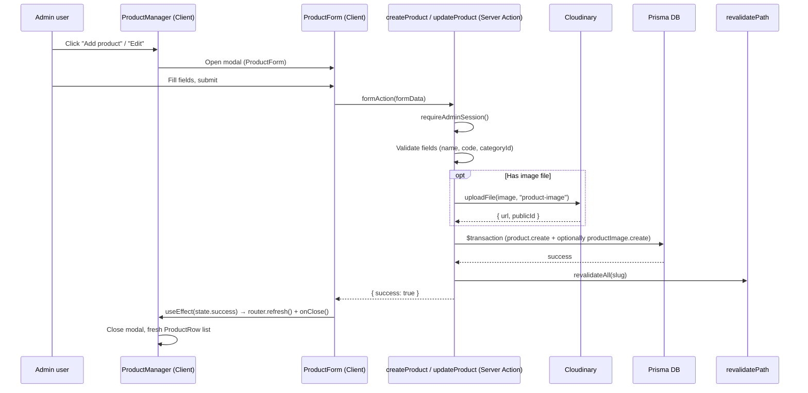
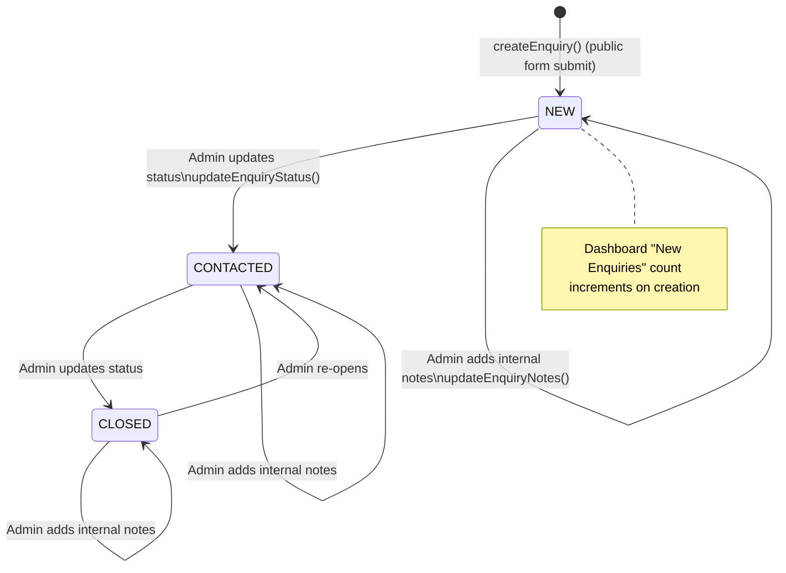

# NexChair Admin Portal — Complete Technical Reference

**Stage 5 of the NexChair Technical Documentation Series**

| Attribute | Value |
|---|---|
| Document | `04-admin-portal-and-operations.md` |
| Covers | Complete admin portal: routes, auth, CRUD operations, component architecture, server actions, security |
| Prerequisite reading | `00-project-inventory.md`, `02-database-schema-reference.md`, `03-enquiry-workflow-end-to-end.md` |
| Source verified | All claims sourced directly from application code |
| Scope boundary | Admin portal only. Public website is documented in `01-public-website-and-frontend.md`. Enquiry intake is documented in `03-enquiry-workflow-end-to-end.md`. |

---

## Table of Contents

1. [Admin Portal Overview](#1-admin-portal-overview)
2. [Route Inventory](#2-route-inventory)
3. [Authentication System — Login](#3-authentication-system--login)
4. [Session Management](#4-session-management)
5. [Roles and Permissions](#5-roles-and-permissions)
6. [Admin Layout and Shell](#6-admin-layout-and-shell)
7. [Dashboard](#7-dashboard)
8. [Product Management](#8-product-management)
9. [Category Management](#9-category-management)
10. [Product Image Management](#10-product-image-management)
11. [Catalogue Management](#11-catalogue-management)
12. [Enquiry Management](#12-enquiry-management)
13. [Settings Page](#13-settings-page)
14. [Server Actions Inventory](#14-server-actions-inventory)
15. [Data Flow Diagrams](#15-data-flow-diagrams)
16. [UI Architecture and Responsiveness](#16-ui-architecture-and-responsiveness)
17. [Validation and Error Handling](#17-validation-and-error-handling)
18. [Security Observations](#18-security-observations)
19. [Test Coverage Matrix](#19-test-coverage-matrix)
20. [Troubleshooting Reference](#20-troubleshooting-reference)

---

## 1. Admin Portal Overview

The NexChair admin portal is a fully integrated management interface built on the Next.js App Router. It runs at the `/admin` route prefix and is completely isolated from the public website by a custom JWT-based authentication system.

### Key characteristics

| Property | Value |
|---|---|
| Route prefix | `/admin` |
| Protected route group | `app/admin/(protected)/` |
| Authentication mechanism | Custom JWT (jose HS256), 7-day expiry, httpOnly cookie |
| Authorization model | Single tier — any valid session grants full access |
| Admin user model | `AdminUser` Prisma model — email + bcrypt password hash |
| Background colour | `#f5f1ea` (cream) |
| Accent colour | `#c44e18` (burnt orange) |
| Sidebar background | `#171717` (near-black) |
| Layout type | Fixed full-screen overlay (`fixed inset-0 z-[100] overflow-hidden`) |
| Render mode | Server Components for pages; Client Components for interactive UI |

### What the admin portal manages

1. **Products** — full CRUD, image gallery, spec sheets, active/inactive toggle, bestseller flag
2. **Categories** — full CRUD, Cloudinary images, sort order, active/inactive toggle
3. **Enquiries** — read-only view of incoming enquiries, status lifecycle, internal notes
4. **Catalogues** — PDF upload and management via Vercel Blob
5. **Settings** — placeholder; no functionality implemented

---

## 2. Route Inventory

| Route | File | Render Mode | Auth Guard | Description |
|---|---|---|---|---|
| `/admin/login` | `app/admin/login/page.tsx` | Client Component | None (login page) | Email + password login form |
| `/admin` | `app/admin/(protected)/page.tsx` | Server Component (async) | Layout + page | Dashboard — 4 stat cards |
| `/admin/products` | `app/admin/(protected)/products/page.tsx` | Server Component (async) | Layout + page | Product list; optional `?category=` filter |
| `/admin/categories` | `app/admin/(protected)/categories/page.tsx` | Server Component (async) | Layout + page | Category list |
| `/admin/enquiries` | `app/admin/(protected)/enquiries/page.tsx` | Server Component (async) | Layout + page | Enquiry list; filterable, searchable, paginated |
| `/admin/enquiries/[id]` | `app/admin/(protected)/enquiries/[id]/page.tsx` | Server Component (async) | Layout + page | Enquiry detail — read + status/notes edit |
| `/admin/catalogues` | `app/admin/(protected)/catalogues/page.tsx` | Server Component (async) | Layout + page | Catalogue PDF management |
| `/admin/settings` | `app/admin/(protected)/settings/page.tsx` | Server Component | Layout + page | **PLACEHOLDER** — "Settings coming soon." |

### Route group mechanics

The `(protected)` route group in `app/admin/(protected)/` applies a shared layout via `app/admin/(protected)/layout.tsx`. This layout calls `requireAdminSession()` once per request, then renders `AdminShell` with the authenticated user's email and `{children}`.

The login page at `app/admin/login/page.tsx` is **outside** the `(protected)` group and therefore has no layout guard. It calls no auth check.

---

## 3. Authentication System — Login

### Login page

**File:** `app/admin/login/page.tsx`
**Type:** Client Component (`"use client"`)

The login page renders a form with two uncontrolled inputs (email and password). Submission calls `signInAdmin(formData)` via `useTransition`. The button is disabled while `isPending` is `true`. Any error returned from the action is displayed via `state.message`.

### `signInAdmin()` server action

**File:** `app/actions/admin-auth.ts`

The login flow executes in this exact order:

```
1. checkLoginRateLimit(email)        — 5/15 min sliding window, fail-CLOSED
   → { allowed: false } → return { success: false, message: "Too many attempts, try again in Xs" }

2. Empty field check
   → email or password blank → return { success: false, message: "Email and password are required" }

3. prisma.adminUser.findUnique({ where: { email } })
   → null → return { success: false, message: "Invalid email or password" }

4. bcrypt.compare(password, admin.password)
   → false → return { success: false, message: "Invalid email or password" }

5. createAdminSession(admin.id, admin.email)
   → Sets httpOnly JWT cookie

6. redirect("/admin")
```

Important:
- Steps 3 and 4 return the **same error message** intentionally — user enumeration prevention
- `bcrypt.compare` uses 12-round hashes
- Login rate limit is **fail-CLOSED**: if Upstash is unavailable and an error is thrown, the check still allows the request through (the `checkLoginRateLimit` implementation wraps in try/catch and returns `{ allowed: true }` on error — same fail-open pattern as the enquiry rate limiter)

### `signOutAdmin()` server action

**File:** `app/actions/admin-auth.ts`

```
1. clearAdminSession()   → Clears the nexchair_admin_session cookie
2. redirect("/admin/login")
```

Called from `LogoutButton` (`components/admin/LogoutButton.tsx`) via a `<form action={signOutAdmin}>`. The form-based approach means logout works without JavaScript.

---

## 4. Session Management

**File:** `lib/auth/admin.ts`

### Cookie

| Property | Value |
|---|---|
| Name | `nexchair_admin_session` |
| Algorithm | HS256 (symmetric) |
| Payload | `{ adminId: string, email: string }` |
| Duration | 7 days |
| `httpOnly` | `true` |
| `sameSite` | `"lax"` |
| `secure` | `true` in production, `false` in development |
| `path` | `"/"` |

### Critical startup behaviour

`lib/auth/admin.ts` reads `ADMIN_SESSION_SECRET` at **module load time**:

```typescript
const secret = process.env.ADMIN_SESSION_SECRET;
if (!secret) throw new Error("ADMIN_SESSION_SECRET is not set");
```

This means the entire application will **crash on startup** (not at first request) if the env var is absent. This is intentional — silent runtime failures on a missing signing key would be a security vulnerability.

### Session functions

| Function | Behaviour |
|---|---|
| `createAdminSession(adminId, email)` | Signs JWT with `jose` HS256, sets httpOnly cookie, 7-day expiry |
| `getAdminSession()` | Verifies JWT, returns `{ adminId, email }` or `null` on any error (expired, invalid signature, missing cookie) |
| `clearAdminSession()` | Sets cookie with empty value and `maxAge: 0` to expire it immediately |
| `requireAdminSession()` | Calls `getAdminSession()`; if null, calls `redirect("/admin/login")` |

### Double guard pattern

Every protected page calls `requireAdminSession()` **twice per request** — once in the layout (`app/admin/(protected)/layout.tsx`) and once in the page file itself. This is redundant but safe. The practical effect is that removing the check from one location still leaves the other as a guard.

---

## 5. Roles and Permissions

The admin portal has a **flat, single-role model**. Any user with a valid `AdminUser` record and a valid session has full access to all admin routes and all server actions.

There is no:
- Role hierarchy
- Permission matrix
- Action-level access control
- Multi-admin isolation (all admins see all data)

The `AdminUser` Prisma model has only: `id`, `email`, `password`, `createdAt`, `updatedAt`. There is no `role` field.

**Implication for onboarding:** Creating a new admin user requires direct database access or a seeding script. There is no admin-facing user management UI.

---

## 6. Admin Layout and Shell

### Layout

**File:** `app/admin/(protected)/layout.tsx`

```typescript
export default async function AdminProtectedLayout({ children }) {
  const session = await requireAdminSession();
  return (
    <AdminShell email={session.email}>
      {children}
    </AdminShell>
  );
}
```

The layout wraps all protected content in `AdminShell`. It passes `session.email` to the shell for display in the sidebar footer and header.

The layout's outer container is `fixed inset-0 z-[100] overflow-hidden bg-[#f5f1ea]`. This means the admin portal renders as a full-screen overlay above the public website's HTML output — the public layout (Navbar, Footer) is technically present in the DOM but invisible.

### `AdminShell`

**File:** `components/admin/AdminShell.tsx`
**Type:** Client Component (needs `useState` for mobile sidebar)

#### Sidebar

- Background: `#171717`
- Width: `w-64` (256px)
- Mobile: starts at `-translate-x-full`; `sidebarOpen` state animates to `translate-x-0`
- Mobile backdrop: `fixed inset-0 z-[110] bg-black/50`, clicking it closes the sidebar
- Z-index: sidebar at `z-[120]`, backdrop at `z-[110]`
- Wordmark: "NexChair" in `#c44e18` + "Admin" in `white/50`

#### Sidebar navigation items (in order)

| Label | Href | Active detection |
|---|---|---|
| Dashboard | `/admin` | Exact match (`pathname === "/admin"`) |
| Products | `/admin/products` | `pathname.startsWith("/admin/products")` |
| Categories | `/admin/categories` | `pathname.startsWith("/admin/categories")` |
| Enquiries | `/admin/enquiries` | `pathname.startsWith("/admin/enquiries")` |
| Catalogues | `/admin/catalogues` | `pathname.startsWith("/admin/catalogues")` |
| Settings | `/admin/settings` | `pathname.startsWith("/admin/settings")` |

Active item: left border `border-l-2 border-[#c44e18]`, `bg-white/5`, icon in `#c44e18`.

Sidebar footer: truncated admin email in `white/30`.

#### Header (top bar)

- Height: `h-14`, white background, `border-b border-black/10`
- Hamburger button (mobile only, `md:hidden`) — sets `sidebarOpen(true)`
- Current page label (derived from active nav item)
- Admin email (hidden on mobile, shown at `sm:`)
- `LogoutButton` (always visible)

#### Main content area

- `flex-1 overflow-y-auto p-6`
- Renders `{children}` (the page content)

---

## 7. Dashboard

**File:** `app/admin/(protected)/page.tsx`
**Type:** Server Component (async)

### Data queries

Four parallel Prisma queries via `Promise.all`:

```typescript
const [totalProducts, activeProducts, totalCategories, newEnquiries] = await Promise.all([
  prisma.product.count(),
  prisma.product.count({ where: { isActive: true } }),
  prisma.category.count({ where: { isActive: true } }),
  prisma.enquiry.count({ where: { status: "NEW" } }),
]);
```

### Stat cards

| Card | Query | Value | Link |
|---|---|---|---|
| Total Products | `product.count()` | All products (any status) | `/admin/products` |
| Active Products | `product.count({ where: { isActive: true } })` | Active products only | `/admin/products` |
| Active Categories | `category.count({ where: { isActive: true } })` | Active categories only | `/admin/categories` |
| New Enquiries | `enquiry.count({ where: { status: "NEW" } })` | Unactioned enquiries | `/admin/enquiries` |

Each `StatCard` renders: label, number value, chevron-link. The `newEnquiries` count is the primary operational indicator for the sales team.

---

## 8. Product Management

### Page: `/admin/products`

**File:** `app/admin/(protected)/products/page.tsx`

1. `requireAdminSession()` — guard
2. `getCategories()` — fetch all categories (for form dropdown and slug validation)
3. Validates optional `?category=` slug against real category list — unknown slugs silently fall back to full product list (prevents arbitrary URL param use to probe DB)
4. `getProducts(filterCategory?.id)` — fetches filtered or all products
5. Renders `<ProductManager products={...} categories={...} filterCategory={...} />`

**`getProducts(categoryId?)`** (`app/actions/admin-products.ts`):

```typescript
prisma.product.findMany({
  include: { images: { orderBy: { sortOrder: "asc" } }, category: true },
  where: categoryId ? { categoryId } : undefined,
  orderBy: { createdAt: "desc" },
})
```

Returns `ProductRow[]` — includes `id`, `name`, `code`, `price`, `description`, `colour`, `armrests`, `seatWeight`, `maxUserWeight`, `warranty`, `specs`, `dimensions`, `features`, `isActive`, `isBestseller`, `specSheetKey`, `slug`, `categoryId`, `categoryName`, `imageCount`, `images`.

### `ProductManager`

**File:** `components/admin/ProductManager.tsx`
**Type:** Client Component

#### State

| State variable | Type | Purpose |
|---|---|---|
| `formOpen` | `boolean` | Controls create/edit modal visibility |
| `editingId` | `string \| null` | ID of product being edited; resolved to full `ProductRow` on render |
| `confirmDeleteId` | `string \| null` | Per-row delete confirmation (only one at a time) |
| `deleteError` | `string \| null` | Error from last delete attempt, displayed inline |
| `deletePending` | (from `useTransition`) | Disables delete button during transition |
| `togglePending` | (from `useTransition`) | Disables toggle button during transition |

#### Row layout

Each product row is a `rounded-2xl border border-black/10 bg-white px-4 py-3 flex items-center gap-3` row containing:

1. Thumbnail: primary image (`isPrimary: true`) or first image, `h-12 w-12 rounded-xl object-cover`; falls back to "—" placeholder
2. Product info: name + code, category name, Bestseller badge (if applicable), image count
3. Status toggle: rounded-full pill ("Active" in green / "Inactive" in black/10); single click calls `toggleProductActive`
4. Edit button → `openEdit(product)` → opens modal
5. Delete button → `setConfirmDeleteId(product.id)` → replaces buttons with inline confirmation

#### Inline delete confirmation

When confirming delete for a row:
- Cancel button: clears `confirmDeleteId`
- "Confirm delete" button: calls `handleDelete(id)` via `startDeleteTransition`
  - On success: clears state, calls `router.refresh()`
  - On error: displays `deleteError` above the confirmation buttons

#### Modal

```
fixed inset-x-4 top-[4vh] z-[140]
max-w-2xl, max-height: 92vh, overflow-y-auto, rounded-2xl bg-white p-6
Backdrop: fixed inset-0 z-[130] bg-black/40 (clicking closes form)
```

Modal header: "New product" or "Edit {name}" with `×` close button.

Renders `<ProductForm key={editing?.id ?? "create"} product={editing} categories={categories} onClose={closeForm} />`.

The `key` prop ensures `ProductForm` re-mounts on each edit target — prevents stale state.

### `ProductForm`

**File:** `components/admin/ProductForm.tsx`
**Type:** Client Component

Uses `useActionState(action, INITIAL_STATE)` where `action` is either `createProduct` or `updateProduct` depending on `isEdit = !!product`.

#### All form fields

| Field name | Input type | Required | Notes |
|---|---|---|---|
| `id` | hidden | Edit only | Product ID |
| `name` | text | Yes | maxLength 200; controlled, drives slug preview |
| `code` | text (create) / hidden (edit) | Yes on create | On edit: shown as read-only text `font-mono text-black/50`, hidden input passes unchanged value. Code is **immutable** after creation. |
| `categoryId` | select | Yes | Populated from `categories` prop |
| `price` | text | No | Placeholder "Price on request"; empty string submits as "Price on request" |
| `description` | textarea | No | 3 rows |
| `colour` | text | No | e.g. "Black" |
| `armrests` | text | No | e.g. "4D" |
| `seatWeight` | text | No | e.g. "14 kg" |
| `maxUserWeight` | text | No | e.g. "120 kg" |
| `warranty` | text | No | e.g. "5 years" |
| `specsLumbar` | text | No | Becomes `specs.lumbar`; **only two spec fields in the form** |
| `specsBack` | text | No | Becomes `specs.back` |
| `features` | tag input | No | Add via Enter or "Add" button; each tag submits as separate `hidden input name="features"` |
| `isActive` | select | — | "Active" / "Inactive"; defaults to `true` on create |
| `isBestseller` | select | — | "No" / "Yes"; defaults to `false` on create |
| `removeSpecSheet` | hidden | Edit only | `"true"` / `"false"` based on `specSheetIntent` |
| `specSheet` | file (PDF) | No | Edit: shown when `specSheetIntent === "replace"` or no existing spec sheet |
| `image` | file (image) | No | **Create only** — first/primary image. Edit images handled by `ProductImageManager`. |

#### Spec sheet intent (edit mode)

When editing a product that already has a spec sheet, three buttons toggle `specSheetIntent`:

- **Keep** (default): `removeSpecSheet=false`, no file input shown
- **Replace**: `removeSpecSheet=false`, PDF file input shown
- **Remove**: `removeSpecSheet=true`, file input hidden; server action deletes existing blob

#### `useActionState` / success handling

```typescript
const [state, formAction, pending] = useActionState(action, INITIAL_STATE);

useEffect(() => {
  if (state.success) {
    router.refresh();
    onClose();
  }
}, [state.success, router, onClose]);
```

Errors display as a red banner at the top of the form: `state.error`.

#### `ProductImageManager` placement

`ProductImageManager` is rendered **outside** the form element — it is a sibling `<div>` after the closing `</form>` tag. It has its own independent `<form>` elements internally.

### `createProduct()` server action

**File:** `app/actions/admin-products.ts`

Validation order:
1. `requireAdminSession()`
2. `name` required, `name.length <= 200`
3. `code` required, `code.length <= 50`, uppercased via `.toUpperCase()`
4. `categoryId` required
5. Slug auto-generated from name: `toSlug(name)` (lowercase, non-alphanumeric → hyphens)
6. Uniqueness checks: slug collision → error; code collision → error; category exists → error
7. Optional image upload: `uploadFile(imageFile, "product-image")`
8. `prisma.$transaction`: create `Product` + optionally create first `ProductImage` (`isPrimary: true, sortOrder: 0`)
9. If image upload succeeded but `$transaction` failed: fire-and-forget storage cleanup
10. `revalidateAll(slug)` — revalidates 5 public paths
11. Returns `{ success: true }`

### `updateProduct()` server action

**File:** `app/actions/admin-products.ts`

Runs the same field validation as create. Additional logic:

- `code` is passed as a hidden input but server-side the action reads it back — **code is not changed** (the UI enforces this but the action does not revalidate uniqueness)
- Spec sheet handling:
  - `removeSpecSheet === "true"`: deletes existing blob, sets `specSheetKey` to `null`
  - `specSheet` file present: uploads new PDF to Vercel Blob (`products/spec-sheets`), replaces `specSheetKey`
  - Neither: keeps existing `specSheetKey`
- **CRITICAL:** `parseSpecs(formData)` only writes `{ lumbar, back }` to `specs` JSON — overwrites the entire JSON column. Any other spec data previously stored in `specs` (from other keys) is lost on save. See `02-database-schema-reference.md` Section 7 for full impact.
- `revalidateAll(slug)` after update

### `deleteProduct()` server action

1. `requireAdminSession()`
2. Fetches product including `_count.enquiryItems`
3. If `enquiryItems > 0` → returns error "Cannot delete — this product is referenced by existing enquiries."
4. `prisma.product.delete({ where: { id } })` — cascades to `ProductImage` records
5. Fire-and-forget: for each image, `deleteStorageAsset({ url, publicId })` via `.catch()`
6. Fire-and-forget: spec sheet blob deletion if `specSheetKey` present
7. `revalidateAll(slug)`

### `toggleProductActive()` server action

Simple `prisma.product.update({ where: { id }, data: { isActive: Boolean(formData.get("isActive") === "true") } })` + `revalidateAll(slug)`.

### `revalidateAll(slug)`

```typescript
revalidatePath("/admin/products");
revalidatePath("/product-range");
revalidatePath(`/products/${slug}`);
revalidatePath("/specifications");
revalidatePath("/");
```

---

## 9. Category Management

### Page: `/admin/categories`

**File:** `app/admin/(protected)/categories/page.tsx`

```typescript
await requireAdminSession();
const categories = await getCategories();
return <CategoryManager categories={categories} />;
```

**`getCategories()`** (`app/actions/admin-categories.ts`):

```typescript
prisma.category.findMany({
  include: { _count: { select: { products: true } } },
  orderBy: [{ sortOrder: "asc" }, { name: "asc" }],
})
```

Returns `CategoryRow[]` — includes `id`, `name`, `slug`, `description`, `imageKey`, `sortOrder`, `isActive`, `productCount`.

### `CategoryManager`

**File:** `components/admin/CategoryManager.tsx`
**Type:** Client Component

Pattern mirrors `ProductManager`:
- `formOpen`, `editing` (full `CategoryRow`, not just ID), `confirmDeleteId`, `deleteError`
- `deletePending`, `togglePending` via `useTransition`

#### Row layout

Each category row contains:
1. Thumbnail: `cat.imageKey` (Cloudinary URL) or "—" placeholder, `h-12 w-12 rounded-xl object-cover`
2. Category info: name + slug (`font-mono`), product count, sort order
3. Active/Inactive toggle
4. **Products link**: `<Link href="/admin/products?category=${cat.slug}">` — shortcut to view products in this category
5. Edit button
6. Delete button with inline confirmation

#### Delete protection

`deleteCategory()` returns an error if the category has any products assigned (`_count.products > 0`). The error surfaces in the inline confirmation UI as `deleteError`.

#### Modal

`max-w-lg` (narrower than product modal). Renders `<CategoryForm key={editing?.id ?? "create"} category={editing} onClose={closeForm} />`.

### `CategoryForm`

**File:** `components/admin/CategoryForm.tsx`
**Type:** Client Component

#### All form fields

| Field name | Input type | Required | Notes |
|---|---|---|---|
| `id` | hidden | Edit only | Category ID |
| `name` | text | Yes | maxLength 100; controlled; drives slug preview on create; display-only preview on edit |
| `description` | textarea | No | Optional |
| `sortOrder` | number | No | min 0, step 1; controls display order in public CategorySection |
| `isActive` | select | — | "Yes" / "No" |
| `removeImage` | hidden | — | `"true"` if `imageIntent === "remove"`, else `"false"` |
| `image` | file (image) | No | Shown when: creating, editing with no image, or `imageIntent === "replace"` |

#### Image intent (edit mode)

When an existing image is present and `imageIntent === "keep"` (default), the form shows the current image with two buttons:
- **Replace** → `setImageIntent("replace")` → shows file input below
- **Remove** → `setImageIntent("remove")` → shows "Image will be removed when you save" banner with Undo

When `imageIntent === "replace"` and a file is selected, a local preview is shown via `URL.createObjectURL()`. The object URL is revoked on unmount via `useEffect` cleanup.

#### Slug display

The slug preview (read-only) shows as `font-mono text-black/60` in a `bg-[#f5f1ea]` box. The label reads `/categories/` + slug — however, there is no public `/categories/` route. Slugs are used as `?category=` query params on `/product-range`. The displayed path is misleading.

### `createCategory()` server action

1. `requireAdminSession()`
2. `name` required, `name.length <= 100`; slug = `toSlug(name)`
3. Slug uniqueness check
4. Optional image upload to Cloudinary `nexchair/categories` via `uploadFile(imageFile, "category-image")`
5. `prisma.category.create({...})` with `sortOrder: parseInt(formData.get("sortOrder"))`, `isActive: formData.get("isActive") === "true"`
6. Fire-and-forget image cleanup if DB write fails
7. `revalidatePath("/admin/categories")`, `revalidatePath("/product-range")`, `revalidatePath("/")`

### `updateCategory()` server action

1. `requireAdminSession()`
2. Validates `id` and `name`
3. **Slug is regenerated** from current `name` on every update — changing a category name changes its slug, which breaks any bookmarked `?category=` URLs
4. `removeImage === "true"`: fire-and-forget Cloudinary delete, sets `imageKey: null`
5. New image file: upload to Cloudinary, replace `imageKey`
6. Same `revalidatePath` calls as create

### `deleteCategory()` server action

1. `requireAdminSession()`
2. `prisma.category.findUnique({ include: { _count: { select: { products: true } } } })`
3. If `products > 0`: return error "Cannot delete — this category has products assigned."
4. `prisma.category.delete()`
5. Fire-and-forget: `deleteStorageAsset({ url: cat.imageKey })` if image present
6. Same `revalidatePath` calls

### `toggleCategoryActive()` server action

`prisma.category.update({ data: { isActive: formData.get("isActive") === "true" } })` + same revalidation.

---

## 10. Product Image Management

**File:** `components/admin/ProductImageManager.tsx`
**Type:** Client Component
**Location:** Rendered as a sibling after the `</form>` closing tag within `ProductForm` (edit mode only)

### Upload form

A separate `<form>` element using `useActionState(addProductImage, UPLOAD_INITIAL)`:

| Field | Type | Notes |
|---|---|---|
| `productId` | hidden | Current product ID |
| `altText` | text | Optional descriptive alt text |
| `image` | file | Accept: `image/jpeg,image/png,image/webp`; required |

Accepted formats and size limit displayed: "JPEG, PNG, or WebP · max 5 MB"

After successful upload:
- `fileInputRef.current.value = ""` and `altTextInputRef.current.value = ""` reset the form via DOM refs
- `router.refresh()` re-fetches images from server

### Image list

Each image renders:
- Thumbnail: `h-14 w-14 rounded-lg object-cover`
- Position badge: `#1`, `#2`, etc.
- **Primary** badge in green (if `isPrimary`)
- Alt text preview (truncated to 160px)
- Action buttons:
  - **Set primary** (only on non-primary images): calls `setProductImagePrimary`
  - **↑** / **↓** move buttons: disabled when at bounds, calls `reorderProductImages`
  - **Delete**: triggers inline confirm ("Delete?" + Cancel/Confirm)

All operations use `useTransition` with per-operation error state (`primaryError`, `deleteError`, `reorderError`). A combined `anyPending` flag disables all action buttons while any operation is in flight.

### `addProductImage()` server action

1. `requireAdminSession()`
2. `uploadFile(image, "product-image")` → Cloudinary
3. Gets current max `sortOrder` via `prisma.productImage.aggregate`
4. `prisma.productImage.create({ sortOrder: maxSortOrder + 1, isPrimary: images.length === 0 })` — first image becomes primary automatically
5. `revalidateAll(product.slug)`

### `deleteProductImage()` server action

Uses `prisma.$transaction`:
1. If image is primary and other images exist: find next candidate (`sortOrder` minimum among remaining), set it `isPrimary: true`
2. `prisma.productImage.delete({ where: { id: imageId } })`
3. After transaction: fire-and-forget `deleteStorageAsset({ url, publicId })`
4. `revalidateAll(product.slug)`

### `setProductImagePrimary()` server action

Uses `prisma.$transaction`:
1. `prisma.productImage.updateMany({ where: { productId }, data: { isPrimary: false } })` — clear all
2. `prisma.productImage.update({ where: { id: imageId }, data: { isPrimary: true } })` — set new primary
3. `revalidateAll(product.slug)`

### `reorderProductImages()` server action

1. `requireAdminSession()`
2. Fetches all images for the product
3. Validates that the submitted `imageIds[]` list is a complete permutation (same set of IDs)
4. `prisma.$transaction` of `images.length` individual `update` calls, each setting `sortOrder = i`
5. `revalidateAll(product.slug)`

---

## 11. Catalogue Management

### Page: `/admin/catalogues`

**File:** `app/admin/(protected)/catalogues/page.tsx`

```typescript
await requireAdminSession();
const catalogues = await getCatalogues();
return (
  <div className="mx-auto max-w-3xl">
    {/* header */}
    <CatalogueManager catalogues={catalogues} />
  </div>
);
```

**`getCatalogues()`** (`app/actions/admin-catalogues.ts`):
```typescript
prisma.catalogue.findMany({ orderBy: { createdAt: "desc" } })
```

Returns `CatalogueRow[]`: `id`, `name`, `version`, `storageKey`, `isActive`, `createdAt`.

### `CatalogueManager`

**File:** `components/admin/CatalogueManager.tsx`
**Type:** Client Component with three internal sub-components

#### `CatalogueUploadForm`

`useActionState(createCatalogue, INITIAL)`. Fields:
- `name` — required, maxLength 200, placeholder "e.g. Product Catalogue 2026"
- `version` — optional, maxLength 50, placeholder "e.g. v2, 2026-Q1"
- `file` — required, `accept=".pdf,application/pdf"`, max 25 MB

On success: form `ref.current.reset()`, `router.refresh()`, calls parent `onSuccess()` which sets `showUpload(false)`.

#### `CatalogueEditForm`

`useActionState(updateCatalogue, INITIAL)`. Fields:
- `name` — required
- `version` — optional

**No file field** — catalogue PDFs **cannot be replaced**. To update a file, the existing catalogue must be deleted and a new one uploaded.

On success: `router.refresh()`, `onClose()`.

#### `CatalogueRowActions`

Per-row `editing` and `confirmDelete` state. When `editing === true`, renders `CatalogueEditForm` inline below the row.

Buttons:
- **Download PDF**: `<a href={catalogue.storageKey} target="_blank">` — direct link to Vercel Blob URL
- **Edit**: sets `editing(true)` → shows inline edit form
- **Activate / Deactivate**: calls `toggleCatalogueActive` via `useTransition`
- **Delete** (requires confirmation): calls `deleteCatalogue` via `useTransition`

Inactive catalogues render at `opacity-60`.

### `createCatalogue()` server action

1. `requireAdminSession()`
2. `name` required, `name.length <= 200`
3. `version` optional, `version.length <= 50`
4. File required; `uploadFile(file, "catalogue")` → Vercel Blob `catalogues/` path
5. `prisma.catalogue.create({ storageKey: upload.url, ... })`
6. If DB write fails: fire-and-forget blob deletion (orphan cleanup)
7. `revalidatePath("/admin/catalogues")`

### `updateCatalogue()` server action

Updates `name` and `version` only. No file replacement. No `revalidatePath` beyond admin.

### `toggleCatalogueActive()` server action

`prisma.catalogue.update({ data: { isActive: !catalogue.isActive } })`.

### `deleteCatalogue()` server action

1. `requireAdminSession()`
2. `prisma.catalogue.delete({ where: { id } })` — DB first
3. Fire-and-forget: `deleteFile(catalogue.storageKey)` to remove from Vercel Blob

---

## 12. Enquiry Management

### Admin enquiry data model

Enquiries created by the public site flow into the admin portal as read-only records. Admin staff can:
- Filter and search enquiries
- View full enquiry detail
- Update status (NEW → CONTACTED → CLOSED)
- Add internal notes

Admin staff **cannot**:
- Delete enquiries
- Export enquiries (no CSV/export feature)
- Modify customer-submitted data

### Enquiry list page

**File:** `app/admin/(protected)/enquiries/page.tsx`

Reads searchParams (all optional):
- `status`: `"NEW"` / `"CONTACTED"` / `"CLOSED"` / `""` (all)
- `type`: `"CONTACT"` / `"QUOTE"` / `"ORDER"` / `""` (all)
- `search`: string matched against name, email, company
- `page`: integer ≥ 1

Calls `getEnquiries({ status, type, search, page })` → `{ enquiries, total, page, pageCount }`.

**`getEnquiries()`** (`app/actions/admin-enquiries.ts`):

```typescript
// PAGE_SIZE = 20
prisma.enquiry.findMany({
  where: {
    ...(status ? { status } : {}),
    ...(type   ? { type }   : {}),
    ...(search ? {
      OR: [
        { name:    { contains: search, mode: "insensitive" } },
        { email:   { contains: search, mode: "insensitive" } },
        { company: { contains: search, mode: "insensitive" } },
      ],
    } : {}),
  },
  include: { _count: { select: { items: true } } },
  orderBy: { createdAt: "desc" },
  skip: (page - 1) * 20,
  take: 20,
})
```

Returns `EnquiryListItem[]`: `id`, `name`, `email`, `phone`, `company`, `city`, `type`, `status`, `itemCount`, `createdAt`.

### `EnquiryList`

**File:** `components/admin/EnquiryList.tsx`
**Type:** Client Component

Wrapped in `<Suspense>` on the page — required because `EnquiryList` uses `useSearchParams()`.

#### Filters

All filter changes push a new URL via `router.push()` with updated `URLSearchParams`. Filter state is in the URL, not component state — reloading the page preserves filters.

| Filter | Mechanism | URL param |
|---|---|---|
| Search input | `onKeyDown Enter` fires navigate | `search` |
| Status select | `onChange` fires navigate | `status` |
| Type select | `onChange` fires navigate | `type` |
| Pagination | Previous/Next buttons | `page` |

#### Table columns

| Column | Data |
|---|---|
| Customer | Name (bold), company (if present), email or phone, city |
| Type | "Contact", "Quote", or "Order" |
| Status | Coloured badge: New (orange), Contacted (blue), Closed (grey) |
| Items | `itemCount` or "—" if 0 |
| Date | `en-IN` locale short date |

The entire Customer cell is a `<Link href="/admin/enquiries/${e.id}">` block.

#### Pagination

Shown only when `pageCount > 1`. Previous/Next buttons disabled at bounds. Current page and total displayed.

### Enquiry detail page

**File:** `app/admin/(protected)/enquiries/[id]/page.tsx`
**Type:** Server Component (async)

```
1. requireAdminSession()
2. getEnquiry(id)       — full detail including items
3. notFound() if null
4. Render detail layout
```

**`getEnquiry(id)`** (`app/actions/admin-enquiries.ts`):

```typescript
prisma.enquiry.findUnique({
  where: { id },
  include: { items: { include: { product: { select: { name: true, code: true } } } } },
})
```

Returns all enquiry fields plus `items[]` with `productName`, `productCode`, `colour`, `quantity`.

#### Layout

`lg:grid-cols-[1fr_320px]`

**Left column** (3 sections):

1. **Contact details** — `<Row>` component (renders `null` if `value` is falsy):
   - Name, Email, Phone, WhatsApp, Company, GSTIN, City, Pincode, Contact via, Needed by, Order type

2. **Message** (shown if `enquiry.message` is non-null):
   - `whitespace-pre-wrap` — preserves the structured `Model of interest: X\nNumber of seats: Y\n...` format

3. **Requested products** (shown if `enquiry.items.length > 0`):
   - Table with columns: Product, Code, Colour, Qty

**Right column** (3 sections):

1. **Status** — `<EnquiryStatusForm enquiryId={id} currentStatus={enquiry.status} />`
2. **Internal notes** — `<EnquiryNotesForm enquiryId={id} initialNotes={enquiry.adminNotes} />`
3. **Metadata** — enquiry ID (monospace), createdAt, updatedAt

### `EnquiryStatusForm`

**File:** `components/admin/EnquiryStatusForm.tsx`
**Type:** Client Component

`useActionState(updateEnquiryStatus, INITIAL)`. Select + "Update status" button in a flex row.

Status options: New, Contacted, Closed.

On success: shows inline "Saved" in green. On error: shows inline error in red.

### `EnquiryNotesForm`

**File:** `components/admin/EnquiryNotesForm.tsx`
**Type:** Client Component

`useActionState(updateEnquiryNotes, INITIAL)`. Textarea `maxLength={2000}`, rows 5. Labelled "Private notes visible only to admins."

On success: shows "Notes saved" in green. On error: shows error in red.

### `updateEnquiryStatus()` server action

1. `requireAdminSession()`
2. Validates `id` present
3. `prisma.enquiry.update({ where: { id }, data: { status } })`

### `updateEnquiryNotes()` server action

1. `requireAdminSession()`
2. Validates `id` present
3. Notes truncated to 2000 chars: `adminNotes.slice(0, 2000)` (silent truncation — UI also has `maxLength` but server enforces independently)
4. `prisma.enquiry.update({ where: { id }, data: { adminNotes } })`

---

## 13. Settings Page

**File:** `app/admin/(protected)/settings/page.tsx`

**Status: PLACEHOLDER**

The settings page contains only an `await requireAdminSession()` guard and renders:

```
"Settings coming soon."
```

No settings functionality is implemented. No forms, no data, no actions. The sidebar link to Settings is functional and navigates to this placeholder.

---

## 14. Server Actions Inventory

All admin server actions are in `app/actions/`. All except `signInAdmin`, `signOutAdmin`, and `getCategories`/`getProducts` (which are also called from public server pages) require `requireAdminSession()`.

### Auth actions (`app/actions/admin-auth.ts`)

| Function | Signature | Auth | Description |
|---|---|---|---|
| `signInAdmin` | `(formData: FormData) → { success, message }` | None | Rate-limited login; creates JWT session on success |
| `signOutAdmin` | `() → void` | None | Clears session cookie; redirects to `/admin/login` |

### Product actions (`app/actions/admin-products.ts`)

| Function | Signature | Description |
|---|---|---|
| `getProducts` | `(categoryId?: string) → ProductRow[]` | Fetch all products with images + category info |
| `createProduct` | `(state, formData) → ProductActionState` | Create product + optional first image |
| `updateProduct` | `(state, formData) → ProductActionState` | Update product fields, spec sheet intent |
| `deleteProduct` | `(state, formData) → ProductActionState` | Delete product (blocked if enquiry items exist) |
| `toggleProductActive` | `(state, formData) → ProductActionState` | Toggle `isActive` flag |
| `addProductImage` | `(state, formData) → ImageActionState` | Upload image to Cloudinary, add to DB |
| `deleteProductImage` | `(state, formData) → ImageActionState` | Delete image, promote next primary in `$transaction` |
| `setProductImagePrimary` | `(state, formData) → ImageActionState` | Set primary image in `$transaction` |
| `reorderProductImages` | `(state, formData) → ImageActionState` | Reorder images; validates complete permutation |

### Category actions (`app/actions/admin-categories.ts`)

| Function | Signature | Description |
|---|---|---|
| `getCategories` | `() → CategoryRow[]` | Fetch all categories ordered by `[sortOrder, name]` |
| `createCategory` | `(state, formData) → CategoryActionState` | Create category, optional Cloudinary image |
| `updateCategory` | `(state, formData) → CategoryActionState` | Update category fields + image intent |
| `deleteCategory` | `(state, formData) → CategoryActionState` | Delete category (blocked if products exist) |
| `toggleCategoryActive` | `(state, formData) → CategoryActionState` | Toggle `isActive` flag |

### Catalogue actions (`app/actions/admin-catalogues.ts`)

| Function | Signature | Description |
|---|---|---|
| `getCatalogues` | `() → CatalogueRow[]` | Fetch all catalogues ordered by `createdAt: "desc"` |
| `createCatalogue` | `(state, formData) → CatalogueActionState` | Upload PDF to Vercel Blob, create DB record |
| `updateCatalogue` | `(state, formData) → CatalogueActionState` | Update name/version only (no file replacement) |
| `toggleCatalogueActive` | `(state, formData) → CatalogueActionState` | Toggle `isActive` flag |
| `deleteCatalogue` | `(state, formData) → CatalogueActionState` | Delete DB record + fire-and-forget blob cleanup |

### Enquiry actions (`app/actions/admin-enquiries.ts`)

| Function | Signature | Description |
|---|---|---|
| `getEnquiries` | `({ status, type, search, page }) → { enquiries, total, page, pageCount }` | Paginated, filtered enquiry list |
| `getEnquiry` | `(id: string) → EnquiryDetail \| null` | Full enquiry detail including items |
| `updateEnquiryStatus` | `(state, formData) → EnquiryActionState` | Update enquiry status |
| `updateEnquiryNotes` | `(state, formData) → EnquiryActionState` | Update admin notes (truncated to 2000 chars) |

### Action state return types

All admin actions return a consistent `{ success: boolean, error?: string }` shape. Auth actions return `{ success: boolean, message?: string }`. The distinction is cosmetic — `error` is used in product/category/catalogue/image actions; `message` is used in auth.

---

## 15. Data Flow Diagrams

### Diagram 1 — Admin portal route structure and auth guard

```mermaid
flowchart TD
    A["/admin/login"] -->|signInAdmin| B{credentials valid?}
    B -->|no| A
    B -->|yes| C["createAdminSession() → cookie"]
    C --> D["/admin (dashboard)"]

    subgraph Protected Route Group app/admin/(protected)/
        LAYOUT["layout.tsx — requireAdminSession()"]
        LAYOUT --> DASH["/admin — Dashboard"]
        LAYOUT --> PROD["/admin/products — ProductManager"]
        LAYOUT --> CAT["/admin/categories — CategoryManager"]
        LAYOUT --> ENQ["/admin/enquiries — EnquiryList"]
        LAYOUT --> ENQ2["/admin/enquiries/[id] — EnquiryDetail"]
        LAYOUT --> CATA["/admin/catalogues — CatalogueManager"]
        LAYOUT --> SET["/admin/settings — Placeholder"]
    end

    PROD -->|"+ Add product / Edit"| PF["ProductForm modal"]
    PF -->|createProduct / updateProduct| DB[(Prisma DB)]
    PF --> PIMG["ProductImageManager (sibling)"]
    PIMG -->|addProductImage| CDN["Cloudinary"]
    CDN --> DB

    CAT -->|"+ Add / Edit"| CF["CategoryForm modal"]
    CF -->|createCategory / updateCategory| DB
    CF --> CDN2["Cloudinary"]

    CATA -->|"Upload new"| CPDF["CatalogueUploadForm"]
    CPDF -->|createCatalogue| BLOB["Vercel Blob"]
    BLOB --> DB

    ENQ -->|click row| ENQ2
    ENQ2 --> SF["EnquiryStatusForm → updateEnquiryStatus"]
    ENQ2 --> NF["EnquiryNotesForm → updateEnquiryNotes"]
    SF --> DB
    NF --> DB

    D -->|"Sign out"| LB["LogoutButton → signOutAdmin"]
    LB -->|"clearAdminSession()"| A
```

### Diagram 2 — Product create/update data flow



### Diagram 3 — Product image management operations

```mermaid
flowchart LR
    PIM["ProductImageManager"] --> UPLOAD["Upload form\n(separate <form>)\nuseActionState(addProductImage)"]
    PIM --> LIST["Image list\nper-image controls"]

    UPLOAD -->|"submit"| ADD["addProductImage()"]
    ADD -->|"uploadFile"| CDN["Cloudinary\nnexchair/products/"]
    CDN --> DB["ProductImage.create\nsortOrder = max+1\nisPrimary = (count===0)"]

    LIST --> SP["Set primary\nsetProductImagePrimary()"]
    SP -->|"$transaction"| DB2["updateMany isPrimary=false\nthen update isPrimary=true"]

    LIST --> DEL["Delete\ndeleteProductImage()"]
    DEL -->|"$transaction"| DB3["delete ProductImage\npromote next primary"]
    DB3 -->|"fire-and-forget"| CDN2["deleteStorageAsset()"]

    LIST --> REORDER["Move up/down\nreorderProductImages()"]
    REORDER -->|"$transaction (array)"| DB4["N × update sortOrder=i"]

    DB --> RV["revalidateAll(slug)"]
    DB2 --> RV
    DB3 --> RV
    DB4 --> RV
```



### Diagram 4 — Enquiry lifecycle (admin perspective)



### Diagram 5 — Admin layout and component composition

```mermaid
flowchart TD
    REQ["Browser request\n/admin/*"] --> LAYOUT["layout.tsx\nrequireAdminSession() ×1"]
    LAYOUT -->|"email"| SHELL["AdminShell (Client)\nSidebar + Header + main area"]
    SHELL --> CHILD["Page {children}"]

    CHILD -->|"/admin"| DASH["DashboardPage\n4× prisma.count()"]
    CHILD -->|"/admin/products"| PPGE["ProductsPage\ngetCategories() + getProducts()"]
    PPGE -->|products + categories| PMGR["ProductManager (Client)\nrow list + modal state"]
    PMGR --> PFRM["ProductForm (Client)\nuseActionState"]
    PFRM --> PIMGMGR["ProductImageManager (Client)\n4 operations"]

    CHILD -->|"/admin/categories"| CPGE["CategoriesPage\ngetCategories()"]
    CPGE -->|categories| CMGR["CategoryManager (Client)\nrow list + modal state"]
    CMGR --> CFRM["CategoryForm (Client)\nuseActionState + image intent"]

    CHILD -->|"/admin/enquiries"| EPGE["EnquiriesPage\ngetEnquiries()"]
    EPGE -->|result| ELIST["EnquiryList (Client, Suspense)\nuseSearchParams + router.push"]

    CHILD -->|"/admin/enquiries/[id]"| EDET["EnquiryDetailPage\ngetEnquiry(id)"]
    EDET --> ESFRM["EnquiryStatusForm (Client)"]
    EDET --> ENFRM["EnquiryNotesForm (Client)"]

    CHILD -->|"/admin/catalogues"| CTPGE["CataloguesPage\ngetCatalogues()"]
    CTPGE -->|catalogues| CTMGR["CatalogueManager (Client)\nupload + edit + delete per row"]

    SHELL --> LB["LogoutButton (Client)\n<form action={signOutAdmin}>"]
```



---

## 16. UI Architecture and Responsiveness

### Overall layout

The admin portal uses a fixed full-screen overlay. The outer container is:

```
fixed inset-0 z-[100] overflow-hidden bg-[#f5f1ea]
```

This renders completely over the public website's layout. The admin UI does not inherit the public website's fonts or CSS custom properties — it uses Tailwind utility classes directly.

### Sidebar and content area split

```
flex h-full
├── aside.w-64 (sidebar — dark, fixed)
└── div.flex-1.flex.flex-col (main area)
    ├── header.h-14 (top bar)
    └── main.flex-1.overflow-y-auto.p-6 (page content)
```

On mobile (`< md` breakpoint): sidebar is hidden off-screen (`-translate-x-full`). Hamburger button in header reveals it via state. Dark backdrop overlay closes it.

On desktop (`md:` and above): sidebar is always visible (`md:relative md:translate-x-0`).

### Z-index stack

| Layer | Z-index | Element |
|---|---|---|
| Admin overlay | 100 | Root admin container |
| Mobile sidebar backdrop | 110 | `AdminShell` mobile backdrop |
| Sidebar | 120 | `aside` element |
| Product/Category form backdrop | 130 | Modal backdrop (black/40) |
| Product/Category form modal | 140 | Form dialog |

### Modal dimensions

| Modal | Max width | Max height | Notes |
|---|---|---|---|
| ProductForm | `max-w-2xl` (672px) | 92vh | Scroll enabled (`overflow-y-auto`) |
| CategoryForm | `max-w-lg` (512px) | 92vh | Scroll enabled |

Both modals are positioned `fixed inset-x-4 top-[4vh]` — responsive to mobile narrow screens.

### Font usage

Admin portal does **not** use the brand fonts (Plus Jakarta Sans, Cormorant Garamond). It inherits the browser default sans-serif or Tailwind's reset. The `.font-display` class (Cormorant Garamond) is not used in any admin component.

### Colour palette (admin-specific)

| Use | Value |
|---|---|
| Sidebar background | `#171717` |
| Accent / CTA | `#c44e18` (slightly darker orange than public `#D85B13`) |
| Page background | `#f5f1ea` |
| Bestseller chip background | `#f5dfd4` |
| "New" status badge bg | `#f5dfd4` / text `#c44e18` |
| "Contacted" status badge | `bg-blue-50 text-blue-700` |
| "Closed" status badge | `bg-black/5 text-black/40` |

---

## 17. Validation and Error Handling

### Server-side validation (all admin actions)

| Action | Validations |
|---|---|
| `createProduct` | name required + ≤ 200 chars; code required + ≤ 50 chars; categoryId required; slug uniqueness; code uniqueness; category exists |
| `updateProduct` | Same field checks; `removeSpecSheet` intent; `parseSpecs()` overwrites full specs JSON |
| `deleteProduct` | Blocked if `enquiryItems > 0` |
| `createCategory` | name required + ≤ 100 chars; slug uniqueness |
| `updateCategory` | name required + ≤ 100 chars; `removeImage` intent |
| `deleteCategory` | Blocked if `products > 0` |
| `createCatalogue` | name required + ≤ 200 chars; version optional + ≤ 50 chars; file required |
| `updateCatalogue` | name required + ≤ 200 chars; version optional + ≤ 50 chars |
| `addProductImage` | File required (enforced by `uploadFile` → `StorageValidationError`) |
| `updateEnquiryNotes` | Notes silently truncated to 2000 chars |
| `signInAdmin` | Fields required; rate limit; user existence; password match |

### Storage validation (`lib/storage.ts`)

`uploadFile()` throws `StorageValidationError` for:
- **product-image / category-image**: not JPEG/PNG/WebP, or > 5 MB
- **spec-sheet**: not PDF, or > 10 MB
- **catalogue**: not PDF, or > 25 MB

`StorageValidationError` is caught in the calling action and returned as `{ success: false, error: message }`.

### Client-side validation

Client components enforce a minimal set of constraints to provide immediate feedback:

- Required `name` inputs have `required` HTML attribute
- `maxLength` on `name`, `code`, `version`, `adminNotes` textarea
- `code` input styled with `uppercase` CSS but actual uppercasing is done server-side
- File inputs have `accept` attribute (browser-enforced, not server-enforced independently)

The server action validates everything independently of client hints.

### Error display patterns

| Pattern | Used in |
|---|---|
| Red banner at top of form (`bg-red-50 text-red-700`) | `ProductForm`, `CategoryForm`, `CatalogueUploadForm`, `CatalogueEditForm` |
| Inline error below buttons | `ProductManager` delete confirmation, `ProductImageManager` per-operation banners |
| Inline text next to button | `EnquiryStatusForm`, `EnquiryNotesForm` |

### `useActionState` vs `useTransition`

Forms that use `<form action={...}>` use `useActionState` — the action result flows back as `state`. Direct imperative calls (toggle, delete) use `useTransition` with async action invocation and manual success/error handling in the transition callback.

---

## 18. Security Observations

The following are factual observations about the current implementation — not prescriptive recommendations.

### 1. `ADMIN_SESSION_SECRET` failure mode

Throws at **module load time** (`lib/auth/admin.ts:3`), not at first request. A missing env var crashes the application on startup, which is intentional and preferable to silent runtime JWT signing failures.

### 2. Login rate limiting — fail-CLOSED for login

`checkLoginRateLimit()` keyed `login:{ip}:{email.toLowerCase()}` enforces 5 attempts per 15-minute window. If Upstash is unreachable, the check **fails open** (the try/catch returns `{ allowed: true }`). This is consistent with the enquiry rate limiter's behaviour but means Upstash unavailability disables rate limiting entirely.

### 3. User enumeration protection

`signInAdmin` returns `"Invalid email or password"` for both "user not found" and "wrong password" cases. `bcrypt.compare` is **not** called when the user is not found — no timing consistency with a constant-time comparison. A sufficiently sophisticated timing attack could distinguish "not found" (fast path) from "wrong password" (bcrypt path), but this requires negligible practical effort and is an accepted trade-off.

### 4. Double session guard

`requireAdminSession()` is called in both the layout (`app/admin/(protected)/layout.tsx`) and each individual page file. This is redundant but provides defence in depth — if a page is extracted from the route group, it retains its own guard.

### 5. Product code immutability

The `code` field is editable only on create. In `ProductForm` edit mode, the code is passed as a hidden input but rendered as read-only text. The server action reads the submitted code but does not re-check uniqueness — it relies on the UI preventing changes. A client bypassing the form could technically submit a different code value that would collide with an existing product.

### 6. Slug regeneration on category name update

`updateCategory()` regenerates the slug from the new name on every update. Renaming a category renames its slug, breaking all existing `?category=SLUG` URLs silently. No redirect is created.

### 7. Storage path security

Uploaded files are stored with server-generated IDs: `generateUniqueId()` = `${Date.now()}-${Math.random().toString(36).slice(2, 9)}`. User-provided filenames are never used in storage paths. This prevents path traversal attacks.

### 8. Fire-and-forget storage deletion

After a successful database delete, storage cleanup (Cloudinary / Vercel Blob) is performed with `.catch()` only — the response is returned before cleanup completes, and failures are silent. Orphaned storage assets are possible if the cleanup call fails. No retry mechanism exists.

### 9. No CSRF tokens

No explicit CSRF token is implemented. Next.js Server Actions include a built-in same-origin check as of Next.js 14 — only same-origin requests can invoke server actions via the special POST format. Cross-site form submissions to `/api/` routes would not apply here.

### 10. No audit log

Admin actions are not logged. There is no way to determine which admin performed which mutation after the fact, beyond inferring from `updatedAt` timestamps.

### 11. Admin email exposure

The authenticated admin's email address is displayed in:
- Sidebar footer (`white/30`, truncated)
- Header bar (`black/40`, hidden on mobile)

This is not sensitive per se but is worth noting if multiple admins share the portal.

### 12. `updateEnquiryNotes` silent truncation

Notes longer than 2000 characters are truncated server-side without notifying the admin. The textarea also has `maxLength={2000}` which prevents submission of longer strings through the UI, but a programmatic call would receive silent truncation.

---

## 19. Test Coverage Matrix

### Auth tests (`app/actions/__tests__/admin-auth.test.ts`)

Framework: Vitest with `vi.hoisted` mocking.

Mocks: `next/navigation.redirect`, `@/lib/prisma`, `bcryptjs`, `@/lib/auth/admin`, `@/lib/ratelimit`.

| Test group | Scenarios covered |
|---|---|
| `signInAdmin — rate limit exceeded` | Returns `success: false` with retry seconds; does not query DB; does not compare passwords; does not create session; does not redirect |
| `signInAdmin — rate limit exceeded, no retryAfterSeconds` | Falls back to 60 seconds in message |
| `signInAdmin — valid credentials` | Calls `createAdminSession` with correct adminId + email; calls redirect to `/admin` |
| `signInAdmin — missing fields` | Returns `success: false` for empty email; returns `success: false` for empty password; does not query DB |
| `signInAdmin — user not found` | Returns "Invalid email or password"; does not call `bcrypt.compare` |
| `signInAdmin — wrong password` | Returns "Invalid email or password"; does not create session |
| `signOutAdmin` | Calls `clearAdminSession`; redirects to `/admin/login` |

### Public enquiry tests (`app/actions/__tests__/enquiries.test.ts`)

Covered in Stage 3 documentation (`03-enquiry-workflow-end-to-end.md` Section 12).

### Integration test coverage — not present

The following admin actions have **no test files**:

| File | Test file |
|---|---|
| `app/actions/admin-products.ts` | None |
| `app/actions/admin-categories.ts` | None |
| `app/actions/admin-catalogues.ts` | None |
| `app/actions/admin-enquiries.ts` | None |

### Component test coverage — not present

No component tests exist for any admin component.

### Implementation status summary

| Area | Status |
|---|---|
| `signInAdmin` / `signOutAdmin` unit tests | IMPLEMENTED — comprehensive |
| `createEnquiry` unit tests | IMPLEMENTED — comprehensive (Stage 4) |
| Email / Sheets / rate-limit unit tests | IMPLEMENTED — comprehensive (Stage 4) |
| Admin product / category / catalogue actions | NO TESTS |
| Admin enquiry actions | NO TESTS |
| All admin components | NO TESTS |

---

## 20. Troubleshooting Reference

### Authentication issues

**Symptom:** Every admin request redirects to `/admin/login` even after a correct login.

Causes to check:
1. `ADMIN_SESSION_SECRET` env var — if missing, the application throws on startup. Confirm the env var is set in both local `.env` and production environment.
2. Cookie domain mismatch — the session cookie is `sameSite: "lax"` and `secure: true` in production. If accessing via HTTP in production or via a non-matching domain, the cookie will not be sent.
3. Clock skew — JWT expiry is validated with `jose`. If server time is significantly off, tokens may appear expired.

**Symptom:** "Application error" on startup.

Most common cause: `ADMIN_SESSION_SECRET` is not set. Check server startup logs for `Error: ADMIN_SESSION_SECRET is not set`.

---

**Symptom:** `signInAdmin` returns "Too many login attempts" for a correct password.

The login rate limiter uses `login:{ip}:{email}` as the key. After 5 failed attempts within 15 minutes, all further attempts are blocked. Causes:
1. Multiple failed attempts from the same IP
2. Rate limit key uses `x-real-ip` or first entry of `x-forwarded-for` — a misconfigured reverse proxy may send inconsistent IP headers

Resolution: wait 15 minutes for the window to expire, or manually flush the Upstash Redis key `login:{ip}:{email}`.

---

### Product management issues

**Symptom:** Saving a product overwrites existing spec data.

`updateProduct()` calls `parseSpecs(formData)` which constructs `{ lumbar, back }` from `specsLumbar` and `specsBack` inputs only. Any other keys previously stored in the `specs` JSON column (e.g. from a data import) are lost on save. This is a known architectural limitation documented in `02-database-schema-reference.md` Section 7.

**Symptom:** Cannot delete a product — "Cannot delete — this product is referenced by existing enquiries."

The product has one or more `EnquiryItem` rows pointing to it. The constraint exists to preserve enquiry history. Resolution: there is no UI to remove this constraint. The enquiry items would need to be removed via direct database access to unblock the deletion.

**Symptom:** New product image not appearing after upload.

After `addProductImage` succeeds, `router.refresh()` is called. If the image appears in the database but not in the UI, this may indicate a Cloudinary upload succeeded but the Cloudinary URL is not accessible publicly (check the `nexchair/products` Cloudinary folder for upload limits or permission issues).

**Symptom:** Image deletion succeeded but file still appears on the public site.

`deleteProductImage()` deletes from the DB and fires Cloudinary deletion asynchronously. After the DB delete, `revalidateAll(slug)` runs, which should purge the Next.js page cache. If the old image still appears:
1. Check whether Cloudinary deletion actually completed (the fire-and-forget `.catch()` suppresses errors)
2. The `invalidate: true` parameter in `deleteStorageAsset` should bust the Cloudinary CDN cache — if not, the CDN may be caching the URL independently

---

### Category management issues

**Symptom:** Category filter on product range page stops working after renaming a category.

Renaming a category regenerates its slug. The old `?category=SLUG` URL will silently fall back to showing all products. Any bookmarks or external links using the old slug are now broken. No redirect is created.

**Symptom:** Cannot delete a category — "Cannot delete — this category has products assigned."

Move all products to another category (via `updateProduct`) before deleting, or deactivate the category instead.

---

### Catalogue management issues

**Symptom:** Wrong PDF was uploaded — no way to replace it.

`updateCatalogue()` only updates name and version. File replacement is not supported. The correct workflow:
1. Delete the incorrect catalogue
2. Upload a new one with the correct file

---

### Enquiry management issues

**Symptom:** "New" enquiry count on dashboard is higher than expected.

The dashboard counts all enquiries with `status: "NEW"`. This includes enquiries from all time that have never been actioned. Update the status of old enquiries to "CONTACTED" or "CLOSED" to bring the count current.

**Symptom:** Enquiry search not finding a submission.

The search query uses `contains` with `mode: "insensitive"` on `name`, `email`, and `company` only. It does not search `phone`, `city`, `message`, or any `EnquiryItem` fields. Order enquiries submitted through `OrderEnquiryForm` only have a name and phone (email is optional) — if the email is blank, only name and company are searchable.

**Symptom:** Internal notes appear truncated.

`updateEnquiryNotes()` truncates notes to 2000 characters server-side without displaying an error. The textarea also has `maxLength={2000}` which prevents submission of more than 2000 characters through the UI, so truncation should not occur in practice. If it does, the note was submitted via a direct API call bypassing the UI.

---

### Storage issues

**Symptom:** Image upload returns "File must be a JPEG, PNG, or WebP image."

`lib/storage.ts` validates MIME type and file extension. Accepted: `image/jpeg`, `image/png`, `image/webp`. Even if the browser shows an `accept="image/*"` file picker, the server rejects unsupported types (e.g. TIFF, GIF, AVIF). Convert the image before uploading.

**Symptom:** Catalogue upload returns "File too large."

Catalogue PDFs are limited to 25 MB. Spec sheet PDFs are limited to 10 MB. Product images are limited to 5 MB. Compress the file before uploading.

**Symptom:** Cloudinary upload succeeds but image URL is broken.

Cloudinary URLs follow the pattern `res.cloudinary.com/[cloud-name]/image/upload/[public-id]`. If the cloud name in the URL does not match the `CLOUDINARY_CLOUD_NAME` env var, the URL will 404. Check that the env var matches the actual Cloudinary account name.

---

## Implementation Status Summary

| Feature | Status |
|---|---|
| Admin authentication — login / logout | IMPLEMENTED |
| JWT session (7-day, httpOnly, HS256) | IMPLEMENTED |
| Login rate limiting (5/15 min) | IMPLEMENTED |
| Admin shell — sidebar nav + header | IMPLEMENTED |
| Dashboard — 4 stat cards | IMPLEMENTED |
| Product CRUD | IMPLEMENTED |
| Product image gallery management (upload, set primary, reorder, delete) | IMPLEMENTED |
| Product spec sheet management (upload, replace, remove) | IMPLEMENTED |
| Product active/inactive toggle | IMPLEMENTED |
| Product bestseller flag | IMPLEMENTED |
| Category CRUD | IMPLEMENTED |
| Category image management (upload, replace, remove) | IMPLEMENTED |
| Category active/inactive toggle | IMPLEMENTED |
| Catalogue PDF upload | IMPLEMENTED |
| Catalogue name/version update | IMPLEMENTED |
| Catalogue PDF replacement | NOT IMPLEMENTED — delete + re-upload required |
| Catalogue active/inactive toggle | IMPLEMENTED |
| Enquiry list — filter by status/type, text search, pagination | IMPLEMENTED |
| Enquiry detail — full field display | IMPLEMENTED |
| Enquiry status management | IMPLEMENTED |
| Admin internal notes | IMPLEMENTED |
| Enquiry delete / export | NOT IMPLEMENTED |
| Settings page | PLACEHOLDER ONLY |
| Multi-admin user management | NOT IMPLEMENTED — DB-level only |
| Audit log | NOT IMPLEMENTED |
| Admin product / category / catalogue tests | NOT IMPLEMENTED |
| Admin component tests | NOT IMPLEMENTED |
