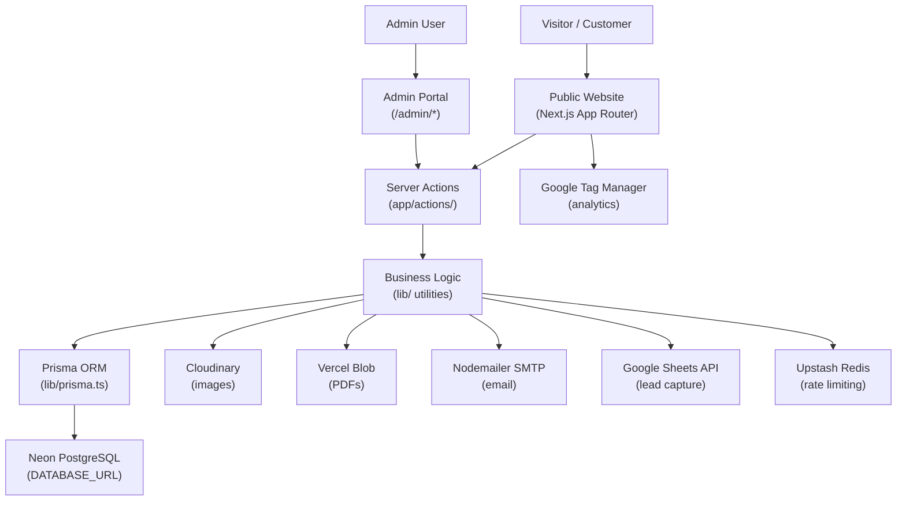
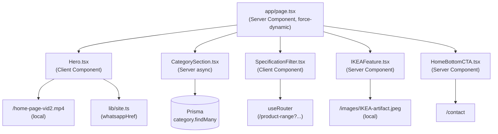
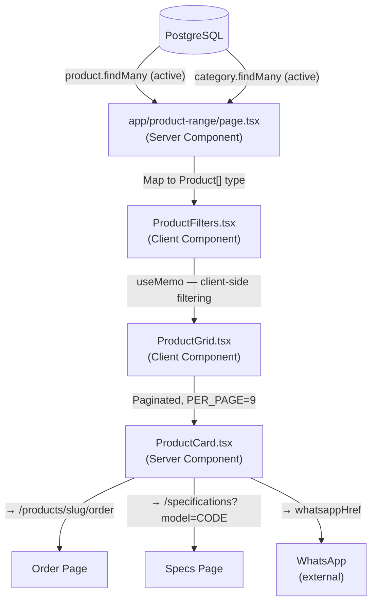
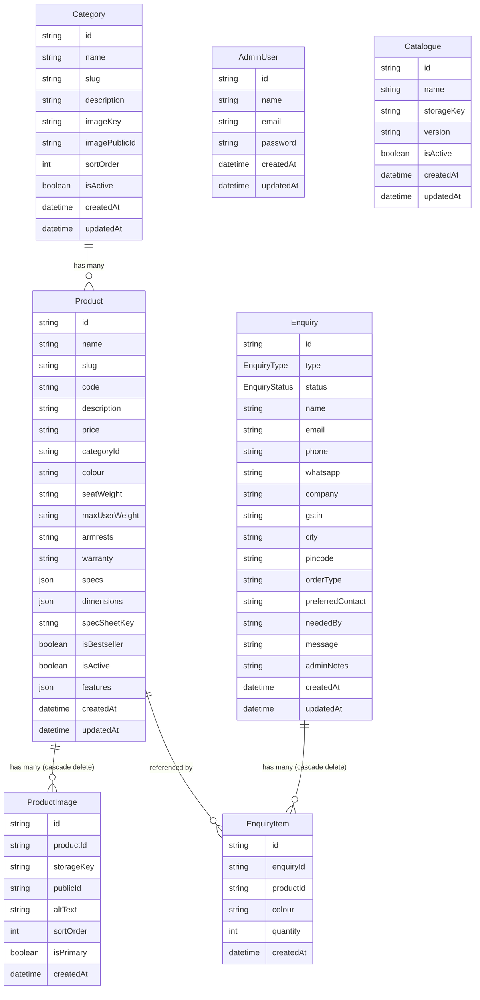
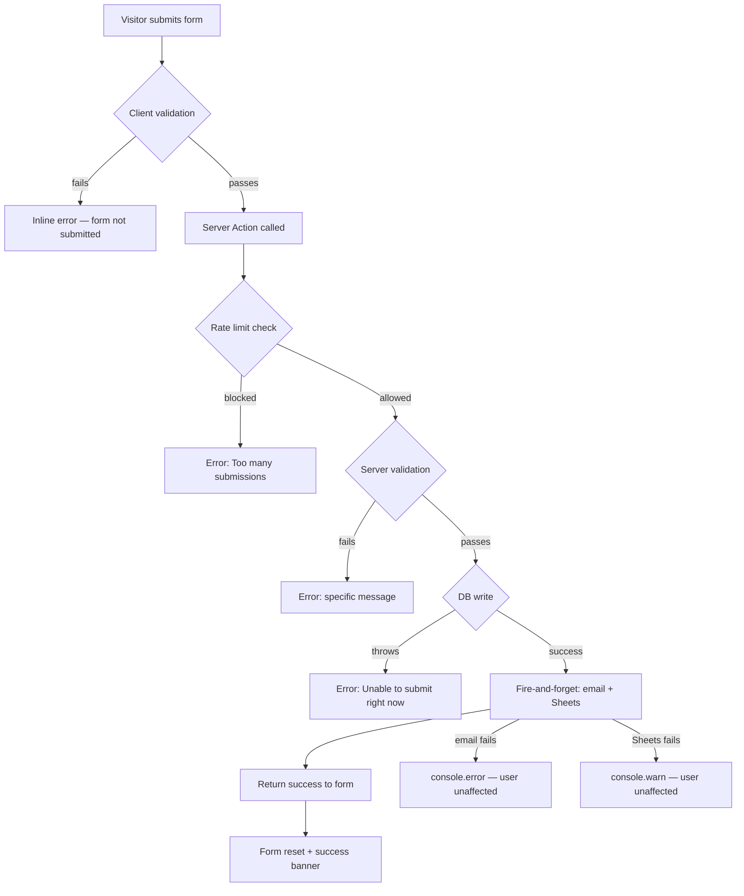
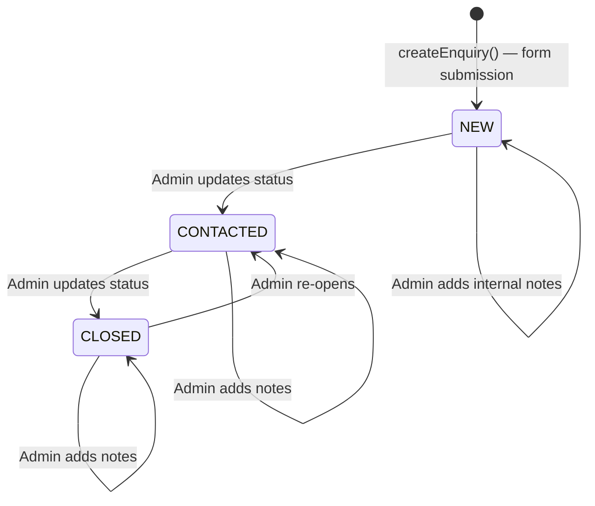
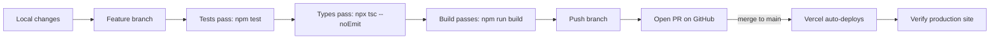

# NexChair — Complete Developer Handover

**Document type:** Consolidated master developer handover  
**Version:** 1.0  
**Date:** 2026-11-24  
**Status:** Complete  
**Source of truth:** Repository at `C:\Users\Pragya Awasthi\OneDrive\Desktop\IG1\nexchair`

> This document consolidates all six source handover documents (00–05) into a single comprehensive reference. It contains full technical detail across all 20 chapters and is intended to function as a complete standalone handover. For exhaustive low-level detail on any specific topic, the relevant source document (00–05) provides the most granular reference.

---

## Table of Contents

1. [Project Overview](#chapter-1--project-overview)
2. [Complete Application Architecture](#chapter-2--complete-application-architecture)
3. [Repository and Folder Structure](#chapter-3--repository-and-folder-structure)
4. [Public Website: Complete Functional Documentation](#chapter-4--public-website-complete-functional-documentation)
5. [Frontend Architecture and UI Implementation](#chapter-5--frontend-architecture-and-ui-implementation)
6. [Product Management and Product Lifecycle](#chapter-6--product-management-and-product-lifecycle)
7. [Backend Architecture and Server Actions](#chapter-7--backend-architecture-and-server-actions)
8. [Database and Data Models](#chapter-8--database-and-data-models)
9. [Complete Enquiry Workflow](#chapter-9--complete-enquiry-workflow)
10. [Admin Portal: Complete Operations Guide](#chapter-10--admin-portal-complete-operations-guide)
11. [Image, Video and Document Management](#chapter-11--image-video-and-document-management)
12. [Third-Party Integrations](#chapter-12--third-party-integrations)
13. [Authentication, Security and Permissions](#chapter-13--authentication-security-and-permissions)
14. [Environment Setup and Local Development](#chapter-14--environment-setup-and-local-development)
15. [Deployment and Hosting](#chapter-15--deployment-and-hosting)
16. [Testing and Quality Assurance](#chapter-16--testing-and-quality-assurance)
17. [Troubleshooting and Common Issues](#chapter-17--troubleshooting-and-common-issues)
18. [Developer Maintenance and Change Guide](#chapter-18--developer-maintenance-and-change-guide)
19. [Known Limitations and Outstanding Items](#chapter-19--known-limitations-and-outstanding-items)
20. [New Developer Handover Checklist](#chapter-20--new-developer-handover-checklist)
- [Appendix A: Documentation Consistency Report](#appendix-a-documentation-consistency-report)

---

## Chapter 1 — Project Overview

### 1.1 Business Context

NexChair is a B2B/B2C ergonomic office chair brand based in Pune, India. The website is the primary product catalogue and lead-capture channel for the business.

| Attribute | Value |
|---|---|
| Production domain | `https://www.nexchair.in` |
| Business sector | Office seating — B2B and B2C |
| Headquarters | Chakan, Pune, Maharashtra, India |
| Contact phone | +91 77982 03669 |
| Contact email | nexchairsales@gmail.com |
| WhatsApp | 917798203669 (default; configurable via env var) |

### 1.2 Business Objectives

The website serves four primary functions:

1. Display the product catalogue — categories, individual products, specifications, downloadable spec sheets
2. Capture enquiries — contact/quote requests and product order enquiries — via web forms
3. Notify the sales team immediately by email and log leads to Google Sheets
4. Provide an admin portal for managing products, categories, catalogues, and enquiries

### 1.3 Public Website Capabilities

| Route | Purpose |
|---|---|
| `/` | Homepage: hero video, category grid, specification filter, feature section, CTA |
| `/product-range` | Browse all active products with category and spec filters |
| `/products/[slug]` | Individual product detail: gallery, specs, dimensions, comparison |
| `/products/[slug]/order` | Multi-product order enquiry form |
| `/about` | Company information, principles, stats |
| `/contact` | Contact/quote enquiry form and business contact info |
| `/specifications` | Specifications browser: grid of products or single-product spec detail |

### 1.4 Admin Portal Capabilities

| Route | Purpose |
|---|---|
| `/admin/login` | Admin authentication |
| `/admin` | Dashboard: live counts (products, enquiries) |
| `/admin/products` | Full product CRUD: create, edit, delete, toggle active, manage images |
| `/admin/categories` | Category CRUD: create, edit, delete, toggle active, upload images |
| `/admin/enquiries` | Paginated enquiry list with filter and search |
| `/admin/enquiries/[id]` | Enquiry detail: status lifecycle, internal notes |
| `/admin/catalogues` | PDF catalogue upload and management |
| `/admin/settings` | Placeholder — no functionality implemented |

### 1.5 Primary User Journeys

**Visitor browsing products:**
Homepage → Category Section → Product Range → Product Detail → Specifications or Order page

**Visitor submitting an enquiry:**
Contact page or Order page → Form submission → DB record created → Email sent to sales → Row appended to Google Sheets

**Admin managing leads:**
Admin login → Dashboard → Enquiries → Enquiry detail → Update status → Add notes

**Admin adding a product:**
Admin login → Products → New Product → Fill form → Submit → Upload images

### 1.6 Technology Stack

| Concern | Technology | Version |
|---|---|---|
| Framework | Next.js (App Router) | 16.3.8 |
| UI Library | React | 19.2.8 |
| Language | TypeScript | ^5 |
| CSS Framework | Tailwind CSS | ^4 |
| PostCSS integration | @tailwindcss/postcss | ^4 |
| ORM | Prisma | 7.10.0 |
| DB Adapter | @prisma/adapter-pg (pg Pool) | — |
| Auth | jose (HS256 JWT) | — |
| Password hashing | bcryptjs | — |
| Rate limiting | @upstash/ratelimit + @upstash/redis | — |
| Email | Nodemailer (SMTP) | — |
| Image CDN | Cloudinary v2 | — |
| PDF storage | @vercel/blob | — |
| Lead capture | Google Sheets API v4 (manual fetch) | — |
| Analytics | Google Tag Manager | GTM-TB368V3C |
| Node.js | >=22.12.0 (from `engines` in package.json) | — |
| Fonts | Plus Jakarta Sans, Cormorant Garamond | Google Fonts |
| Testing | Vitest | 5.0.5 |

### 1.7 Hosting and Infrastructure

| Service | Purpose | Status |
|---|---|---|
| Vercel | Hosting and deployment | IMPLEMENTED (inferred from tooling) |
| Neon PostgreSQL | Serverless PostgreSQL, region ap-southeast-1 | IMPLEMENTED |
| Cloudinary | Product and category image CDN | IMPLEMENTED |
| Vercel Blob | PDF file storage (spec sheets, catalogues) | IMPLEMENTED |
| Upstash Redis | Rate limiting backing store | IMPLEMENTED |
| Google Sheets | Enquiry lead capture | IMPLEMENTED |
| Google Tag Manager | Analytics container GTM-TB368V3C | IMPLEMENTED |
| Gmail SMTP | Transactional email via STARTTLS | IMPLEMENTED |

### 1.8 Overall System Architecture

NexChair is a full-stack Next.js application using the App Router. There is no separate API layer — the application uses Server Components for data fetching and Server Actions for all mutations and form handling. The public website and admin portal share the same Next.js application; they are separated by route prefixes (`/` for public, `/admin` for protected) and an authentication middleware in the admin route group layout. All database access goes through a Prisma singleton using the `@prisma/adapter-pg` driver connected to a Neon serverless PostgreSQL database. File storage is split: images to Cloudinary, PDFs to Vercel Blob. After each enquiry submission, two fire-and-forget operations run concurrently: an SMTP email notification and a Google Sheets row append. Rate limiting uses Upstash Redis via REST.

### 1.9 Documentation Consistency Report

See Appendix A for findings from the cross-document consistency audit performed during the creation of this document.

---

## Chapter 2 — Complete Application Architecture

### 2.1 Architecture Diagram



### 2.2 Rendering Strategy

**Server Components** handle all data fetching. Pages that must always reflect fresh data export `export const dynamic = "force-dynamic"`. Product detail pages are rendered on demand. The admin portal is fully server-rendered with client-side interactivity in forms.

**Client Components** are used only where browser-side state is required: the navbar mobile menu, product filters (useMemo-based client-side filtering), forms with controlled inputs, admin UI components with modal/transition state.

**Server Actions** (`app/actions/*.ts`) are the sole mutation layer. There is no REST API — no `app/api/route.ts` files are implemented. Server Actions handle: enquiry submission, admin login/logout, product CRUD, category CRUD, catalogue management, and enquiry status updates.

### 2.3 Request and Data Flow

**Public page request:**
1. Browser requests a page (e.g., `/product-range`)
2. Next.js executes the Server Component
3. Server Component queries Prisma → Neon PostgreSQL
4. HTML rendered server-side with product data embedded
5. Client Components hydrate in browser (ProductFilters, etc.)
6. No further server requests on client-side filter interactions (all data passed as props)

**Enquiry form submission:**
1. User fills form → Client Component calls Server Action via `useTransition`
2. Server Action: rate limit check → validation → Prisma write → `Promise.allSettled([email, sheets])`
3. Returns `{success, message, enquiryId}` to client
4. Email and Sheets fire-and-forget concurrently after DB write

**Admin mutation:**
1. Admin fills form → Server Action called
2. Server Action: `requireAdminSession()` guard → validation → Prisma write → `revalidatePath()`
3. `useEffect` on `state.success` → `router.refresh()` to reload fresh data

---

## Chapter 3 — Repository and Folder Structure

### 3.1 Full Directory Tree

```
nexchair/
├── app/                          # Next.js App Router — pages, layouts, actions
│   ├── actions/                  # Server Actions ("use server")
│   │   ├── __tests__/            # Vitest test files for actions
│   │   ├── admin-auth.ts
│   │   ├── admin-catalogues.ts
│   │   ├── admin-categories.ts
│   │   ├── admin-enquiries.ts
│   │   ├── admin-products.ts
│   │   └── enquiries.ts
│   ├── admin/
│   │   ├── (protected)/          # Route group: session-guarded admin pages
│   │   │   ├── layout.tsx        # Applies AdminShell + session check
│   │   │   ├── page.tsx          # Dashboard
│   │   │   ├── catalogues/page.tsx
│   │   │   ├── categories/page.tsx
│   │   │   ├── enquiries/
│   │   │   │   ├── page.tsx
│   │   │   │   └── [id]/page.tsx
│   │   │   ├── products/page.tsx
│   │   │   └── settings/page.tsx
│   │   └── login/page.tsx
│   ├── about/page.tsx
│   ├── contact/page.tsx
│   ├── product-range/page.tsx
│   ├── products/[slug]/
│   │   ├── page.tsx
│   │   └── order/page.tsx
│   ├── specifications/page.tsx
│   ├── globals.css
│   ├── icon.png
│   ├── layout.tsx                # Root layout (fonts, GTM, global nav)
│   ├── page.tsx                  # Homepage
│   ├── robots.ts
│   └── sitemap.ts
│
├── components/                   # Reusable React components
│   ├── admin/                    # Admin-only components
│   │   ├── AdminShell.tsx
│   │   ├── CatalogueManager.tsx
│   │   ├── CategoryForm.tsx
│   │   ├── CategoryManager.tsx
│   │   ├── EnquiryList.tsx
│   │   ├── EnquiryNotesForm.tsx
│   │   ├── EnquiryStatusForm.tsx
│   │   ├── LogoutButton.tsx
│   │   ├── ProductForm.tsx
│   │   ├── ProductImageManager.tsx
│   │   └── ProductManager.tsx
│   ├── contact/
│   │   ├── ContactEnquiryForm.tsx  # UNUSED — never imported
│   │   └── ContactQuoteForm.tsx
│   ├── home/
│   │   ├── Bestsellers.tsx         # UNUSED
│   │   ├── CategorySection.tsx
│   │   ├── Hero.tsx
│   │   ├── HomeBottomCTA.tsx
│   │   ├── IKEAFeature.tsx
│   │   ├── ProductShowcase.tsx     # UNUSED
│   │   ├── QuoteForm.tsx           # UNUSED
│   │   ├── QuoteSection.tsx        # UNUSED
│   │   ├── SpecificationFilter.tsx
│   │   ├── SpecsHighlights.tsx     # COMMENTED OUT in page.tsx
│   │   └── WhyNexChair.tsx         # UNUSED
│   ├── order/
│   │   └── OrderEnquiryForm.tsx
│   ├── product-detail/
│   │   ├── ProductComparison.tsx
│   │   └── ProductGallery.tsx
│   ├── product-range/
│   │   ├── ProductFilters.tsx
│   │   ├── ProductGrid.tsx
│   │   ├── ProductRangeCTA.tsx
│   │   └── ProductRangeHeader.tsx
│   ├── specifications/
│   │   └── SpecGallery.tsx
│   ├── AnnouncementBar.tsx
│   ├── CompanyStats.tsx            # UNUSED — never imported
│   ├── Footer.tsx
│   ├── Navbar.tsx
│   └── ProductCard.tsx
│
├── lib/                          # Backend utilities (server-only)
│   ├── __tests__/
│   │   ├── email.test.ts
│   │   ├── ratelimit.test.ts
│   │   └── sheets.test.ts
│   ├── auth/admin.ts
│   ├── cloudinary.ts
│   ├── email.ts
│   ├── prisma.ts
│   ├── ratelimit.ts
│   ├── sheets.ts
│   ├── site.ts
│   └── storage.ts
│
├── types/
│   └── product.ts                # Legacy Product type (bridge type, pre-database)
│
├── data/
│   └── products.ts               # LEGACY — static product data, superseded by DB
│
├── prisma/
│   ├── migrations/               # Migration SQL files (committed to git)
│   │   ├── 20261005163606_init/
│   │   ├── 20261006061354_add_product_features/
│   │   ├── 20261015065134_add_cloudinary_public_ids/
│   │   └── 20261023000000_add_enquiry_admin_notes/
│   ├── schema.prisma
│   └── seed.ts                   # LEGACY — broken; no package.json "seed" entry
│
├── generated/
│   └── prisma/                   # Prisma generated client (gitignored — must be generated)
│
├── scripts/                      # Maintenance/admin scripts (tsx)
│   ├── create-admin.ts           # Create initial admin user
│   ├── fix-sheet-headers.ts
│   ├── import-archive.ts         # Initial product data import from ZIP
│   ├── merge-excel-specs.ts      # Batch spec update from Excel
│   └── update-images.ts
│
├── public/                       # Static assets served at /
│   ├── images/
│   │   ├── principle/            # About page principle card images (×4)
│   │   └── site/                 # Logo files
│   ├── home-page-vid.mp4         # Hero video (NOT referenced in Hero.tsx)
│   ├── home-page-vid2.mp4        # Hero video (ACTIVE — used in Hero.tsx)
│   └── *.svg                     # Next.js scaffold SVGs (unused)
│
├── docs/nexchair-handover/       # This documentation
├── info/                         # Design screenshots (not served)
│
├── next.config.ts                # Next.js config (body size limit 12mb, Cloudinary domain)
├── package.json
├── prisma.config.ts
├── postcss.config.mjs
├── tsconfig.json
├── vitest.config.mts
├── eslint.config.mjs
├── AGENTS.md
├── CLAUDE.md
└── README.md                     # Default create-next-app scaffold (outdated)
```

### 3.2 Key File Reference Table

| Path | Purpose |
|---|---|
| `app/layout.tsx` | Root layout: fonts, GTM, AnnouncementBar, Navbar, Footer |
| `app/page.tsx` | Homepage (force-dynamic) |
| `app/actions/enquiries.ts` | Public enquiry Server Action: validate, save, email, Sheets |
| `app/actions/admin-auth.ts` | Admin login/logout Server Actions |
| `app/actions/admin-products.ts` | Product CRUD Server Actions (9 functions) |
| `app/actions/admin-categories.ts` | Category CRUD Server Actions (5 functions) |
| `app/actions/admin-enquiries.ts` | Enquiry management Server Actions (4 functions) |
| `app/actions/admin-catalogues.ts` | Catalogue management Server Actions (5 functions) |
| `lib/prisma.ts` | Prisma singleton (throws at startup if DATABASE_URL missing) |
| `lib/auth/admin.ts` | JWT session management (throws at startup if ADMIN_SESSION_SECRET missing) |
| `lib/cloudinary.ts` | Cloudinary client (throws at startup if credentials missing) |
| `lib/storage.ts` | File upload/delete routing (Cloudinary vs Vercel Blob), size validation |
| `lib/email.ts` | Email templates (buildInternalHtml, buildCustomerHtml) and sendEnquiryEmails |
| `lib/sheets.ts` | Google Sheets append function (service account JWT auth) |
| `lib/ratelimit.ts` | Rate limit check functions (enquiry: fail-open; login: fail-closed) |
| `lib/site.ts` | Contact info, WhatsApp number, business hours |
| `prisma/schema.prisma` | Database schema (7 models, 2 enums) |
| `generated/prisma/` | Prisma generated client (gitignored — must be regenerated) |
| `scripts/create-admin.ts` | Create initial admin user (use this, not prisma db seed) |
| `types/product.ts` | Legacy Product interface — bridge type used by filter components |
| `data/products.ts` | LEGACY: static product data, superseded by DB, still present |
| `next.config.ts` | Server Actions body size limit 12mb, Cloudinary remote image pattern |

---

## Chapter 4 — Public Website: Complete Functional Documentation

### 4.1 Route Table

| Route | File | Render Mode | Dynamic | Data Source |
|---|---|---|---|---|
| `/` | `app/page.tsx` | Server Component | force-dynamic | Prisma (via CategorySection) |
| `/product-range` | `app/product-range/page.tsx` | Server Component | force-dynamic | Prisma |
| `/products/[slug]` | `app/products/[slug]/page.tsx` | Server Component | per-request | Prisma findUnique |
| `/products/[slug]/order` | `app/products/[slug]/order/page.tsx` | Server Component | per-request | Prisma findMany (all active) |
| `/about` | `app/about/page.tsx` | Server Component | static | Static content + lib/site.ts |
| `/contact` | `app/contact/page.tsx` | Server Component | static | lib/site.ts |
| `/specifications` | `app/specifications/page.tsx` | Server Component | per-request | Prisma (dual-mode) |
| `/sitemap.xml` | `app/sitemap.ts` | Next.js metadata | — | Prisma (active products) |
| `/robots.txt` | `app/robots.ts` | Next.js metadata | — | Static |

The root layout (`app/layout.tsx`) applies to all routes: AnnouncementBar → Navbar → {children} → Footer.

### 4.2 Homepage

**File:** `app/page.tsx`  
**Rendering:** Server Component, `export const dynamic = "force-dynamic"`

**Homepage component tree:**



**Sections in render order:**

**1. Hero** (`components/home/Hero.tsx`) — Client Component
- Full-width dark teal section with video panel on right (desktop) or below text (mobile)
- Video: `/home-page-vid2.mp4`, attributes: `autoPlay`, `loop`, `muted`, `playsInline`
- Mute toggle button in video corner (manages `isMuted` state via `videoRef`)
- Poster/fallback image: `/images/hero-image.png`
- Heading: "Built for the long day. Sold on facts."
- CTAs: "Explore the range" → `/product-range`; "Chat on WhatsApp" → `whatsappHref` (new tab)
- Trust strip: 3 metrics (1 year warranty, 13+ years, Pan-India delivery)
- Background: `#073B38`
- Note: `/home-page-vid.mp4` exists in `public/` but is NOT referenced in Hero.tsx

**2. CategorySection** (`components/home/CategorySection.tsx`) — Server Component (async)
- Fetches active categories from Prisma: `category.findMany({ where: { isActive: true }, orderBy: [{ sortOrder: "asc" }, { name: "asc" }] })`
- Falls back to 6 hardcoded category names if DB query fails
- Grid: `grid-cols-2 sm:grid-cols-3 lg:grid-cols-6`
- Each card links to `/product-range?category=${category.slug}`
- Background: `#FBF2E8`

**3. SpecificationFilter** (`components/home/SpecificationFilter.tsx`) — Client Component
- All filter options hardcoded (not from DB)
- Budget: Under ₹3,000 / ₹3,000–₹5,000 / ₹5,000–₹8,000 / ₹8,000–₹12,000 / Above ₹12,000
- Back type: Mesh / Fabric / Leatherette / Leather
- Armrests: Fixed / Adjustable / 2D Adjustable / 4D Adjustable / No armrests
- On "Show chairs" click: constructs URL params and calls `router.push('/product-range?...')`
- Background: linear-gradient `#092F30 → #073B38`

**4. IKEAFeature** (`components/home/IKEAFeature.tsx`) — Server Component
- Status: FULLY HARDCODED — references IKEA GLOSTAD sofa with external `ikea.com` URL
- Image: `/images/IKEA-artifact.jpeg`
- Contains "View on IKEA" external link
- Note: This is likely placeholder/demonstration content. Replacing requires rewriting the entire component.

**5. HomeBottomCTA** (`components/home/HomeBottomCTA.tsx`) — Server Component
- Heading: "Kitting out a whole office?"
- CTA: "Request a quote" → `/contact`
- Background: `#F1E5D6`

### 4.3 Product Range Page

**File:** `app/product-range/page.tsx`  
**Rendering:** Server Component, force-dynamic

Two parallel Prisma queries via `Promise.all`:
1. All active products with primary image and category
2. All active categories for filter pills

Products are transformed into the legacy `Product` type before passing to client components. All filtering and pagination happens client-side — no server round-trips after initial page load.

**Components:** `ProductRangeHeader` (static), `ProductFilters` (Client — all filtering logic), `ProductRangeCTA` (static)

**ProductFilters** accepts all products and categories as props. Filter logic runs in `useMemo`. Filter options: category pills, back type, armrests, max weight, features, colour (dynamic from product data), budget (numeric input). All filters are ANDed. Sort options: Recommended, Price Low→High, Price High→Low, Newest.

**ProductGrid:** Client-side pagination, `PER_PAGE = 9`, numbered pagination buttons.

**ProductCard** (`components/ProductCard.tsx`) — Server Component
- Uses plain `` tags (NOT `next/image`) for product images
- Bestseller badge if `isBestseller === true`
- Spec badge: Back, Armrests, Max weight
- CTAs: "Enquire" → `/products/${slug}/order`; "WhatsApp" → `whatsappHref` (new tab); "Full specs" → `/specifications?model=${code}`

### 4.4 Product Detail Page

**File:** `app/products/[slug]/page.tsx`

Prisma queries: `findUnique({ where: { slug, isActive: true }, include: { category, images } })` + `findMany` for similar products (same category, take 2). Returns `notFound()` if product is null.

**Price display:** `normalisedProductPrice()` — if value is empty, contains `[`, or equals "Price on request", displays "Price on request".

**Sticky tab navigation:** Specifications | Mechanism | Warranty & care | Compare (pure CSS scroll-to-anchor).

**Spec sheet download:** Direct link to Vercel Blob URL (`product.specSheetKey`). If null, shows disabled span.

**ProductGallery** (`components/product-detail/ProductGallery.tsx`) — Client Component
- Uses plain `` tags (NOT `next/image`) — no Next.js image optimization
- Thumbnail navigation, previous/next arrows, index wraps with modulo

### 4.5 Product Order Page

**File:** `app/products/[slug]/order/page.tsx`

Fetches ALL active products (not just current) to populate the product dropdown in `OrderEnquiryForm`. Current product is identified by slug match in results.

### 4.6 About Page

**File:** `app/about/page.tsx`

Fully static. Sections: hero (factory image), statistics strip (4 hardcoded stats), company description, 4 principle cards, closing CTA with WhatsApp link.

**Content gap:** One principle card has `note: "Coverage details pending — awaiting confirmation from client."` hardcoded in JSX — this renders visibly on the live page.

### 4.7 Contact Page

**File:** `app/contact/page.tsx`

Renders `ContactQuoteForm` and a contact info panel (data from `lib/site.ts`). Business hours: Mon–Sat 9:30 AM–8:00 PM, Sun Closed. Two addresses: Chakan and Balewadi.

### 4.8 Specifications Page

**File:** `app/specifications/page.tsx`

Dual-mode operation:
- With `?model=CODE`: shows SpecGallery + spec sheet download + WhatsApp/enquire CTAs for that specific product
- Without: shows category-filtered product grid

`SpecGallery.tsx` uses `next/image` with `fill` layout (unlike `ProductGallery.tsx` which uses plain ``).

Product card links go to `/specifications?model=${product.code}`.

---

## Chapter 5 — Frontend Architecture and UI Implementation

### 5.1 Shared Layout Components

**AnnouncementBar** (`components/AnnouncementBar.tsx`) — Server Component
- Background: `#0B3838`, text: `#FFF9F0` at 80% opacity, icons: `#E8AD4D`
- Mobile: single line "1 year warranty on every chair"
- Desktop (sm:): 3 items with gold dividers: bulk orders, GST invoicing, warranty

**Navbar** (`components/Navbar.tsx`) — Client Component
- Logo: `/images/site/nexchair-logo.png`, `width={140} height={36}`, `priority`
- 4 nav links (hardcoded): Home, Product Range, About, Contact
- WhatsApp button: green `#1aad4b`; "Request a quote" button: orange `#D85B13`
- Mobile menu: `useState` for `menuOpen`, hamburger icon, hides at `md:`
- Background: `#F8F2E9`, text: `#0E3159`, position: `sticky top-0 z-50`

**Footer** (`components/Footer.tsx`) — Server Component
- Background: linear-gradient `#092F30 → #073B38 → #0a3c39`
- 4-column grid: Shop (product category links), Company, Contact Info (from lib/site.ts), WhatsApp
- Mobile: `grid-cols-2`, Desktop: `grid-cols-4`
- Shop links use `?category=` URL params: ergonomic-chair, executive-chair, lounge-chair, visitor-chair

**lib/site.ts** — Single source of truth for all contact information
- `whatsappHref` derived from `NEXT_PUBLIC_WHATSAPP_NUMBER` env var (default: `917798203669`)
- Two physical addresses: Chakan (primary) and Balewadi
- Business hours array: Mon–Sat 9:30 AM–8:00 PM, Sunday Closed

### 5.2 Font System

| Font | CSS Variable | Usage |
|---|---|---|
| Plus Jakarta Sans | `--font-sans` | Body text, UI elements |
| Cormorant Garamond | `--font-cormorant` | Major headings via `.font-display` class |

Both fonts loaded via `next/font/google` in `app/layout.tsx` and injected as CSS variables on the `<html>` element.

The `.font-display` utility class in `globals.css` applies `font-family: var(--font-cormorant)` to major headings throughout the public website.

**Note:** Admin portal components do NOT use brand fonts — they inherit browser default sans-serif.

### 5.3 Tailwind CSS v4

Tailwind CSS v4 is a breaking change from v3:
- No `tailwind.config.ts` or `tailwind.config.js` file
- Configured via `@import "tailwindcss"` in `globals.css`
- PostCSS: `@tailwindcss/postcss` only (in `postcss.config.mjs`)
- CSS custom properties define the full colour system in `globals.css`

### 5.4 Brand Colour Reference

| Token | Hex Values | Usage |
|---|---|---|
| Dark teal | `#073B38` / `#092F30` | Hero, footer, product card backgrounds |
| Orange | `#D85B13` / `#F26919` | Buttons, CTAs, active states |
| Gold | `#E8AD4D` / `#F0A52E` | Decorative, icons, dividers |
| Cream | `#FBF2E8` / `#F5EBDD` | Page backgrounds, card fills |
| Navy | `#0E3159` / `#102B43` | Secondary text, alternate headers |
| Charcoal | `#352C27` | Body text |
| Admin orange | `#c44e18` | Admin portal accent (slightly darker) |
| Admin sidebar | `#171717` | Admin sidebar background |

### 5.5 Animations

Defined in `globals.css`:
- `fadeUp` keyframe: slides element up from 24px
- `fadeIn` keyframe: opacity 0 → 1
- Delay utilities: `.anim-delay-1` through `.anim-delay-5`
- `prefers-reduced-motion: reduce` media query disables all animations

### 5.6 Legacy Product Type Bridge

`types/product.ts` defines a `Product` interface that pre-dates the database layer. It is used by `ProductFilters`, `ProductGrid`, and `ProductCard`. The `/product-range` page transforms Prisma results into this legacy `Product` type before passing to client components. This transformation at `app/product-range/page.tsx` is the coupling point between the database layer and the component layer. When adding new product fields to the UI, both the Prisma query and this transformation step must be updated.

---

## Chapter 6 — Product Management and Product Lifecycle

### 6.1 Product Lifecycle Flow

```
Admin creates product → isActive=true → Visible on /product-range
                                      → Detail page at /products/[slug]
                                      → Order enquiry at /products/[slug]/order
                                      → Specifications at /specifications?model=CODE
                                      → Included in sitemap.xml
```

Products are deactivated (not deleted) when discontinuing them, to preserve their enquiry history.

A product cannot be deleted if any `EnquiryItem` references it — the application checks `_count.enquiryItems > 0` before allowing deletion.

### 6.2 Product Data Retrieval



### 6.3 Price Normalization

`normalisedProductPrice(raw: string)` trims the value; if the trimmed string is empty, contains `[`, or equals `"Price on request"`, it returns `"Price on request"`. Otherwise returns the trimmed string. This handles legacy placeholder prices from the import scripts.

The `Product.price` field is a **STRING** (not numeric). It stores values like `"₹ 12,500"` or `"Price on request"`. Numeric sorting requires parsing via `parsePrice()`.

### 6.4 Specs and Dimensions JSON

`Product.specs` and `Product.dimensions` are freeform JSONB columns. The product detail page reads specific keys:

**`specs` keys used by the UI:** `lumbar`, `armrests`, `back`

**`dimensions` keys used by the UI:** `seat`, `base`, `casters`, `gasLift`, `tiltMechanism`, `reclineRange`, `tiltLock`, `seatSlider`, `headrest`, `warrantyFrame`, `warrantyUpholstery`, `warrantyService`

Missing keys render as `"-"` and are filtered out of the spec table. The admin ProductForm only writes `lumbar` and `back` to the `specs` JSON — this means updating a product via the admin portal **overwrites the entire specs JSON** with only those two keys, losing any other spec data previously stored.

### 6.5 Spec Sheet Download

If `product.specSheetKey` is set: rendered as `<a href={product.specSheetKey} target="_blank">` — a direct link to the Vercel Blob URL. No authentication required. If not set: a disabled `<span>` with `cursor-not-allowed`.

### 6.6 Product Image Flow

1. Admin → Products → manage images → select file
2. `ProductImageManager` form submits to `addProductImage()` Server Action
3. `lib/storage.ts` validates: type must be `image/*`, size ≤ 5MB
4. Cloudinary `upload_stream` → returns `{url: secure_url, publicId}`
5. `ProductImage` record created: `storageKey=url`, `publicId=publicId`

The first image uploaded becomes primary automatically (`isPrimary: true`). Reorder and set-primary operations use Prisma `$transaction`.

---

## Chapter 7 — Backend Architecture and Server Actions

### 7.1 Architecture Principles

- No `app/api/route.ts` files — no REST API layer
- All mutations via Server Actions in `app/actions/`
- All Server Actions have `"use server"` directive at top of file
- Validation is manual regex and length checks — no Zod or other schema library
- Admin actions call `requireAdminSession()` as first operation
- File handling delegated to `lib/storage.ts`
- Cache invalidation via `revalidatePath()` after mutations

### 7.2 Public Enquiry Action

**File:** `app/actions/enquiries.ts`

| Function | Signature | Purpose |
|---|---|---|
| `createEnquiry(input)` | `CreateEnquiryInput → {success, message, enquiryId?}` | Validate, persist enquiry+items, send email+Sheets |

**Execution sequence:** Rate limit → type validation → name validation → contact validation → email/phone format → message length → items count → item quantities → product ID verification → Prisma write → `Promise.allSettled([email, sheets])` → return success.

### 7.3 Admin Auth Actions

**File:** `app/actions/admin-auth.ts`

| Function | Signature | Purpose |
|---|---|---|
| `signInAdmin(formData)` | `FormData → {success, message}` | Rate-limited login; creates JWT session cookie on success |
| `signOutAdmin()` | `() → void` | Clears session cookie, redirects to /admin/login |

### 7.4 Product Actions

**File:** `app/actions/admin-products.ts`

| Function | Description |
|---|---|
| `getProducts(categoryId?)` | Fetch all products with images and category |
| `createProduct(state, formData)` | Create product + optional first image in `$transaction` |
| `updateProduct(state, formData)` | Update product fields, spec sheet intent (keep/replace/remove) |
| `deleteProduct(state, formData)` | Delete product (blocked if enquiry items exist) |
| `toggleProductActive(state, formData)` | Toggle `isActive` flag |
| `addProductImage(state, formData)` | Upload image to Cloudinary, add to DB |
| `deleteProductImage(state, formData)` | Delete image, promote next primary in `$transaction` |
| `setProductImagePrimary(state, formData)` | Set primary image in `$transaction` |
| `reorderProductImages(state, formData)` | Reorder images; validates complete permutation |

After every product mutation: `revalidateAll(slug)` calls `revalidatePath()` on 5 paths.

**Spec sheet intent:** When editing a product, three options control the spec sheet: "keep" (no change), "replace" (new PDF upload), "remove" (delete existing, set null). Sent as hidden input `removeSpecSheet`.

### 7.5 Category Actions

**File:** `app/actions/admin-categories.ts`

| Function | Description |
|---|---|
| `getCategories()` | Fetch all categories ordered by [sortOrder, name] |
| `createCategory(state, formData)` | Create category, optional Cloudinary image |
| `updateCategory(state, formData)` | Update fields + image intent; slug regenerated from name |
| `deleteCategory(state, formData)` | Delete category (blocked if products > 0) |
| `toggleCategoryActive(state, formData)` | Toggle `isActive` flag |

**Warning:** `updateCategory()` regenerates the slug from the new name on every update. Renaming a category changes its slug, silently breaking existing `?category=SLUG` URLs with no redirect created.

### 7.6 Enquiry Actions

**File:** `app/actions/admin-enquiries.ts`

| Function | Description |
|---|---|
| `getEnquiries({status, type, search, page})` | Paginated list (20/page), filter by status/type/search |
| `getEnquiry(id)` | Full enquiry detail including items with product names |
| `updateEnquiryStatus(state, formData)` | Change EnquiryStatus (NEW / CONTACTED / CLOSED) |
| `updateEnquiryNotes(state, formData)` | Update adminNotes field (max 2000 chars; silently truncated) |

### 7.7 Catalogue Actions

**File:** `app/actions/admin-catalogues.ts`

| Function | Description |
|---|---|
| `getCatalogues()` | Fetch all catalogues ordered by createdAt desc |
| `createCatalogue(state, formData)` | Upload PDF to Vercel Blob (`catalogues/`), create DB record |
| `updateCatalogue(state, formData)` | Update name/version only — no file replacement |
| `toggleCatalogueActive(state, formData)` | Toggle isActive flag |
| `deleteCatalogue(state, formData)` | Delete DB record + fire-and-forget Vercel Blob cleanup |

---

## Chapter 8 — Database and Data Models

### 8.1 Database Infrastructure

| Item | Detail |
|---|---|
| Provider | PostgreSQL (confirmed from migration_lock.toml) |
| Host | Neon serverless PostgreSQL, region ap-southeast-1 (AWS Singapore) |
| Database name | nexchair_db |
| ORM | Prisma 7.10.0 |
| Adapter | @prisma/adapter-pg with pg.Pool |
| Generated client output | `generated/prisma/` (gitignored) |
| Schema file | `prisma/schema.prisma` |
| Config file | `prisma.config.ts` (root) |
| SSL | `rejectUnauthorized: true` on pg Pool; `sslmode` stripped then re-applied |

**Singleton pattern:** Global `prisma` instance attached to `globalThis` in development to survive hot-reload. Production creates fresh instance per cold start.

**Startup-time throw:** `lib/prisma.ts` throws immediately on import if `DATABASE_URL` is undefined.

**Note:** `@prisma/adapter-neon` is installed but unused. Only `@prisma/adapter-pg` is used.

### 8.2 Model Inventory

The schema defines **7 models** and **2 enums**.

| Enum | Values |
|---|---|
| `EnquiryType` | `CONTACT`, `QUOTE`, `ORDER` |
| `EnquiryStatus` | `NEW`, `CONTACTED`, `CLOSED` |

### 8.3 Model: AdminUser

Stores admin portal login accounts. Passwords are bcryptjs hashes (12 rounds). No role field — single-tier access model.

| Field | Type | Required | Default | Constraints | Description |
|---|---|---|---|---|---|
| `id` | String | Yes | cuid() | PK | Unique identifier |
| `name` | String | Yes | — | NOT NULL | Display name |
| `email` | String | Yes | — | UNIQUE, NOT NULL | Login email (lowercased before storage) |
| `password` | String | Yes | — | NOT NULL | bcryptjs hash |
| `createdAt` | DateTime | Yes | now() | NOT NULL | Creation timestamp |
| `updatedAt` | DateTime | Yes | — | NOT NULL, @updatedAt | Auto-updated |

No relations to other models. Created/updated only via `scripts/create-admin.ts`. Never deleted via application code.

### 8.4 Model: Category

Product categories displayed on the public website.

| Field | Type | Required | Default | Constraints | Description |
|---|---|---|---|---|---|
| `id` | String | Yes | cuid() | PK | Unique identifier |
| `name` | String | Yes | — | NOT NULL | Display name (e.g., "Executive Chair") |
| `slug` | String | Yes | — | UNIQUE, NOT NULL | URL-safe identifier (e.g., `executive-chair`) |
| `description` | String? | No | NULL | — | Optional; not currently displayed publicly |
| `imageKey` | String? | No | NULL | — | Full Cloudinary URL |
| `imagePublicId` | String? | No | NULL | — | Cloudinary public_id for deletion |
| `sortOrder` | Int | Yes | 0 | NOT NULL | Controls display order |
| `isActive` | Boolean | Yes | true | NOT NULL | Visibility on public site |
| `createdAt` | DateTime | Yes | now() | NOT NULL | Creation timestamp |
| `updatedAt` | DateTime | Yes | — | NOT NULL, @updatedAt | Auto-updated |

Cannot delete a category that has products assigned (database RESTRICT FK + application guard).

### 8.5 Model: Product

The core product catalogue record.

| Field | Type | Required | Default | Constraints | Description |
|---|---|---|---|---|---|
| `id` | String | Yes | cuid() | PK | Unique identifier |
| `name` | String | Yes | — | NOT NULL | Product display name |
| `slug` | String | Yes | — | UNIQUE, NOT NULL | URL path segment |
| `code` | String | Yes | — | UNIQUE, NOT NULL | Model code (e.g., `NC-ERGOMAX`), uppercase |
| `description` | String? | No | NULL | — | Optional long-form description |
| `price` | String | Yes | — | NOT NULL | **String, not numeric** (e.g., "₹ 12,500") |
| `categoryId` | String | Yes | — | NOT NULL, FK→Category | Owning category |
| `colour` | String? | No | NULL | — | Available colours (e.g., "Graphite / Black") |
| `seatWeight` | String? | No | NULL | — | Net weight string |
| `maxUserWeight` | String? | No | NULL | — | Maximum user weight string |
| `armrests` | String? | No | NULL | — | Armrest description |
| `warranty` | String? | No | NULL | — | Warranty description |
| `specs` | Json? | No | NULL | — | Freeform JSON: `lumbar`, `armrests`, `back` |
| `dimensions` | Json? | No | NULL | — | Freeform JSON: 12 mechanism/dimension keys |
| `specSheetKey` | String? | No | NULL | — | Vercel Blob URL to PDF spec sheet |
| `isBestseller` | Boolean | Yes | false | NOT NULL | Bestseller badge flag |
| `isActive` | Boolean | Yes | true | NOT NULL | Visibility on public site |
| `features` | Json? | No | NULL | — | JSON array of feature strings |
| `createdAt` | DateTime | Yes | now() | NOT NULL | Creation timestamp |
| `updatedAt` | DateTime | Yes | — | NOT NULL, @updatedAt | Auto-updated |

**Indexes:** categoryId, isActive, isBestseller

**Critical rule:** The admin ProductForm's `updateProduct()` only writes `{lumbar, back}` to `specs` JSON on save — this overwrites the entire JSON column. Any other spec keys previously stored are lost on update.

### 8.6 Model: ProductImage

Images for a product, stored in Cloudinary.

| Field | Type | Required | Default | Constraints | Description |
|---|---|---|---|---|---|
| `id` | String | Yes | cuid() | PK | Unique identifier |
| `productId` | String | Yes | — | NOT NULL, FK→Product CASCADE | Parent product |
| `storageKey` | String | Yes | — | NOT NULL | Full Cloudinary HTTPS URL |
| `publicId` | String? | No | NULL | — | Cloudinary public_id for deletion |
| `altText` | String? | No | NULL | — | Optional alt text |
| `sortOrder` | Int | Yes | 0 | NOT NULL | Display order |
| `isPrimary` | Boolean | Yes | false | NOT NULL | Main/thumbnail image flag |
| `createdAt` | DateTime | Yes | now() | NOT NULL | Creation timestamp (no updatedAt) |

**Index:** productId. CASCADE delete when parent Product is deleted.

**Rule:** At most one `isPrimary: true` per product — maintained by application code only (no DB constraint).

### 8.7 Model: Catalogue

PDF catalogue documents managed via admin portal.

| Field | Type | Required | Default | Constraints | Description |
|---|---|---|---|---|---|
| `id` | String | Yes | cuid() | PK | Unique identifier |
| `name` | String | Yes | — | NOT NULL | Display name |
| `storageKey` | String | Yes | — | NOT NULL | Full Vercel Blob URL |
| `version` | String? | No | NULL | — | Optional version label |
| `isActive` | Boolean | Yes | true | NOT NULL | Admin toggle (no public effect currently) |
| `createdAt` | DateTime | Yes | now() | NOT NULL | Creation timestamp |
| `updatedAt` | DateTime | Yes | — | NOT NULL, @updatedAt | Auto-updated |

No relations to other models. No public route reads from this model.

**To replace a catalogue PDF:** Upload a new one, then delete the old. `updateCatalogue` can only change name/version.

### 8.8 Model: Enquiry

Customer enquiry submissions.

| Field | Type | Required | Default | Constraints | Description |
|---|---|---|---|---|---|
| `id` | String | Yes | cuid() | PK | Unique ID; also used as Lead ID in Sheets |
| `type` | EnquiryType | Yes | — | NOT NULL | CONTACT / QUOTE / ORDER |
| `status` | EnquiryStatus | Yes | NEW | NOT NULL | Sales pipeline status |
| `name` | String | Yes | — | NOT NULL | Customer name |
| `email` | String? | No | NULL | — | Customer email (at least one of email/phone required) |
| `phone` | String? | No | NULL | — | Customer phone |
| `whatsapp` | String? | No | NULL | — | Optional separate WhatsApp number |
| `company` | String? | No | NULL | — | Company name |
| `gstin` | String? | No | NULL | — | GST identification number |
| `city` | String? | No | NULL | — | City |
| `pincode` | String? | No | NULL | — | PIN code |
| `orderType` | String? | No | NULL | — | "Home" or "Business" (from OrderEnquiryForm) |
| `preferredContact` | String? | No | NULL | — | Contact method (or model repurposed from ContactQuoteForm) |
| `neededBy` | String? | No | NULL | — | Requested delivery timeframe |
| `message` | String? | No | NULL | — | Free-text message, max 2000 chars |
| `adminNotes` | String? | No | NULL | — | Internal admin notes, max 2000 chars |
| `createdAt` | DateTime | Yes | now() | NOT NULL | Submission timestamp |
| `updatedAt` | DateTime | Yes | — | NOT NULL, @updatedAt | Auto-updated |

**Indexes:** type, status, createdAt. No delete via application code.

**Notable field quirk:** `ContactQuoteForm` repurposes `preferredContact` to store the selected model of interest. The semantically correct field for contact method (`WhatsApp/Phone/Email`) is used by `OrderEnquiryForm`.

### 8.9 Model: EnquiryItem

Line items within an ORDER enquiry.

| Field | Type | Required | Default | Constraints | Description |
|---|---|---|---|---|---|
| `id` | String | Yes | cuid() | PK | Unique identifier |
| `enquiryId` | String | Yes | — | NOT NULL, FK→Enquiry CASCADE | Parent enquiry |
| `productId` | String | Yes | — | NOT NULL, FK→Product RESTRICT | Referenced product |
| `colour` | String? | No | NULL | — | Selected colour option |
| `quantity` | Int | Yes | 1 | NOT NULL | Number of units (≥1) |
| `createdAt` | DateTime | Yes | now() | NOT NULL | Creation timestamp (no updatedAt) |

**Indexes:** enquiryId, productId. CASCADE on Enquiry delete. RESTRICT on Product delete — a product referenced by any EnquiryItem cannot be deleted.

### 8.10 ER Diagram



### 8.11 Migration History

| Migration | Date | Change |
|---|---|---|
| `20261005163606_init` | 2026-10-05 | Initial schema — all 6 models, enums, indexes |
| `20261006061354_add_product_features` | 2026-10-06 | Added `features` JSON column to Product |
| `20261015065134_add_cloudinary_public_ids` | 2026-10-15 | Added `imagePublicId` to Category, `publicId` to ProductImage |
| `20261023000000_add_enquiry_admin_notes` | 2026-10-23 | Added `adminNotes` text column to Enquiry |

### 8.12 Seed Script Status

`prisma/seed.ts` exists but is **LEGACY and broken**. There is no `"prisma": {"seed": "..."}` entry in `package.json`, so running `prisma db seed` will fail. The seed file seeds from `data/products.ts` which contains placeholder data. Do not use it.

For initial admin setup: use `npm run create-admin`.

---

## Chapter 9 — Complete Enquiry Workflow

### 9.1 Enquiry Entry Points

The website has many buttons and CTAs. Only two paths create a database record:

1. **Contact/Quote form** — `/contact` → `ContactQuoteForm` → `createEnquiry({ type: "CONTACT", ... })`
2. **Product Order form** — `/products/[slug]/order` → `OrderEnquiryForm` → `createEnquiry({ type: "ORDER", ... })`

**All WhatsApp buttons** throughout the site (Navbar, ProductCard, Hero, Contact page, etc.) open `wa.me/` URLs in a new tab. They do NOT submit database enquiries.

**The QUOTE enquiry type:** `EnquiryType.QUOTE` is a valid enum value that the server action accepts and stores correctly. However, no currently active form submits it. `ContactQuoteForm` hardcodes `type: "CONTACT"`. `OrderEnquiryForm` hardcodes `type: "ORDER"`. The unused `QuoteForm` and `ContactEnquiryForm` components exist but are never rendered.

### 9.2 ContactQuoteForm Fields

**Component:** `components/contact/ContactQuoteForm.tsx`  
**Enquiry type:** `"CONTACT"`

| Field | Input type | Required | Notes |
|---|---|---|---|
| name | text | Yes | Server validated: non-empty, max 200 chars |
| company | text | No | — |
| phone | tel | Conditionally | At least one of phone/email required; regex validated |
| email | email | Conditionally | At least one of phone/email required; regex validated |
| model | select | No | Hardcoded options (not from DB): "Not sure yet", "Ergonomic task", "Executive", "Gaming & streaming", "Visitor & training", "Drafting stools", "Work-from-home" — stored in `preferredContact` field |
| seats | select | No | "1–5", "6–20", "21–50", "Custom" |
| customSeats | number | Conditional | Shown when seats="Custom" |
| anything | textarea | No | Additional message |

**Message packing:** The form constructs a structured message string: `"Model of interest: {model}\nNumber of seats: {seats}\nAdditional info: {anything}"`. This is stored in `Enquiry.message`. Email and Sheets integrations parse it back via `parseContactMessage()`.

**Model options note:** The model options in `ContactQuoteForm` are hardcoded as category-style strings (e.g., "Ergonomic task"), NOT product names from the database. If the product lineup changes, `ContactQuoteForm.tsx` must be manually updated.

### 9.3 OrderEnquiryForm Fields

**Component:** `components/order/OrderEnquiryForm.tsx`  
**Enquiry type:** `"ORDER"`

**Section 1 — Order type:** Radio: "For myself / home office" (Home) | "For a business / institution" (Business) → stored in `Enquiry.orderType`

**Section 2 — Chairs (dynamic line items):** Pre-populated with current product. Each item: product select (all active products), colour select (Graphite / Black / Brown, hardcoded), quantity stepper (+/−, min 1). "Add another model" appends blank item. Already-selected products are disabled in other rows.

**Section 3 — Customer details:**

| Field | Input type | Required | DB Mapping |
|---|---|---|---|
| name | text | Yes | Enquiry.name |
| phone | tel | Conditionally | Enquiry.phone + Enquiry.whatsapp |
| email | email | Conditionally | Enquiry.email |
| city | text | No | Enquiry.city |
| company | text | No | Enquiry.company |
| gstin | text | No | Enquiry.gstin |
| neededBy | select | No | Enquiry.neededBy |
| preferredContact | select | No | Enquiry.preferredContact |
| notes | textarea | No | Enquiry.message |
| agreed | checkbox | Yes (client only) | Not stored |

### 9.4 createEnquiry Execution Sequence

| Step | Operation | Failure Result |
|---|---|---|
| 1 | Rate limit check (5/10min per IP, fail-OPEN) | `{success: false, message: "Too many submissions..."}` |
| 2 | Enquiry type validation | `{success: false, message: "Invalid enquiry type."}` |
| 3 | Name validation (non-empty, ≤200) | `{success: false, message: "Name is required."}` |
| 4 | Contact validation (email OR phone required) | `{success: false, message: "Email or mobile number is required."}` |
| 5 | Email format (regex if provided) | `{success: false, message: "Please enter a valid email address."}` |
| 6 | Phone format (regex if provided) | `{success: false, message: "Please enter a valid phone number."}` |
| 7 | Message length (≤2000) | `{success: false, message: "Message must be 2000 characters or fewer."}` |
| 8 | Items count (≤50) | `{success: false, message: "Too many items in a single enquiry."}` |
| 9 | Item quantity (≥1 each) | `{success: false, message: "Quantity must be at least 1."}` |
| 10 | Product ID verification (active products only) | `{success: false, message: "One or more selected products are unavailable."}` |
| 11 | `prisma.enquiry.create(...)` with nested items | `{success: false, message: "Unable to submit enquiry right now."}` |
| 12 | `Promise.allSettled([sendEnquiryEmails, appendEnquiryToSheet])` | Failures logged; do NOT affect response |
| 13 | Return success | `{success: true, message: "Enquiry submitted successfully.", enquiryId}` |

### 9.5 Google Sheets Column Mapping (11 columns A–K)

| Col | Header | Source | Notes |
|---|---|---|---|
| A | Submission Date & Time | `enquiry.createdAt` | Formatted IST via `en-IN` locale, `Asia/Kolkata` timezone |
| B | Lead ID | `enquiry.id` | CUID; also used for duplicate guard |
| C | Enquiry Type | `enquiry.type` | "CONTACT", "QUOTE", or "ORDER" |
| D | Customer Name | `enquiry.name` | Raw string |
| E | Company Name | `enquiry.company` | Empty string if null |
| F | Phone / WhatsApp | `enquiry.phone ?? enquiry.whatsapp` | Prefers phone, falls back to whatsapp |
| G | Email | `enquiry.email` | Empty string if null |
| H | Model of Interest | Derived (see below) | — |
| I | Number of Seats | Derived (see below) | — |
| J | Additional Requirements | Derived (see below) | — |
| K | Lead Source | Hardcoded `"Website"` | Always "Website" |

**Columns H–J derivation:**
- For CONTACT/QUOTE: message parsed via `parseContactMessage()` to extract structured fields
- For ORDER: H = product names joined by ";"; I = sum of item quantities; J = formatted item lines + message

**Duplicate guard:** Before appending, checks column B for existing Lead ID. Fails open (proceeds on lookup failure).

**Authentication:** Service account RS256 JWT generated per-call, exchanged for OAuth2 access token. No token caching.

### 9.6 Email Notifications

After successful DB write, two emails fire concurrently via `Promise.allSettled`:

**Sales notification** (always sent if SMTP configured):
- Recipient: `SALES_NOTIFICATION_EMAIL` env var (falls back to `ADMIN_EMAIL`)
- Subject: `New Website Enquiry from {name} – NexChair`
- Content: HTML table with all non-null enquiry fields; product items table if ORDER; admin panel link if `APP_URL` set

**Customer acknowledgement** (sent only for CONTACT type when email is provided):
- Recipient: `enquiry.email`
- Subject: `We've received your enquiry — NexChair`
- Content: acknowledgement with name, type label, 8-char reference code

**Note from source doc 05:** Customer acknowledgement is sent only for CONTACT type enquiries. ORDER type does not trigger a customer acknowledgement email.

Both emails fail open — failures are logged but do not affect the user response.

### 9.7 Enquiry Submission Failure Diagram



---

## Chapter 10 — Admin Portal: Complete Operations Guide

### 10.1 Admin Route Inventory

| Route | Purpose | Key Component |
|---|---|---|
| `/admin/login` | Login page | Inline form (Client Component) |
| `/admin` | Dashboard (4 stat cards) | StatCard (inline) |
| `/admin/products` | Product list + CRUD | ProductManager |
| `/admin/categories` | Category list + CRUD | CategoryManager |
| `/admin/enquiries` | Enquiry list + filter | EnquiryList |
| `/admin/enquiries/[id]` | Enquiry detail | EnquiryStatusForm, EnquiryNotesForm |
| `/admin/catalogues` | PDF catalogue management | CatalogueManager |
| `/admin/settings` | PLACEHOLDER | "Settings coming soon." |

### 10.2 Authentication Flow

**Login:**
1. `signInAdmin(formData)` Server Action
2. `checkLoginRateLimit(email)` — 5 attempts / 15 min per IP+email, **fail-CLOSED in production**
3. Find AdminUser by email (not found → "Invalid email or password")
4. `bcrypt.compare(password, hash)` (wrong password → same error message — user enumeration prevention)
5. `createAdminSession()` — Signs HS256 JWT with `jose`, sets httpOnly cookie `nexchair_admin_session`
6. Cookie properties: `httpOnly: true`, `secure: true` (production), `sameSite: "lax"`, `maxAge: 7*24*60*60`
7. `redirect('/admin')`

**Session verification:**
- `requireAdminSession()` in `lib/auth/admin.ts` reads cookie, verifies JWT
- Called in `app/admin/(protected)/layout.tsx` → blocks all protected routes
- Also called in each protected page file (double guard — defence in depth)

**Logout:**
- `signOutAdmin()` form action → `clearAdminSession()` → `redirect('/admin/login')`
- Form-based: works without JavaScript

### 10.3 Key Admin Component Details

**ProductForm:**
- `useActionState(createProduct or updateProduct, INITIAL_STATE)`
- `code` field is READ-ONLY on edit (shown as plain text, submitted as hidden input)
- `specSheetIntent`: "keep" | "replace" | "remove" controls spec sheet handling
- `ProductImageManager` rendered OUTSIDE the form as a sibling `<div>` after `</form>`

**ProductImageManager:**
- Separate `<form>` elements for uploads
- Operations (set primary, reorder, delete) via `useTransition`
- `anyPending` flag disables all action buttons while any operation is in-flight
- After upload: resets file input via DOM refs, calls `router.refresh()`

**CatalogueManager:**
- `CatalogueEditForm` can only update name/version — no PDF file replacement
- To replace a catalogue PDF: upload new → delete old

**EnquiryList:**
- Filter state stored in URL via `router.push()` with updated `URLSearchParams`
- Uses `useSearchParams()` — must be wrapped in `<Suspense>` on the page
- Reloading preserves filter state

**AdminShell z-index stack:**
| Layer | Z-index | Element |
|---|---|---|
| Admin overlay | 100 | Root admin container |
| Mobile backdrop | 110 | Sidebar backdrop |
| Sidebar | 120 | `<aside>` element |
| Form modal backdrop | 130 | Black/40 backdrop |
| Form modal | 140 | ProductForm / CategoryForm dialog |

### 10.4 Dashboard

Four stat cards loaded via `Promise.all`:
- Total Products: `product.count()`
- Active Products: `product.count({ where: { isActive: true } })`
- Active Categories: `category.count({ where: { isActive: true } })`
- New Enquiries: `enquiry.count({ where: { status: "NEW" } })` — primary operational indicator

### 10.5 Enquiry Lifecycle (Admin View)



Admin staff can: filter/search enquiries, view full detail, update status, add internal notes.

Admin staff cannot: delete enquiries, export CSV, modify customer-submitted data.

### 10.6 Security Observations

- Single admin role — all authenticated admins have full access to all data and operations
- No CSRF tokens on Server Actions (relies on Next.js built-in same-origin enforcement)
- File uploads: type/size validation in `lib/storage.ts` before Cloudinary/Blob upload
- Admin login rate-limit is fail-CLOSED — Upstash env vars required in production
- No IP binding on sessions
- No session revocation mechanism — must wait for 7-day expiry or manually delete cookie
- `ADMIN_SESSION_SECRET` is a startup-time throw
- No audit log — no way to determine which admin performed which mutation

---

## Chapter 11 — Image, Video and Document Management

### 11.1 Local Static Assets (`public/`)

| Asset | Path | Used By |
|---|---|---|
| Logo | `/images/site/nexchair-logo.png` | Navbar, Footer |
| Hero video (ACTIVE) | `/home-page-vid2.mp4` | Hero component |
| Hero video (INACTIVE) | `/home-page-vid.mp4` | NOT referenced in Hero.tsx |
| Hero poster | `/images/hero-image.png` | Hero component poster attribute |
| Factory image | `/images/factory-image.png` | About page hero |
| Principle images (×4) | `/images/principle/principle-fit.png`, `principle-specs.png`, `principle-support.png`, `principle-teams.png` | About page principle cards |
| IKEA feature image | `/images/IKEA-artifact.jpeg` | IKEAFeature component |
| About concept | `/images/aboutUsConcept.png` | About page |
| Default SVGs | `/file.svg`, `/globe.svg`, `/next.svg`, `/vercel.svg`, `/window.svg` | Next.js scaffold defaults — unused |

### 11.2 Cloudinary (Product and Category Images)

| Property | Value |
|---|---|
| Product images folder | `nexchair/products/` |
| Category images folder | `nexchair/categories/` |
| DB column for URL | `ProductImage.storageKey`, `Category.imageKey` |
| DB column for deletion | `ProductImage.publicId`, `Category.imagePublicId` |
| Deletion method | `cloudinary.uploader.destroy(publicId, { invalidate: true })` |

**ProductGallery.tsx** (product detail page) uses plain `` tags — NOT `next/image`. Images are NOT optimized through Next.js. Served directly as Cloudinary URLs.

**SpecGallery.tsx** (specifications page) uses `next/image` with `fill` layout and is optimized through Next.js.

Images are uploaded ONLY via admin portal. Never upload directly to Cloudinary and attempt to link; use Admin → Products → manage images.

### 11.3 Vercel Blob (PDFs)

| Asset type | Blob path prefix | DB column |
|---|---|---|
| Product spec sheets | `products/spec-sheets/` | `Product.specSheetKey` |
| Catalogues | `catalogues/` | `Catalogue.storageKey` |

**Size limits (enforced in `lib/storage.ts`):**
- Spec sheets: PDF only, max 10MB
- Catalogues: PDF only, max 25MB

**CRITICAL KNOWN CONFLICT:** `next.config.ts` sets `serverActions.bodySizeLimit: "12mb"`. Catalogue uploads larger than 12MB will fail with a 413 error from Next.js before even reaching `lib/storage.ts` validation. See Chapter 19 for details.

### 11.4 To Replace a Catalogue PDF

The `CatalogueEditForm` cannot replace the PDF file — it can only update name and version. To replace a catalogue:
1. Upload a new catalogue via `CatalogueUploadForm`
2. Delete the old catalogue via the row delete button (triggers `deleteCatalogue()` which calls Vercel Blob `del()`)

### 11.5 Image Upload Flow

```
Admin → Products → manage images → select file
→ ProductImageManager form submits → addProductImage() Server Action
→ lib/storage.ts validates (image/*, ≤5MB)
→ cloudinary.upload_stream → {url: secure_url, publicId}
→ prisma.productImage.create({storageKey: url, publicId})
→ router.refresh()
```

---

## Chapter 12 — Third-Party Integrations

### 12.1 Neon PostgreSQL

| Property | Value |
|---|---|
| Code file | `lib/prisma.ts` |
| Auth method | `DATABASE_URL` connection string |
| Pooled URL | Used in `.env.local` for app runtime (has `-pooler` in hostname) |
| Direct URL | Used in `.env` for Prisma CLI migrations |
| SSL config | `sslmode` stripped from URL, then `ssl: { rejectUnauthorized: true }` applied |
| Failure mode | Startup crash if `DATABASE_URL` missing |
| Env vars | `DATABASE_URL` (two values in two files) |

### 12.2 Cloudinary

| Property | Value |
|---|---|
| Code files | `lib/cloudinary.ts`, `lib/storage.ts` |
| Auth method | Cloud name + API key + API secret |
| Failure mode | Startup crash if any credential missing |
| Env vars | `CLOUDINARY_CLOUD_NAME`, `CLOUDINARY_API_KEY`, `CLOUDINARY_API_SECRET` |

### 12.3 Vercel Blob

| Property | Value |
|---|---|
| Code file | `lib/storage.ts` |
| Auth method | `BLOB_READ_WRITE_TOKEN` (read automatically by SDK) |
| Failure mode | No startup crash — `put()` and `del()` throw at request time |
| Env vars | `BLOB_READ_WRITE_TOKEN` |

### 12.4 SMTP Email (Nodemailer)

| Property | Value |
|---|---|
| Code file | `lib/email.ts` |
| Provider | Gmail SMTP with App Password |
| Config | smtp.gmail.com, port 587, STARTTLS (`SMTP_SECURE=false`) |
| Failure mode | Fail-open — skips silently if not configured; logs warning |
| Auth method | Username + App Password (NOT OAuth2, NOT account password) |
| Env vars | `SMTP_HOST`, `SMTP_PORT`, `SMTP_SECURE`, `SMTP_USER`, `SMTP_PASSWORD`, `EMAIL_FROM`, `SALES_NOTIFICATION_EMAIL` (or `ADMIN_EMAIL`) |

**No singleton transporter** — a new nodemailer transporter is created on every call to `sendEnquiryEmails()`.

### 12.5 Google Sheets

| Property | Value |
|---|---|
| Code file | `lib/sheets.ts` |
| Auth method | Service account RS256 JWT (no googleapis SDK — manual fetch to Sheets API v4) |
| Token caching | None — new token obtained on every call |
| Failure mode | Fail-open — skips silently if not configured; logs warning |
| Env vars | `GOOGLE_SHEETS_SPREADSHEET_ID`, `GOOGLE_SHEETS_SHEET_NAME`, `GOOGLE_SERVICE_ACCOUNT_EMAIL`, `GOOGLE_PRIVATE_KEY` |

**GOOGLE_PRIVATE_KEY format:** RSA private key in PKCS8 PEM format. In `.env.local`, newlines must be represented as `\n` escape sequences (not literal newlines), wrapped in double quotes. When pasting from service account JSON, the `private_key` field already uses `\n` sequences.

### 12.6 Upstash Redis

| Property | Value |
|---|---|
| Code file | `lib/ratelimit.ts` |
| Protocol | REST API (not TCP Redis protocol) |
| Key prefix | `nexchair:rl` |
| Enquiry limit | 5/10min per IP — fail-OPEN |
| Login limit | 5/15min per IP+email — fail-CLOSED in production |
| Failure mode (enquiry) | Upstash unavailable → allows traffic |
| Failure mode (login) | Upstash env vars MISSING in production → blocks all logins |
| Env vars | `UPSTASH_REDIS_REST_URL`, `UPSTASH_REDIS_REST_TOKEN` |

**Critical:** Missing Upstash env vars in production blocks admin login entirely due to fail-CLOSED behaviour.

### 12.7 Google Tag Manager

| Property | Value |
|---|---|
| Code file | `app/layout.tsx` (hardcoded) |
| Container ID | `GTM-TB368V3C` (NOT an env var) |
| Implementation | Inline Script + noscript iframe fallback |
| Data layer | No `dataLayer.push()` calls in application code |
| Changing container ID | Edit `app/layout.tsx` lines containing `GTM-TB368V3C` |

---

## Chapter 13 — Authentication, Security and Permissions

### 13.1 Admin Login Flow

```
1. POST signInAdmin(formData)
2. checkLoginRateLimit(email) — 5/15min per IP+email
   → allowed: false → "Too many attempts, try again in Xs"
3. Empty field check → email or password blank → error
4. prisma.adminUser.findUnique({ where: { email } })
   → null → "Invalid email or password"
5. bcryptjs.compare(password, admin.password)
   → false → "Invalid email or password" (same message — enumeration prevention)
6. createAdminSession(admin.id, admin.email)
   → SignJWT(HS256, payload: {adminId, email})
   → cookies().set('nexchair_admin_session', token, {httpOnly: true, secure: true, sameSite: 'lax', maxAge: 604800})
7. redirect('/admin')
```

### 13.2 Session Verification

`requireAdminSession()` in `lib/auth/admin.ts`:
1. Reads `nexchair_admin_session` cookie
2. Verifies JWT signature with `ADMIN_SESSION_SECRET`
3. Returns `{adminId, email}` on success
4. Calls `redirect('/admin/login')` on any failure (expired, invalid signature, missing)

Called twice per protected page request — in layout.tsx and in the page file (double guard).

### 13.3 Startup-Time Throws

Three modules throw at import time if environment variables are missing:

| Module | Variable | Error |
|---|---|---|
| `lib/auth/admin.ts` | `ADMIN_SESSION_SECRET` | `"ADMIN_SESSION_SECRET is not set"` |
| `lib/prisma.ts` | `DATABASE_URL` | `"DATABASE_URL is not defined"` |
| `lib/cloudinary.ts` | Any of 3 Cloudinary vars | `"Cloudinary configuration error: missing environment variable(s)"` |

### 13.4 Single Admin Role

The admin portal has a flat, single-role model:
- Any valid `AdminUser` with a valid session has full access to all routes and all actions
- No role field on AdminUser model
- No action-level access control
- No multi-admin isolation — all admins see all data

Creating additional admin users requires running `npm run create-admin`. There is no admin-facing user management UI.

### 13.5 Security Observations

| Observation | Detail |
|---|---|
| Fail-CLOSED login rate limit | Missing Upstash in production blocks all logins |
| No CSRF tokens | Server Actions use Next.js built-in same-origin enforcement |
| No session revocation | Sessions last 7 days; no way to invalidate before expiry |
| No audit log | No record of which admin performed which mutation |
| Product code immutability | UI enforces read-only on edit; server-side uniqueness not re-validated |
| Category slug regeneration | Renaming a category silently breaks existing ?category= URLs |
| Fire-and-forget cleanup | Storage deletion after DB delete is not guaranteed; orphans possible |
| Timing attack on login | bcrypt.compare not called for missing user (fast path) — theoretical timing difference |
| File storage paths | Server-generated IDs prevent path traversal |
| GOOGLE_PRIVATE_KEY | Store with \n sequences in Vercel env, not literal newlines |

### 13.6 Secrets Management

- `.env` and `.env.local` are gitignored — never commit these files
- No `.env.example` file exists in the repository
- Credentials must be obtained from previous developer or service dashboards
- If credentials are accidentally committed: treat as compromised and rotate immediately

---

## Chapter 14 — Environment Setup and Local Development

### 14.1 Prerequisites

| Tool | Required Version | How to Verify |
|---|---|---|
| Node.js | >= 22.12.0 | `node --version` |
| npm | >= 10 | `npm --version` |
| Git | Any recent | `git --version` |

No OS-specific requirements. Compatible with macOS, Linux, and Windows (with bash shell).

### 14.2 Setup Steps

```bash
# 1. Clone the repository
git clone https://github.com/<org-or-user>/nexchair.git
cd nexchair

# 2. Install dependencies
npm install
# Note: postinstall runs "prisma skills sync || exit 0" — harmless if fails

# 3. Create .env with direct DATABASE_URL for Prisma CLI
# (see env var table below)

# 4. Create .env.local with all app env vars
# (see env var table below)

# 5. Generate Prisma client
npx prisma generate

# 6. Apply all migrations to database
npx prisma migrate deploy

# 7. Create initial admin user
npm run create-admin
# (requires ADMIN_EMAIL and ADMIN_PASSWORD in .env or .env.local)

# 8. Start development server
npm run dev
# → http://localhost:3000

# 9. Access admin portal
# → http://localhost:3000/admin/login
```

### 14.3 Two-File Environment Pattern

This is a critical architectural pattern — do not use a single `.env` file.

| File | DATABASE_URL Type | Purpose |
|---|---|---|
| `.env` | Direct (non-pooled) | Used by Prisma CLI migrations and utility scripts |
| `.env.local` | Pooled (has `-pooler` in hostname) | Used by Next.js application at runtime |

Prisma's migration engine requires a direct connection — it cannot work through PgBouncer. Next.js applications under serverless deployments benefit from pooled connections. Next.js loads `.env.local` automatically and it overrides `.env` for the application.

### 14.4 Environment Variable Reference

| Variable | File | Criticality | Causes Startup Crash | Notes |
|---|---|---|---|---|
| `DATABASE_URL` | `.env` | REQUIRED | Yes | Direct Neon URL for Prisma CLI |
| `DATABASE_URL` | `.env.local` | REQUIRED | Yes | Pooled Neon URL for app runtime |
| `ADMIN_SESSION_SECRET` | `.env.local` | CRITICAL | Yes | HS256 JWT signing key; 64-char hex recommended |
| `CLOUDINARY_CLOUD_NAME` | `.env.local` | CRITICAL | Yes | From Cloudinary dashboard |
| `CLOUDINARY_API_KEY` | `.env.local` | CRITICAL | Yes | From Cloudinary dashboard |
| `CLOUDINARY_API_SECRET` | `.env.local` | CRITICAL | Yes | From Cloudinary dashboard |
| `BLOB_READ_WRITE_TOKEN` | `.env.local` | REQUIRED for uploads | No | From Vercel Storage dashboard |
| `SMTP_HOST` | `.env.local` | RECOMMENDED | No | smtp.gmail.com in production |
| `SMTP_PORT` | `.env.local` | RECOMMENDED | No | 587 for STARTTLS |
| `SMTP_SECURE` | `.env.local` | RECOMMENDED | No | false for STARTTLS |
| `SMTP_USER` | `.env.local` | RECOMMENDED | No | Gmail address |
| `SMTP_PASSWORD` | `.env.local` | RECOMMENDED | No | Gmail App Password (16-char) |
| `EMAIL_FROM` | `.env.local` | RECOMMENDED | No | Sender name + address |
| `SALES_NOTIFICATION_EMAIL` | `.env.local` | RECOMMENDED | No | Sales team recipient |
| `ADMIN_EMAIL` | `.env.local` / `.env` | RECOMMENDED | No | Fallback recipient; used by create-admin script |
| `ADMIN_PASSWORD` | `.env` | Script-only | No | Used by create-admin script only |
| `GOOGLE_SHEETS_SPREADSHEET_ID` | `.env.local` | RECOMMENDED | No | From spreadsheet URL |
| `GOOGLE_SHEETS_SHEET_NAME` | `.env.local` | RECOMMENDED | No | Exact worksheet tab name (case-sensitive) |
| `GOOGLE_SERVICE_ACCOUNT_EMAIL` | `.env.local` | RECOMMENDED | No | Service account email |
| `GOOGLE_PRIVATE_KEY` | `.env.local` | RECOMMENDED | No | RSA private key with \\n newlines |
| `UPSTASH_REDIS_REST_URL` | `.env.local` | REQUIRED in production | No | From Upstash dashboard |
| `UPSTASH_REDIS_REST_TOKEN` | `.env.local` | REQUIRED in production | No | From Upstash dashboard |
| `APP_URL` | `.env.local` | OPTIONAL | No | Base URL for email links; use https://www.nexchair.in in production |
| `NEXT_PUBLIC_WHATSAPP_NUMBER` | `.env.local` | OPTIONAL | No | Default: 917798203669 |

### 14.5 npm Script Reference

| Script | Command | Purpose |
|---|---|---|
| `npm run dev` | `next dev` | Local development server on port 3000 |
| `npm run build` | `prisma generate && next build` | Production build (generates Prisma client first) |
| `npm start` | `next start` | Start production server |
| `npm run lint` | `eslint` | ESLint check |
| `npm test` | `vitest run` | Run test suite once and exit |
| `npm run create-admin` | `tsx scripts/create-admin.ts` | Create initial admin user |
| `npx prisma generate` | — | Regenerate Prisma client (required after clone or schema change) |
| `npx prisma migrate deploy` | — | Apply all pending migrations to connected DB |
| `npx prisma migrate dev --name X` | — | Create a new migration (dev only, never on production DB) |
| `npx prisma studio` | — | Visual DB browser at localhost:5555 |
| `npx prisma migrate status` | — | Show applied vs pending migrations |
| `npx tsc --noEmit` | — | TypeScript type check without output |

### 14.6 Local Development Database Options

**Option A — Use existing Neon database (simplest):** Connect to the same Neon database used by production. Acceptable for most development work but test data appears in production DB.

**Option B — Create a Neon branch (recommended for schema changes):** Neon supports database branching — a full copy of the DB at a point in time. Safest for running migrations.

**Option C — Local PostgreSQL:** Use `postgresql://localhost/nexchair_dev?sslmode=disable`. Note: `lib/prisma.ts` sets `ssl: { rejectUnauthorized: true }` which will fail without SSL on local — may need to modify pool configuration.

### 14.7 ADMIN_SESSION_SECRET Generation

```bash
# macOS / Linux / Git Bash on Windows
node -e "console.log(require('crypto').randomBytes(32).toString('hex'))"
```

The secret must remain stable. Changing it invalidates all existing admin sessions.

---

## Chapter 15 — Deployment and Hosting

### 15.1 Deployment Platform

| Property | Value |
|---|---|
| Platform | Vercel (inferred from @vercel/blob, eslint-config-next, next start) |
| Production URL | `https://www.nexchair.in` (confirmed in app/sitemap.ts) |
| Configuration | Vercel dashboard only — no `vercel.json` in repository |
| CI/CD | None — no `.github/` directory, no GitHub Actions |
| Deployment trigger | Git push to `main` |

### 15.2 Build Configuration

| Setting | Value |
|---|---|
| Build command | `npm run build` (which runs `prisma generate && next build`) |
| Install command | `npm install` |
| Output directory | `.next` (Next.js default) |
| Node.js version | >= 22.12.0 (from `package.json` engines) |

**Critical:** The build command must include `prisma generate`. If the generated Prisma client at `generated/prisma/` is not regenerated during build, the deployment will fail with "Cannot find module" errors.

### 15.3 Environment Variables on Vercel

All variables from the table in Chapter 14 must be set in Vercel dashboard:  
`Project → Settings → Environment Variables`

**Key notes:**
- Use the **pooled** Neon URL for `DATABASE_URL` in production — never the direct URL
- `GOOGLE_PRIVATE_KEY`: must use `\n` escape sequences in Vercel env (not literal newlines)
- GTM Container ID `GTM-TB368V3C` is hardcoded in `app/layout.tsx` — not an env var
- After adding/changing env vars: manual redeployment required

### 15.4 Deployment Workflow



### 15.5 Rolling Back

In Vercel dashboard:
1. Go to Deployments
2. Find the last known-good deployment
3. Click "..." → "Promote to Production"

This does not revert git history — only switches which build serves production traffic.

### 15.6 Deployment Failure Investigation

If a build fails: Vercel keeps previous deployment live (failed build does not replace live site). Check:
- Vercel → Deployments → failed deployment → Build Logs
- Common causes: TypeScript error, missing env var causing startup throw, `prisma generate` failure

### 15.7 DNS

| Domain | Target | Status |
|---|---|---|
| `nexchair.in` | Vercel | UNVERIFIED (not in codebase) |
| `www.nexchair.in` | Vercel | CONFIRMED (in app/sitemap.ts) |

DNS configuration is managed in domain registrar and Vercel dashboard. Do not modify DNS without understanding current setup.

---

## Chapter 16 — Testing and Quality Assurance

### 16.1 Test Framework

| Item | Value |
|---|---|
| Test runner | Vitest 5.0.5 |
| Config file | `vitest.config.mts` |
| Environment | `node` |
| Mock clearing | `clearMocks: true` |
| Path alias | `@` → repo root |

Tests use mocked dependencies — no real database or external services are called.

### 16.2 Test File Inventory

| File | Coverage |
|---|---|
| `app/actions/__tests__/admin-auth.test.ts` | 15 tests: rate limit (5), valid credentials (2), missing fields (3), user not found (2), wrong password (2), signOutAdmin (1) |
| `app/actions/__tests__/enquiries.test.ts` | Enquiry creation Server Action |
| `lib/__tests__/email.test.ts` | Email HTML builder and send logic |
| `lib/__tests__/ratelimit.test.ts` | Rate limit logic |
| `lib/__tests__/sheets.test.ts` | Google Sheets append logic |

### 16.3 What Is NOT Covered

- All React components (no component tests)
- All public pages (no end-to-end tests)
- Admin UI flows
- Image upload flows
- Responsive layout and browser compatibility
- All admin actions (admin-products, admin-categories, admin-catalogues, admin-enquiries)

### 16.4 Manual Testing Required

Passing unit tests do not confirm that the UI works, images load, emails deliver, or forms submit correctly in a real browser. The following must be tested manually after any significant change:

- Submit a test enquiry (contact form + order form) — verify DB record, email, Sheets row
- Upload a product image — verify Cloudinary upload and display on product page
- Admin login — verify session persistence across page navigations
- Mobile layout — verify navbar, product cards, forms on small screens

### 16.5 TypeScript

TypeScript strict mode is enabled. `npm run build` performs type checking via `tsc`. Run `npx tsc --noEmit` before pushing to catch type errors without building.

---

## Chapter 17 — Troubleshooting and Common Issues

### 17.1 Startup Crashes (Missing Env Vars)

| Symptom | Cause | File | Resolution |
|---|---|---|---|
| `Error: ADMIN_SESSION_SECRET is not set` | Missing env var | `lib/auth/admin.ts` line 3 | Add `ADMIN_SESSION_SECRET` to `.env.local` (or Vercel env) |
| `Error: DATABASE_URL is not defined` | Missing DATABASE_URL | `lib/prisma.ts` | Add pooled `DATABASE_URL` to `.env.local` |
| `Cloudinary configuration error: missing environment variable(s)` | Missing any Cloudinary credential | `lib/cloudinary.ts` | Add all 3 Cloudinary vars |

### 17.2 Database Connection Failures

| Symptom | Cause | Resolution |
|---|---|---|
| `SSL connection required` | Missing `sslmode=require` in URL | Add `?sslmode=require` to connection string |
| `Too many connections` | Using direct URL in serverless | Switch to pooled URL in Vercel env |
| `P1001: Can't reach database server` | Wrong host or network issue | Verify hostname in Neon console |
| `channel_binding` error | Pooler doesn't support it | Only add `channel_binding=require` to direct URL, not pooled |

### 17.3 Prisma Errors

| Symptom | Cause | Resolution |
|---|---|---|
| `Cannot find module '../generated/prisma/client'` | Generated client not built | Run `npx prisma generate` |
| `P2002: Unique constraint failed` | Duplicate slug or code | Choose unique values |
| `P2025: Record not found` | Stale ID reference | Refresh the page; check if record was deleted |

### 17.4 Admin Login Issues

| Symptom | Cause | Investigation | Resolution |
|---|---|---|---|
| "Too many attempts" on every login attempt in production | Upstash env vars missing (fail-CLOSED) | Check server logs: "CRITICAL: Upstash credentials missing" | Add `UPSTASH_REDIS_REST_URL` and `UPSTASH_REDIS_REST_TOKEN` to Vercel env, then redeploy |
| Redirected to login after correct password | Invalid JWT cookie or wrong `ADMIN_SESSION_SECRET` | DevTools → Application → Cookies | Verify `ADMIN_SESSION_SECRET` is set correctly; clear cookie and retry |
| "Invalid email or password" with correct credentials | Admin user not created in this database | — | Run `npm run create-admin` against the correct database |

### 17.5 Email Delivery Failures

| Symptom | Cause | Resolution |
|---|---|---|
| Enquiries saved but no email sent | SMTP vars missing | Check server logs for "Email is not configured"; configure all SMTP vars |
| Auth error 535 | Wrong App Password | Regenerate Gmail App Password; ensure 2FA is active |
| Customer acknowledgement not sent | ORDER type submission (expected) | Customer acks only sent for CONTACT type |
| `Less secure app access` error | Deprecated Gmail feature | Use App Password with 2FA enabled |

### 17.6 Google Sheets Failures

| Symptom | Cause | Resolution |
|---|---|---|
| Rows not appearing in sheet | Any Sheets var missing | Check all 4 vars in Vercel env |
| 403 Permission denied | Service account not shared on spreadsheet | Add service account email as Editor in Google Sheets share settings |
| `invalid_grant` JWT error | Clock skew or wrong private key | Re-download service account JSON; verify server time |
| Wrong worksheet | `GOOGLE_SHEETS_SHEET_NAME` mismatch | Must exactly match tab name (case-sensitive) |
| Private key format error | Literal newlines in env var | Ensure key uses `\n` escape sequences in `.env.local` / Vercel env |

### 17.7 File Upload Failures

| Symptom | Cause | Resolution |
|---|---|---|
| Image upload fails: `Cloudinary configuration error` | Missing Cloudinary vars | Add all 3 Cloudinary vars |
| Image upload: type/size error | Wrong MIME type or > 5MB | Use JPEG/PNG/WebP under 5MB |
| PDF upload fails: 413 error | File exceeds 12MB Next.js body size limit | Compress PDF; known gap for catalogues (25MB limit vs 12MB body limit) |
| PDF upload: `BLOB_READ_WRITE_TOKEN not found` | Missing token | Add token from Vercel Blob dashboard |
| Catalogue >12MB fails | Server Actions body limit conflict | Compress PDF to under 12MB; or increase `serverActions.bodySizeLimit` in `next.config.ts` |

### 17.8 "Too many submissions" on Every Request

This can have two different causes:

1. **Upstash credentials misconfigured:** Rate limit key is in an invalid state. Check Upstash dashboard for quota or connectivity issues.
2. **Enquiry rate limit hit legitimately:** 5 submissions in 10 minutes from same IP. Wait for window to expire, or flush the key in Upstash dashboard.
3. **Upstash env vars set but service unreachable:** The enquiry limiter fails open (should allow traffic). Check Upstash dashboard for outage.

### 17.9 Product/Category Not Appearing on Public Site

1. Check `isActive` flag — must be `true`
2. Check category: product must belong to an active category
3. For categories: check `isActive` flag on the category itself
4. Clear any cached page if applicable (or wait for `revalidatePath` to take effect)

### 17.10 Deployment Failures

| Symptom | Investigation |
|---|---|
| Build fails with startup-time throw | Check which env var is missing in Vercel env |
| `Cannot find module generated/prisma` | Verify build command includes `prisma generate` |
| TypeScript error in build | Run `npx tsc --noEmit` locally to identify the error |
| Deployment hangs | Check Vercel build logs for the stalled step |

---

## Chapter 18 — Developer Maintenance and Change Guide

### 18.1 Adding a Product

1. Admin portal → Products → "New Product" button
2. Fill `ProductForm`: name, code (immutable after creation), category, price, description, specs
3. Submit → product created with `isActive: true` by default
4. Upload images via `ProductImageManager` (appears after product creation in edit mode)
5. Product appears on `/product-range` and `/products/[slug]` immediately

**Files involved:** `components/admin/ProductForm.tsx`, `app/actions/admin-products.ts`

### 18.2 Changing Homepage Content

| Section | File | Notes |
|---|---|---|
| Hero heading, CTA text | `components/home/Hero.tsx` | Also video source, poster |
| Category section fallback | `components/home/CategorySection.tsx` | The hardcoded fallback array |
| IKEA feature section | `components/home/IKEAFeature.tsx` | Fully hardcoded — replace entire content to change |
| Bottom CTA | `components/home/HomeBottomCTA.tsx` | Static copy |
| Specification filter options | `components/home/SpecificationFilter.tsx` | Budget/back/armrest options hardcoded |

### 18.3 Updating ContactQuoteForm Model Options

**File:** `components/contact/ContactQuoteForm.tsx`

The `modelOptions` array is hardcoded at the top of the file. It must be manually updated when the product lineup changes. It is NOT auto-synced from the database.

Currently (as of source code reading): `["Not sure yet", "Ergonomic task", "Executive", "Gaming & streaming", "Visitor & training", "Drafting stools", "Work-from-home"]`

### 18.4 Adding a Database Field

1. Edit `prisma/schema.prisma`
2. Run `npx prisma migrate dev --name describe_the_change` (against local or Neon branch DB)
3. Commit the generated migration file in `prisma/migrations/`
4. Update relevant Server Actions in `app/actions/`
5. Update relevant form components in `components/`
6. Update relevant type definitions if needed
7. Deploy: Vercel build runs `prisma generate && next build`, then `prisma migrate deploy`

**Warning:** The admin `updateProduct()` Server Action's `parseSpecs()` function only reads `lumbar` and `back` from the submitted form. Any new spec keys stored in `Product.specs` will be overwritten on save. If you add new spec fields to the product form, update `parseSpecs()` in `admin-products.ts`.

### 18.5 Changing Email Templates

**File:** `lib/email.ts`

- Sales notification template: `buildInternalHtml()` function
- Customer acknowledgement template: `buildCustomerHtml()` function

### 18.6 Updating Google Sheets Column Mapping

**File:** `lib/sheets.ts`

- Column definitions: `buildSheetRow()` function
- Column header comments at top of function

Both the column comment block and the array position in `buildSheetRow()` must be updated together. The headers are written to the sheet row in order — column A is `row[0]`, column B is `row[1]`, etc.

### 18.7 Modifying Rate Limits

**File:** `lib/ratelimit.ts`

- Enquiry rate limit: `checkEnquiryRateLimit()` — the `Ratelimit.slidingWindow(5, "10 m")` call
- Login rate limit: `checkLoginRateLimit()` — the `Ratelimit.slidingWindow(5, "15 m")` call

After changing, test manually in development (rate limiting is disabled when Upstash vars absent).

### 18.8 Managing Environment Variables

**Local:** Edit `.env` or `.env.local` directly.

**Production:** Vercel dashboard → Project Settings → Environment Variables. After changing env vars, manually trigger a redeployment (Vercel does not auto-redeploy on env var change).

**Rotating ADMIN_SESSION_SECRET:** Be aware this invalidates all existing admin sessions — everyone logged in will be redirected to login.

**Rotating Cloudinary credentials:** Update all 3 vars together — the app throws if any single one is missing.

### 18.9 Adding or Updating Business Contact Information

**File:** `lib/site.ts`

This is the single source of truth for all contact information. Changes propagate automatically to Navbar, Footer, Contact page, About page, and Product detail page.

For the WhatsApp number: update `NEXT_PUBLIC_WHATSAPP_NUMBER` in both `.env.local` and Vercel env.

---

## Chapter 19 — Known Limitations and Outstanding Items

| Priority | Status | Item | Detail |
|---|---|---|---|
| HIGH | PLACEHOLDER | Admin settings page | `/admin/settings` renders "Settings coming soon." — no functionality implemented |
| HIGH | PENDING | About page principle note | One principle card has "Coverage details pending — awaiting confirmation from client." hardcoded in JSX — renders visibly on live page |
| HIGH | KNOWN BUG | Catalogue PDF size limit conflict | Storage limit is 25MB but Next.js Server Actions body limit is 12MB in `next.config.ts` — catalogues >12MB fail silently with 413 |
| HIGH | HARDCODED | ContactQuoteForm model options | 7 category-style options hardcoded (not from DB, and not matching product names) — must be manually updated when product lineup changes |
| HIGH | CONFIGURATION | Admin login blocked in production | Login is fail-CLOSED for Upstash — if Upstash env vars not set in Vercel dashboard, all admin login attempts fail |
| MEDIUM | PARTIAL | ProductGallery image optimization | ProductGallery uses plain `` tags (no next/image optimization); SpecGallery uses next/image |
| MEDIUM | LEGACY | Multiple unused components | CompanyStats, ContactEnquiryForm, Bestsellers, ProductShowcase, SpecsHighlights, QuoteForm, QuoteSection, WhyNexChair |
| MEDIUM | LEGACY | data/products.ts | Static product data file, superseded by DB, still present |
| MEDIUM | LEGACY | @prisma/adapter-neon | Installed but unused — only @prisma/adapter-pg is used |
| MEDIUM | LEGACY | prisma/seed.ts | File exists but broken — no `"prisma":{"seed":"..."}` in package.json |
| MEDIUM | DATA RISK | specs JSON overwrite on save | Admin ProductForm's updateProduct() only writes {lumbar, back} to specs JSON — overwrites entire column, losing other keys |
| MEDIUM | UNVERIFIED | DNS records | nexchair.in DNS settings not documented from codebase; must verify in registrar/Vercel |
| MEDIUM | UNVERIFIED | GTM tag/trigger configuration | Container ID GTM-TB368V3C known; actual tags/triggers require GTM dashboard access |
| MEDIUM | UNVERIFIED | Vercel project/team configuration | No vercel.json; all configuration is dashboard-only |
| LOW | INFORMATIONAL | No CI/CD pipeline | No GitHub Actions; deployments are manual push-to-main |
| LOW | INFORMATIONAL | No .env.example | No template for environment variables — credentials must be obtained from previous developer |
| LOW | INFORMATIONAL | No rollback procedure documented | Vercel provides instant rollback but no documented procedure |
| LOW | INFORMATIONAL | Unused SVG files in public/ | file.svg, globe.svg, next.svg, vercel.svg, window.svg are Next.js scaffold defaults |
| LOW | INFORMATIONAL | home-page-vid.mp4 unused | Present in public/ but not referenced in Hero.tsx |
| LOW | INFORMATIONAL | No session revocation | Admin sessions last 7 days; no mechanism to invalidate before expiry |
| LOW | INFORMATIONAL | QUOTE type unreachable | EnquiryType.QUOTE exists in schema but no live form submits it |
| LOW | INFORMATIONAL | Category slug regeneration risk | Renaming a category changes its slug, silently breaking ?category= URLs |
| INFORMATIONAL | INFORMATIONAL | Single admin role | No granular permissions; all admins have full access to all data |
| INFORMATIONAL | INFORMATIONAL | No enquiry deletion | Enquiry records cannot be deleted via any application code path |
| INFORMATIONAL | INFORMATIONAL | No export feature | No CSV/Excel export for enquiries |

---

## Chapter 20 — New Developer Handover Checklist

### Before Starting

- [ ] Repository access obtained (GitHub)
- [ ] Node.js >= 22.12.0 installed on local machine
- [ ] All environment variable values obtained from previous developer or service dashboards
- [ ] Access to Vercel dashboard (production env vars and deployments)
- [ ] Access to Neon dashboard (nexchair_db database management)
- [ ] Access to Cloudinary dashboard (image management, cloud name, API keys)
- [ ] Access to Upstash dashboard (rate limit monitoring and Redis keys)
- [ ] Access to Google Sheets (the Website Enquiries spreadsheet)
- [ ] Access to Google Cloud Console (service account for Sheets integration)
- [ ] Access to GTM dashboard (container GTM-TB368V3C)
- [ ] Read Chapters 1–5 of this document for overview and architecture

### Day 1

- [ ] Clone repository: `git clone https://github.com/<org>/nexchair.git`
- [ ] `npm install`
- [ ] Create `.env` with direct DATABASE_URL (for Prisma CLI)
- [ ] Create `.env.local` with all app env vars (see Chapter 14 table)
- [ ] `npx prisma generate`
- [ ] `npx prisma migrate deploy` — verify all 4 migrations apply cleanly
- [ ] `npm run create-admin` — create local admin account using ADMIN_EMAIL + ADMIN_PASSWORD
- [ ] `npm run dev`
- [ ] Open `http://localhost:3000` — verify public website loads with products and categories
- [ ] Open `http://localhost:3000/admin/login` — verify admin login works
- [ ] Submit a test enquiry form (contact form) — verify: DB record created, email received, Sheets row added
- [ ] `npm test` — verify test suite passes (all 5 test files)

### First Week

- [ ] Read Chapters 4–6 (public website and product management)
- [ ] Read Chapters 7–8 (Server Actions and database)
- [ ] Read Chapters 9–10 (enquiry workflow and admin portal)
- [ ] Walk through all admin portal sections: Products, Categories, Enquiries, Catalogues
- [ ] Upload a test product image — verify Cloudinary upload and display on product detail page
- [ ] Read Chapter 13 (security and authentication)
- [ ] Read Chapters 14–15 (environment setup and deployment)
- [ ] Deploy a test change to preview environment (create feature branch → push → Vercel preview)
- [ ] Review Chapter 19 (known limitations) — assess which HIGH-priority items to address
- [ ] Understand the catalogue PDF 12MB/25MB limit conflict (Chapters 11 and 19)
- [ ] Confirm Upstash env vars are set in Vercel dashboard (required for admin login to work in production)

---

## Appendix A — Documentation Consistency Report

This appendix documents findings from the cross-document consistency audit performed during the creation of this master handover document.

### A.1 ContactQuoteForm Model Options — Discrepancy Found

**Source doc 01** (`01-public-website-and-frontend.md`) states:
> Hardcoded model options: "NX Task Mesh" · "NX Pro Mesh" · "NX Home Compact" · "NX Executive" · "NX Board" · "NX Studio" · "NX Nest" · "Not sure yet"

**Source doc 03** (`03-enquiry-workflow-end-to-end.md`) states:
> Model of interest select, options: "Not sure yet", "Ergonomic task", "Executive", "Gaming & streaming", "Visitor & training", "Drafting stools", "Work-from-home"

**Actual source code** (`components/contact/ContactQuoteForm.tsx`):
```
const modelOptions = [
  "Not sure yet",
  "Ergonomic task",
  "Executive",
  "Gaming & streaming",
  "Visitor & training",
  "Drafting stools",
  "Work-from-home",
];
```

**Resolution:** The source code is authoritative. Source doc 01 contains outdated information — the model options appear to have been updated since doc 01 was written. The correct options are those listed in doc 03 and confirmed in source code: category-style strings, NOT product names. This handover document uses the source-code-verified values.

### A.2 EnquiryType Enum — Consistent

All documents and the actual `prisma/schema.prisma` are consistent: `EnquiryType` has values `CONTACT`, `QUOTE`, `ORDER`. No discrepancy.

### A.3 Google Sheets Column Count — Consistent

All documents consistently state 11 columns (A–K). The column mapping in `lib/sheets.ts` confirms 11 columns. No discrepancy.

### A.4 lib/storage.ts Size Limits — Consistent

All documents consistently state: images 5MB, spec-sheets 10MB, catalogues 25MB. No discrepancy in the storage limits themselves. The 12MB Server Actions body size limit in `next.config.ts` creates a conflict with the 25MB catalogue storage limit — this is documented as a known limitation in Chapter 19, not a documentation discrepancy.

### A.5 Rate Limit Fail-Mode for Login — Clarification

**Source docs 02, 04, 05** state the login rate limiter is "fail-CLOSED in production."

**Source doc 04** (Section 18.2) adds a nuance: "Login rate limit is fail-CLOSED: if Upstash is unreachable and an error is thrown, the check still allows the request through (the `checkLoginRateLimit` implementation wraps in try/catch and returns `{ allowed: true }` on error)."

**Clarification:** "Fail-CLOSED" in this context refers specifically to what happens when Upstash **env vars are absent** in production — in that case, `checkLoginRateLimit` returns `{ allowed: false }` explicitly. When Upstash env vars exist but Upstash is temporarily unreachable (network error), the try/catch returns `{ allowed: true }`. This distinction is preserved in Chapters 10 and 12 of this document.

### A.6 Customer Acknowledgement Email — Clarification

**Source doc 03** states the customer acknowledgement email is sent for CONTACT type enquiries.

**Source doc 05** (Section D) states: "Customer acknowledgement is sent only for CONTACT type enquiries. ORDER type does not trigger a customer ack."

**Actual code in lib/email.ts:** The customer acknowledgement is sent `if (data.email)` with no type check visible in the excerpts read. However, source doc 03 and 05 agree that ORDER type does not send a customer ack.

**Status:** The exact condition for customer acknowledgement email could not be fully verified from the excerpts read. The source docs agree on the behaviour. This should be verified by reading `lib/email.ts` directly if behaviour is in doubt.

### A.7 Model Count — Minor Discrepancy

**Source doc 02** (02-database-schema-reference.md) states: "The schema defines **7 models** and 2 enums."

**Source doc 00** (00-project-inventory.md) states: "The schema defines **6 models** and 2 enums."

**Actual `prisma/schema.prisma`:** 7 models are defined: AdminUser, Category, Product, ProductImage, Catalogue, Enquiry, EnquiryItem.

**Resolution:** Source doc 00 (the initial inventory) contains a counting error — it listed 6 models. Source doc 02 and the actual schema are correct at 7 models. This handover document uses the correct count of 7 models.

---

*End of NexChair Complete Developer Handover*  
*Source: Repository inspection + consolidation of source documents 00–05*  
*Date: 2026-11-24*  
*Status: Complete*
